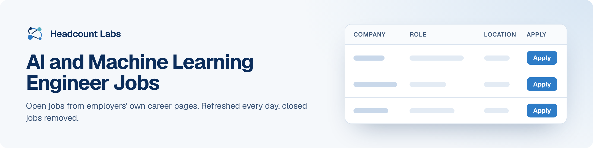

# AI and Machine Learning Engineer Jobs

AI engineer, machine learning engineer, applied scientist and LLM jobs at US employers.

**400 open jobs** · 363 new since the last update · 363 removed because they closed or left the employer's board · updated November 2, 2026 at 4:53 AM EST

This list is built and refreshed every day by [Headcount Labs](https://headcountlabs.com/?utm_source=github&utm_medium=job-list&utm_campaign=ai-ml-engineer-jobs), which reads jobs straight from employers' own career pages and job boards. Every job here was still listed on its source board when we last read that board, within the past 3 days, and was posted in the past 30 days. Copies of the same job are merged into one row, and jobs that close are removed at the next update.

Want this data in your own app or agent? Use the [Headcount Labs jobs API](https://headcountlabs.com/docs/?utm_source=github&utm_medium=job-list&utm_campaign=ai-ml-engineer-jobs) (free tier), the [MCP server](https://headcountlabs.com/mcp/?utm_source=github&utm_medium=job-list&utm_campaign=ai-ml-engineer-jobs) for Claude, ChatGPT and other AI assistants, or the [public dataset subsets](https://huggingface.co/HeadcountLabs) on Hugging Face (the full dataset is coming soon).

**Full dataset.** A bigger, one-off snapshot dated 2026-10-19 (all matching jobs, not only the open jobs below) is on Hugging Face: [Tech and software jobs](https://huggingface.co/datasets/HeadcountLabs/tech-jobs). It loads with `datasets.load_dataset` and is under the Open Database License (ODbL) 1.0.

**Jump to:** [Posted in the last 7 days (317)](#posted-in-the-last-7-days) · [Posted 8 to 30 days ago (83)](#posted-8-to-30-days-ago)

**Columns.** *Apply* opens the original posting on the employer's site. *Details* opens the job on Headcount Labs, with every posting we found for it. *Remote* shows what the employer states; a dash means the posting doesn't say. *Pay* is the range the employer published.

## Posted in the last 7 days

| Company | Role | Location | Remote | Pay | Posted | Apply | Details |
| --- | --- | --- | --- | --- | --- | :---: | :---: |
| **True Talent Solutions Partners** | Member of Technical Staff, AI Agents | New York, NY | On-site | — | Nov 2 |  | <a href="https://headcountlabs.com/catalog/jobs/e4444ff0-21e4-4ac4-8f75-ea3c4d4d354b?utm_source=github&utm_medium=job-list&utm_campaign=ai-ml-engineer-jobs">via Headcount Labs</a> |
| **True Talent Solutions Partners** | Mid/Senior Full Stack AI Engineer | San Francisco, CA | On-site | — | Nov 2 |  | <a href="https://headcountlabs.com/catalog/jobs/4652de11-a4a1-43fd-b728-f24424ef0e15?utm_source=github&utm_medium=job-list&utm_campaign=ai-ml-engineer-jobs">via Headcount Labs</a> |
| **True Talent Solutions Partners** | Senior/Staff Product Engineer, Applied AI | San Francisco, CA | On-site | — | Nov 2 |  | <a href="https://headcountlabs.com/catalog/jobs/a7a6194b-57e7-4a47-94de-71e0a25247ee?utm_source=github&utm_medium=job-list&utm_campaign=ai-ml-engineer-jobs">via Headcount Labs</a> |
| **Roku** | SW Engineer Intern, AI Engineering | San Jose, CA | — | — | Nov 2 |  | <a href="https://headcountlabs.com/catalog/jobs/cfbe737d-7d9d-4285-bbf4-bd048852331a?utm_source=github&utm_medium=job-list&utm_campaign=ai-ml-engineer-jobs">via Headcount Labs</a> |
| **True Talent Solutions Partners** | Founding AI Agent Engineer | San Francisco Bay Area, CA | On-site | — | Nov 1 |  | <a href="https://headcountlabs.com/catalog/jobs/cbeb6f54-da05-48d1-a590-e46c911a6518?utm_source=github&utm_medium=job-list&utm_campaign=ai-ml-engineer-jobs">via Headcount Labs</a> |
| **True Talent Solutions Partners** | AI Scheduler | San Francisco, CA | On-site | — | Nov 1 |  | <a href="https://headcountlabs.com/catalog/jobs/86dac79b-b5d7-4bdf-82dc-23bd360396f2?utm_source=github&utm_medium=job-list&utm_campaign=ai-ml-engineer-jobs">via Headcount Labs</a> |
| **True Talent Solutions Partners** | Senior ML / AI Engineer | San Francisco, CA | On-site | — | Nov 1 |  | <a href="https://headcountlabs.com/catalog/jobs/454267e2-7a38-4c4b-8dd7-39774102a6a7?utm_source=github&utm_medium=job-list&utm_campaign=ai-ml-engineer-jobs">via Headcount Labs</a> |
| **True Talent Solutions Partners** | Product Manager, AI Education | New York, NY | On-site | — | Nov 1 |  | <a href="https://headcountlabs.com/catalog/jobs/c4ca9f4c-7867-4173-839c-168e0f004061?utm_source=github&utm_medium=job-list&utm_campaign=ai-ml-engineer-jobs">via Headcount Labs</a> |
| **True Talent Solutions Partners** | Product Manager, AI Platform | San Francisco, CA | On-site | — | Nov 1 |  | <a href="https://headcountlabs.com/catalog/jobs/2ff2fca5-b201-449d-8bc8-549d5c7ac87c?utm_source=github&utm_medium=job-list&utm_campaign=ai-ml-engineer-jobs">via Headcount Labs</a> |
| **Penguin Solutions** | Vice President, AI Talent Acquisition | Fremont, CA | — | $240k–$270k/yr | Nov 1 |  | <a href="https://headcountlabs.com/catalog/jobs/0e02ec1b-aa2a-472e-ae88-e1ae165e0596?utm_source=github&utm_medium=job-list&utm_campaign=ai-ml-engineer-jobs">via Headcount Labs</a> |
| **LLS Lineage Logistics Services, LLC** | Senior Business Analyst (AI COE) | Novi, MI | Remote | — | Nov 1 |  | <a href="https://headcountlabs.com/catalog/jobs/84685784-1dbf-4dfd-8904-9c74d6c23df9?utm_source=github&utm_medium=job-list&utm_campaign=ai-ml-engineer-jobs">via Headcount Labs</a> |
| **Fast Switch** | Principal Engineering AI Solution Architect: | United States | — | — | Nov 1 |  | <a href="https://headcountlabs.com/catalog/jobs/e1ff1dab-504a-40c9-82d1-8dccfc93ec66?utm_source=github&utm_medium=job-list&utm_campaign=ai-ml-engineer-jobs">via Headcount Labs</a> |
| **Davidson Technologies, Inc.** | AI (ML) Engineer - Colorado Springs, CO | Colorado Springs, CO | — | $119k–$142k/yr | Nov 1 |  | <a href="https://headcountlabs.com/catalog/jobs/51ac68e0-0c03-4c80-a691-8beeb3162856?utm_source=github&utm_medium=job-list&utm_campaign=ai-ml-engineer-jobs">via Headcount Labs</a> |
| **COGNIZANT TECH SOLUTIONS A** | GenAI Automation Architect – AI-Driven Quality Engineering Transformation | Charlotte, NC | Hybrid | — | Nov 1 |  | <a href="https://headcountlabs.com/catalog/jobs/4be1143d-bfd8-4689-9f13-211cb3fbf7a1?utm_source=github&utm_medium=job-list&utm_campaign=ai-ml-engineer-jobs">via Headcount Labs</a> |
| **Centene Management Company LLC** | Senior Director, AI Productivity &amp; LCNC AI | United States | Remote | $172k–$327k/yr | Nov 1 |  | <a href="https://headcountlabs.com/catalog/jobs/f894d445-0f82-4809-8eab-164127540697?utm_source=github&utm_medium=job-list&utm_campaign=ai-ml-engineer-jobs">via Headcount Labs</a> |
| **Centene Management Company LLC** | Director, AI Vendor Integrations &amp; Standards | United States | Remote | $146k–$270k/yr | Nov 1 |  | <a href="https://headcountlabs.com/catalog/jobs/d178d655-7699-4551-ae0d-45e39fe5efa0?utm_source=github&utm_medium=job-list&utm_campaign=ai-ml-engineer-jobs">via Headcount Labs</a> |
| **Centene Management Company LLC** | Senior Director, AI Lifecycle Management | United States | Remote | $172k–$327k/yr | Nov 1 |  | <a href="https://headcountlabs.com/catalog/jobs/1b4c3c52-d934-4585-9a23-05a3b3614fee?utm_source=github&utm_medium=job-list&utm_campaign=ai-ml-engineer-jobs">via Headcount Labs</a> |
| **Jobgether** | Director of Operations - AI Native Operations | United States | Remote | $90k–$102k/yr | Oct 31 |  | <a href="https://headcountlabs.com/catalog/jobs/f795bd21-b034-4536-bca2-72305b8c2a61?utm_source=github&utm_medium=job-list&utm_campaign=ai-ml-engineer-jobs">via Headcount Labs</a> |
| **Intel Corporation** | AI Silicon Performance Modeling and Analysis Engineer | Santa Clara, CA | Hybrid | $142k–$232k/yr | Oct 31 |  | <a href="https://headcountlabs.com/catalog/jobs/d3265cdf-8b19-4ab1-98c4-b833021166d8?utm_source=github&utm_medium=job-list&utm_campaign=ai-ml-engineer-jobs">via Headcount Labs</a> |
| **Intel Corporation** | Supply Chain Planning and Operations (SCPO) AI Lead | 

4 locations
Folsom, CA Phoenix, AZ Santa Clara, CA Hillsboro, OR
 | Hybrid | $170k–$315k/yr | Oct 31 |  | <a href="https://headcountlabs.com/catalog/jobs/74188990-9371-4cab-b5c0-104c741cdbdd?utm_source=github&utm_medium=job-list&utm_campaign=ai-ml-engineer-jobs">via Headcount Labs</a> |
| **Gramian Consulting Group** | Quality &amp; Patient Safety Nurse (AI Clinical Evaluation) | United States | Remote | — | Oct 31 |  | <a href="https://headcountlabs.com/catalog/jobs/e5dd153d-5921-4e6e-9122-cc43c61dcab3?utm_source=github&utm_medium=job-list&utm_campaign=ai-ml-engineer-jobs">via Headcount Labs</a> |
| **Gramian Consulting Group** | Clinical Pharmacist (AI Clinical Evaluation) | United States | Remote | — | Oct 31 |  | <a href="https://headcountlabs.com/catalog/jobs/c4c5c6c4-4ad9-41a7-9be6-286882227c49?utm_source=github&utm_medium=job-list&utm_campaign=ai-ml-engineer-jobs">via Headcount Labs</a> |
| **Gramian Consulting Group** | Medical Coder / CDI Specialist (AI Clinical Evaluation) | United States | Remote | — | Oct 31 |  | <a href="https://headcountlabs.com/catalog/jobs/6705bc71-1880-4c66-9b71-6a99ef385339?utm_source=github&utm_medium=job-list&utm_campaign=ai-ml-engineer-jobs">via Headcount Labs</a> |
| **Gramian Consulting Group** | Emergency Medicine Physician (AI Clinical Evaluation) | United States | Remote | — | Oct 31 |  | <a href="https://headcountlabs.com/catalog/jobs/66f6989e-0d62-4e08-b1e4-c57d1cead556?utm_source=github&utm_medium=job-list&utm_campaign=ai-ml-engineer-jobs">via Headcount Labs</a> |
| **Gramian Consulting Group** | General Physician (AI Evaluation) | United States | Remote | — | Oct 31 |  | <a href="https://headcountlabs.com/catalog/jobs/7e943a28-1860-48c3-836e-8b90146ea49a?utm_source=github&utm_medium=job-list&utm_campaign=ai-ml-engineer-jobs">via Headcount Labs</a> |
| **Genius Road** | AI Solutions Architect #3352 | United States | Remote | — | Oct 31 |  | <a href="https://headcountlabs.com/catalog/jobs/d2002843-6939-4e41-b56c-45dfd1405c86?utm_source=github&utm_medium=job-list&utm_campaign=ai-ml-engineer-jobs">via Headcount Labs</a> |
| **Gartner** | Sr Director Analyst - AI Driven Compute Architecture and Custom Silicon | Irving, TX | Remote | $172k–$202k/yr | Oct 31 |  | <a href="https://headcountlabs.com/catalog/jobs/963ca142-337b-4f70-ace9-b932105849ee?utm_source=github&utm_medium=job-list&utm_campaign=ai-ml-engineer-jobs">via Headcount Labs</a> |
| **Gartner** | Associate Director - AI Product Lead - Growth and Retention | 

4 locations
Irving, TX Arlington, VA Fort Myers, FL Stamford, CT
 | Hybrid | $108k–$148k/yr | Oct 31 |  | <a href="https://headcountlabs.com/catalog/jobs/7098389c-6a48-4aa0-b3db-3789bae30fc3?utm_source=github&utm_medium=job-list&utm_campaign=ai-ml-engineer-jobs">via Headcount Labs</a> |
| **E2M SOLUTIONS PRIVATE LIMITED** | AI Solutions Sales Specialist | San Diego, CA | Hybrid | $30k–$35k/yr | Oct 31 |  | <a href="https://headcountlabs.com/catalog/jobs/43194338-e539-4036-861d-706aa80fa2ea?utm_source=github&utm_medium=job-list&utm_campaign=ai-ml-engineer-jobs">via Headcount Labs</a> |
| **Computacenter AG &amp; Co. oHG** | Solution Specialist (AI Data Center) | United States | Remote | $150k–$225k/yr | Oct 31 |  | <a href="https://headcountlabs.com/catalog/jobs/fc496360-7c43-4b07-b3e4-2a086f3f506b?utm_source=github&utm_medium=job-list&utm_campaign=ai-ml-engineer-jobs">via Headcount Labs</a> |
| **Computacenter AG &amp; Co. oHG** | Services Architect (AI Data Center) | United States | Remote | $140k–$200k/yr | Oct 31 |  | <a href="https://headcountlabs.com/catalog/jobs/39da3144-ef2a-48dc-8063-5e38cac1dfb6?utm_source=github&utm_medium=job-list&utm_campaign=ai-ml-engineer-jobs">via Headcount Labs</a> |
| **Computacenter AG &amp; Co. oHG** | AI Enterprise Architect | Dallas, TX | — | — | Oct 31 |  | <a href="https://headcountlabs.com/catalog/jobs/17e4eaad-fbdb-4ae8-a04c-89ac38994bc6?utm_source=github&utm_medium=job-list&utm_campaign=ai-ml-engineer-jobs">via Headcount Labs</a> |
| **Computacenter AG &amp; Co. oHG** | Service Specialist - AI Data Center | United States | Remote | $150k–$180k/yr | Oct 31 |  | <a href="https://headcountlabs.com/catalog/jobs/0cd8653d-0cf5-4a17-ae76-02992199fe63?utm_source=github&utm_medium=job-list&utm_campaign=ai-ml-engineer-jobs">via Headcount Labs</a> |
| **Ametek, Inc.** | Software Engineer - AI/ML | 

2 locations
United States Mount Prospect, IL
 | — | — | Oct 31 |  | <a href="https://headcountlabs.com/catalog/jobs/edf69df2-6938-42de-89e5-d20e888d1e00?utm_source=github&utm_medium=job-list&utm_campaign=ai-ml-engineer-jobs">via Headcount Labs</a> |
| **Workday, Inc.** | Sr Manager, AI Engineering | 

2 locations
Pleasanton, CA Seattle, WA
 | — | $255k–$383k/yr | Oct 30 |  | <a href="https://headcountlabs.com/catalog/jobs/b1a6bba3-4ad6-4493-8385-11a627348248?utm_source=github&utm_medium=job-list&utm_campaign=ai-ml-engineer-jobs">via Headcount Labs</a> |
| **VMware LLC** | Sr Engineering Manager – Private AI | Promontory B, CA | — | — | Oct 30 |  | <a href="https://headcountlabs.com/catalog/jobs/87758cc5-872b-4607-9bcf-f6a402eb1fe6?utm_source=github&utm_medium=job-list&utm_campaign=ai-ml-engineer-jobs">via Headcount Labs</a> |
| **URUS Group** | AI Product Manager, Enterprise Operations | Madison, WI | Remote | — | Oct 30 |  | <a href="https://headcountlabs.com/catalog/jobs/07e0a0b8-7a15-4ebe-a4cf-c47cb5737345?utm_source=github&utm_medium=job-list&utm_campaign=ai-ml-engineer-jobs">via Headcount Labs</a> |
| **The Elevance Health Companies, Inc.** | AI-Native Software Engineer | United States | — | $113k–$177k/yr | Oct 30 |  | <a href="https://headcountlabs.com/catalog/jobs/af5ce2cf-000d-4806-9445-5e8e94c0af2b?utm_source=github&utm_medium=job-list&utm_campaign=ai-ml-engineer-jobs">via Headcount Labs</a> |
| **The Elevance Health Companies, Inc.** | Distinguished AI Engineer | United States | — | $255k–$382k/yr | Oct 30 |  | <a href="https://headcountlabs.com/catalog/jobs/2f65efa9-5223-4bb3-9ade-928cba989b75?utm_source=github&utm_medium=job-list&utm_campaign=ai-ml-engineer-jobs">via Headcount Labs</a> |
| **The Elevance Health Companies, Inc.** | AI-Native Software Engineer Advisor Senior | United States | — | $142k–$222k/yr | Oct 30 |  | <a href="https://headcountlabs.com/catalog/jobs/36259422-996a-48a9-b540-abc942c11850?utm_source=github&utm_medium=job-list&utm_campaign=ai-ml-engineer-jobs">via Headcount Labs</a> |
| **TASI Measurement** | AI Engineer | Largo, FL | Hybrid | — | Oct 30 |  | <a href="https://headcountlabs.com/catalog/jobs/5c625d7d-c3eb-4065-a3d0-8e6e03f66585?utm_source=github&utm_medium=job-list&utm_campaign=ai-ml-engineer-jobs">via Headcount Labs</a> |
| **Talent Search PRO** | Principal AI Platform Architect – Agentic AI | Cincinnati, OH | — | — | Oct 30 |  | <a href="https://headcountlabs.com/catalog/jobs/eb8f904c-adf5-49ce-89ea-e82725babd7b?utm_source=github&utm_medium=job-list&utm_campaign=ai-ml-engineer-jobs">via Headcount Labs</a> |
| **State Farm** | GenAI Engineer (LLM) | 

4 locations
Bloomington, IL Richardson, TX Dunwoody, GA Tempe, AZ
 | Hybrid | $85k–$142k/yr | Oct 30 |  | <a href="https://headcountlabs.com/catalog/jobs/d2339f82-d1e9-4ee3-9fd9-f2cbb6efb09c?utm_source=github&utm_medium=job-list&utm_campaign=ai-ml-engineer-jobs">via Headcount Labs</a> |
| **Staples Inc.** | Sr Manager AI Platforms | 

2 locations
Framingham, MA United States
 | On-site | $139k–$191k/yr | Oct 30 |  | <a href="https://headcountlabs.com/catalog/jobs/20fa2a53-c1f5-49bf-843e-a07690b6c318?utm_source=github&utm_medium=job-list&utm_campaign=ai-ml-engineer-jobs">via Headcount Labs</a> |
| **Sellfire** | Remote Inside Sales Rep - AI-Enabled, Flexible Hours (Independent Contractor) | 

16 locations
United States Tampa, FL Phoenix, AZ Denver, CO Miami, FL Chicago, IL Las Vegas, NV Raleigh, NC Salt Lake City, UT Boise, ID Atlanta, GA Orlando, FL +4 more
 | Remote | $8k/mo | Oct 30 |  | <a href="https://headcountlabs.com/catalog/jobs/4b92ad9b-cede-4851-88cc-2eeea7671dcd?utm_source=github&utm_medium=job-list&utm_campaign=ai-ml-engineer-jobs">via Headcount Labs</a> |
| **Salesforce, Inc.** | AI Labs Summer Internship, Emerging Talent | 

2 locations
San Francisco, CA Seattle, WA
 | — | $53–$57/hr | Oct 30 |  | <a href="https://headcountlabs.com/catalog/jobs/cc3e7d55-f11f-4472-a024-6fb29107b828?utm_source=github&utm_medium=job-list&utm_campaign=ai-ml-engineer-jobs">via Headcount Labs</a> |
| **Robert Half** | Manager AI | California | Remote | $123k–$190k/yr | Oct 30 |  | <a href="https://headcountlabs.com/catalog/jobs/b37d739d-835c-4cb8-9011-3c9079a7fec2?utm_source=github&utm_medium=job-list&utm_campaign=ai-ml-engineer-jobs">via Headcount Labs</a> |
| **Protiviti Inc.** | AI People Enablement &amp; Workforce Transformation Senior Consultant | 

10 locations
CHARLOTTE United States MIAMI PHILADELPHIA TAMPA CHICAGO AUSTIN DALLAS HOUSTON BOSTON
 | On-site | $100k–$164k/yr | Oct 30 |  | <a href="https://headcountlabs.com/catalog/jobs/9e968d15-dc4b-49cc-9cdd-24258cc25038?utm_source=github&utm_medium=job-list&utm_campaign=ai-ml-engineer-jobs">via Headcount Labs</a> |
| **Principal Financial Group** | Experienced Info Security Engineer (AI Automation) | United States | Remote | $85k–$187k/yr | Oct 30 |  | <a href="https://headcountlabs.com/catalog/jobs/3301a105-8a31-496c-b2e2-85c425ae9af4?utm_source=github&utm_medium=job-list&utm_campaign=ai-ml-engineer-jobs">via Headcount Labs</a> |
| **Patrick Industries** | IT Sr. Analyst, AI Engineer | Elkhart, IN | — | — | Oct 30 |  | <a href="https://headcountlabs.com/catalog/jobs/1c377f05-8ace-4c1d-a649-0a1502f5e8e2?utm_source=github&utm_medium=job-list&utm_campaign=ai-ml-engineer-jobs">via Headcount Labs</a> |
| **Pacific Gas And Electric Company** | ATS Engineer, Expert (AI-Datacenter integration expertise desired) | Danville, CA | Hybrid | — | Oct 30 |  | <a href="https://headcountlabs.com/catalog/jobs/bab8bef5-e476-4634-ac60-0c841de93783?utm_source=github&utm_medium=job-list&utm_campaign=ai-ml-engineer-jobs">via Headcount Labs</a> |
| **Okta** | Principal Product Manager, Enterprise AI | 

3 locations
Bellevue, WA Chicago, IL San Francisco, CA
 | — | — | Oct 30 |  | <a href="https://headcountlabs.com/catalog/jobs/f519e631-eee0-482c-aa50-c624abab3060?utm_source=github&utm_medium=job-list&utm_campaign=ai-ml-engineer-jobs">via Headcount Labs</a> |
| **Novo Nordisk** | Lead ML Scientist - Molecular AI | Waltham, MA | — | — | Oct 30 |  | <a href="https://headcountlabs.com/catalog/jobs/eeaabe7b-829a-42b0-ae1a-f5fe2416f144?utm_source=github&utm_medium=job-list&utm_campaign=ai-ml-engineer-jobs">via Headcount Labs</a> |
| **Miratech** | Principal AI Strategist | United States | Remote | — | Oct 30 |  | <a href="https://headcountlabs.com/catalog/jobs/f6394c14-1e03-4814-92d6-a93e99d56efc?utm_source=github&utm_medium=job-list&utm_campaign=ai-ml-engineer-jobs">via Headcount Labs</a> |
| **Millennium Corporation** | AI-Focused Red Team Operator | 

2 locations
Washington, DC Huntsville, AL
 | — | $130k–$133k/yr | Oct 30 |  | <a href="https://headcountlabs.com/catalog/jobs/9912a333-75ce-4f59-b17b-eff83398b011?utm_source=github&utm_medium=job-list&utm_campaign=ai-ml-engineer-jobs">via Headcount Labs</a> |
| **Medallia** | Senior QA Engineer – GovCloud (Automation &amp; AI) | McLean, VA | Hybrid | $102k–$150k/yr | Oct 30 |  | <a href="https://headcountlabs.com/catalog/jobs/222b7f6c-5f81-4f8a-a0ec-0cca4cdfb5b3?utm_source=github&utm_medium=job-list&utm_campaign=ai-ml-engineer-jobs">via Headcount Labs</a> |
| **LPL Financial** | AVP, Full Stack Engineer – AI/GenAI. | 

2 locations
Fort Mill, SC New York, NY
 | Hybrid | $140k–$234k/yr | Oct 30 |  | <a href="https://headcountlabs.com/catalog/jobs/25ae986f-89d3-4868-a754-9e17b9fc4122?utm_source=github&utm_medium=job-list&utm_campaign=ai-ml-engineer-jobs">via Headcount Labs</a> |
| **Legora** | AI Enablement Lead | New York City, NY | On-site | $134k–$203k/yr | Oct 30 |  | <a href="https://headcountlabs.com/catalog/jobs/e086cc12-1e1e-4147-b3b3-57da6b2029ad?utm_source=github&utm_medium=job-list&utm_campaign=ai-ml-engineer-jobs">via Headcount Labs</a> |
| **Kimley-Horn** | AI Platform Engineer | Dallas, TX | On-site | — | Oct 30 |  | <a href="https://headcountlabs.com/catalog/jobs/c743bc84-7d84-4ce8-ac9d-fce247476594?utm_source=github&utm_medium=job-list&utm_campaign=ai-ml-engineer-jobs">via Headcount Labs</a> |
| **Jobgether** | AI Partnerships Lead | United States | Remote | $150k–$200k/yr | Oct 30 |  | <a href="https://headcountlabs.com/catalog/jobs/df4b19ef-1032-4347-ae2d-f3b2838de079?utm_source=github&utm_medium=job-list&utm_campaign=ai-ml-engineer-jobs">via Headcount Labs</a> |
| **Jobgether** | Senior Applied AI Engineer | United States | Remote | — | Oct 30 |  | <a href="https://headcountlabs.com/catalog/jobs/c1a516bd-cfa8-4335-9a79-ea48822a3954?utm_source=github&utm_medium=job-list&utm_campaign=ai-ml-engineer-jobs">via Headcount Labs</a> |
| **J.E. Dunn Construction Group Inc P** | AI/Data Architect - Microsoft Fabric and Foundry | Kansas City, MO | — | — | Oct 30 |  | <a href="https://headcountlabs.com/catalog/jobs/50f463d6-1fb5-4056-9a38-c13c3fd63fe7?utm_source=github&utm_medium=job-list&utm_campaign=ai-ml-engineer-jobs">via Headcount Labs</a> |
| **Intel Corporation** | Compiler Engineer for Tile-based AI DSLs | 

5 locations
Santa Clara, CA Folsom, CA Beaver Brook, MA Hillsboro, OR Austin, TX
 | Hybrid | $150k–$285k/yr | Oct 30 |  | <a href="https://headcountlabs.com/catalog/jobs/3b69b48a-7b55-47a8-b1c7-9ec014ae975c?utm_source=github&utm_medium=job-list&utm_campaign=ai-ml-engineer-jobs">via Headcount Labs</a> |
| **Intel Corporation** | Compiler Engineer for AI DSLs | 

4 locations
Santa Clara, CA Beaver Brook, MA Hillsboro, OR Austin, TX
 | Hybrid | $129k–$182k/yr | Oct 30 |  | <a href="https://headcountlabs.com/catalog/jobs/26732979-5cbe-48fd-975e-349f57493caf?utm_source=github&utm_medium=job-list&utm_campaign=ai-ml-engineer-jobs">via Headcount Labs</a> |
| **Honeywell** | Sr AI Manager | 

5 locations
Charlotte, NC Houston, TX Atlanta, GA Rosemont, IL Des Plaines, IL
 | Hybrid | $159k–$199k/yr | Oct 30 |  | <a href="https://headcountlabs.com/catalog/jobs/8a07b940-0555-4bfb-b5b4-91a77e0dc5b2?utm_source=github&utm_medium=job-list&utm_campaign=ai-ml-engineer-jobs">via Headcount Labs</a> |
| **Hazen** | Director of AI Strategy &amp; Adoption | 

3 locations
Lakewood, CO New York, NY Raleigh, NC
 | On-site | $275k–$325k/yr | Oct 30 |  | <a href="https://headcountlabs.com/catalog/jobs/34727bee-4f3f-4c27-b27a-423e3b5786b5?utm_source=github&utm_medium=job-list&utm_campaign=ai-ml-engineer-jobs">via Headcount Labs</a> |
| **Gramian Consulting Group** | Commercial Aviation &amp; Flight Operations Specialist - AI Projects | United States | Remote | — | Oct 30 |  | <a href="https://headcountlabs.com/catalog/jobs/4ffecd05-ca48-4087-8c0a-1d4cd2742dec?utm_source=github&utm_medium=job-list&utm_campaign=ai-ml-engineer-jobs">via Headcount Labs</a> |
| **Gramian Consulting Group** | Intelligence Operations &amp; Collection Specialist - AI Training Projects | United States | Remote | — | Oct 30 |  | <a href="https://headcountlabs.com/catalog/jobs/b8ea9088-7c38-4142-bf95-a7d657bb5fcb?utm_source=github&utm_medium=job-list&utm_campaign=ai-ml-engineer-jobs">via Headcount Labs</a> |
| **Gramian Consulting Group** | Litigation Attorney (AI Legal Evaluation) | United States | Remote | — | Oct 30 |  | <a href="https://headcountlabs.com/catalog/jobs/9fd4fdc7-781f-4813-ac1e-8d48adb18761?utm_source=github&utm_medium=job-list&utm_campaign=ai-ml-engineer-jobs">via Headcount Labs</a> |
| **Google** | Staff Software Engineer, Google Workspace, AI/ML | Sunnyvale, CA | — | $207k–$300k/yr | Oct 30 |  | <a href="https://headcountlabs.com/catalog/jobs/49c54c8a-3ddc-4c32-95f5-880358c1d6d4?utm_source=github&utm_medium=job-list&utm_campaign=ai-ml-engineer-jobs">via Headcount Labs</a> |
| **Google** | Software Engineer, AI/ML, Ads Quality | New York, NY | — | $147k–$210k/yr | Oct 30 |  | <a href="https://headcountlabs.com/catalog/jobs/3200f06d-e11b-4f84-ab32-37fea7649e7f?utm_source=github&utm_medium=job-list&utm_campaign=ai-ml-engineer-jobs">via Headcount Labs</a> |
| **Genius Road** | AI/ML Engineer #3312 | Austin, TX | Hybrid | — | Oct 30 |  | <a href="https://headcountlabs.com/catalog/jobs/83d7d5fc-8f92-4654-8a05-d95a0e121970?utm_source=github&utm_medium=job-list&utm_campaign=ai-ml-engineer-jobs">via Headcount Labs</a> |
| **General Dynamics Electric Boat** | Enterprise AI Engineering &amp; Platforms Manager | Groton, CT | — | — | Oct 30 |  | <a href="https://headcountlabs.com/catalog/jobs/cf785ebd-b12f-4d00-a493-f53247eff0d7?utm_source=github&utm_medium=job-list&utm_campaign=ai-ml-engineer-jobs">via Headcount Labs</a> |
| **Gartner** | Sr Director, Analyst - Data Management and AI Readiness | United States | Remote | $172k–$202k/yr | Oct 30 |  | <a href="https://headcountlabs.com/catalog/jobs/32d56f72-067a-42a8-a2d4-70188cbde83d?utm_source=github&utm_medium=job-list&utm_campaign=ai-ml-engineer-jobs">via Headcount Labs</a> |
| **Ford Motor Company** | AI Engineer | Dearborn, MI | Hybrid | — | Oct 30 |  | <a href="https://headcountlabs.com/catalog/jobs/c49efdd3-6565-49ea-8487-b28ecbccac5f?utm_source=github&utm_medium=job-list&utm_campaign=ai-ml-engineer-jobs">via Headcount Labs</a> |
| **First Citizens Bank** | 2027 Summer Intern - AI Innovation (Raleigh, NC) | Raleigh, NC | Hybrid | — | Oct 30 |  | <a href="https://headcountlabs.com/catalog/jobs/aefbd3fb-8cce-4b5b-a553-2f0dac0bbd29?utm_source=github&utm_medium=job-list&utm_campaign=ai-ml-engineer-jobs">via Headcount Labs</a> |
| **Elsevier Inc. Company** | AI Software Engineering Lead | 

2 locations
Philadelphia, PA Pennsylvania
 | — | $115k–$192k/yr | Oct 30 |  | <a href="https://headcountlabs.com/catalog/jobs/6efb38ac-0042-47f1-846e-67b05cd534a7?utm_source=github&utm_medium=job-list&utm_campaign=ai-ml-engineer-jobs">via Headcount Labs</a> |
| **Dynatrace** | Sr Director, Enterprise AI | 

2 locations
Massachusetts Boston
 | Remote | $224k–$280k/yr | Oct 30 |  | <a href="https://headcountlabs.com/catalog/jobs/6b3b9c5e-4d46-4279-bf5f-6bc7bb9974c0?utm_source=github&utm_medium=job-list&utm_campaign=ai-ml-engineer-jobs">via Headcount Labs</a> |
| **Dell Technologies** | Senior Principal AI System Performance Architect | United States | On-site | $200k–$258k/yr | Oct 30 |  | <a href="https://headcountlabs.com/catalog/jobs/af2c0647-bb73-4000-b26c-f28a50008ed7?utm_source=github&utm_medium=job-list&utm_campaign=ai-ml-engineer-jobs">via Headcount Labs</a> |
| **CoSourcing Partners** | Business Analyst – Agentic AI &amp; Automation, Chat Customer Experience | Stamford, CT | On-site | — | Oct 30 |  | <a href="https://headcountlabs.com/catalog/jobs/e24208f6-cda6-46df-9911-3270774a7372?utm_source=github&utm_medium=job-list&utm_campaign=ai-ml-engineer-jobs">via Headcount Labs</a> |
| **COGNIZANT TECH SOLUTIONS A** | AI Engineer - Azure (Onsite) | Washington, DC | On-site | $110k–$135k/yr | Oct 30 |  | <a href="https://headcountlabs.com/catalog/jobs/6c4be1af-4c1a-4e12-b879-79971a45b38b?utm_source=github&utm_medium=job-list&utm_campaign=ai-ml-engineer-jobs">via Headcount Labs</a> |
| **COGNIZANT TECH SOLUTIONS A** | Consulting Principal Enterprise Architect — AI Specialty (Platforms &amp; Services / Hi-Tech) | San Jose, CA | Hybrid | $165k–$194k/yr | Oct 30 |  | <a href="https://headcountlabs.com/catalog/jobs/0ab254be-7b32-47b8-8b9c-5b958aad5066?utm_source=github&utm_medium=job-list&utm_campaign=ai-ml-engineer-jobs">via Headcount Labs</a> |
| **Coca-Cola North America** | Senior Manager, AI &amp; Analytics Engineering | Atlanta, GA | — | $143k–$169k/yr | Oct 30 |  | <a href="https://headcountlabs.com/catalog/jobs/849f27b7-787c-4f78-897a-609f2cddd5fb?utm_source=github&utm_medium=job-list&utm_campaign=ai-ml-engineer-jobs">via Headcount Labs</a> |
| **Citi** | Senior AI/AML Engineer, Vice President | Jersey City, NJ | — | $142k–$213k/yr | Oct 30 |  | <a href="https://headcountlabs.com/catalog/jobs/6df9cbf9-73ac-4ddd-9afb-fe769931e29b?utm_source=github&utm_medium=job-list&utm_campaign=ai-ml-engineer-jobs">via Headcount Labs</a> |
| **Cayuse Holdings** | Responsible AI Lead | Austin, TX | Hybrid | $80–$100/hr | Oct 30 |  | <a href="https://headcountlabs.com/catalog/jobs/acf1d651-4c4b-45f0-80db-d1968e1d6679?utm_source=github&utm_medium=job-list&utm_campaign=ai-ml-engineer-jobs">via Headcount Labs</a> |
| **Cayuse Holdings** | Director of AI and Analytics | Austin, TX | — | $90–$120/hr | Oct 30 |  | <a href="https://headcountlabs.com/catalog/jobs/55eb4b1d-f96f-40fd-a934-73d6dd35b420?utm_source=github&utm_medium=job-list&utm_campaign=ai-ml-engineer-jobs">via Headcount Labs</a> |
| **Cargill** | Tech Lead - AI Lab, Ag &amp; Trading North America | Wayzata, MN | — | $115k–$165k/yr | Oct 30 |  | <a href="https://headcountlabs.com/catalog/jobs/7b2b9c2d-3fdc-45c5-bc5f-f4bbed8b8fdc?utm_source=github&utm_medium=job-list&utm_campaign=ai-ml-engineer-jobs">via Headcount Labs</a> |
| **Capital One** | Manager, Project Management- Change and Enablement for AI (Hybrid) | 

5 locations
Richmond, VA Chicago, IL McLean, VA Plano, TX Riverwoods, IL
 | Hybrid | $138k–$158k/yr | Oct 30 |  | <a href="https://headcountlabs.com/catalog/jobs/9f03ece7-6c8c-4988-b193-a162004c22da?utm_source=github&utm_medium=job-list&utm_campaign=ai-ml-engineer-jobs">via Headcount Labs</a> |
| **Capital One** | Applied Researcher 4 (AI Foundations, VLM Customization) | 

4 locations
San Jose, CA Cambridge, MA McLean, VA New York, NY
 | — | $219k–$250k/yr | Oct 30 |  | <a href="https://headcountlabs.com/catalog/jobs/9f01b8fc-c909-47dc-8bcd-de24bee035b8?utm_source=github&utm_medium=job-list&utm_campaign=ai-ml-engineer-jobs">via Headcount Labs</a> |
| **Capital One** | Full Stack Engineer 4 (AI Operations/MLX Group) | 

3 locations
New York, NY Cambridge, MA McLean, VA
 | — | $197k–$225k/yr | Oct 30 |  | <a href="https://headcountlabs.com/catalog/jobs/65cba0cf-39f3-403e-8db7-749babbc346d?utm_source=github&utm_medium=job-list&utm_campaign=ai-ml-engineer-jobs">via Headcount Labs</a> |
| **BMC** | Principal Outbound Product Manager - AI / Agentic Automation | Santa Clara, CA | — | — | Oct 30 |  | <a href="https://headcountlabs.com/catalog/jobs/ed314317-50e9-4562-a8ad-4bcf8d48b48c?utm_source=github&utm_medium=job-list&utm_campaign=ai-ml-engineer-jobs">via Headcount Labs</a> |
| **AOP and Ignite Christian Academy** | Product Manager, AI | Boston, MA | Hybrid | $129k–$200k/yr | Oct 30 |  | <a href="https://headcountlabs.com/catalog/jobs/f2853d26-3588-4571-8826-f5dd1959890f?utm_source=github&utm_medium=job-list&utm_campaign=ai-ml-engineer-jobs">via Headcount Labs</a> |
| **Alta Genetics** | Dairy Reproductive Specialist (AI Technician) | 

2 locations
Sioux Falls, SD Brookings, SD
 | On-site | — | Oct 30 |  | <a href="https://headcountlabs.com/catalog/jobs/101235d4-c1b4-4250-9ba9-cba794454474?utm_source=github&utm_medium=job-list&utm_campaign=ai-ml-engineer-jobs">via Headcount Labs</a> |
| **Allstate Insurance Co.** | Digital Product Manager - AI Knowledge &amp; Solutions | USA -, PA | Remote | — | Oct 30 |  | <a href="https://headcountlabs.com/catalog/jobs/2129f955-abb7-490c-9c51-3ae59577e1f1?utm_source=github&utm_medium=job-list&utm_campaign=ai-ml-engineer-jobs">via Headcount Labs</a> |
| **31 MSI - (Marvell Semiconductor Inc.) US** | AI Security Engineer | 

2 locations
Santa Clara, CA Austin, TX
 | — | $132k–$197k/yr | Oct 30 |  | <a href="https://headcountlabs.com/catalog/jobs/0892725d-ae80-4966-806a-924bf4074ace?utm_source=github&utm_medium=job-list&utm_campaign=ai-ml-engineer-jobs">via Headcount Labs</a> |
| **Western Digital** | Senior Technologist, System Architecture - AI Adoption &amp; Development | Rochester, MN | — | $188k–$250k/yr | Oct 29 |  | <a href="https://headcountlabs.com/catalog/jobs/f81cac00-e70f-42f9-b880-872533a1f8b1?utm_source=github&utm_medium=job-list&utm_campaign=ai-ml-engineer-jobs">via Headcount Labs</a> |
| **Truist Bank** | Software Engineer--Java and AI Enablement | 

2 locations
Raleigh, NC Charlotte, NC
 | — | — | Oct 29 |  | <a href="https://headcountlabs.com/catalog/jobs/f492c33d-5946-49b8-85cc-7c12765b3376?utm_source=github&utm_medium=job-list&utm_campaign=ai-ml-engineer-jobs">via Headcount Labs</a> |
| **Truist Bank** | Data Protection Engineer – Rubrik/Automation/AI/Infrastructure-as-Code Delivery | 

4 locations
Raleigh, NC Atlanta, GA Charlotte, NC Richmond, VA
 | — | $125k–$155k/yr | Oct 29 |  | <a href="https://headcountlabs.com/catalog/jobs/e52444b8-875c-4967-8b94-7c9ba38c0719?utm_source=github&utm_medium=job-list&utm_campaign=ai-ml-engineer-jobs">via Headcount Labs</a> |
| **TriVista Business Group, Inc** | Senior AI Engineer | Varies, CA | Remote | $140k–$177k/yr | Oct 29 |  | <a href="https://headcountlabs.com/catalog/jobs/31499a91-0485-4c4b-9f2d-4793e61c2425?utm_source=github&utm_medium=job-list&utm_campaign=ai-ml-engineer-jobs">via Headcount Labs</a> |
| **Trimble Inc.** | AI Agentic Software Engineer | Lake Oswego, OR | On-site | $122k–$168k/yr | Oct 29 |  | <a href="https://headcountlabs.com/catalog/jobs/388b662f-daa1-4a84-9121-32f5630f3c68?utm_source=github&utm_medium=job-list&utm_campaign=ai-ml-engineer-jobs">via Headcount Labs</a> |
| **TIFIN** | Senior AI Engineer, TIFIN @Work | Boulder, CO | — | $150k–$200k/yr | Oct 29 |  | <a href="https://headcountlabs.com/catalog/jobs/33203111-81be-4816-a9cc-069494c3f501?utm_source=github&utm_medium=job-list&utm_campaign=ai-ml-engineer-jobs">via Headcount Labs</a> |
| **The Coca-Cola Company** | Senior Director, Global Media AI Governance &amp; Investment Integrity | 

2 locations
Atlanta, GA London
 | — | $219k–$247k/yr | Oct 29 |  | <a href="https://headcountlabs.com/catalog/jobs/ae625e24-426f-4ace-a784-b1132822d880?utm_source=github&utm_medium=job-list&utm_campaign=ai-ml-engineer-jobs">via Headcount Labs</a> |
| **The Coca-Cola Company** | Senior Director, AI Cyber Programs &amp; Emerging Technology | Atlanta, GA | — | $202k–$229k/yr | Oct 29 |  | <a href="https://headcountlabs.com/catalog/jobs/93de9ec0-2d0f-4904-8ad5-aac77a2d2adf?utm_source=github&utm_medium=job-list&utm_campaign=ai-ml-engineer-jobs">via Headcount Labs</a> |
| **The Cigna Group** | Legal Operations Financial, Data &amp; AI Analytics Intern | 

2 locations
St. Louis, MO Saint Louis, MO
 | Hybrid | $24–$25/hr | Oct 29 |  | <a href="https://headcountlabs.com/catalog/jobs/5de1124e-05c9-437a-b2ab-b02d3b08976f?utm_source=github&utm_medium=job-list&utm_campaign=ai-ml-engineer-jobs">via Headcount Labs</a> |
| **Tempus AI, Inc.** | Director, Revenue Cycle Operations - Tempus AI Diagnostics | United States | Remote | $150k–$200k/yr | Oct 29 |  | <a href="https://headcountlabs.com/catalog/jobs/188e226c-02fc-4819-972f-553436889a59?utm_source=github&utm_medium=job-list&utm_campaign=ai-ml-engineer-jobs">via Headcount Labs</a> |
| **Tallahassee Memorial Healthcare** | Executive Director - Enterprise Data - Analytics -AI | Tallahassee, FL | — | — | Oct 29 |  | <a href="https://headcountlabs.com/catalog/jobs/0ece97a9-a814-4d63-ab8f-376d31cff3bd?utm_source=github&utm_medium=job-list&utm_campaign=ai-ml-engineer-jobs">via Headcount Labs</a> |
| **T. Rowe Price** | Senior AI Software Engineer — T. Rowe Price Labs | 

2 locations
New York, NY Baltimore, MD
 | On-site | $121k–$206k/yr | Oct 29 |  | <a href="https://headcountlabs.com/catalog/jobs/c5a2c546-df02-4d22-a031-b91cd6a36d48?utm_source=github&utm_medium=job-list&utm_campaign=ai-ml-engineer-jobs">via Headcount Labs</a> |
| **Syntax Systems USA LP** | Industry AI Advisor | Morrisville, NC | — | — | Oct 29 |  | <a href="https://headcountlabs.com/catalog/jobs/18062c9c-da57-4079-97fc-42cb81914905?utm_source=github&utm_medium=job-list&utm_campaign=ai-ml-engineer-jobs">via Headcount Labs</a> |
| **Seagate Technology** | R&amp;D Data Analytics, AI and Production Systems - Summer 2027 Internship (Masters or PhD) | Bloomington, MN | — | $35–$45/hr | Oct 29 |  | <a href="https://headcountlabs.com/catalog/jobs/70039303-d8c2-4c37-a3ea-efcf66691ab6?utm_source=github&utm_medium=job-list&utm_campaign=ai-ml-engineer-jobs">via Headcount Labs</a> |
| **Robinhood** | Senior Software Engineer, AI Security | 

2 locations
Bellevue, WA Menlo Park, CA
 | — | $196k–$230k/yr | Oct 29 |  | <a href="https://headcountlabs.com/catalog/jobs/b13f30d6-8141-46c8-b94f-9bcb8874f741?utm_source=github&utm_medium=job-list&utm_campaign=ai-ml-engineer-jobs">via Headcount Labs</a> |
| **reliance** | Software Engineer- NET and AI Solutions (Hybrid) | Forth Worth, TX | Hybrid | — | Oct 29 |  | <a href="https://headcountlabs.com/catalog/jobs/6c56c295-8df2-4b90-8b5d-9a9c76c7df83?utm_source=github&utm_medium=job-list&utm_campaign=ai-ml-engineer-jobs">via Headcount Labs</a> |
| **Rapid7** | Staff AI Engineer | California | Remote | $186k–$252k/yr | Oct 29 |  | <a href="https://headcountlabs.com/catalog/jobs/7ff25d86-d3a0-4e26-b4e8-631ae0097f4c?utm_source=github&utm_medium=job-list&utm_campaign=ai-ml-engineer-jobs">via Headcount Labs</a> |
| **Rapid7** | Distinguished AI Engineer | California | Remote | $274k–$370k/yr | Oct 29 |  | <a href="https://headcountlabs.com/catalog/jobs/6e478beb-66a0-46b5-879d-90733eabcf18?utm_source=github&utm_medium=job-list&utm_campaign=ai-ml-engineer-jobs">via Headcount Labs</a> |
| **Rapid7** | Senior Principal AI Engineer | California | Remote | $238k–$322k/yr | Oct 29 |  | <a href="https://headcountlabs.com/catalog/jobs/1c630561-40fd-44af-b08a-f3c552e334d0?utm_source=github&utm_medium=job-list&utm_campaign=ai-ml-engineer-jobs">via Headcount Labs</a> |
| **Publicis Groupe Holdings B.V** | Manager, AI Engineering | New York, NY | — | $89k–$142k/yr | Oct 29 |  | <a href="https://headcountlabs.com/catalog/jobs/818737f0-1a11-4c34-a7e6-09c48ccc8395?utm_source=github&utm_medium=job-list&utm_campaign=ai-ml-engineer-jobs">via Headcount Labs</a> |
| **Peraton** | Senior AI Platform Engineer | Fort Meade, MD | — | $146k–$234k/yr | Oct 29 |  | <a href="https://headcountlabs.com/catalog/jobs/0ebf99b5-7be1-4b89-8019-7d2f51c6c64c?utm_source=github&utm_medium=job-list&utm_campaign=ai-ml-engineer-jobs">via Headcount Labs</a> |
| **Paramount** | Principal Machine Learning Engineer, Content Engineering | New York, NY | — | $234k–$350k/yr | Oct 29 |  | <a href="https://headcountlabs.com/catalog/jobs/671febdf-43c9-4e59-9e04-f29be16ff55f?utm_source=github&utm_medium=job-list&utm_campaign=ai-ml-engineer-jobs">via Headcount Labs</a> |
| **Okta** | Sr. Software Engineer, AI Platform &amp; Infrastructure | San Francisco, CA | — | — | Oct 29 |  | <a href="https://headcountlabs.com/catalog/jobs/1b6fdd2e-d172-43e4-84f3-76262d4d1446?utm_source=github&utm_medium=job-list&utm_campaign=ai-ml-engineer-jobs">via Headcount Labs</a> |
| **Montefiore** | AI Computational Engineer (JR230420) | Yonkers, NY | — | $124k–$155k/yr | Oct 29 |  | <a href="https://headcountlabs.com/catalog/jobs/4851bc0c-9243-480b-96a9-481259edd305?utm_source=github&utm_medium=job-list&utm_campaign=ai-ml-engineer-jobs">via Headcount Labs</a> |
| **Military Spouse Jobs &amp; VetJobs** | AI/ML Engineer, Senior (TS/SCI w/ poly) - Chantilly, VA | Chantilly, VA | — | $161k/yr | Oct 29 |  | <a href="https://headcountlabs.com/catalog/jobs/2c743f0a-03c8-4b5e-9f59-e5311b4908dc?utm_source=github&utm_medium=job-list&utm_campaign=ai-ml-engineer-jobs">via Headcount Labs</a> |
| **Military Spouse Jobs &amp; VetJobs** | AWS Cloud Security Consultant (Application &amp; AI Security) | United States | — | — | Oct 29 |  | <a href="https://headcountlabs.com/catalog/jobs/560f8f53-00f0-4581-aa57-86ac685ee677?utm_source=github&utm_medium=job-list&utm_campaign=ai-ml-engineer-jobs">via Headcount Labs</a> |
| **Military Spouse Jobs &amp; VetJobs** | AI Platform Integration Engineer | United States | — | — | Oct 29 |  | <a href="https://headcountlabs.com/catalog/jobs/5f94fe10-3fd3-47d2-907a-a19befc39cc7?utm_source=github&utm_medium=job-list&utm_campaign=ai-ml-engineer-jobs">via Headcount Labs</a> |
| **Mayo Clinic** | Research Fellow - Cardiovascular Medicine - Cardiovascular AI | Rochester, MN | — | $72k–$84k/yr | Oct 29 |  | <a href="https://headcountlabs.com/catalog/jobs/36336775-05f9-4201-9040-58ee3cddd646?utm_source=github&utm_medium=job-list&utm_campaign=ai-ml-engineer-jobs">via Headcount Labs</a> |
| **Matthew Bender &amp; Company, Inc. Company** | US Legal Editor, AI Content Updating | 

2 locations
United States USA - Nationwide
 | Remote | $65k–$108k/yr | Oct 29 |  | <a href="https://headcountlabs.com/catalog/jobs/680ceabc-7e4d-4eda-a379-cc4246424113?utm_source=github&utm_medium=job-list&utm_campaign=ai-ml-engineer-jobs">via Headcount Labs</a> |
| **Liftoff** | Application Security Engineer, Generative AI | United States | Remote | — | Oct 29 |  | <a href="https://headcountlabs.com/catalog/jobs/66311cfb-d31b-4e5c-af6e-eaa7424b7584?utm_source=github&utm_medium=job-list&utm_campaign=ai-ml-engineer-jobs">via Headcount Labs</a> |
| **Jobgether** | Senior Product Manager, AI Workflow Design | United States | Remote | $125k–$132k/yr | Oct 29 |  | <a href="https://headcountlabs.com/catalog/jobs/c6b62574-a4f4-4bc5-a8a8-5d96b9de77ae?utm_source=github&utm_medium=job-list&utm_campaign=ai-ml-engineer-jobs">via Headcount Labs</a> |
| **Jobgether** | Director of AI Strategy &amp; Enablement | United States | Remote | $115k–$130k/yr | Oct 29 |  | <a href="https://headcountlabs.com/catalog/jobs/eaaaa335-4206-4ce7-9ea2-5ef32e431a51?utm_source=github&utm_medium=job-list&utm_campaign=ai-ml-engineer-jobs">via Headcount Labs</a> |
| **Jobgether** | AI Research Scientist – Scientific Evaluation (ML/AI) | United States | Remote | $50–$65/hr | Oct 29 |  | <a href="https://headcountlabs.com/catalog/jobs/ecad1195-4550-4b2c-ab95-c8ec910ef87f?utm_source=github&utm_medium=job-list&utm_campaign=ai-ml-engineer-jobs">via Headcount Labs</a> |
| **International Motors, LLC** | Senior AI Product Owner | Lisle, IL | — | — | Oct 29 |  | <a href="https://headcountlabs.com/catalog/jobs/9c0cbc73-71d2-4ab5-8ea5-16cd34a7d1df?utm_source=github&utm_medium=job-list&utm_campaign=ai-ml-engineer-jobs">via Headcount Labs</a> |
| **Intel Corporation** | GPU AI Solution Architect | 

2 locations
Hillsboro, OR Folsom, CA
 | Hybrid | $195k–$315k/yr | Oct 29 |  | <a href="https://headcountlabs.com/catalog/jobs/f295d553-bef6-4548-8095-c1430dec941a?utm_source=github&utm_medium=job-list&utm_campaign=ai-ml-engineer-jobs">via Headcount Labs</a> |
| **Intel Corporation** | AI Algorithm Development Engineer | 

2 locations
Hillsboro, OR Phoenix, AZ
 | On-site | $150k–$276k/yr | Oct 29 |  | <a href="https://headcountlabs.com/catalog/jobs/a055de3f-3ea1-47ef-b352-22abac5b7ab4?utm_source=github&utm_medium=job-list&utm_campaign=ai-ml-engineer-jobs">via Headcount Labs</a> |
| **Guidewire Software, Inc. (US)** | Senior AI Machine learning Engineer | United States | Remote | $176k–$288k/yr | Oct 29 |  | <a href="https://headcountlabs.com/catalog/jobs/86de73d3-2da0-4bd4-a110-75d8f69d9d97?utm_source=github&utm_medium=job-list&utm_campaign=ai-ml-engineer-jobs">via Headcount Labs</a> |
| **Greystar** | Senior Director - AI Enablement | United States | Remote | $180k–$200k/yr | Oct 29 |  | <a href="https://headcountlabs.com/catalog/jobs/d595f200-15dc-4022-9800-ed4c33489f05?utm_source=github&utm_medium=job-list&utm_campaign=ai-ml-engineer-jobs">via Headcount Labs</a> |
| **Givzey** | Senior Applied AI Engineer | United States | Remote | — | Oct 29 |  | <a href="https://headcountlabs.com/catalog/jobs/a452b5bf-03e6-420f-aec2-da05abd4fab5?utm_source=github&utm_medium=job-list&utm_campaign=ai-ml-engineer-jobs">via Headcount Labs</a> |
| **First Citizens Bank** | 2027 Summer Intern - AI Adoption (Raleigh, NC) | Raleigh, NC | Hybrid | $18.70–$28.60/hr | Oct 29 |  | <a href="https://headcountlabs.com/catalog/jobs/eb4dfadb-f64d-4e66-974a-6eea976338bd?utm_source=github&utm_medium=job-list&utm_campaign=ai-ml-engineer-jobs">via Headcount Labs</a> |
| **Farmers Insurance** | Lead - AI Forward Deployed Lead Engineer | United States | Hybrid | $147k–$250k/yr | Oct 29 |  | <a href="https://headcountlabs.com/catalog/jobs/e7695af2-c1f4-4927-9809-ad072105ebf2?utm_source=github&utm_medium=job-list&utm_campaign=ai-ml-engineer-jobs">via Headcount Labs</a> |
| **Exelixis Inc** | Associate AI and Agentic Engineer | Alameda, CA | — | $115k–$145k/yr | Oct 29 |  | <a href="https://headcountlabs.com/catalog/jobs/cbfadd3b-dadd-4402-8561-d2d0335fc8ca?utm_source=github&utm_medium=job-list&utm_campaign=ai-ml-engineer-jobs">via Headcount Labs</a> |
| **Exelixis Inc** | Associate Engineer- AI and Agentics | Alameda, CA | — | $115k–$145k/yr | Oct 29 |  | <a href="https://headcountlabs.com/catalog/jobs/ba6275ae-bf6f-4c37-822c-eedcb4222060?utm_source=github&utm_medium=job-list&utm_campaign=ai-ml-engineer-jobs">via Headcount Labs</a> |
| **Everpure** | AI Enablement Engineer | Santa Clara, CA | On-site | $140k–$210k/yr | Oct 29 |  | <a href="https://headcountlabs.com/catalog/jobs/ccfce401-3789-4124-bba7-67f5287d547a?utm_source=github&utm_medium=job-list&utm_campaign=ai-ml-engineer-jobs">via Headcount Labs</a> |
| **Equinix LLC** | Staff Software Engineer, AI Infrastructure | Redwood City | Hybrid | $146k–$218k/yr | Oct 29 |  | <a href="https://headcountlabs.com/catalog/jobs/d2291c2d-7008-494c-94fe-82fef0461608?utm_source=github&utm_medium=job-list&utm_campaign=ai-ml-engineer-jobs">via Headcount Labs</a> |
| **Elsevier Inc. Company** | Senior Software Engineer / Senior AI Engineer | 

2 locations
Pennsylvania Philadelphia, PA
 | Remote | $87k–$144k/yr | Oct 29 |  | <a href="https://headcountlabs.com/catalog/jobs/60d10efd-a015-4ad1-87e5-23af5e6693b2?utm_source=github&utm_medium=job-list&utm_campaign=ai-ml-engineer-jobs">via Headcount Labs</a> |
| **Eli Lilly and Company** | Agentic Automation Lead - Frontier AI | 

2 locations
South San Francisco, CA United States
 | — | $194k–$339k/yr | Oct 29 |  | <a href="https://headcountlabs.com/catalog/jobs/aa6211b3-3428-4d9c-8ed0-63ca8380d0b5?utm_source=github&utm_medium=job-list&utm_campaign=ai-ml-engineer-jobs">via Headcount Labs</a> |
| **Eli Lilly and Company** | Advisor - Agentic Automation, Frontier AI | 

2 locations
South San Francisco, CA United States
 | On-site | $168k–$268k/yr | Oct 29 |  | <a href="https://headcountlabs.com/catalog/jobs/8bc8d926-480d-45fb-9ab2-d9f82c8104f9?utm_source=github&utm_medium=job-list&utm_campaign=ai-ml-engineer-jobs">via Headcount Labs</a> |
| **eBay Inc.** | AI Analytics Engineer - Traffic | Austin | Hybrid | $81k–$144k/yr | Oct 29 |  | <a href="https://headcountlabs.com/catalog/jobs/c8611c35-5cf1-48f5-a0b5-d8ec7968bc61?utm_source=github&utm_medium=job-list&utm_campaign=ai-ml-engineer-jobs">via Headcount Labs</a> |
| **Dell Technologies** | Senior Analyst, Agentic AI Engineer | Hopkinton, MA | On-site | $96k–$132k/yr | Oct 29 |  | <a href="https://headcountlabs.com/catalog/jobs/a11cab14-0ae9-46d3-86a8-8942013397fe?utm_source=github&utm_medium=job-list&utm_campaign=ai-ml-engineer-jobs">via Headcount Labs</a> |
| **Dell Technologies** | Principal AI Performance Architect | Austin, TX | On-site | $163k–$211k/yr | Oct 29 |  | <a href="https://headcountlabs.com/catalog/jobs/816b6f49-fed7-4675-bd6d-b0086e64989e?utm_source=github&utm_medium=job-list&utm_campaign=ai-ml-engineer-jobs">via Headcount Labs</a> |
| **Dell Technologies** | Senior Principal AI Performance Architect | Austin, TX | On-site | $200k–$258k/yr | Oct 29 |  | <a href="https://headcountlabs.com/catalog/jobs/16a90bf5-cff6-4b5d-84f1-c652edadf3c6?utm_source=github&utm_medium=job-list&utm_campaign=ai-ml-engineer-jobs">via Headcount Labs</a> |
| **Covalent Resource Group** | AI DevOps Engineer | Southfield, MI | — | — | Oct 29 |  | <a href="https://headcountlabs.com/catalog/jobs/b91ecd0e-137f-4b3a-ac39-5c559dcb45be?utm_source=github&utm_medium=job-list&utm_campaign=ai-ml-engineer-jobs">via Headcount Labs</a> |
| **Conveyor** | Lead Product Manager, AI Products | United States | Remote | $190k–$215k/yr | Oct 29 |  | <a href="https://headcountlabs.com/catalog/jobs/616c98a4-9f0f-40cd-891b-ff0392c44f6f?utm_source=github&utm_medium=job-list&utm_campaign=ai-ml-engineer-jobs">via Headcount Labs</a> |
| **Computershare** | Senior Director, Operating Model &amp; AI Enablement | 

2 locations
Louisville, KY Canton, MA
 | Hybrid | $126k–$189k/yr | Oct 29 |  | <a href="https://headcountlabs.com/catalog/jobs/6de9a4ae-9464-4210-8305-df6c2a86be41?utm_source=github&utm_medium=job-list&utm_campaign=ai-ml-engineer-jobs">via Headcount Labs</a> |
| **Coinbase** | Staff Machine Learning Engineer, Compliance Automation (Platform) | United States | Remote | $218k–$256k/yr | Oct 29 |  | <a href="https://headcountlabs.com/catalog/jobs/a71cdd13-a284-47e0-8591-687c266d62e9?utm_source=github&utm_medium=job-list&utm_campaign=ai-ml-engineer-jobs">via Headcount Labs</a> |
| **COGNIZANT TECH SOLUTIONS A** | Consulting Principal, Enterprise AI | Irving, TX | Hybrid | — | Oct 29 |  | <a href="https://headcountlabs.com/catalog/jobs/4c9c9fe3-5bfb-4faa-b083-766d26f44b2f?utm_source=github&utm_medium=job-list&utm_campaign=ai-ml-engineer-jobs">via Headcount Labs</a> |
| **COGNIZANT TECH SOLUTIONS A** | AI Governance Process Lead | Burlington, NJ | Remote | $100k–$117k/yr | Oct 29 |  | <a href="https://headcountlabs.com/catalog/jobs/7dac19cc-404b-4295-994b-7ce8a9e9e6b5?utm_source=github&utm_medium=job-list&utm_campaign=ai-ml-engineer-jobs">via Headcount Labs</a> |
| **COGNIZANT TECH SOLUTIONS A** | Senior DevOps Developer with Java/AI - Hybrid | Mclean, VA | Hybrid | $64k–$102k/yr | Oct 29 |  | <a href="https://headcountlabs.com/catalog/jobs/353e199d-83e5-440a-af73-c2fce522c391?utm_source=github&utm_medium=job-list&utm_campaign=ai-ml-engineer-jobs">via Headcount Labs</a> |
| **Citi** | Lead Generative AI Python Engineer - Vice President | 

2 locations
Jersey City, NJ United States
 | Hybrid | $142k–$213k/yr | Oct 29 |  | <a href="https://headcountlabs.com/catalog/jobs/0b3e7704-7b0b-4a89-a3f8-508e660f3773?utm_source=github&utm_medium=job-list&utm_campaign=ai-ml-engineer-jobs">via Headcount Labs</a> |
| **Capital One** | Machine Learning Engineer 4 | 

7 locations
McLean, VA Cambridge, MA Richmond, VA Plano, TX New York, NY Philadelphia, PA Wilmington, DE
 | — | $179k–$205k/yr | Oct 29 |  | <a href="https://headcountlabs.com/catalog/jobs/ad13c5db-72df-430b-8e35-00c0bf38456a?utm_source=github&utm_medium=job-list&utm_campaign=ai-ml-engineer-jobs">via Headcount Labs</a> |
| **Capital One** | Machine Learning Engineer 5 (Senior Manager, IC) | 

6 locations
Chicago, IL New York, NY Cambridge, MA McLean, VA San Francisco, CA San Jose, CA
 | — | $230k–$262k/yr | Oct 29 |  | <a href="https://headcountlabs.com/catalog/jobs/d909d09e-d01f-40e7-b357-e6eff60e5a09?utm_source=github&utm_medium=job-list&utm_campaign=ai-ml-engineer-jobs">via Headcount Labs</a> |
| **Capital One** | Sr. Manager, Product Manager- AI Enablement- GPN | 

2 locations
McLean, VA New York, NY
 | Hybrid | $201k–$229k/yr | Oct 29 |  | <a href="https://headcountlabs.com/catalog/jobs/5de47bf3-ce88-4b8a-9e6c-24fed056dc3e?utm_source=github&utm_medium=job-list&utm_campaign=ai-ml-engineer-jobs">via Headcount Labs</a> |
| **Capital One** | Machine Learning Engineer 5, Senior Manager - Intelligent Foundations and Experiences (IFX) | 

2 locations
McLean, VA Richmond, VA
 | — | $230k–$262k/yr | Oct 29 |  | <a href="https://headcountlabs.com/catalog/jobs/974c12bb-a8ee-4e0f-974c-3fd98fb07d3f?utm_source=github&utm_medium=job-list&utm_campaign=ai-ml-engineer-jobs">via Headcount Labs</a> |
| **BMW Group** | Risk Management and AI Solutions Analyst | Woodcliff Lake, NJ | Hybrid | $62k–$125k/yr | Oct 29 |  | <a href="https://headcountlabs.com/catalog/jobs/b0178776-c420-4dfa-ac63-4b865d7e9655?utm_source=github&utm_medium=job-list&utm_campaign=ai-ml-engineer-jobs">via Headcount Labs</a> |
| **BMC** | Lead / Principal Forward Deployed Engineer - Control-M AI | United States | — | — | Oct 29 |  | <a href="https://headcountlabs.com/catalog/jobs/2c6eebe6-073e-4d49-a825-58f7347c9b78?utm_source=github&utm_medium=job-list&utm_campaign=ai-ml-engineer-jobs">via Headcount Labs</a> |
| **BlackRock** | AI Product Solutions Lead, Technology Product Management, Vice President | New York, NY | Hybrid | $162k–$215k/yr | Oct 29 |  | <a href="https://headcountlabs.com/catalog/jobs/6949eb6a-26a5-4b57-9a2d-377b5474db85?utm_source=github&utm_medium=job-list&utm_campaign=ai-ml-engineer-jobs">via Headcount Labs</a> |
| **Berkshire Hathaway** | Assistant Vice President, AI Security | Boston, MA | — | $200k–$285k/yr | Oct 29 |  | <a href="https://headcountlabs.com/catalog/jobs/7c48217e-c726-41cc-8f13-0a2c07f952a8?utm_source=github&utm_medium=job-list&utm_campaign=ai-ml-engineer-jobs">via Headcount Labs</a> |
| **Barnes - US** | Enterprise Data Products &amp; AI Analytics Architect | United States | Remote | $110k–$172k/yr | Oct 29 |  | <a href="https://headcountlabs.com/catalog/jobs/fb1faa3a-9c7c-4bc8-9b25-2d8e4958b268?utm_source=github&utm_medium=job-list&utm_campaign=ai-ml-engineer-jobs">via Headcount Labs</a> |
| **Avalara** | People Operations &amp; AI Transformation Architect | United States | — | $153k–$253k/yr | Oct 29 |  | <a href="https://headcountlabs.com/catalog/jobs/5a097e51-0b8e-4d98-bd56-484947c9b66b?utm_source=github&utm_medium=job-list&utm_campaign=ai-ml-engineer-jobs">via Headcount Labs</a> |
| **Atos** | Solution Director - Next Generation AI and Digital Solutions | Irving | — | — | Oct 29 |  | <a href="https://headcountlabs.com/catalog/jobs/550cdbe2-01e8-499e-b0f2-f64ffe322e0d?utm_source=github&utm_medium=job-list&utm_campaign=ai-ml-engineer-jobs">via Headcount Labs</a> |
| **Asana** | Customer Success Manager (AI Success Architect) | Chicago | Hybrid | $117k–$149k/yr | Oct 29 |  | <a href="https://headcountlabs.com/catalog/jobs/84ba2861-6e21-4d88-9bf2-884c4d4fa7cc?utm_source=github&utm_medium=job-list&utm_campaign=ai-ml-engineer-jobs">via Headcount Labs</a> |
| **Apex Service Partners** | Enterprise AI Tools Associate | Irving, TX | — | — | Oct 29 |  | <a href="https://headcountlabs.com/catalog/jobs/4c87ca6c-f5a7-4bbc-ad06-0e728381723e?utm_source=github&utm_medium=job-list&utm_campaign=ai-ml-engineer-jobs">via Headcount Labs</a> |
| **Ametek, Inc.** | Commercial Excellence &amp; AI Analyst | Virtual | Remote | — | Oct 29 |  | <a href="https://headcountlabs.com/catalog/jobs/cdc024f8-fcd0-478f-88cb-47a1f0efdde2?utm_source=github&utm_medium=job-list&utm_campaign=ai-ml-engineer-jobs">via Headcount Labs</a> |
| **Ally Bank** | Senior Director - Applied Data &amp; AI | 

2 locations
Charlotte, NC Detroit, MI
 | Hybrid | $170k–$300k/yr | Oct 29 |  | <a href="https://headcountlabs.com/catalog/jobs/5a1b7a4b-be6b-42ea-8efc-179fd9f546f4?utm_source=github&utm_medium=job-list&utm_campaign=ai-ml-engineer-jobs">via Headcount Labs</a> |
| **Advanced Micro Devices, Inc** | Director, Sovereign AI Marketing | San Jose, CA | — | — | Oct 29 |  | <a href="https://headcountlabs.com/catalog/jobs/3b8dee4a-d5b2-4dc7-bce5-16f926338841?utm_source=github&utm_medium=job-list&utm_campaign=ai-ml-engineer-jobs">via Headcount Labs</a> |
| **AbbVie** | AI Senior Business System Consultant | North Chicago, IL | — | $124k–$236k/yr | Oct 29 |  | <a href="https://headcountlabs.com/catalog/jobs/4e040d11-5803-4116-bb97-2f3f6f5cfad8?utm_source=github&utm_medium=job-list&utm_campaign=ai-ml-engineer-jobs">via Headcount Labs</a> |
| **40 CCC Intelligent Solutions Inc.** | AI Engineer | Chicago, IL | Remote | — | Oct 29 |  | <a href="https://headcountlabs.com/catalog/jobs/97b79432-8edd-498a-9a46-42f3b2327984?utm_source=github&utm_medium=job-list&utm_campaign=ai-ml-engineer-jobs">via Headcount Labs</a> |
| **40 CCC Intelligent Solutions Inc.** | Senior AI Engineer | Chicago, IL | Remote | — | Oct 29 |  | <a href="https://headcountlabs.com/catalog/jobs/619b8574-4ce5-4d3b-8c54-4ff3800abbbb?utm_source=github&utm_medium=job-list&utm_campaign=ai-ml-engineer-jobs">via Headcount Labs</a> |
| **31 MSI - (Marvell Semiconductor Inc.) US** | Network Site Reliability Engineer, Senior Staff AI Solutions Lab | Santa Clara, CA | — | $131k–$196k/yr | Oct 29 |  | <a href="https://headcountlabs.com/catalog/jobs/427b720e-9b38-4968-b407-926908e37f44?utm_source=github&utm_medium=job-list&utm_campaign=ai-ml-engineer-jobs">via Headcount Labs</a> |
| **31 MSI - (Marvell Semiconductor Inc.) US** | Systems Performance Principal Engineer, AI Solutions Lab | Santa Clara, CA | — | $187k–$275k/yr | Oct 29 |  | <a href="https://headcountlabs.com/catalog/jobs/ad898f74-a836-43bc-ab71-44c773f2adb0?utm_source=github&utm_medium=job-list&utm_campaign=ai-ml-engineer-jobs">via Headcount Labs</a> |
| **31 MSI - (Marvell Semiconductor Inc.) US** | Principal Network Engineer/AI Fabrics Architect, AI Solutions Lab | Santa Clara, CA | — | $155k–$232k/yr | Oct 29 |  | <a href="https://headcountlabs.com/catalog/jobs/30933fc2-0296-465f-81c9-5affda780246?utm_source=github&utm_medium=job-list&utm_campaign=ai-ml-engineer-jobs">via Headcount Labs</a> |
| **Wingstop** | Senior Director - AI Products | Dallas, TX | On-site | — | Oct 28 |  | <a href="https://headcountlabs.com/catalog/jobs/e6021bb4-7c4d-4d69-8903-72192ecab997?utm_source=github&utm_medium=job-list&utm_campaign=ai-ml-engineer-jobs">via Headcount Labs</a> |
| **Upstart** | Applied Scientist | United States | Remote | $142k–$196k/yr | Oct 28 |  | <a href="https://headcountlabs.com/catalog/jobs/176d12a0-e892-423b-a68e-dc5d5f11d5aa?utm_source=github&utm_medium=job-list&utm_campaign=ai-ml-engineer-jobs">via Headcount Labs</a> |
| **UCSF** | AI Program Manager, IT Dept | San Francisco, CA | — | $160k–$280k/yr | Oct 28 |  | <a href="https://headcountlabs.com/catalog/jobs/b88cc785-0179-4da6-bc27-4027883ef02c?utm_source=github&utm_medium=job-list&utm_campaign=ai-ml-engineer-jobs">via Headcount Labs</a> |
| **Tri-State Generation and Transmission Association, Inc.** | AI Engineer I, II, III or Senior | Westminster, CO | On-site | $101k–$128k/yr | Oct 28 |  | <a href="https://headcountlabs.com/catalog/jobs/aa2e3d4a-bd01-4a20-a869-5301d8435bc4?utm_source=github&utm_medium=job-list&utm_campaign=ai-ml-engineer-jobs">via Headcount Labs</a> |
| **TransUnion LLC** | Principal – TruIQ Product and AI Strategy | 

3 locations
Chicago, IL New York, NY Reston, VA
 | — | $169k–$281k/yr | Oct 28 |  | <a href="https://headcountlabs.com/catalog/jobs/eea1dd8a-8648-4f61-b2d2-dbf8a02aa304?utm_source=github&utm_medium=job-list&utm_campaign=ai-ml-engineer-jobs">via Headcount Labs</a> |
| **TransUnion LLC** | Senior Architect AI Engineering and Platforms | 

2 locations
Chicago, IL Reston, VA
 | — | $142k–$238k/yr | Oct 28 |  | <a href="https://headcountlabs.com/catalog/jobs/a3266ab0-91ab-4b03-ba7f-4de769670462?utm_source=github&utm_medium=job-list&utm_campaign=ai-ml-engineer-jobs">via Headcount Labs</a> |
| **Suntory Global Spirits** | Manager - Data Science &amp; AI | Chicago, IL | — | $130k–$150k/yr | Oct 28 |  | <a href="https://headcountlabs.com/catalog/jobs/adbdb49c-b4ae-4732-ba20-2326a86d976f?utm_source=github&utm_medium=job-list&utm_campaign=ai-ml-engineer-jobs">via Headcount Labs</a> |
| **SMX** | Cleared AI/ML Engineer (5785) | United States | — | $115k–$180k/yr | Oct 28 |  | <a href="https://headcountlabs.com/catalog/jobs/3d3a255b-ce11-4de5-b7f5-22b514b31da4?utm_source=github&utm_medium=job-list&utm_campaign=ai-ml-engineer-jobs">via Headcount Labs</a> |
| **Schonfeld** | 2027 Enterprise AI Intern | New York, NY | — | $100k–$110k/yr | Oct 28 |  | <a href="https://headcountlabs.com/catalog/jobs/77504613-10f3-4ec1-9785-dc1f03901819?utm_source=github&utm_medium=job-list&utm_campaign=ai-ml-engineer-jobs">via Headcount Labs</a> |
| **Robinhood** | AI Operations Engineer | 

3 locations
Bellevue, WA Menlo Park, CA New York, NY
 | — | $132k–$155k/yr | Oct 28 |  | <a href="https://headcountlabs.com/catalog/jobs/24e7c78d-068a-4b96-a205-7bfdfa14efff?utm_source=github&utm_medium=job-list&utm_campaign=ai-ml-engineer-jobs">via Headcount Labs</a> |
| **Rippling** | AI Deployment Lead | 

2 locations
New York, NY San Francisco, CA
 | On-site | — | Oct 28 |  | <a href="https://headcountlabs.com/catalog/jobs/4d30f287-3360-460e-b1d6-471905d12ce9?utm_source=github&utm_medium=job-list&utm_campaign=ai-ml-engineer-jobs">via Headcount Labs</a> |
| **Raymond James &amp; Associates, Inc.** | AI Business Enablement Analyst | 

2 locations
New York, NY Saint Petersburg, FL
 | Hybrid | $65k–$125k/yr | Oct 28 |  | <a href="https://headcountlabs.com/catalog/jobs/b7894c3c-e91f-4dec-8377-a16a224fc3dc?utm_source=github&utm_medium=job-list&utm_campaign=ai-ml-engineer-jobs">via Headcount Labs</a> |
| **Publicis Groupe Holdings B.V** | Senior Director, AI &amp; Automation | 

3 locations
Wakefield, MA Irving, TX Chicago, IL
 | — | $128k–$254k/yr | Oct 28 |  | <a href="https://headcountlabs.com/catalog/jobs/37f418b0-cdef-4e6a-8e98-e9b6da417ae5?utm_source=github&utm_medium=job-list&utm_campaign=ai-ml-engineer-jobs">via Headcount Labs</a> |
| **Principal Financial Group** | Director of Engineering, Cyber GRC Data, AI &amp; Automation | United States | Remote | $160k–$210k/yr | Oct 28 |  | <a href="https://headcountlabs.com/catalog/jobs/9a71fb49-2ae2-4181-a7c2-233d533573ce?utm_source=github&utm_medium=job-list&utm_campaign=ai-ml-engineer-jobs">via Headcount Labs</a> |
| **Principal Financial Group** | Sr AI Governance Analyst II | Des Moines, IA | Remote | $135k–$152k/yr | Oct 28 |  | <a href="https://headcountlabs.com/catalog/jobs/c56e3abd-224f-41c6-b35b-fefb3ba5f0dc?utm_source=github&utm_medium=job-list&utm_campaign=ai-ml-engineer-jobs">via Headcount Labs</a> |
| **Pearson** | Lead Specialist, AI Scientist | 

2 locations
United States Hoboken, NJ
 | Remote | $150k–$190k/yr | Oct 28 |  | <a href="https://headcountlabs.com/catalog/jobs/b0368f6a-27a2-40ad-a0ab-3bf47deb16da?utm_source=github&utm_medium=job-list&utm_campaign=ai-ml-engineer-jobs">via Headcount Labs</a> |
| **Palo Alto Networks** | Principal AI Engineer - AI Ops | Santa Clara, CA | On-site | $156k–$253k/yr | Oct 28 |  | <a href="https://headcountlabs.com/catalog/jobs/111fbe6e-d90d-4020-b6fb-63bbf463555b?utm_source=github&utm_medium=job-list&utm_campaign=ai-ml-engineer-jobs">via Headcount Labs</a> |
| **Miratech** | Quality Assurance Engineer – Conversational AI &amp; Voice Testing | United States | Remote | — | Oct 28 |  | <a href="https://headcountlabs.com/catalog/jobs/4ccfc985-a98d-4b15-bbaa-f8c510db74c7?utm_source=github&utm_medium=job-list&utm_campaign=ai-ml-engineer-jobs">via Headcount Labs</a> |
| **LSI Corporation** | Electrical Hardware &amp; AI Integration Engineer | 

2 locations
United States Fort Collins, CO
 | — | — | Oct 28 |  | <a href="https://headcountlabs.com/catalog/jobs/c3c0ec8d-88ef-49f4-9c1d-10d7817724ac?utm_source=github&utm_medium=job-list&utm_campaign=ai-ml-engineer-jobs">via Headcount Labs</a> |
| **LSI Corporation** | Principal AI Development Engineer | 

2 locations
San Jose, CA United States
 | — | — | Oct 28 |  | <a href="https://headcountlabs.com/catalog/jobs/bf81c493-817a-4e4e-92d2-e8c1ee096a6c?utm_source=github&utm_medium=job-list&utm_campaign=ai-ml-engineer-jobs">via Headcount Labs</a> |
| **Lovable** | AI-Led Scaled Customer Success Manager | 

3 locations
Boston San Francisco, CA New York City
 | On-site | $118k–$160k/yr | Oct 28 |  | <a href="https://headcountlabs.com/catalog/jobs/8cd7d2c8-b41e-4faf-a700-ccd555f11dbf?utm_source=github&utm_medium=job-list&utm_campaign=ai-ml-engineer-jobs">via Headcount Labs</a> |
| **John Wiley &amp; Sons, Inc.** | AI Solutions Engineer | Hoboken, NJ | Remote | $88k–$123k/yr | Oct 28 |  | <a href="https://headcountlabs.com/catalog/jobs/7efd9566-f2f0-43a0-b126-7334fb58befa?utm_source=github&utm_medium=job-list&utm_campaign=ai-ml-engineer-jobs">via Headcount Labs</a> |
| **Jobgether** | AI Algorithms/Software Engineer | United States | Remote | — | Oct 28 |  | <a href="https://headcountlabs.com/catalog/jobs/f25a8c4d-a1bd-464f-bed2-344d28872ad1?utm_source=github&utm_medium=job-list&utm_campaign=ai-ml-engineer-jobs">via Headcount Labs</a> |
| **Intel Corporation** | AI Software Development Engineer - Neuromorphic Computing | Santa Clara, CA | Hybrid | $170k–$241k/yr | Oct 28 |  | <a href="https://headcountlabs.com/catalog/jobs/9bc52824-b76e-45a7-b9f0-f59f3e23f6c7?utm_source=github&utm_medium=job-list&utm_campaign=ai-ml-engineer-jobs">via Headcount Labs</a> |
| **Hyundai Motor Company** | Senior Group Manager, AI Strategy | Fountain Valley, CA | — | $182k–$246k/yr | Oct 28 |  | <a href="https://headcountlabs.com/catalog/jobs/f4a252cb-413d-44dc-92c7-7a34ddb8a5d7?utm_source=github&utm_medium=job-list&utm_campaign=ai-ml-engineer-jobs">via Headcount Labs</a> |
| **HII** | AI-Enabled Solutions Developer (Cloud Engineer 3)- 30464 | Fairfax, VA | Remote | $100k–$145k/yr | Oct 28 |  | <a href="https://headcountlabs.com/catalog/jobs/601c720c-2666-420e-905b-035ec4d05c81?utm_source=github&utm_medium=job-list&utm_campaign=ai-ml-engineer-jobs">via Headcount Labs</a> |
| **Hayward Industries, Inc.** | VP, Enterprise Architecture &amp; AI Innovation | Charlotte, NC | — | — | Oct 28 |  | <a href="https://headcountlabs.com/catalog/jobs/4f2393e0-9923-4570-b382-6e061551c4df?utm_source=github&utm_medium=job-list&utm_campaign=ai-ml-engineer-jobs">via Headcount Labs</a> |
| **Greystar** | Senior Data Engineer, AI &amp; Data Platform | 

2 locations
South Carolina United States
 | Remote | $115k–$135k/yr | Oct 28 |  | <a href="https://headcountlabs.com/catalog/jobs/63f91068-f299-4f02-a2b9-3aeab4bba658?utm_source=github&utm_medium=job-list&utm_campaign=ai-ml-engineer-jobs">via Headcount Labs</a> |
| **GreenSky Administrative Services LLC** | Agentic (AI) Native Produce Manager | Atlanta, GA | Hybrid | — | Oct 28 |  | <a href="https://headcountlabs.com/catalog/jobs/63fed51b-723f-4d8b-a884-5b298df4deda?utm_source=github&utm_medium=job-list&utm_campaign=ai-ml-engineer-jobs">via Headcount Labs</a> |
| **FormFactor, Inc.** | Electrical Design Automation Intern – AI &amp; EDA Automation | Livermore, CA | — | $30.95–$40.64/hr | Oct 28 |  | <a href="https://headcountlabs.com/catalog/jobs/3cc4f260-c951-4f74-a8ed-3faf973036d9?utm_source=github&utm_medium=job-list&utm_campaign=ai-ml-engineer-jobs">via Headcount Labs</a> |
| **Flagship Pioneering, Inc.** | Scientist, Machine Learning (Human Physiology) | Cambridge | — | $136k–$212k/yr | Oct 28 |  | <a href="https://headcountlabs.com/catalog/jobs/bf024987-dd9b-402b-a2c8-2a47215010ce?utm_source=github&utm_medium=job-list&utm_campaign=ai-ml-engineer-jobs">via Headcount Labs</a> |
| **Everwatch** | Artificial Intelligence/Machine Learning Engineer | Annapolis Junction, MD | — | $47.60–$108.18/hr | Oct 28 |  | <a href="https://headcountlabs.com/catalog/jobs/da40e9fc-df93-43da-a559-b165bca37ffb?utm_source=github&utm_medium=job-list&utm_campaign=ai-ml-engineer-jobs">via Headcount Labs</a> |
| **Eli Lilly and Company** | AI Scientist | Indianapolis IN | — | $153k–$246k/yr | Oct 28 |  | <a href="https://headcountlabs.com/catalog/jobs/dd3b14ff-6660-4fed-9b57-29dfd07785fc?utm_source=github&utm_medium=job-list&utm_campaign=ai-ml-engineer-jobs">via Headcount Labs</a> |
| **Eli Lilly and Company** | Advisor - Scientific Machine Learning &amp; Agentic Workflows Engineer | Indianapolis IN | — | $130k–$211k/yr | Oct 28 |  | <a href="https://headcountlabs.com/catalog/jobs/e5b14024-5119-4b9e-86e3-3857269ecb0c?utm_source=github&utm_medium=job-list&utm_campaign=ai-ml-engineer-jobs">via Headcount Labs</a> |
| **Eli Lilly and Company** | AI Engineer | United States | — | $141k–$253k/yr | Oct 28 |  | <a href="https://headcountlabs.com/catalog/jobs/a7b2c806-f6f5-4656-9517-efe37c7fa271?utm_source=github&utm_medium=job-list&utm_campaign=ai-ml-engineer-jobs">via Headcount Labs</a> |
| **Dell Technologies** | Senior Principal Engineer, Hardware Engineering - AI Server Systems | United States | On-site | $176k–$242k/yr | Oct 28 |  | <a href="https://headcountlabs.com/catalog/jobs/a1703238-472e-4d14-82ee-ce47526ad8f5?utm_source=github&utm_medium=job-list&utm_campaign=ai-ml-engineer-jobs">via Headcount Labs</a> |
| **Dell Technologies** | Principal Consultant - AI Infrastructure Services | 

2 locations
United States Seattle, WA
 | Remote | $177k–$230k/yr | Oct 28 |  | <a href="https://headcountlabs.com/catalog/jobs/a124003b-ae8d-4ae9-be78-7e7e3091cac7?utm_source=github&utm_medium=job-list&utm_campaign=ai-ml-engineer-jobs">via Headcount Labs</a> |
| **Dell Technologies** | Senior Consultant - AI Infrastructure Services | San Francisco, CA | Remote | $141k–$183k/yr | Oct 28 |  | <a href="https://headcountlabs.com/catalog/jobs/86a8c8f7-b91e-40a1-9d77-d76b06913755?utm_source=github&utm_medium=job-list&utm_campaign=ai-ml-engineer-jobs">via Headcount Labs</a> |
| **Dell Technologies** | Technical Staff, Hardware Engineering - AI Server Systems | Round Rock, TX | On-site | $208k–$286k/yr | Oct 28 |  | <a href="https://headcountlabs.com/catalog/jobs/815da7c5-d987-40f6-abec-ca7446091af3?utm_source=github&utm_medium=job-list&utm_campaign=ai-ml-engineer-jobs">via Headcount Labs</a> |
| **Crazy Maple Studio** | AI Storyboard &amp; Video Artist, Mandarin (Contractor) | Sunnyvale, CA | On-site | — | Oct 28 |  | <a href="https://headcountlabs.com/catalog/jobs/ad432582-3536-42a9-a94a-bd6cfeeca26a?utm_source=github&utm_medium=job-list&utm_campaign=ai-ml-engineer-jobs">via Headcount Labs</a> |
| **COGNIZANT TECH SOLUTIONS A** | Senior Consulting Manager, AI-Led Mainframe Modernization | Vernon Hills, IL | Remote | $134k–$158k/yr | Oct 28 |  | <a href="https://headcountlabs.com/catalog/jobs/ecc748f4-48f7-4be5-82bd-0a8d40d63976?utm_source=github&utm_medium=job-list&utm_campaign=ai-ml-engineer-jobs">via Headcount Labs</a> |
| **COGNIZANT TECH SOLUTIONS A** | Frontier Engineer (AI/Agentic) | United States | Hybrid | $100k/yr | Oct 28 |  | <a href="https://headcountlabs.com/catalog/jobs/b0043854-c205-42c8-b5bb-1cf2075055f6?utm_source=github&utm_medium=job-list&utm_campaign=ai-ml-engineer-jobs">via Headcount Labs</a> |
| **Clearbrook Group Services Inc.** | VP, AI Data Strategy &amp; Program Management | New York | On-site | $214k–$257k/yr | Oct 28 |  | <a href="https://headcountlabs.com/catalog/jobs/23fd909a-5bda-425b-b995-2cb1c7e58c2c?utm_source=github&utm_medium=job-list&utm_campaign=ai-ml-engineer-jobs">via Headcount Labs</a> |
| **Capital One** | Business Director - AI/ML Product Strategy &amp; Operations | 

2 locations
New York, NY San Francisco, CA
 | Hybrid | $251k–$287k/yr | Oct 28 |  | <a href="https://headcountlabs.com/catalog/jobs/3d848096-6f39-4952-b6e9-f6c43e76b596?utm_source=github&utm_medium=job-list&utm_campaign=ai-ml-engineer-jobs">via Headcount Labs</a> |
| **Blackbaud** | Manager, Software Engineering - AI and Data Platform | United States | Remote | $134k–$174k/yr | Oct 28 |  | <a href="https://headcountlabs.com/catalog/jobs/4d0cb3e1-0222-4f36-a94b-a64138907c4c?utm_source=github&utm_medium=job-list&utm_campaign=ai-ml-engineer-jobs">via Headcount Labs</a> |
| **Allstate Insurance Co.** | Kong AI Gateway Engineer (Remote, United States) | USA -, IL | Remote | — | Oct 28 |  | <a href="https://headcountlabs.com/catalog/jobs/149ef1c6-ed29-49d4-b8cd-54b9d87e8244?utm_source=github&utm_medium=job-list&utm_campaign=ai-ml-engineer-jobs">via Headcount Labs</a> |
| **Advanced Micro Devices, Inc** | Snr. Marketing Manager - AI Developer Campaigns &amp; Growth | Austin, TX | — | — | Oct 28 |  | <a href="https://headcountlabs.com/catalog/jobs/d9652836-4153-4054-a31e-f1e8de9369a5?utm_source=github&utm_medium=job-list&utm_campaign=ai-ml-engineer-jobs">via Headcount Labs</a> |
| **Acuity Inc.** | Finance AI Product Management Intern - Onsite | Atlanta, GA | On-site | — | Oct 28 |  | <a href="https://headcountlabs.com/catalog/jobs/f4ee5e86-7cd4-4124-b1f6-daf9f038719d?utm_source=github&utm_medium=job-list&utm_campaign=ai-ml-engineer-jobs">via Headcount Labs</a> |
| **Acuity Inc.** | Senior Platform Engineer - AI Enablement | Boulder, CO | On-site | $121k–$261k/yr | Oct 28 |  | <a href="https://headcountlabs.com/catalog/jobs/6e149ed9-9ea6-48ab-81b8-ff43f06dd774?utm_source=github&utm_medium=job-list&utm_campaign=ai-ml-engineer-jobs">via Headcount Labs</a> |
| **Acuity Inc.** | Finance AI Engineering Intern - Onsite | Atlanta, GA | On-site | — | Oct 28 |  | <a href="https://headcountlabs.com/catalog/jobs/fba36d0f-5ce5-4f40-992c-a824d257bf84?utm_source=github&utm_medium=job-list&utm_campaign=ai-ml-engineer-jobs">via Headcount Labs</a> |
| **AbbVie** | AI Architect | North Chicago, IL | — | $110k–$208k/yr | Oct 28 |  | <a href="https://headcountlabs.com/catalog/jobs/caf00abb-0bd4-4adb-a0a5-013e9d1de720?utm_source=github&utm_medium=job-list&utm_campaign=ai-ml-engineer-jobs">via Headcount Labs</a> |
| **AbbVie** | Associate Director, AI &amp; Automation Strategy | North Chicago, IL | — | $142k–$268k/yr | Oct 28 |  | <a href="https://headcountlabs.com/catalog/jobs/009fc4e4-44b1-4aae-8a6b-115937ad5ded?utm_source=github&utm_medium=job-list&utm_campaign=ai-ml-engineer-jobs">via Headcount Labs</a> |
| **6J2 - Zoetis Services LLC** | Cloud Application &amp; AI Security Engineer | Parsippany | Remote | $93k–$140k/yr | Oct 28 |  | <a href="https://headcountlabs.com/catalog/jobs/2b739e8f-534c-49cc-b98a-9c6b10aaf3e5?utm_source=github&utm_medium=job-list&utm_campaign=ai-ml-engineer-jobs">via Headcount Labs</a> |
| **31 MSI - (Marvell Semiconductor Inc.) US** | AI Sr. Principal Engineer | Irvine, CA | — | $203k–$300k/yr | Oct 28 |  | <a href="https://headcountlabs.com/catalog/jobs/68b3ce9c-4fe4-4d3c-9299-d611b068e25c?utm_source=github&utm_medium=job-list&utm_campaign=ai-ml-engineer-jobs">via Headcount Labs</a> |
| **. Crane Worldwide Logistics .** | Enterprise AI Enablement Engineer | Houston, TX | Remote | — | Oct 28 |  | <a href="https://headcountlabs.com/catalog/jobs/b8e0dae5-ca4d-45d5-be37-0fdbce8214c8?utm_source=github&utm_medium=job-list&utm_campaign=ai-ml-engineer-jobs">via Headcount Labs</a> |
| **Western Union, LLC** | Software Engineer, AI &amp; Cloud Applications | Austin, TX | Hybrid | $195k–$220k/yr | Oct 27 |  | <a href="https://headcountlabs.com/catalog/jobs/b890f154-e9bd-455d-8834-b6ad974b115a?utm_source=github&utm_medium=job-list&utm_campaign=ai-ml-engineer-jobs">via Headcount Labs</a> |
| **US01 Illumina, Inc.** | Director of AI Strategy, Architecture and Solutions | 

2 locations
San Diego, CA US - California - San Diego
 | — | $205k–$308k/yr | Oct 27 |  | <a href="https://headcountlabs.com/catalog/jobs/71ea0e1c-fb32-4d15-a023-6cfd646adb79?utm_source=github&utm_medium=job-list&utm_campaign=ai-ml-engineer-jobs">via Headcount Labs</a> |
| **US01 Illumina, Inc.** | Senior Staff AI Engineer, (AI Quality &amp; Test Automation) | San Diego, CA | — | $142k–$212k/yr | Oct 27 |  | <a href="https://headcountlabs.com/catalog/jobs/32c379bc-8c63-40a3-bf57-3baa2433bc48?utm_source=github&utm_medium=job-list&utm_campaign=ai-ml-engineer-jobs">via Headcount Labs</a> |
| **Total Aviation Staffing, LLC** | Head of AI Sensor Fusion &amp; Digital Twin | Firebaugh, CA | — | — | Oct 27 |  | <a href="https://headcountlabs.com/catalog/jobs/3e46ec6e-b765-42c1-b067-3b2f572997bb?utm_source=github&utm_medium=job-list&utm_campaign=ai-ml-engineer-jobs">via Headcount Labs</a> |
| **The Coca-Cola Company** | Senior Manager, Application &amp; Machine Learning Engineer - Fuelight | Atlanta, GA | — | $152k–$178k/yr | Oct 27 |  | <a href="https://headcountlabs.com/catalog/jobs/e8a8c412-46d6-4121-a1f2-54662a2c077d?utm_source=github&utm_medium=job-list&utm_campaign=ai-ml-engineer-jobs">via Headcount Labs</a> |
| **Tempus AI, Inc.** | AI Scientist | 

4 locations
New York City Boston Chicago Redwood City
 | Remote | $100k–$150k/yr | Oct 27 |  | <a href="https://headcountlabs.com/catalog/jobs/f6093614-5e27-4c51-9a8f-92dbd43cf8c0?utm_source=github&utm_medium=job-list&utm_campaign=ai-ml-engineer-jobs">via Headcount Labs</a> |
| **Tempus AI, Inc.** | Director, Strategy &amp; Operations - Life Sciences AI Products | 

4 locations
New York City Boston Chicago Redwood City
 | — | $150k–$220k/yr | Oct 27 |  | <a href="https://headcountlabs.com/catalog/jobs/0cb33608-d0f1-474b-b84a-eaff7d54751f?utm_source=github&utm_medium=job-list&utm_campaign=ai-ml-engineer-jobs">via Headcount Labs</a> |
| **TE Connectivity** | Pricing Automation / AI Agent Specialist | United States | — | $96k–$143k/yr | Oct 27 |  | <a href="https://headcountlabs.com/catalog/jobs/145cc2f3-9c41-44ac-9b87-7eb3781b28ac?utm_source=github&utm_medium=job-list&utm_campaign=ai-ml-engineer-jobs">via Headcount Labs</a> |
| **stanleyreid** | Senior AI/ML Engineer, to 260k - FS Poly | Aurora, CO | — | $170k–$260k/yr | Oct 27 |  | <a href="https://headcountlabs.com/catalog/jobs/7e5f60ad-cf14-42a2-8ba6-a84426b7ab31?utm_source=github&utm_medium=job-list&utm_campaign=ai-ml-engineer-jobs">via Headcount Labs</a> |
| **Pyramid Systems Inc** | Principal AI Software Developer | United States | Remote | $166k–$210k/yr | Oct 27 |  | <a href="https://headcountlabs.com/catalog/jobs/a9d240b3-1fee-4be5-8517-df4361d53b3c?utm_source=github&utm_medium=job-list&utm_campaign=ai-ml-engineer-jobs">via Headcount Labs</a> |
| **Peraton** | Data Analyst - Gen AI Power Platform User | Reston, VA | — | $104k–$166k/yr | Oct 27 |  | <a href="https://headcountlabs.com/catalog/jobs/00ecac7c-8383-4843-8aaa-037612043570?utm_source=github&utm_medium=job-list&utm_campaign=ai-ml-engineer-jobs">via Headcount Labs</a> |
| **Pennymac** | Product Owner (Conversational AI) | Carrollton, TX | — | $90k–$150k/yr | Oct 27 |  | <a href="https://headcountlabs.com/catalog/jobs/c8bf6396-63dc-4a9b-9815-a95802626ed8?utm_source=github&utm_medium=job-list&utm_campaign=ai-ml-engineer-jobs">via Headcount Labs</a> |
| **PCC Talent Acquisition Portal** | AI Developer Co-op/Internship (January 2027) | Portland | — | — | Oct 27 |  | <a href="https://headcountlabs.com/catalog/jobs/11e83b95-6b1b-43b4-91af-e3e3cd4b4311?utm_source=github&utm_medium=job-list&utm_campaign=ai-ml-engineer-jobs">via Headcount Labs</a> |
| **Paramount** | Lead Machine Learning Operations Engineer | Burbank, CA | — | $157k–$235k/yr | Oct 27 |  | <a href="https://headcountlabs.com/catalog/jobs/d7b4b327-332d-42e7-a415-9722c84b3bec?utm_source=github&utm_medium=job-list&utm_campaign=ai-ml-engineer-jobs">via Headcount Labs</a> |
| **Paramount** | Lead Software Engineer, AI | 

2 locations
Burbank, CA New York, NY
 | On-site | $157k–$235k/yr | Oct 27 |  | <a href="https://headcountlabs.com/catalog/jobs/4a38be7b-925c-43a3-be1a-d30ef922d015?utm_source=github&utm_medium=job-list&utm_campaign=ai-ml-engineer-jobs">via Headcount Labs</a> |
| **Miratech** | Senior AI Engineer (Python) | United States | Remote | — | Oct 27 |  | <a href="https://headcountlabs.com/catalog/jobs/e3adf995-939f-4b2b-bf90-ad6cee5d269e?utm_source=github&utm_medium=job-list&utm_campaign=ai-ml-engineer-jobs">via Headcount Labs</a> |
| **MCKESSON** | Principal AI Engineer | 

2 locations
Atlanta, GA Columbus, OH
 | Remote | $195k–$325k/yr | Oct 27 |  | <a href="https://headcountlabs.com/catalog/jobs/f33bbd3c-ba92-42ce-ac2f-dde041179016?utm_source=github&utm_medium=job-list&utm_campaign=ai-ml-engineer-jobs">via Headcount Labs</a> |
| **MCKESSON** | Lead AI Engineer | 

3 locations
Columbus, OH Alpharetta, GA Atlanta, GA
 | Hybrid | $155k–$259k/yr | Oct 27 |  | <a href="https://headcountlabs.com/catalog/jobs/e3fc2521-4548-4c03-b68a-2a6093533951?utm_source=github&utm_medium=job-list&utm_campaign=ai-ml-engineer-jobs">via Headcount Labs</a> |
| **Mayo Clinic** | Senior Director - AI | Rochester, MN | — | $248k–$372k/yr | Oct 27 |  | <a href="https://headcountlabs.com/catalog/jobs/4f1185ca-de2e-47bf-8a3f-fd760d063604?utm_source=github&utm_medium=job-list&utm_campaign=ai-ml-engineer-jobs">via Headcount Labs</a> |
| **Logical Intelligence** | AI Implementation Strategist — Enterprise Deployment | San Francisco, CA | — | — | Oct 27 |  | <a href="https://headcountlabs.com/catalog/jobs/45bdf5eb-e7bf-4709-841d-7f5bff7d1663?utm_source=github&utm_medium=job-list&utm_campaign=ai-ml-engineer-jobs">via Headcount Labs</a> |
| **Locus Robotics** | Forward Deployed AI Engineer | Wilmington, MA | — | $150k–$200k/yr | Oct 27 |  | <a href="https://headcountlabs.com/catalog/jobs/a5fe43c7-6b2b-4bab-843d-974f1ac5884a?utm_source=github&utm_medium=job-list&utm_campaign=ai-ml-engineer-jobs">via Headcount Labs</a> |
| **Life360** | Senior Software Engineer II, Mobile (iOS) - Global Monetization (AI Native) | United States | Remote | $118k–$216k/yr | Oct 27 |  | <a href="https://headcountlabs.com/catalog/jobs/cea50da7-ef94-49af-954d-afdf40b31924?utm_source=github&utm_medium=job-list&utm_campaign=ai-ml-engineer-jobs">via Headcount Labs</a> |
| **LettrLabs** | Staff AI Product Engineer | Los Angeles, CA | Remote | $200k–$250k/yr | Oct 27 |  | <a href="https://headcountlabs.com/catalog/jobs/55f43da1-2d88-4089-825c-0be9d6fc78b1?utm_source=github&utm_medium=job-list&utm_campaign=ai-ml-engineer-jobs">via Headcount Labs</a> |
| **Jobgether** | Staff Application Engineer - AI Enablement | United States | Remote | $112k–$165k/yr | Oct 27 |  | <a href="https://headcountlabs.com/catalog/jobs/de4541a7-04b9-414e-be7b-08222f301223?utm_source=github&utm_medium=job-list&utm_campaign=ai-ml-engineer-jobs">via Headcount Labs</a> |
| **Homecare Homebase** | Principal AI Engineer | 

2 locations
United States Dallas, TX
 | Hybrid | — | Oct 27 |  | <a href="https://headcountlabs.com/catalog/jobs/67f4a7dc-3790-4ec5-b48c-8444f8fa8c52?utm_source=github&utm_medium=job-list&utm_campaign=ai-ml-engineer-jobs">via Headcount Labs</a> |
| **Hillel International** | Director of AI Strategy &amp; Enablement | Washington, DC | Remote | $115k–$130k/yr | Oct 27 |  | <a href="https://headcountlabs.com/catalog/jobs/d7f38cab-893f-4380-85cf-23c478f1c778?utm_source=github&utm_medium=job-list&utm_campaign=ai-ml-engineer-jobs">via Headcount Labs</a> |
| **Hazen &amp; Sawyer** | AI Adoption &amp; Governance Manager | 

8 locations
Los Angeles, CA Concord, CA Sacramento, CA Hollywood, FL Cincinnati, OH New York, NY Raleigh, NC San Francisco, CA
 | — | $110k–$150k/yr | Oct 27 |  | <a href="https://headcountlabs.com/catalog/jobs/d952efb3-f657-47a3-9c44-d9cd0a60c905?utm_source=github&utm_medium=job-list&utm_campaign=ai-ml-engineer-jobs">via Headcount Labs</a> |
| **Ford Motor Company** | AI/ML Integration Technologist (Battery Mfg) | Glendale, KY | On-site | — | Oct 27 |  | <a href="https://headcountlabs.com/catalog/jobs/44f0839c-3576-47b6-a291-c70d6ad99806?utm_source=github&utm_medium=job-list&utm_campaign=ai-ml-engineer-jobs">via Headcount Labs</a> |
| **Ford business partners** | AI-First Backend Developer | Dearborn, MI | Hybrid | $100k–$167k/yr | Oct 27 |  | <a href="https://headcountlabs.com/catalog/jobs/df3d68ce-7044-4604-b7b0-ce2e45cb2390?utm_source=github&utm_medium=job-list&utm_campaign=ai-ml-engineer-jobs">via Headcount Labs</a> |
| **Fidus Systems** | Solutions Architect, AI/ML | United States | Remote | — | Oct 27 |  | <a href="https://headcountlabs.com/catalog/jobs/5d1e424d-d61e-402c-911a-ac191465dd52?utm_source=github&utm_medium=job-list&utm_campaign=ai-ml-engineer-jobs">via Headcount Labs</a> |
| **Edward Jones** | Senior AI Scientist | United States | — | — | Oct 27 |  | <a href="https://headcountlabs.com/catalog/jobs/9f0521f3-9b8f-41f5-8108-fd0fc3ddfc4d?utm_source=github&utm_medium=job-list&utm_campaign=ai-ml-engineer-jobs">via Headcount Labs</a> |
| **CTDI** | AI Software Developer | West Chester, PA | On-site | — | Oct 27 |  | <a href="https://headcountlabs.com/catalog/jobs/0c34598a-b929-42b8-b653-93467edaea75?utm_source=github&utm_medium=job-list&utm_campaign=ai-ml-engineer-jobs">via Headcount Labs</a> |
| **CoSourcing Partners** | AI Platform Engineer, Developer / AI Ops | Charlotte, NC | On-site | — | Oct 27 |  | <a href="https://headcountlabs.com/catalog/jobs/302c43a4-7290-477c-976f-53aa51aecfd5?utm_source=github&utm_medium=job-list&utm_campaign=ai-ml-engineer-jobs">via Headcount Labs</a> |
| **Citizens** | Principal AI Security Engineer | 

8 locations
Johnston, RI Pittsburgh, PA Philadelphia, PA Phoenix, AZ Irving, TX Boston, MA Cleveland, OH Franklin, TN
 | — | $150k–$190k/yr | Oct 27 |  | <a href="https://headcountlabs.com/catalog/jobs/da993d9e-4ba3-42e3-9d47-fdb94e2652a5?utm_source=github&utm_medium=job-list&utm_campaign=ai-ml-engineer-jobs">via Headcount Labs</a> |
| **Citi** | Senior AI Application Development Lead, Senior Vice President | 

2 locations
United States New York, NY
 | Hybrid | $177k–$265k/yr | Oct 27 |  | <a href="https://headcountlabs.com/catalog/jobs/5f7a62d3-883b-4883-85f2-f8b6072f41e4?utm_source=github&utm_medium=job-list&utm_campaign=ai-ml-engineer-jobs">via Headcount Labs</a> |
| **Church &amp; Dwight Co., Inc.** | AI Engineer, Commercial | Princeton South | Hybrid | $71k–$101k/yr | Oct 27 |  | <a href="https://headcountlabs.com/catalog/jobs/da296cf4-2d1e-418b-8678-cf192b3f60eb?utm_source=github&utm_medium=job-list&utm_campaign=ai-ml-engineer-jobs">via Headcount Labs</a> |
| **Chenega Corporation** | AI Engineer | Atlanta, GA | — | $105k/yr | Oct 27 |  | <a href="https://headcountlabs.com/catalog/jobs/a6197c0c-d0b2-449d-92a6-9f73d2eebb69?utm_source=github&utm_medium=job-list&utm_campaign=ai-ml-engineer-jobs">via Headcount Labs</a> |
| **Cerence Operating Company** | Principal AI Researcher, LLM | 

3 locations
United States Aachen Canada
 | Remote | $141k–$226k/yr | Oct 27 |  | <a href="https://headcountlabs.com/catalog/jobs/604185cf-6d5d-42f2-b3ec-f5a36386e093?utm_source=github&utm_medium=job-list&utm_campaign=ai-ml-engineer-jobs">via Headcount Labs</a> |
| **Blueprint Technologies** | Sales Director, Data &amp; AI Solutions | Bellevue, WA | Hybrid | $145k–$160k/yr | Oct 27 |  | <a href="https://headcountlabs.com/catalog/jobs/43d5de8b-aeec-4bad-b92e-7c9181170922?utm_source=github&utm_medium=job-list&utm_campaign=ai-ml-engineer-jobs">via Headcount Labs</a> |
| **Banyan Software** | Director CX AI | United States | — | $85k–$110k/yr | Oct 27 |  | <a href="https://headcountlabs.com/catalog/jobs/e2d2f324-9bee-49d7-9e9d-c6f4696b48b0?utm_source=github&utm_medium=job-list&utm_campaign=ai-ml-engineer-jobs">via Headcount Labs</a> |
| **Avnet US** | AI Software Engineer (Azure AI, Java/Angular Full-Stack) | 

2 locations
Tempe, AZ Phoenix, AZ
 | On-site | — | Oct 27 |  | <a href="https://headcountlabs.com/catalog/jobs/770e9e5a-da25-4f9c-b6c7-3710d5af6270?utm_source=github&utm_medium=job-list&utm_campaign=ai-ml-engineer-jobs">via Headcount Labs</a> |
| **AEP Service Corporation** | Managing Director - AI Security | 

3 locations
Columbus, OH Austin, TX Washington, DC
 | On-site | $226k–$280k/yr | Oct 27 |  | <a href="https://headcountlabs.com/catalog/jobs/ab383342-7c6b-4023-8299-307a23801547?utm_source=github&utm_medium=job-list&utm_campaign=ai-ml-engineer-jobs">via Headcount Labs</a> |
| **Acuity Inc.** | Data and AI Intern - Flexible | Atlanta, GA | — | — | Oct 27 |  | <a href="https://headcountlabs.com/catalog/jobs/ef010d8f-c03d-484e-8012-c37547dc7c5b?utm_source=github&utm_medium=job-list&utm_campaign=ai-ml-engineer-jobs">via Headcount Labs</a> |
| **AbbVie** | Associate Director, Technology and Innovation - AI | North Chicago, IL | — | $142k–$268k/yr | Oct 27 |  | <a href="https://headcountlabs.com/catalog/jobs/f54a0994-957b-47de-b8e9-fcb0af793a2a?utm_source=github&utm_medium=job-list&utm_campaign=ai-ml-engineer-jobs">via Headcount Labs</a> |
| **AbbVie** | Associate Director, Procurement Category Management &amp; Capability Leadership – AI/Emerging Technology | North Chicago, IL | — | $142k–$268k/yr | Oct 27 |  | <a href="https://headcountlabs.com/catalog/jobs/1570995e-02d0-405b-bdfe-516e3256d9f3?utm_source=github&utm_medium=job-list&utm_campaign=ai-ml-engineer-jobs">via Headcount Labs</a> |
| **Workday, Inc.** | Principal Partner AI Architect | 

3 locations
Pleasanton, CA United States Workday USA Offices
 | Remote | $139k–$208k/yr | Oct 26 |  | <a href="https://headcountlabs.com/catalog/jobs/6d7a6319-ab5e-46bb-89e0-3ee16a729f13?utm_source=github&utm_medium=job-list&utm_campaign=ai-ml-engineer-jobs">via Headcount Labs</a> |
| **Workday, Inc.** | Senior AI Deployment Engineer | 

2 locations
Chicago, IL United States
 | — | $147k–$221k/yr | Oct 26 |  | <a href="https://headcountlabs.com/catalog/jobs/26a1037e-cddf-4159-8e51-1e7f74b5fab5?utm_source=github&utm_medium=job-list&utm_campaign=ai-ml-engineer-jobs">via Headcount Labs</a> |
| **Wm. Wrigley Jr.** | Sr Manager Growth AI Transformation | Chicago, IL | On-site | $170k–$234k/yr | Oct 26 |  | <a href="https://headcountlabs.com/catalog/jobs/7234dc12-427c-498a-abd3-0146f12373e4?utm_source=github&utm_medium=job-list&utm_campaign=ai-ml-engineer-jobs">via Headcount Labs</a> |
| **UCSF** | Machine Learning Engineer | San Francisco, CA | — | $101k–$216k/yr | Oct 26 |  | <a href="https://headcountlabs.com/catalog/jobs/1f168151-9e97-4658-b812-f47e61441650?utm_source=github&utm_medium=job-list&utm_campaign=ai-ml-engineer-jobs">via Headcount Labs</a> |
| **Turning Point Global Solutions** | AI-Assisted Full-Stack Engineer | Washington, DC | Hybrid | — | Oct 26 |  | <a href="https://headcountlabs.com/catalog/jobs/fb580c6f-9165-4d18-9ae8-be623f12e5c0?utm_source=github&utm_medium=job-list&utm_campaign=ai-ml-engineer-jobs">via Headcount Labs</a> |
| **TOPO DESIGNS LLC** | Operations Coordinator, AI &amp; Sales Operations | Denver, CO | — | $26–$31/hr | Oct 26 |  | <a href="https://headcountlabs.com/catalog/jobs/ead6ebc9-b0f7-44db-97af-fff30149f230?utm_source=github&utm_medium=job-list&utm_campaign=ai-ml-engineer-jobs">via Headcount Labs</a> |
| **TISTA Science and Technology Corporation** | Data/AI Developer | United States | Remote | $96k–$106k/yr | Oct 26 |  | <a href="https://headcountlabs.com/catalog/jobs/fb387776-f852-44c0-b7dc-31a06969e563?utm_source=github&utm_medium=job-list&utm_campaign=ai-ml-engineer-jobs">via Headcount Labs</a> |
| **ThoughtSpot** | Senior Manager, Financial Cloud &amp; AI Operations (FIN OPs) | 

2 locations
Tempe, AZ Mountain View, CA
 | Hybrid | — | Oct 26 |  | <a href="https://headcountlabs.com/catalog/jobs/bfb2a53c-29e6-4a68-8d67-2479bb3664b4?utm_source=github&utm_medium=job-list&utm_campaign=ai-ml-engineer-jobs">via Headcount Labs</a> |
| **Talent Search PRO** | AI Architect / Forward deployed Engineer with Healthcare background | Chicago, TX | — | $200k/yr | Oct 26 |  | <a href="https://headcountlabs.com/catalog/jobs/aa2bbb2d-96aa-4925-902d-82e6a763e1da?utm_source=github&utm_medium=job-list&utm_campaign=ai-ml-engineer-jobs">via Headcount Labs</a> |
| **Talent Search PRO** | AI Engineering – Enterprise AI, Cloud &amp; Platform Transformation | Chicago, TX | — | $200k/yr | Oct 26 |  | <a href="https://headcountlabs.com/catalog/jobs/3480bbbe-0bd1-409e-b9cf-84279986894e?utm_source=github&utm_medium=job-list&utm_campaign=ai-ml-engineer-jobs">via Headcount Labs</a> |
| **T. Rowe Price** | Senior Salesforce Administrator, AI &amp; DevOps | Owings Mills, MD | On-site | $121k–$206k/yr | Oct 26 |  | <a href="https://headcountlabs.com/catalog/jobs/53abcf36-848d-4631-be68-8f3aad67d02c?utm_source=github&utm_medium=job-list&utm_campaign=ai-ml-engineer-jobs">via Headcount Labs</a> |
| **Supermicro** | Principal Product Manager, Pricing, Packaging, Growth &amp; P&amp;L Operations (Cloud and AI Software) | San Jose, CA | — | — | Oct 26 |  | <a href="https://headcountlabs.com/catalog/jobs/1c0b909c-6131-48ec-b1c8-4baab96071cb?utm_source=github&utm_medium=job-list&utm_campaign=ai-ml-engineer-jobs">via Headcount Labs</a> |
| **Striveworks** | Senior Machine Learning Engineer–Field Engagement | 

3 locations
Washington, DC Seattle, WA Raleigh-Durham, NC
 | — | $160k–$200k/yr | Oct 26 |  | <a href="https://headcountlabs.com/catalog/jobs/fe487531-8ddd-4130-8997-480cca2b7d8e?utm_source=github&utm_medium=job-list&utm_campaign=ai-ml-engineer-jobs">via Headcount Labs</a> |
| **Silverado** | AI Program Strategist | Irvine, CA | — | $150k–$155k/yr | Oct 26 |  | <a href="https://headcountlabs.com/catalog/jobs/de0c8602-5802-467e-8ed3-03acd4309b66?utm_source=github&utm_medium=job-list&utm_campaign=ai-ml-engineer-jobs">via Headcount Labs</a> |
| **Roku** | Senior Product Manager, Creative and Generative AI | 

2 locations
San Jose, CA New York, NY
 | — | $167k–$308k/yr | Oct 26 |  | <a href="https://headcountlabs.com/catalog/jobs/defa9e0f-49e8-4303-a033-9b1a018a9d5d?utm_source=github&utm_medium=job-list&utm_campaign=ai-ml-engineer-jobs">via Headcount Labs</a> |
| **Publicis Groupe Holdings B.V** | PS&#124;AI Sales Engineer | New York, NY | — | — | Oct 26 |  | <a href="https://headcountlabs.com/catalog/jobs/b1af11f8-23f7-4998-9be4-062d5a269101?utm_source=github&utm_medium=job-list&utm_campaign=ai-ml-engineer-jobs">via Headcount Labs</a> |
| **Publicis Groupe Holdings B.V** | Senior Associate, AI Engineering | New York, NY | — | $73k–$113k/yr | Oct 26 |  | <a href="https://headcountlabs.com/catalog/jobs/9f73bdeb-5d7f-40e0-9ed6-b0634295e5b5?utm_source=github&utm_medium=job-list&utm_campaign=ai-ml-engineer-jobs">via Headcount Labs</a> |
| **Pennymac** | AI Product Owner | 

2 locations
Cary, NC Westlake Village, CA
 | — | $75k–$130k/yr | Oct 26 |  | <a href="https://headcountlabs.com/catalog/jobs/c5fe2a9f-cbef-478d-aea2-ae9f5b8ac8d6?utm_source=github&utm_medium=job-list&utm_campaign=ai-ml-engineer-jobs">via Headcount Labs</a> |
| **onsemi** | ReRAM Memory and AI Development Engineer | Gresham, OR | On-site | — | Oct 26 |  | <a href="https://headcountlabs.com/catalog/jobs/7083e62e-5d66-45f1-b7de-d03ccb8fa8d1?utm_source=github&utm_medium=job-list&utm_campaign=ai-ml-engineer-jobs">via Headcount Labs</a> |
| **Mutual of Enumclaw Insurance Company** | Head of Data &amp; AI | Seattle, WA | On-site | $208k–$230k/yr | Oct 26 |  | <a href="https://headcountlabs.com/catalog/jobs/4b0a25b6-a770-4cb6-8d7f-3b19a4501846?utm_source=github&utm_medium=job-list&utm_campaign=ai-ml-engineer-jobs">via Headcount Labs</a> |
| **Mutual of Enumclaw Insurance Company** | AI Engineer | Seattle, WA | On-site | $149k–$162k/yr | Oct 26 |  | <a href="https://headcountlabs.com/catalog/jobs/49f29966-e7aa-4df1-8f1f-65990e336034?utm_source=github&utm_medium=job-list&utm_campaign=ai-ml-engineer-jobs">via Headcount Labs</a> |
| **Morgan Pinnacle Group** | Full-Stack Product Engineer – AI Platform (Hybrid NYC) | New York, NY | Hybrid | — | Oct 26 |  | <a href="https://headcountlabs.com/catalog/jobs/858146a7-74e4-4b0e-94f5-70f4fd12fe78?utm_source=github&utm_medium=job-list&utm_campaign=ai-ml-engineer-jobs">via Headcount Labs</a> |
| **Moog Inc** | AI Software Engineer | Buffalo, NY | Hybrid | $110k–$145k/yr | Oct 26 |  | <a href="https://headcountlabs.com/catalog/jobs/09c7d9f0-208f-4489-a980-6b8d588af7f9?utm_source=github&utm_medium=job-list&utm_campaign=ai-ml-engineer-jobs">via Headcount Labs</a> |
| **Mercy Medical Center** | Systems Analyst (Emerging Technologies &amp; AI) | Baltimore, MD | — | — | Oct 26 |  | <a href="https://headcountlabs.com/catalog/jobs/b48c8110-1e81-442f-bf5b-e9b83410a6d8?utm_source=github&utm_medium=job-list&utm_campaign=ai-ml-engineer-jobs">via Headcount Labs</a> |
| **Infinite Computer Solutions** | AI Engineer | 

2 locations
Texas New York
 | — | — | Oct 26 |  | <a href="https://headcountlabs.com/catalog/jobs/84803488-c5c1-4dfe-b50f-c0444150a617?utm_source=github&utm_medium=job-list&utm_campaign=ai-ml-engineer-jobs">via Headcount Labs</a> |
| **Honeywell** | Senior AI Platform Engineer – Agentic AI | Atlanta, GA | Hybrid | — | Oct 26 |  | <a href="https://headcountlabs.com/catalog/jobs/8841ca78-fa66-44ab-8ff3-bc59d5a15a9b?utm_source=github&utm_medium=job-list&utm_campaign=ai-ml-engineer-jobs">via Headcount Labs</a> |
| **Hewlett Packard Enterprise** | Senior Engineering and AI Program Manager (Andover, MA and Ft. Collins, CO) | 

3 locations
Fort Collins, CO Andover, MA Ft. Collins, CO
 | Hybrid | $130k–$248k/yr | Oct 26 |  | <a href="https://headcountlabs.com/catalog/jobs/03b37f9a-5394-45ee-bbbf-5d9b370e3780?utm_source=github&utm_medium=job-list&utm_campaign=ai-ml-engineer-jobs">via Headcount Labs</a> |
| **Gallagher** | Lead Data Solution and AI Engineer | Rolling Meadows, IL | — | — | Oct 26 |  | <a href="https://headcountlabs.com/catalog/jobs/9b8de035-9741-4afa-9597-667d6c45ba63?utm_source=github&utm_medium=job-list&utm_campaign=ai-ml-engineer-jobs">via Headcount Labs</a> |
| **Franklin Templeton** | Equity Research Analyst (Software and AI) - Clearbridge | New York, NY | On-site | $180k–$230k/yr | Oct 26 |  | <a href="https://headcountlabs.com/catalog/jobs/2cb4b338-48db-4ec2-ab74-b339c3cf0126?utm_source=github&utm_medium=job-list&utm_campaign=ai-ml-engineer-jobs">via Headcount Labs</a> |
| **FLUOR CORP** | IT Operations Specialist I - AI Reviews/DevSecOps | Greenville, SC | On-site | $83k–$154k/yr | Oct 26 |  | <a href="https://headcountlabs.com/catalog/jobs/1bdac31d-7061-4351-9852-a5390b0c1fef?utm_source=github&utm_medium=job-list&utm_campaign=ai-ml-engineer-jobs">via Headcount Labs</a> |
| **Ericsson** | AI Researcher | California | On-site | $146k–$192k/yr | Oct 26 |  | <a href="https://headcountlabs.com/catalog/jobs/2636a4cf-6fe8-4be1-a135-bf9e835932b5?utm_source=github&utm_medium=job-list&utm_campaign=ai-ml-engineer-jobs">via Headcount Labs</a> |
| **Edward Jones** | AI Process Intelligence Specialist | United States | — | — | Oct 26 |  | <a href="https://headcountlabs.com/catalog/jobs/3751265c-bb32-40a8-9592-1bb426c54b25?utm_source=github&utm_medium=job-list&utm_campaign=ai-ml-engineer-jobs">via Headcount Labs</a> |
| **Credit Acceptance Corporation** | Machine Learning Engineer, Senior Manager | 

3 locations
Southfield, MI California Bellevue, CA
 | — | $221k–$310k/yr | Oct 26 |  | <a href="https://headcountlabs.com/catalog/jobs/980eac4b-d843-4300-a255-874762a3bbb1?utm_source=github&utm_medium=job-list&utm_campaign=ai-ml-engineer-jobs">via Headcount Labs</a> |
| **Credit Acceptance Corporation** | Staff Machine Learning Engineer, Platform (MLOPS) | 

3 locations
Southfield, MI California Bellevue, CA
 | — | $185k–$259k/yr | Oct 26 |  | <a href="https://headcountlabs.com/catalog/jobs/85f1711b-ffed-42cc-9cbc-a8aedb6fca6e?utm_source=github&utm_medium=job-list&utm_campaign=ai-ml-engineer-jobs">via Headcount Labs</a> |
| **Continental Casualty Company** | AI-Business Audit Consultant | Chicago, IL | Hybrid | $72k–$141k/yr | Oct 26 |  | <a href="https://headcountlabs.com/catalog/jobs/5a83dd55-e77f-45cd-ac75-9dae0122872b?utm_source=github&utm_medium=job-list&utm_campaign=ai-ml-engineer-jobs">via Headcount Labs</a> |
| **CleanSlate Technology Group** | Associate AI/ML Engineer | Austin, TX | — | — | Oct 26 |  | <a href="https://headcountlabs.com/catalog/jobs/aa32e909-2cc5-4300-9238-e77d4b27f8a4?utm_source=github&utm_medium=job-list&utm_campaign=ai-ml-engineer-jobs">via Headcount Labs</a> |
| **Businessolver** | Product Manager, Agentic AI (Remote) | United States | Remote | — | Oct 26 |  | <a href="https://headcountlabs.com/catalog/jobs/cb44cc9a-16b6-425d-85cd-294697e438b2?utm_source=github&utm_medium=job-list&utm_campaign=ai-ml-engineer-jobs">via Headcount Labs</a> |
| **Avaya** | Principal Product Manager - AI &amp; Platform Innovation | Virtual | Remote | — | Oct 26 |  | <a href="https://headcountlabs.com/catalog/jobs/4a093e4a-e2a5-4952-a64a-030339a5141c?utm_source=github&utm_medium=job-list&utm_campaign=ai-ml-engineer-jobs">via Headcount Labs</a> |
| **Anblicks** | Principal Engineer I - Data Engg &amp; AI | Dallas, TX | — | $140k–$160k/yr | Oct 26 |  | <a href="https://headcountlabs.com/catalog/jobs/7ee3ab39-427a-46de-9c2f-c2ca9d48d414?utm_source=github&utm_medium=job-list&utm_campaign=ai-ml-engineer-jobs">via Headcount Labs</a> |
| **AARP** | Engineer I, AI Agents | United States | — | — | Oct 26 |  | <a href="https://headcountlabs.com/catalog/jobs/7ad37fb8-0adf-4653-9939-57e86989cdd9?utm_source=github&utm_medium=job-list&utm_campaign=ai-ml-engineer-jobs">via Headcount Labs</a> |

## Posted 8 to 30 days ago

| Company | Role | Location | Remote | Pay | Posted | Apply | Details |
| --- | --- | --- | --- | --- | --- | :---: | :---: |
| **Paramount** | Senior Machine Learning Operations Engineer, Agentic Systems Platform Engineering | Burbank, CA | — | $139k–$209k/yr | Oct 25 |  | <a href="https://headcountlabs.com/catalog/jobs/60660aad-1047-44bf-a02d-c61b9c2de8c3?utm_source=github&utm_medium=job-list&utm_campaign=ai-ml-engineer-jobs">via Headcount Labs</a> |
| **Black &amp; Veatch Family of Companies** | AI Program Manager - Power Delivery &amp; Grid | 

10 locations
Overland Park, KS Atlanta, GA Ann Arbor, MI Cary, NC Chattanooga, TN Orlando, FL Phoenix, AZ Houston, TX Dallas, TX Tualatin, OR
 | Hybrid | — | Oct 25 |  | <a href="https://headcountlabs.com/catalog/jobs/37098721-8f67-4875-8b1d-eea63930737c?utm_source=github&utm_medium=job-list&utm_campaign=ai-ml-engineer-jobs">via Headcount Labs</a> |
| **Staples Inc.** | Senior Data Engineer, Supply Chain &amp; AI - Onsite Framingham, MA | Framingham, MA | On-site | $118k–$162k/yr | Oct 24 |  | <a href="https://headcountlabs.com/catalog/jobs/f8165a74-4d27-412e-b105-1cc4a0c17142?utm_source=github&utm_medium=job-list&utm_campaign=ai-ml-engineer-jobs">via Headcount Labs</a> |
| **Lio** | Oracle Procurement Expert (AI Procurement Integration) | United States | On-site | $80k–$140k/yr | Oct 24 |  | <a href="https://headcountlabs.com/catalog/jobs/b38be968-6c75-42d0-8938-6154ba7ee6ca?utm_source=github&utm_medium=job-list&utm_campaign=ai-ml-engineer-jobs">via Headcount Labs</a> |
| **Lincoln Financial** | AVP, AI/ML Operations | Radnor, PA | Hybrid | — | Oct 24 |  | <a href="https://headcountlabs.com/catalog/jobs/cf8ddad8-5d28-4bd3-bcf5-70d7dc44f287?utm_source=github&utm_medium=job-list&utm_campaign=ai-ml-engineer-jobs">via Headcount Labs</a> |
| **Lincoln Financial** | Senior Data Engineer, AI Data Products | Radnor, PA | Hybrid | — | Oct 24 |  | <a href="https://headcountlabs.com/catalog/jobs/a4251e93-eb8c-4fa0-ae0d-f0249d545738?utm_source=github&utm_medium=job-list&utm_campaign=ai-ml-engineer-jobs">via Headcount Labs</a> |
| **Lincoln Financial** | Associate Data Engineer, AI Data Products | Radnor, PA | Hybrid | — | Oct 24 |  | <a href="https://headcountlabs.com/catalog/jobs/a2e89063-a10d-4ab3-a5a9-4922740f40fa?utm_source=github&utm_medium=job-list&utm_campaign=ai-ml-engineer-jobs">via Headcount Labs</a> |
| **Lincoln Financial** | Sr. Associate Data Engineer, AI Data Products | Radnor, PA | Hybrid | — | Oct 24 |  | <a href="https://headcountlabs.com/catalog/jobs/9bc2a104-f087-4844-a59b-d13bb37c19ed?utm_source=github&utm_medium=job-list&utm_campaign=ai-ml-engineer-jobs">via Headcount Labs</a> |
| **Hexion** | AI Transformation Lead - Supply Chain &amp; Procurement | Columbus, OH | — | — | Oct 24 |  | <a href="https://headcountlabs.com/catalog/jobs/93fb6769-96d1-4d35-8576-43042b22daa5?utm_source=github&utm_medium=job-list&utm_campaign=ai-ml-engineer-jobs">via Headcount Labs</a> |
| **ŌURA** | Voice AI Lead (Fixed-Term 6 Months) | San Francisco, CA | Hybrid | $185k–$200k/yr | Oct 23 |  | <a href="https://headcountlabs.com/catalog/jobs/df77172a-b535-4423-abb3-4240b608f744?utm_source=github&utm_medium=job-list&utm_campaign=ai-ml-engineer-jobs">via Headcount Labs</a> |
| **ZINC Zillow, Inc.** | Applied Scientist (Economics) Intern | United States | On-site | $104k–$166k/yr | Oct 23 |  | <a href="https://headcountlabs.com/catalog/jobs/a6df0eb2-851d-4b1e-91bf-a78f526c24a6?utm_source=github&utm_medium=job-list&utm_campaign=ai-ml-engineer-jobs">via Headcount Labs</a> |
| **Workday, Inc.** | Software Engineer/Senior Software Engineer - AI Platform (Agent Cell) | 

3 locations
Boulder, CO Pleasanton, CA Atlanta, GA
 | — | $156k–$234k/yr | Oct 23 |  | <a href="https://headcountlabs.com/catalog/jobs/dca13113-20b3-426a-b981-83328f861b2f?utm_source=github&utm_medium=job-list&utm_campaign=ai-ml-engineer-jobs">via Headcount Labs</a> |
| **Workday, Inc.** | Partner AI Solution Consultant Advisor - oCFO | 

5 locations
Pleasanton, CA Vancouver Toronto United States Workday USA Offices
 | Remote | $147k–$221k/yr | Oct 23 |  | <a href="https://headcountlabs.com/catalog/jobs/d2bc57b8-5453-4422-9a22-f6c93c68e2ce?utm_source=github&utm_medium=job-list&utm_campaign=ai-ml-engineer-jobs">via Headcount Labs</a> |
| **Workday, Inc.** | Principal/Senior AI Engineer | Atlanta, GA | — | $228k–$342k/yr | Oct 23 |  | <a href="https://headcountlabs.com/catalog/jobs/b9752426-5715-4806-92c6-9e506812b87f?utm_source=github&utm_medium=job-list&utm_campaign=ai-ml-engineer-jobs">via Headcount Labs</a> |
| **Tactica Solutions** | Junior AI Integration Analyst | Huntsville, AL | — | $75k–$100k/yr | Oct 23 |  | <a href="https://headcountlabs.com/catalog/jobs/62726775-effb-45c3-bc73-40de2453f0c9?utm_source=github&utm_medium=job-list&utm_campaign=ai-ml-engineer-jobs">via Headcount Labs</a> |
| **T. Rowe Price** | Senior AI Support &amp; Enablement Engineer | Baltimore, MD | On-site | $87k–$148k/yr | Oct 23 |  | <a href="https://headcountlabs.com/catalog/jobs/c1471b3e-147c-4bb3-81db-1113b936ac79?utm_source=github&utm_medium=job-list&utm_campaign=ai-ml-engineer-jobs">via Headcount Labs</a> |
| **SkyWest Airlines** | AI Solutions Architect | St. George, UT | — | — | Oct 23 |  | <a href="https://headcountlabs.com/catalog/jobs/74d626bd-ed7d-4598-9fbc-3a6194f5cbc4?utm_source=github&utm_medium=job-list&utm_campaign=ai-ml-engineer-jobs">via Headcount Labs</a> |
| **SkyWest Airlines** | AI Engineer | St. George, UT | — | — | Oct 23 |  | <a href="https://headcountlabs.com/catalog/jobs/23968ec2-63ab-400a-a17e-8e14da6e7d66?utm_source=github&utm_medium=job-list&utm_campaign=ai-ml-engineer-jobs">via Headcount Labs</a> |
| **Schneider Electric** | Senior Principal, AI Product Manager | 

2 locations
Andover, MA Boston, MA
 | — | — | Oct 23 |  | <a href="https://headcountlabs.com/catalog/jobs/98f85188-b725-45a5-b9ec-ce8783c2adae?utm_source=github&utm_medium=job-list&utm_campaign=ai-ml-engineer-jobs">via Headcount Labs</a> |
| **Rippling** | Director of Sales, AI &amp; Data Cloud | 

3 locations
New York, NY San Francisco, CA Austin, TX
 | On-site | — | Oct 23 |  | <a href="https://headcountlabs.com/catalog/jobs/546e7a8e-95f9-4f7e-9b4a-bf02d3d5e352?utm_source=github&utm_medium=job-list&utm_campaign=ai-ml-engineer-jobs">via Headcount Labs</a> |
| **Raymond James &amp; Associates, Inc.** | Lead Engineer — AI Developer Platform | Saint Petersburg, FL | Hybrid | — | Oct 23 |  | <a href="https://headcountlabs.com/catalog/jobs/08a43c90-a46d-4d03-9e89-931a326ea0f0?utm_source=github&utm_medium=job-list&utm_campaign=ai-ml-engineer-jobs">via Headcount Labs</a> |
| **Pyramid Systems Inc** | Senior Software Engineer/Developer - AI | United States | — | $165k–$195k/yr | Oct 23 |  | <a href="https://headcountlabs.com/catalog/jobs/42312f9c-4f92-4e16-a050-2e3c06bc24f0?utm_source=github&utm_medium=job-list&utm_campaign=ai-ml-engineer-jobs">via Headcount Labs</a> |
| **Publicis Groupe Holdings B.V** | Director, AI Engineering | New York, NY | — | $135k–$217k/yr | Oct 23 |  | <a href="https://headcountlabs.com/catalog/jobs/ff2b4cba-46bc-4267-a278-5b3bfc2719c9?utm_source=github&utm_medium=job-list&utm_campaign=ai-ml-engineer-jobs">via Headcount Labs</a> |
| **Peraton** | Machine Learning Engineer | Annapolis Junction, MD | — | $135k–$216k/yr | Oct 23 |  | <a href="https://headcountlabs.com/catalog/jobs/c8ca81ec-66d6-4788-809c-6f0220028582?utm_source=github&utm_medium=job-list&utm_campaign=ai-ml-engineer-jobs">via Headcount Labs</a> |
| **PayPal, Inc.** | Sr Machine Learning Engineer | San Jose, CA | — | $160k–$236k/yr | Oct 23 |  | <a href="https://headcountlabs.com/catalog/jobs/cb8fda2d-57aa-435f-8af7-cc5a3a2c0b57?utm_source=github&utm_medium=job-list&utm_campaign=ai-ml-engineer-jobs">via Headcount Labs</a> |
| **Palo Alto Networks** | Sr Staff Software Engineer (AI SW Integration - Prisma AIRS) | 

2 locations
United States Santa Clara, CA
 | Hybrid | $135k–$218k/yr | Oct 23 |  | <a href="https://headcountlabs.com/catalog/jobs/1a55adfa-da5a-4c0e-99f3-ea7e475a7176?utm_source=github&utm_medium=job-list&utm_campaign=ai-ml-engineer-jobs">via Headcount Labs</a> |
| **onsemi** | Spring 2027 - Semiconductor AI Specialist Intern | Gresham, OR | On-site | — | Oct 23 |  | <a href="https://headcountlabs.com/catalog/jobs/2be2f69b-e70f-4c65-8a2d-b28e554c187b?utm_source=github&utm_medium=job-list&utm_campaign=ai-ml-engineer-jobs">via Headcount Labs</a> |
| **Okta** | Staff Software Engineer, AI Platform &amp; Infrastructure | San Francisco, CA | — | — | Oct 23 |  | <a href="https://headcountlabs.com/catalog/jobs/92746f6d-92af-41f6-b3a7-c6e12d2f3a0a?utm_source=github&utm_medium=job-list&utm_campaign=ai-ml-engineer-jobs">via Headcount Labs</a> |
| **Okta** | Software Architect, AI Systems and Platform | San Francisco, CA | — | — | Oct 23 |  | <a href="https://headcountlabs.com/catalog/jobs/07ace7f7-cf73-48fd-8c57-3e7e1ff6ec61?utm_source=github&utm_medium=job-list&utm_campaign=ai-ml-engineer-jobs">via Headcount Labs</a> |
| **Novo Nordisk** | Senior Data Scientist - AI Engineering - Clinical Applications | Lexington, MA | — | — | Oct 23 |  | <a href="https://headcountlabs.com/catalog/jobs/cd3544fb-ed62-4a08-b0db-0d1c95a306b6?utm_source=github&utm_medium=job-list&utm_campaign=ai-ml-engineer-jobs">via Headcount Labs</a> |
| **MSA, The Safety Company** | AI Engineer Co-Op Spring 2027 | Cranberry Township, PA | — | — | Oct 23 |  | <a href="https://headcountlabs.com/catalog/jobs/eb571ede-cd10-4e4d-a326-09b6e0484feb?utm_source=github&utm_medium=job-list&utm_campaign=ai-ml-engineer-jobs">via Headcount Labs</a> |
| **Morgan Pinnacle Group** | Software Engineer – Full Stack (Healthcare AI) | New York, NY | On-site | — | Oct 23 |  | <a href="https://headcountlabs.com/catalog/jobs/a2000b59-77bb-4c87-b0c3-6d8e2c81dc7c?utm_source=github&utm_medium=job-list&utm_campaign=ai-ml-engineer-jobs">via Headcount Labs</a> |
| **Military Spouse Jobs &amp; VetJobs** | AI Full Stack Solutions Engineer - Newark, NJ | Newark, NJ | — | $121k–$199k/yr | Oct 23 |  | <a href="https://headcountlabs.com/catalog/jobs/e2a33ca9-5204-43d7-ac67-590923d35202?utm_source=github&utm_medium=job-list&utm_campaign=ai-ml-engineer-jobs">via Headcount Labs</a> |
| **Merck** | 2027 Future Talent Program - Data, AI, and Genome Sciences - Intern | Cambridge, MA | — | $40k–$111k/yr | Oct 23 |  | <a href="https://headcountlabs.com/catalog/jobs/c6c3b275-f352-452f-a307-f2cdc24cde18?utm_source=github&utm_medium=job-list&utm_campaign=ai-ml-engineer-jobs">via Headcount Labs</a> |
| **Merck** | 2027 Future Talent Program - Data, AI, and Genome Sciences, Foundation Models - Intern | Cambridge, MA | — | $40k–$111k/yr | Oct 23 |  | <a href="https://headcountlabs.com/catalog/jobs/64a2aeab-bdc2-40a5-874f-218d0dfe92bb?utm_source=github&utm_medium=job-list&utm_campaign=ai-ml-engineer-jobs">via Headcount Labs</a> |
| **Merck** | 2027 Future Talent Program - AI/ML Biomedical Imaging and Computational Pathology - Intern | Cambridge, MA | — | $40k–$111k/yr | Oct 23 |  | <a href="https://headcountlabs.com/catalog/jobs/0bb1d102-1a52-4b27-b3c8-e6ef008a5fe9?utm_source=github&utm_medium=job-list&utm_campaign=ai-ml-engineer-jobs">via Headcount Labs</a> |
| **Medallia** | Senior AI/ML Platform Engineer | McLean, VA | Hybrid | $148k–$221k/yr | Oct 23 |  | <a href="https://headcountlabs.com/catalog/jobs/31a8e789-f562-4ba5-96f7-0ea9514ae718?utm_source=github&utm_medium=job-list&utm_campaign=ai-ml-engineer-jobs">via Headcount Labs</a> |
| **Mayo Clinic** | AI &amp; I Data Analytics Research Fellow – Radiation Oncology | Rochester, MN | — | $72k–$84k/yr | Oct 23 |  | <a href="https://headcountlabs.com/catalog/jobs/c48ac06b-336d-4fb8-80bf-066c92f9eb1c?utm_source=github&utm_medium=job-list&utm_campaign=ai-ml-engineer-jobs">via Headcount Labs</a> |
| **Mayo Clinic** | Senior Software Engineer - AI Platform Engineering | Rochester, MN | — | $141k–$205k/yr | Oct 23 |  | <a href="https://headcountlabs.com/catalog/jobs/61888b69-b546-49f0-8f6f-0431e0ba0acb?utm_source=github&utm_medium=job-list&utm_campaign=ai-ml-engineer-jobs">via Headcount Labs</a> |
| **Lilly USA, LLC** | Principal AI/ML Engineer – Market Access | Indianapolis IN | — | $69k–$165k/yr | Oct 23 |  | <a href="https://headcountlabs.com/catalog/jobs/18c0e08d-6478-417a-ae8e-88d9004504ae?utm_source=github&utm_medium=job-list&utm_campaign=ai-ml-engineer-jobs">via Headcount Labs</a> |
| **LG Electronics** | Staff/Sr. Staff, Physical AI Researcher (LG Emerging Tech Lab) | Santa Clara, CA | — | $200k–$350k/yr | Oct 23 |  | <a href="https://headcountlabs.com/catalog/jobs/270e5bbf-5e8e-45ee-bab4-a17a4fe288dd?utm_source=github&utm_medium=job-list&utm_campaign=ai-ml-engineer-jobs">via Headcount Labs</a> |
| **J.E. Dunn Construction Group Inc P** | IT Project Manager - Data/AI/Development | Kansas City, MO | — | — | Oct 23 |  | <a href="https://headcountlabs.com/catalog/jobs/c1654495-d208-444a-86ec-208c93060b7e?utm_source=github&utm_medium=job-list&utm_campaign=ai-ml-engineer-jobs">via Headcount Labs</a> |
| **InterMed** | AI Data Engineer | South Portland, ME | — | — | Oct 23 |  | <a href="https://headcountlabs.com/catalog/jobs/ee995626-5717-49d8-8b93-c02c4b338aac?utm_source=github&utm_medium=job-list&utm_campaign=ai-ml-engineer-jobs">via Headcount Labs</a> |
| **Insulet Corporation** | Director, Applied AI - (Hybrid - Acton, MA) | Acton, MA | Hybrid | $204k–$306k/yr | Oct 23 |  | <a href="https://headcountlabs.com/catalog/jobs/1de00f1d-c61f-4541-adb8-8509d230a82a?utm_source=github&utm_medium=job-list&utm_campaign=ai-ml-engineer-jobs">via Headcount Labs</a> |
| **HII** | DSCA AI/ML Engineer (Engineer Machine Learning) Senior - 29442 | Arlington, VA | Remote | $180k–$200k/yr | Oct 23 |  | <a href="https://headcountlabs.com/catalog/jobs/ee8e553c-bf3d-443c-a1ca-b9e3c1e5a989?utm_source=github&utm_medium=job-list&utm_campaign=ai-ml-engineer-jobs">via Headcount Labs</a> |
| **Guidewire Software, Inc. (US)** | Senior Machine Learning Platform Engineer | San Mateo, CA | Hybrid | $160k–$271k/yr | Oct 23 |  | <a href="https://headcountlabs.com/catalog/jobs/deeea885-4559-407a-877f-0ce234eeca35?utm_source=github&utm_medium=job-list&utm_campaign=ai-ml-engineer-jobs">via Headcount Labs</a> |
| **GitLab** | Strategic Account Executive - AI, San Francisco | United States | Remote | $124k–$187k/yr | Oct 23 |  | <a href="https://headcountlabs.com/catalog/jobs/5175d243-e30b-4c60-a8b5-6dec1bf42c01?utm_source=github&utm_medium=job-list&utm_campaign=ai-ml-engineer-jobs">via Headcount Labs</a> |
| **Franklin Templeton** | Head of AI Community | San Ramon, CA | — | $209k–$246k/yr | Oct 23 |  | <a href="https://headcountlabs.com/catalog/jobs/dfc081d3-2d3c-4edc-bcf7-bc65c94128df?utm_source=github&utm_medium=job-list&utm_campaign=ai-ml-engineer-jobs">via Headcount Labs</a> |
| **Franklin Templeton** | Lead – AI Optimization | 

2 locations
San Ramon, CA New York, NY
 | — | $156k–$183k/yr | Oct 23 |  | <a href="https://headcountlabs.com/catalog/jobs/a79a1ae0-8d79-4a5c-b557-65ce112f9914?utm_source=github&utm_medium=job-list&utm_campaign=ai-ml-engineer-jobs">via Headcount Labs</a> |
| **Exelixis Inc** | Engineer I - DevSecOps (Ai Security) | Alameda, CA | — | $144k–$182k/yr | Oct 23 |  | <a href="https://headcountlabs.com/catalog/jobs/bfb196d9-48ee-4445-abeb-7de57ddfcefd?utm_source=github&utm_medium=job-list&utm_campaign=ai-ml-engineer-jobs">via Headcount Labs</a> |
| **Ericsson** | AI and Automation Engineer Intern | Texas | — | — | Oct 23 |  | <a href="https://headcountlabs.com/catalog/jobs/2acf6e4c-18ad-4b7b-ac0f-7949a50cc961?utm_source=github&utm_medium=job-list&utm_campaign=ai-ml-engineer-jobs">via Headcount Labs</a> |
| **Epic Games** | Principal Engineer, AI Platform | 

2 locations
Cary, NC BLANK, BLANK, Multiple Locations
 | — | — | Oct 23 |  | <a href="https://headcountlabs.com/catalog/jobs/2e3d08ed-8ce8-46ad-90f1-a91a86263b52?utm_source=github&utm_medium=job-list&utm_campaign=ai-ml-engineer-jobs">via Headcount Labs</a> |
| **Cerence Operating Company** | Senior Technical Solution Architect – Industrial AI | 

2 locations
United States Montreal
 | Remote | $132k–$211k/yr | Oct 23 |  | <a href="https://headcountlabs.com/catalog/jobs/0f716d8e-1b8f-4e20-b030-734a3a6dd141?utm_source=github&utm_medium=job-list&utm_campaign=ai-ml-engineer-jobs">via Headcount Labs</a> |
| **Cerence GmbH** | Principal Solutions Architect – Robotics &amp; Voice AI | 

2 locations
California Bay Area United States
 | Remote | $119k–$191k/yr | Oct 23 |  | <a href="https://headcountlabs.com/catalog/jobs/c27cb2d5-05ef-4bcf-b9c4-1f4e9fc64d23?utm_source=github&utm_medium=job-list&utm_campaign=ai-ml-engineer-jobs">via Headcount Labs</a> |
| **Cerence GmbH** | Senior Business Developer – Robotics &amp; Voice AI | 

2 locations
California Bay Area United States
 | Remote | $119k–$191k/yr | Oct 23 |  | <a href="https://headcountlabs.com/catalog/jobs/b641753c-8114-4cc3-8c59-2c1fb6bcdb19?utm_source=github&utm_medium=job-list&utm_campaign=ai-ml-engineer-jobs">via Headcount Labs</a> |
| **Cerence GmbH** | Principal AI Scientist | 

2 locations
United States Canada
 | Remote | $124k–$198k/yr | Oct 23 |  | <a href="https://headcountlabs.com/catalog/jobs/1197763c-6be6-42b9-9555-9f40b02838ac?utm_source=github&utm_medium=job-list&utm_campaign=ai-ml-engineer-jobs">via Headcount Labs</a> |
| **Cerence GmbH** | Senior Principal AI Engineer | United States | Remote | $141k–$226k/yr | Oct 23 |  | <a href="https://headcountlabs.com/catalog/jobs/041d4ae2-db76-4856-9fc3-9db58263f331?utm_source=github&utm_medium=job-list&utm_campaign=ai-ml-engineer-jobs">via Headcount Labs</a> |
| **Bath &amp; Body Works, Inc.** | Associate Vice President, Legal – Privacy, Cybersecurity &amp; AI Governance | Columbus, OH | — | — | Oct 23 |  | <a href="https://headcountlabs.com/catalog/jobs/ec0746c1-16f1-43c3-baa6-64616aba6e1c?utm_source=github&utm_medium=job-list&utm_campaign=ai-ml-engineer-jobs">via Headcount Labs</a> |
| **Arcfield** | Senior Embedded Software / Edge AI Engineer | Chantilly, VA | — | — | Oct 23 |  | <a href="https://headcountlabs.com/catalog/jobs/6a1795d9-bbdd-4a2b-b82c-d2682a8ea170?utm_source=github&utm_medium=job-list&utm_campaign=ai-ml-engineer-jobs">via Headcount Labs</a> |
| **Anblicks** | AI Solutions Engineer | Dallas, TX | — | — | Oct 23 |  | <a href="https://headcountlabs.com/catalog/jobs/5efce1a7-0a62-483a-8c57-0192185f7a20?utm_source=github&utm_medium=job-list&utm_campaign=ai-ml-engineer-jobs">via Headcount Labs</a> |
| **American Bureau of Shipping** | Senior Consultant, AI Enablement and Work Redesign | 

3 locations
Knoxville, TN Houston, TX Spring, TX
 | On-site | — | Oct 23 |  | <a href="https://headcountlabs.com/catalog/jobs/affbae2e-b8c5-4373-b9d8-e5dcf5774c4c?utm_source=github&utm_medium=job-list&utm_campaign=ai-ml-engineer-jobs">via Headcount Labs</a> |
| **American Bureau of Shipping** | Consultant, AI Enablement and Work Redesign | 

3 locations
Knoxville, TN Houston, TX Spring, TX
 | Remote | — | Oct 23 |  | <a href="https://headcountlabs.com/catalog/jobs/13312022-a3b7-421c-b0a4-1cd3c98c684c?utm_source=github&utm_medium=job-list&utm_campaign=ai-ml-engineer-jobs">via Headcount Labs</a> |
| **Advanced Micro Devices, Inc** | Director, Strategic Partnerships and Business Planning for AI Infrastructure | Austin, TX | — | — | Oct 23 |  | <a href="https://headcountlabs.com/catalog/jobs/6b404c3f-d2ce-4b8c-b6b3-ac23f13e1721?utm_source=github&utm_medium=job-list&utm_campaign=ai-ml-engineer-jobs">via Headcount Labs</a> |
| **Administrative Openings** | AI Data Engineer | South Portland, ME | — | — | Oct 23 |  | <a href="https://headcountlabs.com/catalog/jobs/5e37c928-4f80-4720-b717-c9a97c2157ff?utm_source=github&utm_medium=job-list&utm_campaign=ai-ml-engineer-jobs">via Headcount Labs</a> |
| **AAFES** | AI Ethics Specialist | AAFES Headquarters, TX | — | — | Oct 23 |  | <a href="https://headcountlabs.com/catalog/jobs/565b338c-db31-408a-9292-cd9c0a20e333?utm_source=github&utm_medium=job-list&utm_campaign=ai-ml-engineer-jobs">via Headcount Labs</a> |
| **31 MSI - (Marvell Semiconductor Inc.) US** | Staff Interop Validation Engineer – AI Data Center Interconnect | Santa Clara, CA | — | $111k–$166k/yr | Oct 23 |  | <a href="https://headcountlabs.com/catalog/jobs/f10ca3b5-33ea-4fe9-b5a3-2d0ba0ea6100?utm_source=github&utm_medium=job-list&utm_campaign=ai-ml-engineer-jobs">via Headcount Labs</a> |
| **ŌURA** | Senior Manufacturing Data Science &amp; Machine Learning Engineer | San Francisco, CA | Hybrid | $173k–$203k/yr | Oct 22 |  | <a href="https://headcountlabs.com/catalog/jobs/8507a9ea-eb83-42fa-8fdd-635db641d36f?utm_source=github&utm_medium=job-list&utm_campaign=ai-ml-engineer-jobs">via Headcount Labs</a> |
| **ŌURA** | Staff AI Engineer - Developer Productivity | United States | Remote | $233k–$268k/yr | Oct 22 |  | <a href="https://headcountlabs.com/catalog/jobs/2c827b85-92c1-4394-9b10-b06e99f88782?utm_source=github&utm_medium=job-list&utm_campaign=ai-ml-engineer-jobs">via Headcount Labs</a> |
| **Wiz, Inc.** | GTM Enablement Program Manager - AI Content Infrastructure | United States | Remote | $136k–$185k/yr | Oct 22 |  | <a href="https://headcountlabs.com/catalog/jobs/66b984ab-294e-4533-9ac0-21b7084e62f8?utm_source=github&utm_medium=job-list&utm_campaign=ai-ml-engineer-jobs">via Headcount Labs</a> |
| **Wight &amp; Company** | AI Solutions Specialist | Darien, IL | — | $80k–$125k/yr | Oct 22 |  | <a href="https://headcountlabs.com/catalog/jobs/8222a148-23ce-42af-af03-72d46c6311a2?utm_source=github&utm_medium=job-list&utm_campaign=ai-ml-engineer-jobs">via Headcount Labs</a> |
| **Unisys Corporation** | Senior Director, Data &amp; AI | 

2 locations
Blue Bell, PA Richmond, VA
 | — | — | Oct 22 |  | <a href="https://headcountlabs.com/catalog/jobs/a01b9d91-786a-4050-8f58-9f05b6b08059?utm_source=github&utm_medium=job-list&utm_campaign=ai-ml-engineer-jobs">via Headcount Labs</a> |
| **Trimble Inc.** | People Development AI &amp; Digital Learning Intern | Westminster, CO | On-site | $19.62–$29.47/hr | Oct 22 |  | <a href="https://headcountlabs.com/catalog/jobs/5f1b9f20-8ec8-4e76-91d6-78a0d7514f97?utm_source=github&utm_medium=job-list&utm_campaign=ai-ml-engineer-jobs">via Headcount Labs</a> |
| **Tempus AI, Inc.** | Analyst, Feasibility AI Apps | 

2 locations
Chicago New York City
 | — | $70k–$105k/yr | Oct 22 |  | <a href="https://headcountlabs.com/catalog/jobs/281e9b13-e29d-4018-8b46-e40e69bd482b?utm_source=github&utm_medium=job-list&utm_campaign=ai-ml-engineer-jobs">via Headcount Labs</a> |
| **STO Building Group** | Enterprise AI Assistant Product Manager | New York, NY | On-site | $120k–$140k/yr | Oct 22 |  | <a href="https://headcountlabs.com/catalog/jobs/0735790f-b7b3-42fe-9115-65bff6bdb2e0?utm_source=github&utm_medium=job-list&utm_campaign=ai-ml-engineer-jobs">via Headcount Labs</a> |
| **Stanford University's Division of Computational Medicine** | Assistant Director, Health AI Strategy &amp; Operations (Hybrid Opportunity) | Stanford, CA | Hybrid | $107k–$199k/yr | Oct 22 |  | <a href="https://headcountlabs.com/catalog/jobs/5de1fc54-7086-49a0-886e-811d5a891297?utm_source=github&utm_medium=job-list&utm_campaign=ai-ml-engineer-jobs">via Headcount Labs</a> |
| **Sprout** | AI Server Configuration Lead | Garland, TX | — | — | Oct 22 |  | <a href="https://headcountlabs.com/catalog/jobs/a45df111-0b83-4970-99fb-16380c0c6468?utm_source=github&utm_medium=job-list&utm_campaign=ai-ml-engineer-jobs">via Headcount Labs</a> |
| **QAD, Inc.** | Sr. AI Customer Success Manager | Atlanta | Remote | $100k–$150k/yr | Oct 22 |  | <a href="https://headcountlabs.com/catalog/jobs/0b161a2d-4977-4012-89db-64cdd1cdc7c5?utm_source=github&utm_medium=job-list&utm_campaign=ai-ml-engineer-jobs">via Headcount Labs</a> |
| **Principal Financial Group** | Product Manager II (AI Capabilities) | Des Moines, IA | Remote | $104k–$187k/yr | Oct 22 |  | <a href="https://headcountlabs.com/catalog/jobs/2751cd16-44ba-4574-ba66-ed5f8bc96026?utm_source=github&utm_medium=job-list&utm_campaign=ai-ml-engineer-jobs">via Headcount Labs</a> |
| **Paramount** | Senior Machine Learning Operations Engineer | New York, NY | — | $139k–$219k/yr | Oct 22 |  | <a href="https://headcountlabs.com/catalog/jobs/36a32f0b-cf9e-476e-b809-aae6156bb50f?utm_source=github&utm_medium=job-list&utm_campaign=ai-ml-engineer-jobs">via Headcount Labs</a> |
| **Insulet Corporation** | Senior Director, Applied AI - Hybrid (Acton, MA) | Acton, MA | Hybrid | $225k–$338k/yr | Oct 22 |  | <a href="https://headcountlabs.com/catalog/jobs/69905213-6c1b-4f76-8870-802f126d7734?utm_source=github&utm_medium=job-list&utm_campaign=ai-ml-engineer-jobs">via Headcount Labs</a> |
| **Insulet Corporation** | Senior Director, Enterprise AI Platform Engineering - Hybrid (Acton, MA or San Diego, CA) | 

2 locations
Acton, MA San Diego, CA
 | Hybrid | $225k–$338k/yr | Oct 22 |  | <a href="https://headcountlabs.com/catalog/jobs/fc5cf52c-94e7-4487-a83f-b034368efc45?utm_source=github&utm_medium=job-list&utm_campaign=ai-ml-engineer-jobs">via Headcount Labs</a> |
| **Innovation Works, Inc.** | RFP – AI Bootcamp Facilitation - Innovation Works, Inc. - Consultant | Pittsburgh, PA | On-site | — | Oct 22 |  | <a href="https://headcountlabs.com/catalog/jobs/41a987dd-f83e-4db0-8783-bca6bb2db7ff?utm_source=github&utm_medium=job-list&utm_campaign=ai-ml-engineer-jobs">via Headcount Labs</a> |
| **HomeSmart Services** | Forward Deployed Engineer — Applied AI | Scottsdale, AZ | Hybrid | — | Oct 22 |  | <a href="https://headcountlabs.com/catalog/jobs/6f52a387-7667-421f-9dfd-f3384beebfab?utm_source=github&utm_medium=job-list&utm_campaign=ai-ml-engineer-jobs">via Headcount Labs</a> |

## Related data on Headcount Labs

- [Machine learning engineer salary data from posted pay](https://headcountlabs.com/salary-data/machine-learning-engineer/)
- [Machine learning engineer job postings dataset](https://headcountlabs.com/data/machine-learning-engineer-job-postings/)
- [US job market report: open jobs by state, top employers, pay and remote share](https://headcountlabs.com/reports/us-job-market/)

## More lists from Headcount Labs

[Software Engineering Internships](https://github.com/HeadcountLabs/software-engineering-internships) · [Data Science, AI and Machine Learning Internships](https://github.com/HeadcountLabs/data-science-ai-internships) · [Engineering Internships](https://github.com/HeadcountLabs/engineering-internships) · [Business, Finance and Marketing Internships](https://github.com/HeadcountLabs/business-finance-internships) · [Internships in the US](https://github.com/HeadcountLabs/internships) · [New Grad Software Engineer Jobs](https://github.com/HeadcountLabs/new-grad-software-engineer-jobs) · [Entry-Level and New Grad Jobs](https://github.com/HeadcountLabs/entry-level-jobs) · [Entry-Level Data Analyst Jobs](https://github.com/HeadcountLabs/entry-level-data-analyst-jobs) · [Remote Software Engineer Jobs](https://github.com/HeadcountLabs/remote-software-engineer-jobs) · [Remote Data, AI and Machine Learning Jobs](https://github.com/HeadcountLabs/remote-data-jobs) · [Remote Product Manager Jobs](https://github.com/HeadcountLabs/remote-product-manager-jobs) · [Remote Marketing Jobs](https://github.com/HeadcountLabs/remote-marketing-jobs) · [Remote Sales Jobs](https://github.com/HeadcountLabs/remote-sales-jobs) · [Remote Customer Support and Success Jobs](https://github.com/HeadcountLabs/remote-customer-support-jobs) · [Remote Healthcare Jobs](https://github.com/HeadcountLabs/remote-healthcare-jobs) · [Remote Finance and Accounting Jobs](https://github.com/HeadcountLabs/remote-finance-accounting-jobs) · [Remote Jobs in the US](https://github.com/HeadcountLabs/remote-jobs) · [Data Engineer Jobs](https://github.com/HeadcountLabs/data-engineer-jobs) · [Cybersecurity Jobs](https://github.com/HeadcountLabs/cybersecurity-jobs) · [Product Manager Jobs](https://github.com/HeadcountLabs/product-manager-jobs) · [Registered Nurse Jobs](https://github.com/HeadcountLabs/registered-nurse-jobs) · [Software Jobs Paying $200k+](https://github.com/HeadcountLabs/high-paying-software-jobs) · [Tech and Software Jobs in the US](https://github.com/HeadcountLabs/tech-jobs) · [Jobs with Salary Listed in the US](https://github.com/HeadcountLabs/pay-transparency-jobs) · [San Francisco Bay Area Tech Jobs](https://github.com/HeadcountLabs/bay-area-tech-jobs) · [New York City Tech Jobs](https://github.com/HeadcountLabs/new-york-tech-jobs) · [Seattle Tech Jobs](https://github.com/HeadcountLabs/seattle-tech-jobs) · [Austin Tech Jobs](https://github.com/HeadcountLabs/austin-tech-jobs) · [Boston Tech Jobs](https://github.com/HeadcountLabs/boston-tech-jobs) · [Los Angeles Tech Jobs](https://github.com/HeadcountLabs/los-angeles-tech-jobs) · [Washington, DC Tech Jobs](https://github.com/HeadcountLabs/washington-dc-tech-jobs)

## Contributing

This README is generated, so edits to it are overwritten at the next update. If a job is closed, a link is broken or a detail is wrong, [open an issue](../../issues/new) with the link and we'll fix it in the data, which fixes it everywhere. Requests for new lists are welcome too.

## License

The list data is under the [Open Database License (ODbL) 1.0](LICENSE). Our own values in it are under the [Database Contents License (DbCL) 1.0](https://opendatacommons.org/licenses/dbcl/1-0/). Credit "Headcount Labs (https://headcountlabs.com)" when you reuse it. Job description text is the employer's own text and is not licensed by us. Takedown requests: [https://headcountlabs.com/remove/](https://headcountlabs.com/remove/). Location data includes data from OpenStreetMap contributors (ODbL) and Overture Maps. The same rows are in [`data/jobs.csv`](data/jobs.csv).

Generated by Headcount Labs from the jobs API on November 2, 2026 at 4:53 AM EST. At most 8 jobs per employer are shown in each list.
