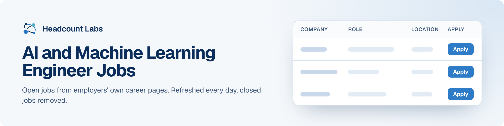

# AI and Machine Learning Engineer Jobs

AI engineer, machine learning engineer, applied scientist and LLM jobs at US employers.

**400 open jobs** · 320 new since the last update · 320 removed because they closed or left the employer's board · updated October 20, 2026 at 5:52 AM EDT

This list is built and refreshed every day by [Headcount Labs](https://headcountlabs.com/?utm_source=github&utm_medium=job-list&utm_campaign=ai-ml-engineer-jobs), which reads jobs straight from employers' own career pages and job boards. Every job here was still listed on its source board when we last read that board, within the past 3 days, and was posted in the past 30 days. Copies of the same job are merged into one row, and jobs that close are removed at the next update.

Want this data in your own app or agent? Use the [Headcount Labs jobs API](https://headcountlabs.com/docs/?utm_source=github&utm_medium=job-list&utm_campaign=ai-ml-engineer-jobs) (free tier), the [MCP server](https://headcountlabs.com/mcp/?utm_source=github&utm_medium=job-list&utm_campaign=ai-ml-engineer-jobs) for Claude, ChatGPT and other AI assistants, or the [open dataset](https://huggingface.co/datasets/HeadcountLabs/job-postings) on Hugging Face ([example queries](https://github.com/HeadcountLabs/job-postings)).

**Full dataset.** A bigger, one-off snapshot dated 2026-10-19 (all matching jobs, not only the open jobs below) is on Hugging Face: [Tech and software jobs](https://huggingface.co/datasets/HeadcountLabs/tech-jobs). It loads with `datasets.load_dataset` and is licensed CC BY 4.0.

**Jump to:** [Posted in the last 7 days (282)](#posted-in-the-last-7-days) · [Posted 8 to 30 days ago (118)](#posted-8-to-30-days-ago)

**Columns.** *Apply* opens the original posting on the employer's site. *Details* opens the job on Headcount Labs, with every posting we found for it. *Remote* shows what the employer states; a dash means the posting doesn't say. *Pay* is the range the employer published.

## Posted in the last 7 days

| Company | Role | Location | Remote | Pay | Posted | Apply | Details |
| --- | --- | --- | --- | --- | --- | :---: | :---: |
| **PG&amp;E Corporation** | ATS Engineer, Expert (AI-Datacenter integration expertise desired) | Danville, CA | Hybrid | — | Oct 20 |  | <a href="https://headcountlabs.com/catalog/jobs/f741cfaf-bf7f-47da-9dae-ac9cb168865e?utm_source=github&utm_medium=job-list&utm_campaign=ai-ml-engineer-jobs">via Headcount Labs</a> |
| **PG&amp;E Corporation** | ATS Engineer, Senior (AI-Datacenter integration expertise desired) | Danville, CA | Hybrid | — | Oct 20 |  | <a href="https://headcountlabs.com/catalog/jobs/90dc4b2a-e816-4134-af3a-cb6bde664adf?utm_source=github&utm_medium=job-list&utm_campaign=ai-ml-engineer-jobs">via Headcount Labs</a> |
| **Jobgether** | Senior AI Enabled Engineer | United States | Remote | — | Oct 20 |  | <a href="https://headcountlabs.com/catalog/jobs/6eae44cd-aa45-40f1-a477-66c663a3b907?utm_source=github&utm_medium=job-list&utm_campaign=ai-ml-engineer-jobs">via Headcount Labs</a> |
| **Jobgether** | Senior Software Engineer (AI Inference &amp; Runtime Platform) | United States | Remote | $140k–$230k/yr | Oct 20 |  | <a href="https://headcountlabs.com/catalog/jobs/c8691a5e-3997-4ca7-938e-f543a22b7472?utm_source=github&utm_medium=job-list&utm_campaign=ai-ml-engineer-jobs">via Headcount Labs</a> |
| **Jobgether** | Principal AI Engineer, Media Pipelines | United States | Remote | — | Oct 20 |  | <a href="https://headcountlabs.com/catalog/jobs/370cc829-d3d5-4326-bad9-832f27834048?utm_source=github&utm_medium=job-list&utm_campaign=ai-ml-engineer-jobs">via Headcount Labs</a> |
| **World Bank Group** | Digital &amp; AI Skills Specialist | Washington, DC | — | — | Oct 19 |  | <a href="https://headcountlabs.com/catalog/jobs/f92ca370-32c9-4226-9331-07d4eefe35eb?utm_source=github&utm_medium=job-list&utm_campaign=ai-ml-engineer-jobs">via Headcount Labs</a> |
| **Waymo** | 2027 Summer Intern, PhD, Machine Learning - Simulation &amp; Closed-Loop Training | Mountain View, CA | — | $85/hr | Oct 19 |  | <a href="https://headcountlabs.com/catalog/jobs/270fa579-339c-4c41-8d10-f8229893daf9?utm_source=github&utm_medium=job-list&utm_campaign=ai-ml-engineer-jobs">via Headcount Labs</a> |
| **VTG** | Staff II/ Staff III AI/ML Engineer | 

2 locations
Manassas, VA Chantilly, VA
 | — | $120k–$160k/yr | Oct 19 |  | <a href="https://headcountlabs.com/catalog/jobs/59dc270b-5c4e-41e9-b6c7-f41516b75f9c?utm_source=github&utm_medium=job-list&utm_campaign=ai-ml-engineer-jobs">via Headcount Labs</a> |
| **UWSTO University of Wisconsin Stout** | AI System Engineer I/II | Menomonie, WI | On-site | $54k–$60k/yr | Oct 19 |  | <a href="https://headcountlabs.com/catalog/jobs/38c9eabd-39c0-4c3c-8633-a4b93b0bc272?utm_source=github&utm_medium=job-list&utm_campaign=ai-ml-engineer-jobs">via Headcount Labs</a> |
| **UnitedHealth Group** | AI Solution Architect - Remote | Denver, CO | Remote | $113k–$193k/yr | Oct 19 |  | <a href="https://headcountlabs.com/catalog/jobs/70fa1ef6-e671-45df-81d8-13c2eee5c216?utm_source=github&utm_medium=job-list&utm_campaign=ai-ml-engineer-jobs">via Headcount Labs</a> |
| **UnitedHealth Group** | Associate AI/ML Engineer | Minnetonka, MN | Remote | $77k–$138k/yr | Oct 19 |  | <a href="https://headcountlabs.com/catalog/jobs/deb69603-7895-4e11-ab30-fbd62ba63532?utm_source=github&utm_medium=job-list&utm_campaign=ai-ml-engineer-jobs">via Headcount Labs</a> |
| **United Services Automobile Asn** | Lead Digital/Technical Product Manager - AI Product Solutions | 

3 locations
Plano Legacy Charlotte, NC United States
 | Hybrid | $143k–$274k/yr | Oct 19 |  | <a href="https://headcountlabs.com/catalog/jobs/fd1b87a1-2a32-4798-bd7e-d953a0b0add7?utm_source=github&utm_medium=job-list&utm_campaign=ai-ml-engineer-jobs">via Headcount Labs</a> |
| **United Services Automobile Asn** | AI/ML Engineer - Senior Level | 

3 locations
United States Charlotte, NC Plano Legacy
 | — | $143k–$274k/yr | Oct 19 |  | <a href="https://headcountlabs.com/catalog/jobs/f30e72d9-6bde-4ff3-bb6c-1ba14c9bff1c?utm_source=github&utm_medium=job-list&utm_campaign=ai-ml-engineer-jobs">via Headcount Labs</a> |
| **United Services Automobile Asn** | AI/ML Engineer - Mid Level | 

3 locations
United States Charlotte, NC Plano Legacy
 | Hybrid | $127k–$243k/yr | Oct 19 |  | <a href="https://headcountlabs.com/catalog/jobs/98a37a8d-6a57-4875-ab5d-728ed5869138?utm_source=github&utm_medium=job-list&utm_campaign=ai-ml-engineer-jobs">via Headcount Labs</a> |
| **United Services Automobile Asn** | AI Governance Analyst - Mid Level | 

3 locations
United States Charlotte, NC Plano Legacy
 | Hybrid | $103k–$198k/yr | Oct 19 |  | <a href="https://headcountlabs.com/catalog/jobs/8070bf11-6449-4862-ba51-c16ba9a7d7b3?utm_source=github&utm_medium=job-list&utm_campaign=ai-ml-engineer-jobs">via Headcount Labs</a> |
| **United Services Automobile Asn** | AI Governance Analyst - Senior Level | 

3 locations
United States Charlotte, NC Plano Legacy
 | Hybrid | $114k–$218k/yr | Oct 19 |  | <a href="https://headcountlabs.com/catalog/jobs/462aed4e-46f8-4556-ba9e-2ddec153522b?utm_source=github&utm_medium=job-list&utm_campaign=ai-ml-engineer-jobs">via Headcount Labs</a> |
| **United Services Automobile Asn** | Senior Development Product Owner - AI Product Solutions | 

3 locations
Plano Legacy Charlotte, NC United States
 | Hybrid | $103k–$198k/yr | Oct 19 |  | <a href="https://headcountlabs.com/catalog/jobs/3e5fe804-6d2b-47f8-bf71-b36208f45e52?utm_source=github&utm_medium=job-list&utm_campaign=ai-ml-engineer-jobs">via Headcount Labs</a> |
| **United Services Automobile Asn** | Lead Development Product Owner - AI Product Solutions | 

3 locations
Plano Legacy Charlotte, NC United States
 | Hybrid | $114k–$218k/yr | Oct 19 |  | <a href="https://headcountlabs.com/catalog/jobs/407835aa-6eca-4852-a6d5-9cf01be85724?utm_source=github&utm_medium=job-list&utm_campaign=ai-ml-engineer-jobs">via Headcount Labs</a> |
| **UBS - Experienced professionals - job boards** | Trading AI Developer, Global Markets | Investment Banking, NY | — | — | Oct 19 |  | <a href="https://headcountlabs.com/catalog/jobs/2ae0a37d-02dc-4d08-8ffe-606725c07976?utm_source=github&utm_medium=job-list&utm_campaign=ai-ml-engineer-jobs">via Headcount Labs</a> |
| **TheStaffed** | GenAI DevOps Engineer /AI Engineer | Los Angeles, CA | — | — | Oct 19 |  | <a href="https://headcountlabs.com/catalog/jobs/a8c95bfa-bc08-49a7-a53b-863f10a5333b?utm_source=github&utm_medium=job-list&utm_campaign=ai-ml-engineer-jobs">via Headcount Labs</a> |
| **TheStaffed** | Security Engineer (AWS Bedrock AgentCore / AI Security) | Los Angeles, CA | — | — | Oct 19 |  | <a href="https://headcountlabs.com/catalog/jobs/a365a7ef-7184-494a-953e-003859b5c1cb?utm_source=github&utm_medium=job-list&utm_campaign=ai-ml-engineer-jobs">via Headcount Labs</a> |
| **TheStaffed** | AI Engineer (Agentic AI / AWS Bedrock) | Los Angeles, CA | — | — | Oct 19 |  | <a href="https://headcountlabs.com/catalog/jobs/65914581-e4f2-407f-b12c-0234e21a0c27?utm_source=github&utm_medium=job-list&utm_campaign=ai-ml-engineer-jobs">via Headcount Labs</a> |
| **Sedgwick Claims Management Services Inc.** | AI Platform Administrator | Telecommuter, FL | On-site | — | Oct 19 |  | <a href="https://headcountlabs.com/catalog/jobs/e13bdb4c-d2aa-43c3-93a4-7cc5db74dc7e?utm_source=github&utm_medium=job-list&utm_campaign=ai-ml-engineer-jobs">via Headcount Labs</a> |
| **Sedgwick Claims Management Services Inc.** | AI Engineer | Telecommuter, TN | — | — | Oct 19 |  | <a href="https://headcountlabs.com/catalog/jobs/b96af7f7-f59a-44de-972d-0e9c0216cc97?utm_source=github&utm_medium=job-list&utm_campaign=ai-ml-engineer-jobs">via Headcount Labs</a> |
| **Sedgwick Claims Management Services Inc.** | Senior AI Engineer | Telecommuter, FL | On-site | — | Oct 19 |  | <a href="https://headcountlabs.com/catalog/jobs/b4963d16-a4c4-42e2-9e47-b67d84ab84fc?utm_source=github&utm_medium=job-list&utm_campaign=ai-ml-engineer-jobs">via Headcount Labs</a> |
| **Sedgwick Claims Management Services Inc.** | Principal AI Engineer | Telecommuter, FL | On-site | — | Oct 19 |  | <a href="https://headcountlabs.com/catalog/jobs/90ecbcc2-39ee-4016-b0a6-9d875d012246?utm_source=github&utm_medium=job-list&utm_campaign=ai-ml-engineer-jobs">via Headcount Labs</a> |
| **Schwab** | Senior Manager, AI Supervision &amp; Controls | 

2 locations
Westlake, TX Austin, TX
 | — | $113k–$145k/yr | Oct 19 |  | <a href="https://headcountlabs.com/catalog/jobs/b2ad18d3-3723-4801-8ed1-bddf504ae87e?utm_source=github&utm_medium=job-list&utm_campaign=ai-ml-engineer-jobs">via Headcount Labs</a> |
| **Schwab** | Director, Conversational AI – Content, Risk and Governance | 

4 locations
Austin, TX Omaha, NE Westlake, TX San Francisco, CA
 | — | $185k–$256k/yr | Oct 19 |  | <a href="https://headcountlabs.com/catalog/jobs/51164f61-0dc7-4973-aca4-6b23d18eb7f0?utm_source=github&utm_medium=job-list&utm_campaign=ai-ml-engineer-jobs">via Headcount Labs</a> |
| **Rainmaker Technology Corporation** | Rainmaker Fellow, Machine Learning | El Segundo, CA | — | — | Oct 19 |  | <a href="https://headcountlabs.com/catalog/jobs/f15eb309-fa58-48b6-b713-541dd2ce3104?utm_source=github&utm_medium=job-list&utm_campaign=ai-ml-engineer-jobs">via Headcount Labs</a> |
| **PG&amp;E Corporation** | Principal AI Platforms Solution Architect | Oakland, CA | Hybrid | — | Oct 19 |  | <a href="https://headcountlabs.com/catalog/jobs/3742843f-18b8-4efe-9140-ccabac4cb453?utm_source=github&utm_medium=job-list&utm_campaign=ai-ml-engineer-jobs">via Headcount Labs</a> |
| **Palo Alto Networks** | Senior Consulting Director, AI Security, Proactive Services (Unit 42) | 

2 locations
Santa Clara, CA Santa Clara, United States of America
 | Remote | $248k–$289k/yr | Oct 19 |  | <a href="https://headcountlabs.com/catalog/jobs/c75c8188-ed2f-4c75-b40f-e1fb45056245?utm_source=github&utm_medium=job-list&utm_campaign=ai-ml-engineer-jobs">via Headcount Labs</a> |
| **Palo Alto Networks** | Senior Product Manager (Edge AI) | 

2 locations
United States Santa Clara, CA
 | On-site | $153k–$248k/yr | Oct 19 |  | <a href="https://headcountlabs.com/catalog/jobs/b12d28c5-7bd1-4ac6-b310-38225feaea1f?utm_source=github&utm_medium=job-list&utm_campaign=ai-ml-engineer-jobs">via Headcount Labs</a> |
| **Palo Alto Networks** | Principal Machine Learning Engineer (AI-ML Data Scientist - ADEM) | 

2 locations
Santa Clara Santa Clara, CA
 | On-site | $163k–$264k/yr | Oct 19 |  | <a href="https://headcountlabs.com/catalog/jobs/37397ca0-2d6a-44cf-9129-49b7239a174e?utm_source=github&utm_medium=job-list&utm_campaign=ai-ml-engineer-jobs">via Headcount Labs</a> |
| **NeuraFlash, Part of Accenture** | Functional Lead, AI &amp; Agentforce Delivery | United States | Remote | — | Oct 19 |  | <a href="https://headcountlabs.com/catalog/jobs/d2391079-ff54-4a55-869e-f0b276572bce?utm_source=github&utm_medium=job-list&utm_campaign=ai-ml-engineer-jobs">via Headcount Labs</a> |
| **MACOM Technology Solutions Holdings, Inc.** | RF Design Intern, AI focus | Morrisville, NC | — | — | Oct 19 |  | <a href="https://headcountlabs.com/catalog/jobs/ff5d5dfe-8d85-4e21-87f4-059a10773998?utm_source=github&utm_medium=job-list&utm_campaign=ai-ml-engineer-jobs">via Headcount Labs</a> |
| **Lincoln Financial** | Director, AI Native Analytics | Radnor, PA | Hybrid | — | Oct 19 |  | <a href="https://headcountlabs.com/catalog/jobs/f61899d5-7cb3-4449-84b5-d8e7936315c3?utm_source=github&utm_medium=job-list&utm_campaign=ai-ml-engineer-jobs">via Headcount Labs</a> |
| **Jobgether** | Director of Sales - AI Frontier Labs | United States | Remote | — | Oct 19 |  | <a href="https://headcountlabs.com/catalog/jobs/e527ad40-a5d3-4721-969b-143b8c60f118?utm_source=github&utm_medium=job-list&utm_campaign=ai-ml-engineer-jobs">via Headcount Labs</a> |
| **Jobgether** | Personal Injury Law &amp; AI Evaluation Specialist | United States | Remote | — | Oct 19 |  | <a href="https://headcountlabs.com/catalog/jobs/78f6aa8f-f7ed-4f0d-9829-9fb1d055ab97?utm_source=github&utm_medium=job-list&utm_campaign=ai-ml-engineer-jobs">via Headcount Labs</a> |
| **Jobgether** | Tax Law &amp; AI Evaluation Specialist | United States | Remote | — | Oct 19 |  | <a href="https://headcountlabs.com/catalog/jobs/c5415232-41b8-4ff5-834a-6bde913ea4ee?utm_source=github&utm_medium=job-list&utm_campaign=ai-ml-engineer-jobs">via Headcount Labs</a> |
| **Jobgether** | Sr. Principal Software and AI Engineer | United States | Remote | $137k–$182k/yr | Oct 19 |  | <a href="https://headcountlabs.com/catalog/jobs/7cd2a073-1a36-4c79-98c9-1849484dc9ed?utm_source=github&utm_medium=job-list&utm_campaign=ai-ml-engineer-jobs">via Headcount Labs</a> |
| **Jobgether** | Government Subject Matter Expert (SME) - AI Model Evaluation | United States | Remote | $35–$40/hr | Oct 19 |  | <a href="https://headcountlabs.com/catalog/jobs/9569cc7a-0bcd-4738-90f5-8e625683a473?utm_source=github&utm_medium=job-list&utm_campaign=ai-ml-engineer-jobs">via Headcount Labs</a> |
| **International Rescue Committee** | AI Platform Engineer | New York | Remote | $88k–$102k/yr | Oct 19 |  | <a href="https://headcountlabs.com/catalog/jobs/1655325f-10f9-40e5-ad41-224fa52d58e6?utm_source=github&utm_medium=job-list&utm_campaign=ai-ml-engineer-jobs">via Headcount Labs</a> |
| **International Motors, LLC** | Senior AI/ML Engineer | Lisle, IL | — | — | Oct 19 |  | <a href="https://headcountlabs.com/catalog/jobs/422b3664-7e49-4108-9345-7e1e106bbcd4?utm_source=github&utm_medium=job-list&utm_campaign=ai-ml-engineer-jobs">via Headcount Labs</a> |
| **HISTOSONICS INC** | Sr. Manager – AI and R&amp;D Infrastructure | Plymouth, MN | — | $170k–$195k/yr | Oct 19 |  | <a href="https://headcountlabs.com/catalog/jobs/83e94a1a-f7f5-45ed-9d36-b1c485ebb276?utm_source=github&utm_medium=job-list&utm_campaign=ai-ml-engineer-jobs">via Headcount Labs</a> |
| **Gormat** | Systems Engineer III, AI Experience | Annapolis Junction, MD | — | $149k–$164k/yr | Oct 19 |  | <a href="https://headcountlabs.com/catalog/jobs/826dd260-ca89-49b6-aa63-9bba8205cb27?utm_source=github&utm_medium=job-list&utm_campaign=ai-ml-engineer-jobs">via Headcount Labs</a> |
| **Gormat** | Systems Engineer, AI Experience | Annapolis Junction, MD | — | $105k–$120k/yr | Oct 19 |  | <a href="https://headcountlabs.com/catalog/jobs/65342c53-c1af-4dd8-b136-b9aa5b3ae4f9?utm_source=github&utm_medium=job-list&utm_campaign=ai-ml-engineer-jobs">via Headcount Labs</a> |
| **Ford Motor Company** | Sr. Director - Finance Data, Analytics and AI | Dearborn, MI | — | — | Oct 19 |  | <a href="https://headcountlabs.com/catalog/jobs/11a276a1-f8fa-430b-9fbb-a9ec9b518678?utm_source=github&utm_medium=job-list&utm_campaign=ai-ml-engineer-jobs">via Headcount Labs</a> |
| **FieldAI** | Robotics Applied Scientist, Spatio-Temporal Scene Understanding &amp; Memory | Irvine, CA | On-site | — | Oct 19 |  | <a href="https://headcountlabs.com/catalog/jobs/f701516f-d92f-40f0-9e29-585e307ac388?utm_source=github&utm_medium=job-list&utm_campaign=ai-ml-engineer-jobs">via Headcount Labs</a> |
| **FieldAI** | Robotics Applied Scientist, Active Perception | Irvine, CA | On-site | — | Oct 19 |  | <a href="https://headcountlabs.com/catalog/jobs/f579a958-4a4c-4f96-8c35-058fb8b421c3?utm_source=github&utm_medium=job-list&utm_campaign=ai-ml-engineer-jobs">via Headcount Labs</a> |
| **Expression** | AI Engineer | Washington, DC | On-site | $130k–$160k/yr | Oct 19 |  | <a href="https://headcountlabs.com/catalog/jobs/9f2e059a-94d9-41f5-a7e2-63d6e1dfd1e2?utm_source=github&utm_medium=job-list&utm_campaign=ai-ml-engineer-jobs">via Headcount Labs</a> |
| **Eagle Brook Church** | AI Solutions Analyst | Centerville, MN | — | $83k–$89k/yr | Oct 19 |  | <a href="https://headcountlabs.com/catalog/jobs/9210cbea-9fae-4220-8810-c9d1a7c2caf7?utm_source=github&utm_medium=job-list&utm_campaign=ai-ml-engineer-jobs">via Headcount Labs</a> |
| **Dust** | Global Head of AI Deployment &amp; Partner Delivery (US) | New York, NY | On-site | $300k–$350k/yr | Oct 19 |  | <a href="https://headcountlabs.com/catalog/jobs/82f7127a-ca60-449d-a6f1-59bcc866d1de?utm_source=github&utm_medium=job-list&utm_campaign=ai-ml-engineer-jobs">via Headcount Labs</a> |
| **Dolead** | Product Manager – AI &amp; Automation | Cambridge | Hybrid | — | Oct 19 |  | <a href="https://headcountlabs.com/catalog/jobs/ca2e3a08-8573-4826-868e-4cfd5e93ac7c?utm_source=github&utm_medium=job-list&utm_campaign=ai-ml-engineer-jobs">via Headcount Labs</a> |
| **DIRECTV** | Principal, System Engineer 2, Multi-Agent AI, AdTech | New York, NY | — | $179k–$268k/yr | Oct 19 |  | <a href="https://headcountlabs.com/catalog/jobs/b68c70cc-861b-4e1c-a3e8-7cc8dbbb15c9?utm_source=github&utm_medium=job-list&utm_campaign=ai-ml-engineer-jobs">via Headcount Labs</a> |
| **DIRECTV** | System Engineer 2, Full Stack Applied AI, AdTech | 

2 locations
New York, NY United States
 | Hybrid | $135k–$202k/yr | Oct 19 |  | <a href="https://headcountlabs.com/catalog/jobs/0fcc42e4-3955-4765-8b1e-d87625bd398f?utm_source=github&utm_medium=job-list&utm_campaign=ai-ml-engineer-jobs">via Headcount Labs</a> |
| **Custom Manufacturing and Engineering** | Computing Engineer/Software Developer –AI/ML, GUI Development, Custom Cobot Control | Pinellas Park, FL | — | $68k–$78k/yr | Oct 19 |  | <a href="https://headcountlabs.com/catalog/jobs/7f441a7f-801c-42da-8b60-66f82c90b2e1?utm_source=github&utm_medium=job-list&utm_campaign=ai-ml-engineer-jobs">via Headcount Labs</a> |
| **CuspAI** | Ecosystem Manager, AI Materials Foundry | 

3 locations
London West Coast Cambridge
 | Hybrid | — | Oct 19 |  | <a href="https://headcountlabs.com/catalog/jobs/c5887287-b75b-4341-bdf3-d09371a62581?utm_source=github&utm_medium=job-list&utm_campaign=ai-ml-engineer-jobs">via Headcount Labs</a> |
| **CP00001 Washington University in St Louis** | AI Business Analyst, Advancement Systems - University Advancement | Clayton, MO | — | $75k–$129k/yr | Oct 19 |  | <a href="https://headcountlabs.com/catalog/jobs/b3b68f24-1491-4847-97ce-bf4c83c34e45?utm_source=github&utm_medium=job-list&utm_campaign=ai-ml-engineer-jobs">via Headcount Labs</a> |
| **Clera** | Founding Engineer (AI/ML) | San Francisco, CA | On-site | — | Oct 19 |  | <a href="https://headcountlabs.com/catalog/jobs/9caa091f-ad0d-4cde-84cd-106e9f060e29?utm_source=github&utm_medium=job-list&utm_campaign=ai-ml-engineer-jobs">via Headcount Labs</a> |
| **Clera** | Staff Engineer, Agentic AI | San Francisco, CA | On-site | — | Oct 19 |  | <a href="https://headcountlabs.com/catalog/jobs/9a417cb2-cb18-4816-b519-508955e20459?utm_source=github&utm_medium=job-list&utm_campaign=ai-ml-engineer-jobs">via Headcount Labs</a> |
| **Clera** | AI/ML Engineer, Individual Contributor | San Francisco, CA | On-site | — | Oct 19 |  | <a href="https://headcountlabs.com/catalog/jobs/6494aa73-d2ad-46bc-a35a-82a071916653?utm_source=github&utm_medium=job-list&utm_campaign=ai-ml-engineer-jobs">via Headcount Labs</a> |
| **Clera** | AI Engineer | San Francisco, CA | On-site | — | Oct 19 |  | <a href="https://headcountlabs.com/catalog/jobs/29882f0b-8749-4cc9-a6c3-7a4772e81484?utm_source=github&utm_medium=job-list&utm_campaign=ai-ml-engineer-jobs">via Headcount Labs</a> |
| **Clera** | Founding Engineer (Applied AI) | San Francisco, CA | On-site | — | Oct 19 |  | <a href="https://headcountlabs.com/catalog/jobs/2a27250e-4503-4077-89fd-d46ba557ae3b?utm_source=github&utm_medium=job-list&utm_campaign=ai-ml-engineer-jobs">via Headcount Labs</a> |
| **Citi** | Director - AI Implementation Lead - Citi COO Corporate Enablement Capabilities Team | 

2 locations
New York, NY Tampa, FL
 | — | $170k–$300k/yr | Oct 19 |  | <a href="https://headcountlabs.com/catalog/jobs/26f79639-be31-4bab-b3c0-dd9433c64e6b?utm_source=github&utm_medium=job-list&utm_campaign=ai-ml-engineer-jobs">via Headcount Labs</a> |
| **Cerebras Systems** | AI Inference Core - Senior SDET, Release Integration Testing | 

2 locations
Sunnyvale, CA Toronto
 | Hybrid | — | Oct 19 |  | <a href="https://headcountlabs.com/catalog/jobs/afa94bff-f8f3-4d0f-9ad7-dfb91d73606a?utm_source=github&utm_medium=job-list&utm_campaign=ai-ml-engineer-jobs">via Headcount Labs</a> |
| **CBT Nuggets** | Technical Product Owner, AI-Directed Development | Eugene | Remote | — | Oct 19 |  | <a href="https://headcountlabs.com/catalog/jobs/57864488-0d2d-4174-8d0c-1fc41c7a4b22?utm_source=github&utm_medium=job-list&utm_campaign=ai-ml-engineer-jobs">via Headcount Labs</a> |
| **Carrier** | Senior AI &amp; Data Solutions Engineer | City, FL | Remote | $96k–$192k/yr | Oct 19 |  | <a href="https://headcountlabs.com/catalog/jobs/f1c16a84-94af-4704-97a5-efd375ebbe36?utm_source=github&utm_medium=job-list&utm_campaign=ai-ml-engineer-jobs">via Headcount Labs</a> |
| **CARNIVAL CRUISE LINE** | Analyst, Consumer AI | Miami, FL | On-site | — | Oct 19 |  | <a href="https://headcountlabs.com/catalog/jobs/14ef5c95-21b9-4b9a-99d7-fb675318375a?utm_source=github&utm_medium=job-list&utm_campaign=ai-ml-engineer-jobs">via Headcount Labs</a> |
| **AstraZeneca** | Director, Oncology Commercial Data Science &amp; AI Products | Gaithersburg, MD | — | — | Oct 19 |  | <a href="https://headcountlabs.com/catalog/jobs/12d7e227-f17c-4dcb-be1b-92372040e6b7?utm_source=github&utm_medium=job-list&utm_campaign=ai-ml-engineer-jobs">via Headcount Labs</a> |
| **Amgen** | Senior Machine Learning Engineer | Washington, DC | Remote | — | Oct 19 |  | <a href="https://headcountlabs.com/catalog/jobs/b3bbc2d6-f76e-4d9d-aaaa-2dff54ebe117?utm_source=github&utm_medium=job-list&utm_campaign=ai-ml-engineer-jobs">via Headcount Labs</a> |
| **AbbVie** | AI &amp; Automation Engineer | North Chicago, IL | Remote | $84k–$162k/yr | Oct 19 |  | <a href="https://headcountlabs.com/catalog/jobs/ddef84c2-75b1-4bf7-9432-aaa04d09337f?utm_source=github&utm_medium=job-list&utm_campaign=ai-ml-engineer-jobs">via Headcount Labs</a> |
| **AbbVie** | Lead AI Automation Engineer | North Chicago, IL | Hybrid | $110k–$208k/yr | Oct 19 |  | <a href="https://headcountlabs.com/catalog/jobs/fc90f001-291a-45fa-82dd-a63d1d1f724d?utm_source=github&utm_medium=job-list&utm_campaign=ai-ml-engineer-jobs">via Headcount Labs</a> |
| **94-1687665 Bank of America, National Association** | Senior Engineer – AI Monitoring &amp; Control Capabilities | 

6 locations
Charlotte Jacksonville Jersey City Pennington Plano Richmond
 | — | $122k–$200k/yr | Oct 19 |  | <a href="https://headcountlabs.com/catalog/jobs/71c2e7ee-5eef-4876-9dd0-0b0ec917706e?utm_source=github&utm_medium=job-list&utm_campaign=ai-ml-engineer-jobs">via Headcount Labs</a> |
| **${new Date().getFullYear()} Infor** | Architect, Senior - AI Cost Optimization | Dallas, TX | Hybrid | — | Oct 19 |  | <a href="https://headcountlabs.com/catalog/jobs/0e7fdea3-b9b8-4a0a-bf57-21d79fe8e617?utm_source=github&utm_medium=job-list&utm_campaign=ai-ml-engineer-jobs">via Headcount Labs</a> |
| **Talent Search PRO** | AI Prompt Engineer / Agentic AI Engineer (Onsite/Hybrid) | Chicago, TX | Hybrid | $200k/yr | Oct 18 |  | <a href="https://headcountlabs.com/catalog/jobs/f94cb60b-3682-4f93-b10b-1602b7ade37f?utm_source=github&utm_medium=job-list&utm_campaign=ai-ml-engineer-jobs">via Headcount Labs</a> |
| **Talent Search PRO** | AI Led Engineering – Enterprise AI, Cloud &amp; Platform Transformation (Onsite/Hybrid) | Chicago, TX | Hybrid | $200k/yr | Oct 18 |  | <a href="https://headcountlabs.com/catalog/jobs/94bcc221-095d-45dd-977a-decc879e39de?utm_source=github&utm_medium=job-list&utm_campaign=ai-ml-engineer-jobs">via Headcount Labs</a> |
| **FlowGen Labs** | Strategic AI Partnerships Lead | San Francisco, CA | On-site | $300k–$450k/yr | Oct 18 |  | <a href="https://headcountlabs.com/catalog/jobs/18e8d372-95d6-4652-8d45-b2df0861a5a1?utm_source=github&utm_medium=job-list&utm_campaign=ai-ml-engineer-jobs">via Headcount Labs</a> |
| **FlowGen Labs** | AI Strategist | San Francisco, CA | On-site | $200k–$375k/yr | Oct 18 |  | <a href="https://headcountlabs.com/catalog/jobs/165ec6f4-3940-4614-aac1-5bca804fc0df?utm_source=github&utm_medium=job-list&utm_campaign=ai-ml-engineer-jobs">via Headcount Labs</a> |
| **Current Opportunities - Virginia Tech** | Faculty Position in Physical AI and Assured Autonomous Systems | Blacksburg, VA | — | $120k–$150k/yr | Oct 18 |  | <a href="https://headcountlabs.com/catalog/jobs/a0316e0f-3da1-4dcb-8474-bb4a0e8e9ee8?utm_source=github&utm_medium=job-list&utm_campaign=ai-ml-engineer-jobs">via Headcount Labs</a> |
| **Pfizer** | Senior Machine Learning Research Scientist | Cambridge, MA | — | $106k–$177k/yr | Oct 17 |  | <a href="https://headcountlabs.com/catalog/jobs/ef310185-1b07-4a39-84d4-d2b30debd85f?utm_source=github&utm_medium=job-list&utm_campaign=ai-ml-engineer-jobs">via Headcount Labs</a> |
| **Vantive** | Integration Technical Architect (AWS/AI) | Deerfield, IL | — | $124k–$170k/yr | Oct 16 |  | <a href="https://headcountlabs.com/catalog/jobs/292db881-cc19-415e-8634-1cf5f350d9f5?utm_source=github&utm_medium=job-list&utm_campaign=ai-ml-engineer-jobs">via Headcount Labs</a> |
| **US063 Oliver Wyman, LLC** | Oliver Wyman - Regional AI Product Enablement Manager | 

2 locations
New York United States
 | Hybrid | $130k–$180k/yr | Oct 16 |  | <a href="https://headcountlabs.com/catalog/jobs/621af548-6149-4611-b089-ebed0d573540?utm_source=github&utm_medium=job-list&utm_campaign=ai-ml-engineer-jobs">via Headcount Labs</a> |
| **UnitedHealth Group** | Lead SWE, AI Dev/IT Operations - Remote or Hybrid in DC or MN | Minnetonka, MN | Remote | $113k–$193k/yr | Oct 16 |  | <a href="https://headcountlabs.com/catalog/jobs/7be47e3b-b1c1-4fcc-a116-b3efc424b3ed?utm_source=github&utm_medium=job-list&utm_campaign=ai-ml-engineer-jobs">via Headcount Labs</a> |
| **UnitedHealth Group** | AI/ML Engineer | 

2 locations
San Francisco, CA Minnetonka, MN
 | Remote | $98k–$176k/yr | Oct 16 |  | <a href="https://headcountlabs.com/catalog/jobs/eefc466c-cf2e-4a46-b45f-36f581d0708e?utm_source=github&utm_medium=job-list&utm_campaign=ai-ml-engineer-jobs">via Headcount Labs</a> |
| **United Services Automobile Asn** | Financial Analyst Lead - AI Technology | 

2 locations
San Antonio, TX Charlotte, NC
 | Hybrid | $127k–$243k/yr | Oct 16 |  | <a href="https://headcountlabs.com/catalog/jobs/591dca4f-294e-4776-bec1-2fa4ad91807a?utm_source=github&utm_medium=job-list&utm_campaign=ai-ml-engineer-jobs">via Headcount Labs</a> |
| **Systems Planning and Analysis** | AI/ML Autonomous Biologist | Arlington, VA | — | $168k/yr | Oct 16 |  | <a href="https://headcountlabs.com/catalog/jobs/10b57eb5-e606-441c-a476-45923b05e5a9?utm_source=github&utm_medium=job-list&utm_campaign=ai-ml-engineer-jobs">via Headcount Labs</a> |
| **Staples, Inc.** | Senior Content Creator - AI &amp; Motion | Framingham, MA | — | — | Oct 16 |  | <a href="https://headcountlabs.com/catalog/jobs/823e3fd6-d529-4079-aae6-3d3457c15f35?utm_source=github&utm_medium=job-list&utm_campaign=ai-ml-engineer-jobs">via Headcount Labs</a> |
| **SpaceX** | Sourcing Manager, AI Satellite Electronics (Starmind) | Bastrop, TX | — | — | Oct 16 |  | <a href="https://headcountlabs.com/catalog/jobs/ad6931e4-137b-4e43-87fa-113b6ef7596d?utm_source=github&utm_medium=job-list&utm_campaign=ai-ml-engineer-jobs">via Headcount Labs</a> |
| **Schneider Electric** | People.AI PMO Specialist | Boston, MA | — | — | Oct 16 |  | <a href="https://headcountlabs.com/catalog/jobs/27bfa28e-d81d-42ba-a27d-02ce739ad6fa?utm_source=github&utm_medium=job-list&utm_campaign=ai-ml-engineer-jobs">via Headcount Labs</a> |
| **Schneider Electric** | Spring Semester AI Quality &amp; Continuous Improvement Intern | Foxboro, MA | — | — | Oct 16 |  | <a href="https://headcountlabs.com/catalog/jobs/e0c13c75-7d8b-47de-8f5f-f4f59a111097?utm_source=github&utm_medium=job-list&utm_campaign=ai-ml-engineer-jobs">via Headcount Labs</a> |
| **Sanofi** | Director of Franchise Digital Strategy &amp; AI Innovation | Morristown, NJ | — | — | Oct 16 |  | <a href="https://headcountlabs.com/catalog/jobs/d28583f3-3bb9-41a5-bf9b-feaa8ac1662d?utm_source=github&utm_medium=job-list&utm_campaign=ai-ml-engineer-jobs">via Headcount Labs</a> |
| **Sanofi** | 2027 Spring Co op Biologics Design and AI Cambridge MA | Cambridge (U.S.), MA | — | $47–$60/hr | Oct 16 |  | <a href="https://headcountlabs.com/catalog/jobs/fb267996-7972-4763-b6c7-f4a0656f52ce?utm_source=github&utm_medium=job-list&utm_campaign=ai-ml-engineer-jobs">via Headcount Labs</a> |
| **S&amp;P Global** | Machine Learning Operations Engineer I | 

2 locations
Cambridge, MA New York, NY
 | — | $120k–$140k/yr | Oct 16 |  | <a href="https://headcountlabs.com/catalog/jobs/c41793f6-b679-4c85-80de-8198e51227e0?utm_source=github&utm_medium=job-list&utm_campaign=ai-ml-engineer-jobs">via Headcount Labs</a> |
| **Publicis Groupe Holdings B.V** | Senior Analyst, Digital Product Management – AI | Boston, MA | — | $73k–$108k/yr | Oct 16 |  | <a href="https://headcountlabs.com/catalog/jobs/9ad77bfb-1a0c-413f-86fb-224573872ddb?utm_source=github&utm_medium=job-list&utm_campaign=ai-ml-engineer-jobs">via Headcount Labs</a> |
| **Publicis Groupe Holdings B.V** | Associate Director, Applied AI Strategy | New York, NY | — | $112k–$180k/yr | Oct 16 |  | <a href="https://headcountlabs.com/catalog/jobs/f7736730-11b3-4b39-8d9e-c4fafbd6d320?utm_source=github&utm_medium=job-list&utm_campaign=ai-ml-engineer-jobs">via Headcount Labs</a> |
| **Provectus** | Senior Product Owner &#124; Forward Deployed AI Delivery (SF and NYC) | 

3 locations
New York San Francisco Bay Area, CA Connecticut
 | Hybrid | $140k–$180k/yr | Oct 16 |  | <a href="https://headcountlabs.com/catalog/jobs/1a1c2612-77d2-4e15-83fb-8f6157ed28e2?utm_source=github&utm_medium=job-list&utm_campaign=ai-ml-engineer-jobs">via Headcount Labs</a> |
| **Peraton** | AI/ML Decision Intelligence Lead | 

3 locations
Herndon, VA Bowie, MD Annapolis Junction, MD
 | — | $146k–$234k/yr | Oct 16 |  | <a href="https://headcountlabs.com/catalog/jobs/5d9d29ff-d911-4739-aeec-9e4330168dd9?utm_source=github&utm_medium=job-list&utm_campaign=ai-ml-engineer-jobs">via Headcount Labs</a> |
| **Patterson Companies, Inc.** | Enterprise Data and AI Architect | 

2 locations
MN NV
 | Remote | $123k–$164k/yr | Oct 16 |  | <a href="https://headcountlabs.com/catalog/jobs/f40aa7d6-56e7-4528-96f1-1e0006d3a1a5?utm_source=github&utm_medium=job-list&utm_campaign=ai-ml-engineer-jobs">via Headcount Labs</a> |
| **Palo Alto Networks** | Senior Staff AI Deployment Strategist | Washington | Remote | $113k–$183k/yr | Oct 16 |  | <a href="https://headcountlabs.com/catalog/jobs/e2d8ce18-e64d-40a7-8f42-67df9cc5e7ce?utm_source=github&utm_medium=job-list&utm_campaign=ai-ml-engineer-jobs">via Headcount Labs</a> |
| **Palo Alto Networks** | Principal, Strategy &amp; AI Transformation | 

2 locations
Santa Clara, CA United States
 | On-site | $225k–$309k/yr | Oct 16 |  | <a href="https://headcountlabs.com/catalog/jobs/d32a7104-a81a-4cbd-8c4e-df9ad81b3f59?utm_source=github&utm_medium=job-list&utm_campaign=ai-ml-engineer-jobs">via Headcount Labs</a> |
| **Palo Alto Networks** | Sr Domain Consultant (AI Security) | 

20 locations
Dallas, TX Atlanta Boston Charlotte Denver Kansas City, MO Minneapolis Nashville New York City Santa Clara Seattle Atlanta, GA +8 more
 | Remote | $233k–$320k/yr | Oct 16 |  | <a href="https://headcountlabs.com/catalog/jobs/bdcd7a8c-c9db-4e12-b7bd-3a16d08ea1cb?utm_source=github&utm_medium=job-list&utm_campaign=ai-ml-engineer-jobs">via Headcount Labs</a> |
| **Palo Alto Networks** | Sr. Director of Product Management - (AI Security Platform) | 

2 locations
United States Santa Clara, CA
 | On-site | $268k–$368k/yr | Oct 16 |  | <a href="https://headcountlabs.com/catalog/jobs/b342540d-173b-4a31-9c49-166badf269bf?utm_source=github&utm_medium=job-list&utm_campaign=ai-ml-engineer-jobs">via Headcount Labs</a> |
| **ONEOK, Inc** | AI Engineer | United States | Remote | $114k–$172k/yr | Oct 16 |  | <a href="https://headcountlabs.com/catalog/jobs/401e4c0c-7575-4c76-924a-9ce49e682791?utm_source=github&utm_medium=job-list&utm_campaign=ai-ml-engineer-jobs">via Headcount Labs</a> |
| **Niagara Bottling, LLC** | Robotics &amp; AI Systems Development Engineer II | Diamond Bar, CA | — | $103k–$149k/yr | Oct 16 |  | <a href="https://headcountlabs.com/catalog/jobs/250eeafe-17f0-4c06-b810-e98c3168b1e8?utm_source=github&utm_medium=job-list&utm_campaign=ai-ml-engineer-jobs">via Headcount Labs</a> |
| **National Laboratory of the Rockies** | Graduate (10-12 weeks) Intern - AI/ML for Cybersecurity | 

2 locations
United States Golden, CO
 | — | $51k–$82k/yr | Oct 16 |  | <a href="https://headcountlabs.com/catalog/jobs/5489b225-3d06-4ec8-b2f9-d064db3e0d55?utm_source=github&utm_medium=job-list&utm_campaign=ai-ml-engineer-jobs">via Headcount Labs</a> |
| **Mirion** | AI Solutions Engineer | United States | Remote | — | Oct 16 |  | <a href="https://headcountlabs.com/catalog/jobs/6fca9e35-71f2-46d5-96eb-b8070d83c115?utm_source=github&utm_medium=job-list&utm_campaign=ai-ml-engineer-jobs">via Headcount Labs</a> |
| **Janssen Research &amp; Development, LLC Legal Entity** | Director, Physical AI for Autonomous Discovery | 

2 locations
Spring House, PA Cambridge, MA
 | Hybrid | $164k–$283k/yr | Oct 16 |  | <a href="https://headcountlabs.com/catalog/jobs/976b1a79-ccc7-451d-a2f9-f5fd81f07f01?utm_source=github&utm_medium=job-list&utm_campaign=ai-ml-engineer-jobs">via Headcount Labs</a> |
| **Glean** | Machine Learning Engineer, Enterprise Brain | Mountain View, CA | Hybrid | $200k–$280k/yr | Oct 16 |  | <a href="https://headcountlabs.com/catalog/jobs/9a832b84-f6f8-492f-aa80-e66e90096015?utm_source=github&utm_medium=job-list&utm_campaign=ai-ml-engineer-jobs">via Headcount Labs</a> |
| **First Citizens Bank** | Enterprise AI Use Case Success Manager | Charlotte, NC | Remote | — | Oct 16 |  | <a href="https://headcountlabs.com/catalog/jobs/66110e5a-0911-45b1-94bf-fbf86f0fb6a1?utm_source=github&utm_medium=job-list&utm_campaign=ai-ml-engineer-jobs">via Headcount Labs</a> |
| **Delinea** | Director, People Business Partner - Product, Technology &amp; AI | United States | Remote | $170k–$200k/yr | Oct 16 |  | <a href="https://headcountlabs.com/catalog/jobs/ee624d54-08c8-4585-805e-1bd376291845?utm_source=github&utm_medium=job-list&utm_campaign=ai-ml-engineer-jobs">via Headcount Labs</a> |
| **Deel** | AI Ecosystems Lead | United States | Remote | $180k–$250k/yr | Oct 16 |  | <a href="https://headcountlabs.com/catalog/jobs/7d7cdc5d-9a43-40a8-92a3-264a067c5c3c?utm_source=github&utm_medium=job-list&utm_campaign=ai-ml-engineer-jobs">via Headcount Labs</a> |
| **Crusoe** | AI Tools Engineer, Storage Infrastructure | San Francisco, CA | On-site | — | Oct 16 |  | <a href="https://headcountlabs.com/catalog/jobs/6c4af3d3-de0a-46e1-aa94-51df1a74f85a?utm_source=github&utm_medium=job-list&utm_campaign=ai-ml-engineer-jobs">via Headcount Labs</a> |
| **Commure** | Senior Engineering Manager, AI Accounting &amp; Ledger Systems | 

3 locations
Mountain View, CA Los Angeles, CA San Francisco, CA
 | Hybrid | $240k–$275k/yr | Oct 16 |  | <a href="https://headcountlabs.com/catalog/jobs/85124390-a119-46c8-b361-dc85e9af54e8?utm_source=github&utm_medium=job-list&utm_campaign=ai-ml-engineer-jobs">via Headcount Labs</a> |
| **Comcast** | Research Assistant, Enterprise AI | Philadelphia, PA | — | — | Oct 16 |  | <a href="https://headcountlabs.com/catalog/jobs/30af1002-f490-44cc-92eb-ae6d2a60ea2c?utm_source=github&utm_medium=job-list&utm_campaign=ai-ml-engineer-jobs">via Headcount Labs</a> |
| **Clera** | Founding Applied AI Engineer | San Francisco, CA | On-site | — | Oct 16 |  | <a href="https://headcountlabs.com/catalog/jobs/6b130548-0be7-4c0f-bba4-3dcaa6157921?utm_source=github&utm_medium=job-list&utm_campaign=ai-ml-engineer-jobs">via Headcount Labs</a> |
| **Clera** | AI Engineer (Mid-Level) | San Francisco, CA | On-site | — | Oct 16 |  | <a href="https://headcountlabs.com/catalog/jobs/23c14639-96dc-4852-aaa7-28c5862b1675?utm_source=github&utm_medium=job-list&utm_campaign=ai-ml-engineer-jobs">via Headcount Labs</a> |
| **Clera** | Senior Applied AI Engineer | San Francisco, CA | On-site | — | Oct 16 |  | <a href="https://headcountlabs.com/catalog/jobs/02d994ec-a5f1-4c2f-a8e5-fd935473b6b1?utm_source=github&utm_medium=job-list&utm_campaign=ai-ml-engineer-jobs">via Headcount Labs</a> |
| **Capital One** | AI Engineer 5 (MLX, Agentic AI, Gen AI platform Services) | 

5 locations
San Jose, CA Cambridge, MA McLean, VA New York, NY San Francisco, CA
 | — | $230k–$262k/yr | Oct 16 |  | <a href="https://headcountlabs.com/catalog/jobs/7ce35e7f-9c10-4a06-bbf7-31931f4baffa?utm_source=github&utm_medium=job-list&utm_campaign=ai-ml-engineer-jobs">via Headcount Labs</a> |
| **Capital One** | AI Engineer 5 (Gen AI SDK: Agentic AI, Guardrails, Evaluation) | 

5 locations
New York, NY Cambridge, MA McLean, VA San Francisco, CA San Jose, CA
 | — | $230k–$262k/yr | Oct 16 |  | <a href="https://headcountlabs.com/catalog/jobs/ebae6700-ccb5-4bcc-aa58-3c505a999caa?utm_source=github&utm_medium=job-list&utm_campaign=ai-ml-engineer-jobs">via Headcount Labs</a> |
| **Capital One** | Applied Researcher 4 (AI Foundations: Recommendation Systems) | 

4 locations
McLean, VA Cambridge, MA New York, NY San Jose, CA
 | — | $219k–$250k/yr | Oct 16 |  | <a href="https://headcountlabs.com/catalog/jobs/6f7e092b-7413-4079-9583-929d4a25da60?utm_source=github&utm_medium=job-list&utm_campaign=ai-ml-engineer-jobs">via Headcount Labs</a> |
| **Capital One** | Full-Stack Engineer 5 (Python, AWS, AI) (Cloud Operations Resilience Engineering) | 

2 locations
McLean, VA Richmond, VA
 | Hybrid | $230k–$262k/yr | Oct 16 |  | <a href="https://headcountlabs.com/catalog/jobs/49958426-68fc-46db-8ef9-c0837a38a133?utm_source=github&utm_medium=job-list&utm_campaign=ai-ml-engineer-jobs">via Headcount Labs</a> |
| **Capital One** | Full-Stack Engineer 4 (Python, AWS, AI) (Cloud Operations Resilience Engineering) | 

2 locations
McLean, VA Richmond, VA
 | Hybrid | $197k–$225k/yr | Oct 16 |  | <a href="https://headcountlabs.com/catalog/jobs/3e119802-682c-4957-ac61-0dd1415f4871?utm_source=github&utm_medium=job-list&utm_campaign=ai-ml-engineer-jobs">via Headcount Labs</a> |
| **Capital One** | Machine Learning Engineer 3 | 

4 locations
McLean, VA New York, NY Plano, TX Richmond, VA
 | — | $162k–$185k/yr | Oct 16 |  | <a href="https://headcountlabs.com/catalog/jobs/30d97295-18ad-4821-9d71-ba3b190f9535?utm_source=github&utm_medium=job-list&utm_campaign=ai-ml-engineer-jobs">via Headcount Labs</a> |
| **Calvert and Calvert Academy** | Senior Product Manager, AI Initiatives | United States | Remote | — | Oct 16 |  | <a href="https://headcountlabs.com/catalog/jobs/94782970-e1fa-4f9d-ad6f-644233327411?utm_source=github&utm_medium=job-list&utm_campaign=ai-ml-engineer-jobs">via Headcount Labs</a> |
| **Brown &amp; Brown, Inc** | Head of AI and Data Platform Engineering - Specialty Distribution | 

2 locations
Plano, TX Daytona Beach, FL
 | Hybrid | — | Oct 16 |  | <a href="https://headcountlabs.com/catalog/jobs/4d24b1dc-bbec-4bd7-af6d-31f041d8e204?utm_source=github&utm_medium=job-list&utm_campaign=ai-ml-engineer-jobs">via Headcount Labs</a> |
| **B10 Wells Fargo Bank, N. A.** | Lead Specialty Software Engineer - Agentic AI | 

2 locations
CHANDLER, AZ CHARLOTTE, NC
 | — | — | Oct 16 |  | <a href="https://headcountlabs.com/catalog/jobs/db8aa99a-19db-42bc-824c-21ec0ce31def?utm_source=github&utm_medium=job-list&utm_campaign=ai-ml-engineer-jobs">via Headcount Labs</a> |
| **Axway Software SA** | Head of Product Marketing (AI Gateway) | United States | Remote | — | Oct 16 |  | <a href="https://headcountlabs.com/catalog/jobs/2300752f-2317-4b9f-8785-b14c6461311d?utm_source=github&utm_medium=job-list&utm_campaign=ai-ml-engineer-jobs">via Headcount Labs</a> |
| **AstraZeneca** | Executive Director, Global Head of Medical AI/Digital Strategy &amp; Enablement | 

2 locations
Gaithersburg Gaithersburg, MD
 | — | — | Oct 16 |  | <a href="https://headcountlabs.com/catalog/jobs/f8c7c3a1-768a-422e-878c-cfdca35be4a4?utm_source=github&utm_medium=job-list&utm_campaign=ai-ml-engineer-jobs">via Headcount Labs</a> |
| **Arcfield** | AI Project Leader | Chantilly, VA | — | — | Oct 16 |  | <a href="https://headcountlabs.com/catalog/jobs/265101af-4fb6-4c15-bdc2-9bf854c7583d?utm_source=github&utm_medium=job-list&utm_campaign=ai-ml-engineer-jobs">via Headcount Labs</a> |
| **Anthropic** | Applied AI Architect, Cyber Specialist | San Francisco, CA &#124; New York City, NY | — | $300k–$400k/yr | Oct 16 |  | <a href="https://headcountlabs.com/catalog/jobs/cc56319e-cd76-4d6b-9cd8-272207659f4b?utm_source=github&utm_medium=job-list&utm_campaign=ai-ml-engineer-jobs">via Headcount Labs</a> |
| **Alleviate Health** | Founding AI Agent Engineer | San Francisco, CA | On-site | — | Oct 16 |  | <a href="https://headcountlabs.com/catalog/jobs/f52bc98e-d27d-4993-afd6-c38484e11196?utm_source=github&utm_medium=job-list&utm_campaign=ai-ml-engineer-jobs">via Headcount Labs</a> |
| **Accenture Federal Services** | Machine Learning Engineer | Washington, DC | — | $108k–$203k/yr | Oct 16 |  | <a href="https://headcountlabs.com/catalog/jobs/787a49e0-cafc-491e-8873-d7b841d1a6f9?utm_source=github&utm_medium=job-list&utm_campaign=ai-ml-engineer-jobs">via Headcount Labs</a> |
| **Accenture Federal Services** | Generative AI Applications Engineer (Agents &amp; RAG) | Washington, DC | — | $103k–$203k/yr | Oct 16 |  | <a href="https://headcountlabs.com/catalog/jobs/9237dc99-8f1e-4dbf-abab-dd22a0f48a66?utm_source=github&utm_medium=job-list&utm_campaign=ai-ml-engineer-jobs">via Headcount Labs</a> |
| **Abrigo** | Principal Applied AI Engineer | 

3 locations
United States Raleigh, NC Austin, TX
 | — | — | Oct 16 |  | <a href="https://headcountlabs.com/catalog/jobs/dee44d57-cebd-4889-b2fd-3fad1aef4896?utm_source=github&utm_medium=job-list&utm_campaign=ai-ml-engineer-jobs">via Headcount Labs</a> |
| **AbbVie** | Manager, Data, Analytics &amp; AI | North Chicago, IL | — | $110k–$208k/yr | Oct 16 |  | <a href="https://headcountlabs.com/catalog/jobs/fac84c57-5525-4144-9ee4-8a3e9c9a77ae?utm_source=github&utm_medium=job-list&utm_campaign=ai-ml-engineer-jobs">via Headcount Labs</a> |
| **94-1687665 Bank of America, National Association** | Senior Engineer- Agentic AI | 

3 locations
Charlotte New York Pennington
 | — | $122k–$200k/yr | Oct 16 |  | <a href="https://headcountlabs.com/catalog/jobs/900b4d99-7bda-4e90-aa81-1b2e00bef2f2?utm_source=github&utm_medium=job-list&utm_campaign=ai-ml-engineer-jobs">via Headcount Labs</a> |
| **94-1687665 Bank of America, National Association** | AI Engineer - Data Scientist I | 

2 locations
New York Charlotte
 | — | $107k–$193k/yr | Oct 16 |  | <a href="https://headcountlabs.com/catalog/jobs/bd8ad02c-dc7c-4e83-bccb-fbeefcdb3f62?utm_source=github&utm_medium=job-list&utm_campaign=ai-ml-engineer-jobs">via Headcount Labs</a> |
| **94-1687665 Bank of America, National Association** | Agile Product Owner – Document AI | 

9 locations
Charlotte Addison Fort Worth Jacksonville Newark Phoenix Plano Saint Louis Tampa
 | — | — | Oct 16 |  | <a href="https://headcountlabs.com/catalog/jobs/9de04b2d-4dbe-4853-8465-b19fb37878ad?utm_source=github&utm_medium=job-list&utm_campaign=ai-ml-engineer-jobs">via Headcount Labs</a> |
| **Yoh** | Software Engineer - ADAS Platform, Sensor Pipeline &amp; AI Inference Optimization | Newark, CA | — | $110–$140/hr | Oct 15 |  | <a href="https://headcountlabs.com/catalog/jobs/7599e0ae-d87e-49e0-9f91-0a261af12836?utm_source=github&utm_medium=job-list&utm_campaign=ai-ml-engineer-jobs">via Headcount Labs</a> |
| **UnitedHealth Group** | Senior AI/ML Engineer | 

2 locations
San Francisco, CA Minnetonka, MN
 | Remote | $120k–$214k/yr | Oct 15 |  | <a href="https://headcountlabs.com/catalog/jobs/59038465-74aa-47df-806c-91d9b2320cac?utm_source=github&utm_medium=job-list&utm_campaign=ai-ml-engineer-jobs">via Headcount Labs</a> |
| **UnitedHealth Group** | Sr. Manager, AI/ML Engineering | Eden Prairie, MN | Remote | $149k–$255k/yr | Oct 15 |  | <a href="https://headcountlabs.com/catalog/jobs/8ced9778-72d9-4d48-a4ba-3cbaea96cbb3?utm_source=github&utm_medium=job-list&utm_campaign=ai-ml-engineer-jobs">via Headcount Labs</a> |
| **UnitedHealth Group** | Sr Manager, AI/ML Engineering - Remote | Minnetonka, MN | Remote | $149k–$255k/yr | Oct 15 |  | <a href="https://headcountlabs.com/catalog/jobs/660b372a-55b3-464d-a561-61b270d2c7a2?utm_source=github&utm_medium=job-list&utm_campaign=ai-ml-engineer-jobs">via Headcount Labs</a> |
| **UnitedHealth Group** | Senior AI/ML Applied Scientist | Eden Prairie, MN | Remote | $92k–$164k/yr | Oct 15 |  | <a href="https://headcountlabs.com/catalog/jobs/8daaac3c-5038-4c78-9d6a-197b34c78b3b?utm_source=github&utm_medium=job-list&utm_campaign=ai-ml-engineer-jobs">via Headcount Labs</a> |
| **Susquehanna International Group, LLP** | Business Analytics AI Co-op with Drexel University | Bala Cynwyd (Philadelphia Area), PA | — | — | Oct 15 |  | <a href="https://headcountlabs.com/catalog/jobs/878cbeec-ac22-4c5c-8d04-b621ac590729?utm_source=github&utm_medium=job-list&utm_campaign=ai-ml-engineer-jobs">via Headcount Labs</a> |
| **State Farm** | GenAI Engineer (LLM) | 

4 locations
Bloomington, IL Dunwoody, GA Richardson, TX Tempe, AZ
 | — | $81k–$142k/yr | Oct 15 |  | <a href="https://headcountlabs.com/catalog/jobs/0099b41b-f66a-46f4-9106-d2eda6d777a8?utm_source=github&utm_medium=job-list&utm_campaign=ai-ml-engineer-jobs">via Headcount Labs</a> |
| **Sierra Nevada Corporation** | AI &amp; Data Platform Engineering Manager | 

2 locations
Lone Tree, CO Wichita, KS
 | — | $199k–$274k/yr | Oct 15 |  | <a href="https://headcountlabs.com/catalog/jobs/48b41468-ad8b-4b7c-b8e9-e5ce752cafa0?utm_source=github&utm_medium=job-list&utm_campaign=ai-ml-engineer-jobs">via Headcount Labs</a> |
| **Schwab** | Senior Manager, Product AI Enablement | 

3 locations
Westlake, TX Austin, TX Orlando, FL
 | — | $120k–$185k/yr | Oct 15 |  | <a href="https://headcountlabs.com/catalog/jobs/56d22310-fe9b-4e16-b6fd-421169b32f60?utm_source=github&utm_medium=job-list&utm_campaign=ai-ml-engineer-jobs">via Headcount Labs</a> |
| **Schwab** | AI Security Engineer | 

3 locations
Southlake, TX Austin, TX Phoenix, AZ
 | — | $130k–$160k/yr | Oct 15 |  | <a href="https://headcountlabs.com/catalog/jobs/eaa4c056-95c4-43b7-8c5e-88794b947d2f?utm_source=github&utm_medium=job-list&utm_campaign=ai-ml-engineer-jobs">via Headcount Labs</a> |
| **Schwab** | AI Platform Developer | 

2 locations
Southlake, TX Austin, TX
 | — | $55.29–$67.31/hr | Oct 15 |  | <a href="https://headcountlabs.com/catalog/jobs/c069e3fa-a479-4a27-941c-315570770606?utm_source=github&utm_medium=job-list&utm_campaign=ai-ml-engineer-jobs">via Headcount Labs</a> |
| **Post Holdings Inc.** | Sr. AI &amp; Machine Learning Engineer | Saint Louis, MO | Hybrid | — | Oct 15 |  | <a href="https://headcountlabs.com/catalog/jobs/f0ffebe1-1f00-417e-b22c-59a4daa72fd6?utm_source=github&utm_medium=job-list&utm_campaign=ai-ml-engineer-jobs">via Headcount Labs</a> |
| **Patterson Dental Supply, Inc.** | Enterprise Data and AI Architect | 

2 locations
Nevada Minnesota
 | Remote | $123k–$164k/yr | Oct 15 |  | <a href="https://headcountlabs.com/catalog/jobs/62d77d6d-76de-4e1b-a12b-509a1795de14?utm_source=github&utm_medium=job-list&utm_campaign=ai-ml-engineer-jobs">via Headcount Labs</a> |
| **Panasonic** | Machine Learning Engineer IV | Irvine, CA | Hybrid | $142k–$230k/yr | Oct 15 |  | <a href="https://headcountlabs.com/catalog/jobs/380894ab-e487-4881-9ba6-8f65042c2a24?utm_source=github&utm_medium=job-list&utm_campaign=ai-ml-engineer-jobs">via Headcount Labs</a> |
| **Palo Alto Networks** | Principal Software Engineer (Cloud Platform and AI Engineering) | 

2 locations
Santa Clara Santa Clara, CA
 | On-site | $156k–$253k/yr | Oct 15 |  | <a href="https://headcountlabs.com/catalog/jobs/859a0632-c408-4721-982b-68f4ba186fdf?utm_source=github&utm_medium=job-list&utm_campaign=ai-ml-engineer-jobs">via Headcount Labs</a> |
| **Okta** | Senior Software Engineer, Applied AI | San Francisco, CA | — | — | Oct 15 |  | <a href="https://headcountlabs.com/catalog/jobs/825a9801-bd66-42f4-8dc2-cbfb9af22c5d?utm_source=github&utm_medium=job-list&utm_campaign=ai-ml-engineer-jobs">via Headcount Labs</a> |
| **Okta** | Staff Software Engineer, Applied AI | San Francisco, CA | — | — | Oct 15 |  | <a href="https://headcountlabs.com/catalog/jobs/27904113-ced0-4e51-b36b-1685f16df25e?utm_source=github&utm_medium=job-list&utm_campaign=ai-ml-engineer-jobs">via Headcount Labs</a> |
| **Okta** | Principal Software Engineer, Applied AI | San Francisco, CA | — | — | Oct 15 |  | <a href="https://headcountlabs.com/catalog/jobs/cfc5a769-bc9f-4bae-9cbd-5da3cb752e0e?utm_source=github&utm_medium=job-list&utm_campaign=ai-ml-engineer-jobs">via Headcount Labs</a> |
| **NeuraFlash, Part of Accenture** | Forward Deployed Engineer, AI &amp; Agentforce | United States | Remote | — | Oct 15 |  | <a href="https://headcountlabs.com/catalog/jobs/b8483cff-bf5d-49cb-b6ab-b6bc61cb17e8?utm_source=github&utm_medium=job-list&utm_campaign=ai-ml-engineer-jobs">via Headcount Labs</a> |
| **MYR Group** | AI Strategist | Thornton, CO | — | $145k–$170k/yr | Oct 15 |  | <a href="https://headcountlabs.com/catalog/jobs/6b58ce46-b5ef-4935-98a6-2d7a7d0bcf57?utm_source=github&utm_medium=job-list&utm_campaign=ai-ml-engineer-jobs">via Headcount Labs</a> |
| **MCKESSON** | Senior AI Strategy Analyst | Richmond, VA | Hybrid | $120k–$200k/yr | Oct 15 |  | <a href="https://headcountlabs.com/catalog/jobs/173f6d4b-e99c-4a4a-92fd-c31edd4ce862?utm_source=github&utm_medium=job-list&utm_campaign=ai-ml-engineer-jobs">via Headcount Labs</a> |
| **Mayo Career Site US** | Principal Technical Business Analyst - AI Program | Rochester, MN | — | $128k–$186k/yr | Oct 15 |  | <a href="https://headcountlabs.com/catalog/jobs/7ede30c4-f51b-425b-a9d3-ba16a57960af?utm_source=github&utm_medium=job-list&utm_campaign=ai-ml-engineer-jobs">via Headcount Labs</a> |
| **Level** | Applied AI Engineer | Austin, TX | On-site | — | Oct 15 |  | <a href="https://headcountlabs.com/catalog/jobs/9c0e16cf-3b66-40b8-9e20-6123a82a2a52?utm_source=github&utm_medium=job-list&utm_campaign=ai-ml-engineer-jobs">via Headcount Labs</a> |
| **L3Harris, Inc** | Director, Program Management AI &amp; Digital Transformation | Palm Bay, FL | — | — | Oct 15 |  | <a href="https://headcountlabs.com/catalog/jobs/ab36800d-4d43-4bdb-a979-d163b2210147?utm_source=github&utm_medium=job-list&utm_campaign=ai-ml-engineer-jobs">via Headcount Labs</a> |
| **Intuit** | Principal AI Scientist - DGX | Mountain View, CA | — | $274k–$370k/yr | Oct 15 |  | <a href="https://headcountlabs.com/catalog/jobs/b4bc19e2-f53b-47c7-b22b-937eb2a48fc7?utm_source=github&utm_medium=job-list&utm_campaign=ai-ml-engineer-jobs">via Headcount Labs</a> |
| **Intuit** | Distinguished Engineer - Intuit Intelligence, ML &amp; AI | Mountain View, CA | — | $316k–$427k/yr | Oct 15 |  | <a href="https://headcountlabs.com/catalog/jobs/86f4642a-e831-46d2-b5ab-9b1578076229?utm_source=github&utm_medium=job-list&utm_campaign=ai-ml-engineer-jobs">via Headcount Labs</a> |
| **Infinite Computer Solutions** | AI Engineer | 

2 locations
New York Texas
 | — | — | Oct 15 |  | <a href="https://headcountlabs.com/catalog/jobs/fcfe7525-156c-4504-944a-77d900ef32d2?utm_source=github&utm_medium=job-list&utm_campaign=ai-ml-engineer-jobs">via Headcount Labs</a> |
| **Incyte Corporation** | Associate Director AI Engagement &amp; Design | Chadds Ford, PA | — | — | Oct 15 |  | <a href="https://headcountlabs.com/catalog/jobs/ee5b89f1-1b82-4b71-b57e-477e29a4116a?utm_source=github&utm_medium=job-list&utm_campaign=ai-ml-engineer-jobs">via Headcount Labs</a> |
| **Govcio LLC** | OPSEC &amp; AI Integration Analyst | San Antonio, TX | On-site | $120k–$150k/yr | Oct 15 |  | <a href="https://headcountlabs.com/catalog/jobs/9a311413-afde-4ae7-9c1c-95dee3a8f06c?utm_source=github&utm_medium=job-list&utm_campaign=ai-ml-engineer-jobs">via Headcount Labs</a> |
| **Gallagher** | AI Application Solutions Architect | Rolling Meadows, IL | — | — | Oct 15 |  | <a href="https://headcountlabs.com/catalog/jobs/2da9846f-c0f4-404f-92c2-b6539e63556e?utm_source=github&utm_medium=job-list&utm_campaign=ai-ml-engineer-jobs">via Headcount Labs</a> |
| **Gallagher** | AI Change Analyst | Rolling Meadows, IL | — | — | Oct 15 |  | <a href="https://headcountlabs.com/catalog/jobs/e2b810d3-bcb3-4b67-ab96-f3ae94fbf00d?utm_source=github&utm_medium=job-list&utm_campaign=ai-ml-engineer-jobs">via Headcount Labs</a> |
| **Ford Motor Company** | Senior Manager, AI Learning &amp; Development | Dearborn, MI | Hybrid | $142k–$268k/yr | Oct 15 |  | <a href="https://headcountlabs.com/catalog/jobs/400df8f7-f0d2-4cfc-85ee-0e76e2799691?utm_source=github&utm_medium=job-list&utm_campaign=ai-ml-engineer-jobs">via Headcount Labs</a> |
| **Edward Jones** | Director - AI Platform Strategy | St. Louis, MO | — | — | Oct 15 |  | <a href="https://headcountlabs.com/catalog/jobs/a45d11d6-f3eb-4678-819e-b62ccf1513bd?utm_source=github&utm_medium=job-list&utm_campaign=ai-ml-engineer-jobs">via Headcount Labs</a> |
| **Databricks** | Product Finance Director, AI Products &amp; GPU Investment Strategy | 

3 locations
Mountain View, CA San Francisco, CA Seattle, WA
 | — | $224k–$308k/yr | Oct 15 |  | <a href="https://headcountlabs.com/catalog/jobs/5a52d05d-492c-403a-a828-ef118cfb3dab?utm_source=github&utm_medium=job-list&utm_campaign=ai-ml-engineer-jobs">via Headcount Labs</a> |
| **CuspAI** | AI Labs Ecosystem Manager | 

3 locations
West Coast London Berlin
 | Hybrid | — | Oct 15 |  | <a href="https://headcountlabs.com/catalog/jobs/a55673a6-1136-4cab-b3fc-bc580ca01ba5?utm_source=github&utm_medium=job-list&utm_campaign=ai-ml-engineer-jobs">via Headcount Labs</a> |
| **Children's Healthcare of Atlanta** | AI/ML Engineer | 

2 locations
Brookhaven, GA United States
 | — | — | Oct 15 |  | <a href="https://headcountlabs.com/catalog/jobs/a42df5cb-4306-48d8-8077-fd7f4ef017a2?utm_source=github&utm_medium=job-list&utm_campaign=ai-ml-engineer-jobs">via Headcount Labs</a> |
| **Capital One** | AI Engineer 5 | 

4 locations
New York, NY Cambridge, MA McLean, VA San Jose, CA
 | — | $230k–$262k/yr | Oct 15 |  | <a href="https://headcountlabs.com/catalog/jobs/9662fc05-9a40-4f76-a668-09f886b2c6f9?utm_source=github&utm_medium=job-list&utm_campaign=ai-ml-engineer-jobs">via Headcount Labs</a> |
| **AstraZeneca** | Associate Director, Clinical AI Translation &amp; Solutions | Cambridge, MA | — | $145k–$217k/yr | Oct 15 |  | <a href="https://headcountlabs.com/catalog/jobs/cc896507-baf2-4309-877a-37a4eb5999ad?utm_source=github&utm_medium=job-list&utm_campaign=ai-ml-engineer-jobs">via Headcount Labs</a> |
| **Applied Medical** | Software Engineer - AI Engineer II/III | Rancho Santa Margarita, CA | — | $80k–$140k/yr | Oct 15 |  | <a href="https://headcountlabs.com/catalog/jobs/2881acb1-74a5-4805-82ea-47039f41d11b?utm_source=github&utm_medium=job-list&utm_campaign=ai-ml-engineer-jobs">via Headcount Labs</a> |
| **Anthropic** | Applied AI Engineer, Startups (Physical AI) | San Francisco, CA | — | $280k–$320k/yr | Oct 15 |  | <a href="https://headcountlabs.com/catalog/jobs/a5ce28f2-845a-4e00-b03c-5c005e0aedb6?utm_source=github&utm_medium=job-list&utm_campaign=ai-ml-engineer-jobs">via Headcount Labs</a> |
| **Anthropic** | Applied AI Engineer, Startups (Life Sciences) | San Francisco, CA &#124; New York City, NY | — | $280k–$320k/yr | Oct 15 |  | <a href="https://headcountlabs.com/catalog/jobs/6f194a11-23a9-4a03-ac57-c9d725beb30a?utm_source=github&utm_medium=job-list&utm_campaign=ai-ml-engineer-jobs">via Headcount Labs</a> |
| **Amgen** | Director, Marketing AI Capabilities | Washington, DC | — | — | Oct 15 |  | <a href="https://headcountlabs.com/catalog/jobs/3f102a39-2f11-46bf-854f-68aad281e74f?utm_source=github&utm_medium=job-list&utm_campaign=ai-ml-engineer-jobs">via Headcount Labs</a> |
| **Abby Care** | Senior Product Manager, AI Clinical Care | San Francisco, CA | Hybrid | $170k–$230k/yr | Oct 15 |  | <a href="https://headcountlabs.com/catalog/jobs/c57404c5-a640-4528-9b13-e3f7a39d7cdd?utm_source=github&utm_medium=job-list&utm_campaign=ai-ml-engineer-jobs">via Headcount Labs</a> |
| **Abby Care** | Senior Applied AI Engineer | San Francisco, CA | Hybrid | $220k–$270k/yr | Oct 15 |  | <a href="https://headcountlabs.com/catalog/jobs/6349d217-1552-49ec-8314-53bad9d2dc00?utm_source=github&utm_medium=job-list&utm_campaign=ai-ml-engineer-jobs">via Headcount Labs</a> |
| **Abby Care** | Applied AI Engineer | San Francisco, CA | Hybrid | $175k–$235k/yr | Oct 15 |  | <a href="https://headcountlabs.com/catalog/jobs/27f0524b-6f77-4225-b317-e984d65728dc?utm_source=github&utm_medium=job-list&utm_campaign=ai-ml-engineer-jobs">via Headcount Labs</a> |
| **Yale University** | Machine Learning and Neuro-Artificial Intelligence Specialist | 

2 locations
New Haven, CT United States
 | Hybrid | $68k–$120k/yr | Oct 14 |  | <a href="https://headcountlabs.com/catalog/jobs/eac5aff9-5c39-4700-b4d1-0480851fb698?utm_source=github&utm_medium=job-list&utm_campaign=ai-ml-engineer-jobs">via Headcount Labs</a> |
| **WRITER** | Senior AI adoption lead (West) | 

2 locations
San Francisco, CA Seattle, WA
 | Hybrid | $186k–$219k/yr | Oct 14 |  | <a href="https://headcountlabs.com/catalog/jobs/97037acb-d8fa-4627-ae40-d396ec0e9bfa?utm_source=github&utm_medium=job-list&utm_campaign=ai-ml-engineer-jobs">via Headcount Labs</a> |
| **WRITER** | AI adoption lead (West) | 

2 locations
San Francisco, CA Seattle, WA
 | Hybrid | $157k–$185k/yr | Oct 14 |  | <a href="https://headcountlabs.com/catalog/jobs/8a69c17e-2166-4604-8e74-9f09545ed710?utm_source=github&utm_medium=job-list&utm_campaign=ai-ml-engineer-jobs">via Headcount Labs</a> |
| **Velosio** | AI Solution Architect | United States | Remote | — | Oct 14 |  | <a href="https://headcountlabs.com/catalog/jobs/29680091-16b8-4b05-a61b-730828b404b5?utm_source=github&utm_medium=job-list&utm_campaign=ai-ml-engineer-jobs">via Headcount Labs</a> |
| **The Coca-Cola Company** | Machine Learning Architect II | 

2 locations
Atlanta, GA San Jose Escazu
 | — | $143k–$169k/yr | Oct 14 |  | <a href="https://headcountlabs.com/catalog/jobs/a3fb3789-f1f4-4bf3-a206-218c2571499e?utm_source=github&utm_medium=job-list&utm_campaign=ai-ml-engineer-jobs">via Headcount Labs</a> |
| **Systems Planning and Analysis** | Cybersecurity Engineer/AI (Offutt AFB) | Offutt Air Force Base, NE | — | — | Oct 14 |  | <a href="https://headcountlabs.com/catalog/jobs/eee88938-b8a1-4a7d-acd7-c667c35975e1?utm_source=github&utm_medium=job-list&utm_campaign=ai-ml-engineer-jobs">via Headcount Labs</a> |
| **Synopsys** | AI Security Architect | Morrisville, NC | — | — | Oct 14 |  | <a href="https://headcountlabs.com/catalog/jobs/f4f5efd7-4f15-42d4-8e28-51622058cc25?utm_source=github&utm_medium=job-list&utm_campaign=ai-ml-engineer-jobs">via Headcount Labs</a> |
| **Sprout** | Solutions Engineer - AI Systems | Garland, TX | — | — | Oct 14 |  | <a href="https://headcountlabs.com/catalog/jobs/27140177-c00f-498e-99d2-499dca50fb12?utm_source=github&utm_medium=job-list&utm_campaign=ai-ml-engineer-jobs">via Headcount Labs</a> |
| **Schwab** | Application Security Engineer - AI Engineer | 

4 locations
Southlake, TX Austin, TX Omaha, NE Orlando, FL
 | — | $125k–$160k/yr | Oct 14 |  | <a href="https://headcountlabs.com/catalog/jobs/eefb345b-0eb3-4dc6-bda7-6a8ac624ad77?utm_source=github&utm_medium=job-list&utm_campaign=ai-ml-engineer-jobs">via Headcount Labs</a> |
| **Schwab** | Director, Internal Audit AI Technology | 

4 locations
Westlake, TX Austin, TX Lone Tree, CO Omaha, NE
 | — | $121k–$270k/yr | Oct 14 |  | <a href="https://headcountlabs.com/catalog/jobs/7efcc3b1-639d-48c9-8c3d-bda6a51e9a5b?utm_source=github&utm_medium=job-list&utm_campaign=ai-ml-engineer-jobs">via Headcount Labs</a> |
| **Publix** | Generative AI Engineer (Hybrid) | Lakeland, FL | Hybrid | — | Oct 14 |  | <a href="https://headcountlabs.com/catalog/jobs/1b6fa7ec-bfdb-4403-9091-acb4543927ac?utm_source=github&utm_medium=job-list&utm_campaign=ai-ml-engineer-jobs">via Headcount Labs</a> |
| **Publicis Groupe Holdings B.V** | Vice President Group Director, Solutions Architect - AI Systems and Experience Engineering | Chicago, IL | — | $168k–$242k/yr | Oct 14 |  | <a href="https://headcountlabs.com/catalog/jobs/ce6efb4b-8cb8-462e-8a9e-1a8474b9022f?utm_source=github&utm_medium=job-list&utm_campaign=ai-ml-engineer-jobs">via Headcount Labs</a> |
| **Prime Intellect** | Strategic Account Executive - AI Infrastructure | San Francisco, CA | — | — | Oct 14 |  | <a href="https://headcountlabs.com/catalog/jobs/63427b8c-6262-4707-a7f8-d2f02e11cf97?utm_source=github&utm_medium=job-list&utm_campaign=ai-ml-engineer-jobs">via Headcount Labs</a> |
| **PepsiCo** | Sr Agentic AI Engineer | 

3 locations
Plano, TX Purchase, NY Chicago, IL
 | — | $106k–$178k/yr | Oct 14 |  | <a href="https://headcountlabs.com/catalog/jobs/1e55e571-3fa1-4520-bc55-c092d3ddc339?utm_source=github&utm_medium=job-list&utm_campaign=ai-ml-engineer-jobs">via Headcount Labs</a> |
| **Orr Group** | AI &amp; Fundraising Operations Consultant | Washington, DC or New York, NY | — | $80k–$100k/yr | Oct 14 |  | <a href="https://headcountlabs.com/catalog/jobs/b604a1b4-5496-4ac9-a43f-e20f05bd8284?utm_source=github&utm_medium=job-list&utm_campaign=ai-ml-engineer-jobs">via Headcount Labs</a> |
| **Northrop Grumman** | AI/DevOps Engineer - Level 4 (AHT) | Redondo Beach, CA | — | $172k–$258k/yr | Oct 14 |  | <a href="https://headcountlabs.com/catalog/jobs/43c146da-fbb4-4469-8bf3-8b21f131c31c?utm_source=github&utm_medium=job-list&utm_campaign=ai-ml-engineer-jobs">via Headcount Labs</a> |
| **MSC Industrial Supply Co.** | Director, AI Product Management | Davidson, NC | — | $146k–$229k/yr | Oct 14 |  | <a href="https://headcountlabs.com/catalog/jobs/77b069bd-3691-4278-8f21-e49339c8719b?utm_source=github&utm_medium=job-list&utm_campaign=ai-ml-engineer-jobs">via Headcount Labs</a> |
| **Lingo US Inc** | Senior AI/ML Engineer | Alameda, CA | — | $114k–$228k/yr | Oct 14 |  | <a href="https://headcountlabs.com/catalog/jobs/8e270c27-0a4c-4496-b560-4c1116fc3785?utm_source=github&utm_medium=job-list&utm_campaign=ai-ml-engineer-jobs">via Headcount Labs</a> |
| **Lingo US Inc** | Principal AI/ML Engineer | Alameda, CA | — | $131k–$261k/yr | Oct 14 |  | <a href="https://headcountlabs.com/catalog/jobs/8aef8873-24bf-4339-be45-6c97dd86ff4d?utm_source=github&utm_medium=job-list&utm_campaign=ai-ml-engineer-jobs">via Headcount Labs</a> |
| **Lingo US Inc** | Staff AI/ML Platform Engineer | Alameda, CA | — | $114k–$228k/yr | Oct 14 |  | <a href="https://headcountlabs.com/catalog/jobs/463cce50-48d7-410f-b8c4-d8c7b935128d?utm_source=github&utm_medium=job-list&utm_campaign=ai-ml-engineer-jobs">via Headcount Labs</a> |
| **Kovo** | Legal &amp; Compliance - sole hire, build with AI | United States | Remote | $200k–$280k/yr | Oct 14 |  | <a href="https://headcountlabs.com/catalog/jobs/f66bbbee-365f-41f8-9837-e78efd9662ec?utm_source=github&utm_medium=job-list&utm_campaign=ai-ml-engineer-jobs">via Headcount Labs</a> |
| **Intuit** | Senior Conversation Designer - AI Conversation Design | 

2 locations
Mountain View, CA San Diego, CA
 | — | $156k–$210k/yr | Oct 14 |  | <a href="https://headcountlabs.com/catalog/jobs/ee842061-3621-47ed-816a-c0a24db4f345?utm_source=github&utm_medium=job-list&utm_campaign=ai-ml-engineer-jobs">via Headcount Labs</a> |
| **Intuit** | Senior Staff AI Scientist | 

2 locations
Oakland, CA Mountain View, CA
 | — | $226k–$306k/yr | Oct 14 |  | <a href="https://headcountlabs.com/catalog/jobs/d4b99f14-5cc7-4a28-8885-6e5afc569cfa?utm_source=github&utm_medium=job-list&utm_campaign=ai-ml-engineer-jobs">via Headcount Labs</a> |
| **Intuit** | Staff Conversation Designer - AI Design Technologist | 

2 locations
Mountain View, CA San Diego, CA
 | — | $188k–$255k/yr | Oct 14 |  | <a href="https://headcountlabs.com/catalog/jobs/7dc8552d-dcb2-47d5-91f3-b0744661047b?utm_source=github&utm_medium=job-list&utm_campaign=ai-ml-engineer-jobs">via Headcount Labs</a> |
| **Inception Point AI** | Principal AI Engineer, Media Pipelines | United States Only | Remote | $175k–$200k/yr | Oct 14 |  | <a href="https://headcountlabs.com/catalog/jobs/1da390f7-17a8-4dbf-876a-f3a702cb4361?utm_source=github&utm_medium=job-list&utm_campaign=ai-ml-engineer-jobs">via Headcount Labs</a> |
| **FurtherAI** | Senior / Staff AI Engineer — Evals &amp; Model Quality | San Francisco, CA | On-site | $300k–$350k/yr | Oct 14 |  | <a href="https://headcountlabs.com/catalog/jobs/65fe5221-3f07-4cce-a709-d7a239e12e59?utm_source=github&utm_medium=job-list&utm_campaign=ai-ml-engineer-jobs">via Headcount Labs</a> |
| **CrowdHealth** | Software Engineer, AI &amp; Data | United States | Remote | $120k/yr | Oct 14 |  | <a href="https://headcountlabs.com/catalog/jobs/4cc2c743-aac8-4e6e-b417-49393e218421?utm_source=github&utm_medium=job-list&utm_campaign=ai-ml-engineer-jobs">via Headcount Labs</a> |
| **ClarityPay** | Forward Deployed Engineer, AI | New York City, NY | Hybrid | $145k–$195k/yr | Oct 14 |  | <a href="https://headcountlabs.com/catalog/jobs/6a175a45-63cf-4794-94f9-6ea8a274061c?utm_source=github&utm_medium=job-list&utm_campaign=ai-ml-engineer-jobs">via Headcount Labs</a> |
| **Carrier** | Agentic AI Engineer Lead | 

2 locations
Indianapolis, IN Kennesaw, GA
 | On-site | $96k–$192k/yr | Oct 14 |  | <a href="https://headcountlabs.com/catalog/jobs/fc2737f5-3e75-415e-b3c5-837a5e55e3b7?utm_source=github&utm_medium=job-list&utm_campaign=ai-ml-engineer-jobs">via Headcount Labs</a> |
| **Capital One** | Senior Manager, Product Management - Machine Learning and AI | 

3 locations
McLean, VA Chicago, IL New York, NY
 | — | $182k–$208k/yr | Oct 14 |  | <a href="https://headcountlabs.com/catalog/jobs/d1cf4f75-65aa-4c06-82a7-636f6f4be5b0?utm_source=github&utm_medium=job-list&utm_campaign=ai-ml-engineer-jobs">via Headcount Labs</a> |
| **Booz Allen Hamilton_United States** | Machine Learning Engineer | 

3 locations
Arlington, VA Alexandria, VA Washington, DC
 | — | $78k–$176k/yr | Oct 14 |  | <a href="https://headcountlabs.com/catalog/jobs/bbd75154-8dce-43c0-b837-e57557ba3bea?utm_source=github&utm_medium=job-list&utm_campaign=ai-ml-engineer-jobs">via Headcount Labs</a> |
| **Booz Allen Hamilton_United States** | AI Researcher | Chantilly, VA | — | $99k–$225k/yr | Oct 14 |  | <a href="https://headcountlabs.com/catalog/jobs/817626b3-f4c2-4816-8eed-8afd3276aeec?utm_source=github&utm_medium=job-list&utm_campaign=ai-ml-engineer-jobs">via Headcount Labs</a> |
| **Bob's Discount Furniture** | Senior Retail AI Solutions Specialist | 

3 locations
Manchester, CT Hartford, CT Boston, MA
 | — | $88k–$110k/yr | Oct 14 |  | <a href="https://headcountlabs.com/catalog/jobs/de7d18be-fcbc-47e8-aba5-d3efb985cd0f?utm_source=github&utm_medium=job-list&utm_campaign=ai-ml-engineer-jobs">via Headcount Labs</a> |
| **BetterHelp** | Senior Clinical QA Specialist, AI | United States | Remote | $125k–$150k/yr | Oct 14 |  | <a href="https://headcountlabs.com/catalog/jobs/e4f7a39b-6253-436b-8078-605fb15d3514?utm_source=github&utm_medium=job-list&utm_campaign=ai-ml-engineer-jobs">via Headcount Labs</a> |
| **Bernard** | AI Engineer, Software Factory | New York City, NY | On-site | — | Oct 14 |  | <a href="https://headcountlabs.com/catalog/jobs/738c9b71-2473-4481-8e07-1fa3836b54a4?utm_source=github&utm_medium=job-list&utm_campaign=ai-ml-engineer-jobs">via Headcount Labs</a> |
| **B10 Wells Fargo Bank, N. A.** | Principal Engineer - AI, Digital Payments &amp; Technology Transformation | 

2 locations
SAN LEANDRO, CA CONCORD, CA
 | Hybrid | $191k–$305k/yr | Oct 14 |  | <a href="https://headcountlabs.com/catalog/jobs/aee3085d-7990-4798-b39b-d2651d3fc4d5?utm_source=github&utm_medium=job-list&utm_campaign=ai-ml-engineer-jobs">via Headcount Labs</a> |
| **B10 Wells Fargo Bank, N. A.** | Lead Quantitative Analytics Specialist - AI Innovation &amp; Modeling (AIM) | CHARLOTTE, NC | On-site | — | Oct 14 |  | <a href="https://headcountlabs.com/catalog/jobs/46a8578f-0d80-4038-8cff-15d5a59c4f0d?utm_source=github&utm_medium=job-list&utm_campaign=ai-ml-engineer-jobs">via Headcount Labs</a> |
| **B10 Wells Fargo Bank, N. A.** | Quantitative Analytics Senior Manager -Agentic AI Platform &amp; Product Owner | 

7 locations
CHARLOTTE, NC IRVING, TX MINNEAPOLIS, MN SAINT LOUIS, MO SAN FRANCISCO, CA TEMPE, AZ WEST DES MOINES, IA
 | Hybrid | $185k–$300k/yr | Oct 14 |  | <a href="https://headcountlabs.com/catalog/jobs/0ab9ce65-89d5-447e-a490-9c2916b9e1c2?utm_source=github&utm_medium=job-list&utm_campaign=ai-ml-engineer-jobs">via Headcount Labs</a> |
| **Atlas Technical Consultants** | AI Project Manager | Lafayette, LA | — | — | Oct 14 |  | <a href="https://headcountlabs.com/catalog/jobs/cf05d3a2-8367-471a-a5ff-3d9585f69f3e?utm_source=github&utm_medium=job-list&utm_campaign=ai-ml-engineer-jobs">via Headcount Labs</a> |
| **AstraZeneca** | Director, AI Research | 

2 locations
Boston, MA Boston
 | Hybrid | $203k–$305k/yr | Oct 14 |  | <a href="https://headcountlabs.com/catalog/jobs/df173df8-9496-4e09-9f35-99966ca91d15?utm_source=github&utm_medium=job-list&utm_campaign=ai-ml-engineer-jobs">via Headcount Labs</a> |
| **AstraZeneca** | Associate Director, AI for Oncology Clinical Development | 

2 locations
Cambridge, MA Cambridge Kendall SQ
 | — | $144k–$216k/yr | Oct 14 |  | <a href="https://headcountlabs.com/catalog/jobs/65e414eb-f797-4fae-b269-171244603f28?utm_source=github&utm_medium=job-list&utm_campaign=ai-ml-engineer-jobs">via Headcount Labs</a> |
| **Anthropic** | Partner Account Manager, AI-Native/Boutique SI Partners | San Francisco, CA &#124; New York City, NY | — | $215k–$300k/yr | Oct 14 |  | <a href="https://headcountlabs.com/catalog/jobs/3727cc9c-2b59-4d64-a646-252036228a67?utm_source=github&utm_medium=job-list&utm_campaign=ai-ml-engineer-jobs">via Headcount Labs</a> |
| **Analog Devices Inc.** | Staff AI/ML Engineer, Time-Series &amp; Sensor Reasoning Models (Lorenz Labs) | 

3 locations
US, CA, San Jose, Rio Robles Rio Robles, CA Wilmington, MA
 | — | $198k–$272k/yr | Oct 14 |  | <a href="https://headcountlabs.com/catalog/jobs/897939a1-3b0c-42f2-9171-695fac7fdd52?utm_source=github&utm_medium=job-list&utm_campaign=ai-ml-engineer-jobs">via Headcount Labs</a> |
| **Analog Devices Inc.** | Senior Principal AI/ML Engineer, Deep Agentic Reasoning Engineer (Lorenz Labs) | 

3 locations
US, CA, San Jose, Rio Robles Rio Robles, CA Wilmington, MA
 | — | $260k–$358k/yr | Oct 14 |  | <a href="https://headcountlabs.com/catalog/jobs/3a94da7a-24a4-4d19-9b84-a80b2a3a5205?utm_source=github&utm_medium=job-list&utm_campaign=ai-ml-engineer-jobs">via Headcount Labs</a> |
| **Analog Devices Inc.** | Principal AI/ML Engineer, Time-Series &amp; Sensor Reasoning Models (Lorenz Labs) | 

3 locations
US, CA, San Jose, Rio Robles Rio Robles, CA Wilmington, MA
 | — | $230k–$316k/yr | Oct 14 |  | <a href="https://headcountlabs.com/catalog/jobs/e3599748-cd2f-43a4-9d95-083ea51d0b92?utm_source=github&utm_medium=job-list&utm_campaign=ai-ml-engineer-jobs">via Headcount Labs</a> |
| **Allen Control Systems** | Director of Computer Vision and Machine Learning | Austin, TX | On-site | — | Oct 14 |  | <a href="https://headcountlabs.com/catalog/jobs/23fd7a1a-df3f-4692-a5aa-61770f1cbda6?utm_source=github&utm_medium=job-list&utm_campaign=ai-ml-engineer-jobs">via Headcount Labs</a> |
| **Accenture Federal Services** | AI Operations Team Lead | Washington, DC | — | $81k–$155k/yr | Oct 14 |  | <a href="https://headcountlabs.com/catalog/jobs/8c27f52a-d965-43d5-ab51-cd64c384094c?utm_source=github&utm_medium=job-list&utm_campaign=ai-ml-engineer-jobs">via Headcount Labs</a> |
| **Accenture Federal Services** | AI Engineer - Senior | Chantilly, VA | — | $94k–$188k/yr | Oct 14 |  | <a href="https://headcountlabs.com/catalog/jobs/4cd9e6dc-c97e-4ac4-b020-886aad90649a?utm_source=github&utm_medium=job-list&utm_campaign=ai-ml-engineer-jobs">via Headcount Labs</a> |
| **Accenture Federal Services** | AI Tool Support Engineer | Washington, DC | — | $94k–$188k/yr | Oct 14 |  | <a href="https://headcountlabs.com/catalog/jobs/406b6107-bb20-4343-86ef-01f7a5de59f3?utm_source=github&utm_medium=job-list&utm_campaign=ai-ml-engineer-jobs">via Headcount Labs</a> |
| **Accenture Federal Services** | AI Engineer - SME | Chantilly, VA | — | $110k–$224k/yr | Oct 14 |  | <a href="https://headcountlabs.com/catalog/jobs/3dde14d9-fef9-4b75-9b97-3a4ce8907e6e?utm_source=github&utm_medium=job-list&utm_campaign=ai-ml-engineer-jobs">via Headcount Labs</a> |
| **a16z** | Partner 18, IT Engineer, AI &amp; Innovation Enablement, San Francisco/Menlo Park | 

2 locations
Menlo Park, CA San Francisco, CA
 | Hybrid | $189k–$221k/yr | Oct 14 |  | <a href="https://headcountlabs.com/catalog/jobs/c59681b8-b77e-4d52-8c6b-fa18e73bf8b9?utm_source=github&utm_medium=job-list&utm_campaign=ai-ml-engineer-jobs">via Headcount Labs</a> |
| **a16z** | Partner 20, Senior IT &amp; AI Platform Engineer, San Francisco/Menlo Park | 

2 locations
Menlo Park, CA San Francisco, CA
 | Hybrid | $221k–$258k/yr | Oct 14 |  | <a href="https://headcountlabs.com/catalog/jobs/714283e8-91be-4223-8574-e3693b40ace5?utm_source=github&utm_medium=job-list&utm_campaign=ai-ml-engineer-jobs">via Headcount Labs</a> |
| **Zoox** | Contract Student Worker – AI Validation and Benchmarking Engineer (40hrs / week Full-Time) | Foster City, CA | Hybrid | $30/hr | Oct 13 |  | <a href="https://headcountlabs.com/catalog/jobs/15eff984-6ef7-4795-a992-36e9dc402427?utm_source=github&utm_medium=job-list&utm_campaign=ai-ml-engineer-jobs">via Headcount Labs</a> |
| **Waymo** | Senior Machine Learning Engineer, Growth | 

2 locations
San Francisco, CA Mountain View, CA
 | Hybrid | $175k–$215k/yr | Oct 13 |  | <a href="https://headcountlabs.com/catalog/jobs/638f806d-d755-4bdd-95fb-1e7d71f94f04?utm_source=github&utm_medium=job-list&utm_campaign=ai-ml-engineer-jobs">via Headcount Labs</a> |
| **Waymo** | 2027 Summer Intern, MS/PhD, Machine Learning, Planning/Prediction | Mountain View, CA | — | $70/hr | Oct 13 |  | <a href="https://headcountlabs.com/catalog/jobs/ccbdaa0e-8c8d-4056-8a62-406bd7f42375?utm_source=github&utm_medium=job-list&utm_campaign=ai-ml-engineer-jobs">via Headcount Labs</a> |
| **Waymo** | Machine Learning Engineer - Gen SWE | Mountain View, CA | Hybrid | $213k–$263k/yr | Oct 13 |  | <a href="https://headcountlabs.com/catalog/jobs/1fb20877-0f12-4970-8fe9-5ea0456eb3f0?utm_source=github&utm_medium=job-list&utm_campaign=ai-ml-engineer-jobs">via Headcount Labs</a> |
| **Takeda Pharmaceutical** | Manager, AI-Ready Data Modeling | Boston, MA | Hybrid | $116k–$182k/yr | Oct 13 |  | <a href="https://headcountlabs.com/catalog/jobs/b6bb0e8f-5c47-4919-8caf-d948f7e3053c?utm_source=github&utm_medium=job-list&utm_campaign=ai-ml-engineer-jobs">via Headcount Labs</a> |
| **SSB&amp;T** | Artificial Intelligence &amp; Machine Learning, Officer | 

4 locations
Quincy, MA Austin, TX Boston, MA Princeton, NJ
 | — | $70k–$119k/yr | Oct 13 |  | <a href="https://headcountlabs.com/catalog/jobs/abb5d0fb-cd11-4780-9beb-a0d1d3cc0565?utm_source=github&utm_medium=job-list&utm_campaign=ai-ml-engineer-jobs">via Headcount Labs</a> |
| **SSA &amp; Company** | SSA - Associate Director, AI &amp; Applied Solutions | US Location | Remote | — | Oct 13 |  | <a href="https://headcountlabs.com/catalog/jobs/038c8936-9ac8-4743-b3e6-ec3f5078455e?utm_source=github&utm_medium=job-list&utm_campaign=ai-ml-engineer-jobs">via Headcount Labs</a> |
| **Rockefeller Capital Management** | AI Controls &amp; Governance Engineer | Hamilton, NJ | — | $150k–$200k/yr | Oct 13 |  | <a href="https://headcountlabs.com/catalog/jobs/6792101b-3189-4a35-9fca-f4b119f20554?utm_source=github&utm_medium=job-list&utm_campaign=ai-ml-engineer-jobs">via Headcount Labs</a> |
| **Robert Half Inc.** | Manager, Machine Learning Operations &amp; Delivery | 

2 locations
California United States
 | Remote | $115k–$175k/yr | Oct 13 |  | <a href="https://headcountlabs.com/catalog/jobs/8150be58-e310-4b3b-9344-3a621d5f936f?utm_source=github&utm_medium=job-list&utm_campaign=ai-ml-engineer-jobs">via Headcount Labs</a> |
| **Pitney Bowes Inc** | AI Technical Product Owner | Shelton, CT | Hybrid | $172k–$192k/yr | Oct 13 |  | <a href="https://headcountlabs.com/catalog/jobs/50fd8b95-c7a4-4ea7-8e9e-9b7310cd578b?utm_source=github&utm_medium=job-list&utm_campaign=ai-ml-engineer-jobs">via Headcount Labs</a> |
| **Pickle Robot Company** | Senior Machine Learning Engineer - Perception | Charlestown, MA | Hybrid | $170k–$227k/yr | Oct 13 |  | <a href="https://headcountlabs.com/catalog/jobs/a9f11cc3-ae1c-4b81-84c6-8bd87c5261c0?utm_source=github&utm_medium=job-list&utm_campaign=ai-ml-engineer-jobs">via Headcount Labs</a> |
| **PenFed Credit Union** | Director, AI Management &amp; Technology | McLean, VA | Hybrid | $97k/yr | Oct 13 |  | <a href="https://headcountlabs.com/catalog/jobs/4ebcf4cf-5234-4171-95dd-e5eedad59600?utm_source=github&utm_medium=job-list&utm_campaign=ai-ml-engineer-jobs">via Headcount Labs</a> |
| **PayPal, Inc.** | Sr. Technical Program Manager, AI Enablement for Enterprise | San Jose, CA | — | $176k–$262k/yr | Oct 13 |  | <a href="https://headcountlabs.com/catalog/jobs/1e967d98-1c26-4458-a87e-ceb13516c5b1?utm_source=github&utm_medium=job-list&utm_campaign=ai-ml-engineer-jobs">via Headcount Labs</a> |
| **Parsons Corporation** | Applied AI Engineer | Westminster, CO | On-site | $75k–$131k/yr | Oct 13 |  | <a href="https://headcountlabs.com/catalog/jobs/7ff7ed84-2d0a-489b-aaab-2945d1d02d5b?utm_source=github&utm_medium=job-list&utm_campaign=ai-ml-engineer-jobs">via Headcount Labs</a> |
| **National Debt Relief, LLC.** | Manager, AI Analytics | United States | Remote | $140k–$160k/yr | Oct 13 |  | <a href="https://headcountlabs.com/catalog/jobs/3be6dc18-afbf-4863-a4a4-9d41b15c1a26?utm_source=github&utm_medium=job-list&utm_campaign=ai-ml-engineer-jobs">via Headcount Labs</a> |
| **LHH** | CONFIDENTIAL AI Engineer | San Francisco, CA | Remote | $280k–$350k/yr | Oct 13 |  | <a href="https://headcountlabs.com/catalog/jobs/3eeb120f-5f72-4ba5-93e1-bfa5ce4689e6?utm_source=github&utm_medium=job-list&utm_campaign=ai-ml-engineer-jobs">via Headcount Labs</a> |
| **Kyndryl, Inc.** | Director, AI Innovation Lab, Vital Studio Lead | United States | On-site | $180k–$342k/yr | Oct 13 |  | <a href="https://headcountlabs.com/catalog/jobs/94365848-1a28-48a5-987d-619d1bc7c652?utm_source=github&utm_medium=job-list&utm_campaign=ai-ml-engineer-jobs">via Headcount Labs</a> |
| **KLA Corporation** | Computer Vision/Machine Learning Intern | Milpitas, CA | — | — | Oct 13 |  | <a href="https://headcountlabs.com/catalog/jobs/1ab1b55f-b5a5-4b4e-b3fb-df238c62139d?utm_source=github&utm_medium=job-list&utm_campaign=ai-ml-engineer-jobs">via Headcount Labs</a> |
| **KLA Corporation** | Software Engineer Intern - AI | Ann Arbor, MI | — | $24–$40/hr | Oct 13 |  | <a href="https://headcountlabs.com/catalog/jobs/c0a0002f-0014-4668-841d-6e2b410883ec?utm_source=github&utm_medium=job-list&utm_campaign=ai-ml-engineer-jobs">via Headcount Labs</a> |
| **Intuit** | Senior AI Research Scientist | Mountain View, CA | — | $180k–$244k/yr | Oct 13 |  | <a href="https://headcountlabs.com/catalog/jobs/d7ee0fed-054f-41cc-a30a-977157a60660?utm_source=github&utm_medium=job-list&utm_campaign=ai-ml-engineer-jobs">via Headcount Labs</a> |
| **HOME DEPOT MANAGEMENT COMPANY, LLC** | Senior AI Engineer (Remote) | United States | Remote | $100k–$250k/yr | Oct 13 |  | <a href="https://headcountlabs.com/catalog/jobs/a2394aed-d0da-4e8c-bb36-43db8f3a76c5?utm_source=github&utm_medium=job-list&utm_campaign=ai-ml-engineer-jobs">via Headcount Labs</a> |
| **HOME DEPOT MANAGEMENT COMPANY, LLC** | Senior Principal Software Engineer - Generative AI &amp; Mobile Platforms (Remote) | 

2 locations
Georgia Texas
 | Remote | $170k–$280k/yr | Oct 13 |  | <a href="https://headcountlabs.com/catalog/jobs/007779da-6c17-4a09-aff4-dac4cbaf71f9?utm_source=github&utm_medium=job-list&utm_campaign=ai-ml-engineer-jobs">via Headcount Labs</a> |
| **Gramian Consulting Group** | Software Engineer - AI Code Evaluation | United States | Remote | — | Oct 13 |  | <a href="https://headcountlabs.com/catalog/jobs/46b8c3a5-e7f3-4d8f-a1a5-99ebc675ed7b?utm_source=github&utm_medium=job-list&utm_campaign=ai-ml-engineer-jobs">via Headcount Labs</a> |
| **Gramian Consulting Group** | Pediatric Hospital Medicine Specialist - AI Clinical Evaluation | United States | Remote | — | Oct 13 |  | <a href="https://headcountlabs.com/catalog/jobs/a4ce2713-6705-4dee-ae01-0d9dc160b958?utm_source=github&utm_medium=job-list&utm_campaign=ai-ml-engineer-jobs">via Headcount Labs</a> |
| **Genentech, Inc.** | Senior Physical AI &amp; Robotics Scientist - Lab Automation | South San Francisco | — | $168k–$312k/yr | Oct 13 |  | <a href="https://headcountlabs.com/catalog/jobs/5520df60-0132-475d-af2c-4d5ec866186b?utm_source=github&utm_medium=job-list&utm_campaign=ai-ml-engineer-jobs">via Headcount Labs</a> |
| **Forvis Mazars** | Manager, Quantitative Consulting - AI | New York, NY | — | — | Oct 13 |  | <a href="https://headcountlabs.com/catalog/jobs/76c85031-ec86-4a5f-acd6-c7e178300e89?utm_source=github&utm_medium=job-list&utm_campaign=ai-ml-engineer-jobs">via Headcount Labs</a> |
| **Ford Motor Company** | Senior Manager, AI Program Management | Dearborn, MI | Hybrid | $142k–$268k/yr | Oct 13 |  | <a href="https://headcountlabs.com/catalog/jobs/011469c2-cb4d-4b16-a1d3-c2d67e127a4d?utm_source=github&utm_medium=job-list&utm_campaign=ai-ml-engineer-jobs">via Headcount Labs</a> |
| **FieldAI** | Robotics Research, Embodied AI Intern (Spring &amp; Summer 2027) | Irvine, CA | On-site | — | Oct 13 |  | <a href="https://headcountlabs.com/catalog/jobs/c12e9d6e-6daa-4298-b881-b65fd477adc7?utm_source=github&utm_medium=job-list&utm_campaign=ai-ml-engineer-jobs">via Headcount Labs</a> |
| **Expedia, Inc.** | Senior Machine Learning Scientist - Personalization | 

2 locations
San Jose, CA Washington
 | — | $187k–$262k/yr | Oct 13 |  | <a href="https://headcountlabs.com/catalog/jobs/581f1219-80de-4dfc-9517-00a65392f643?utm_source=github&utm_medium=job-list&utm_campaign=ai-ml-engineer-jobs">via Headcount Labs</a> |
| **EnableComp** | AI Engineer (REMOTE) | 

2 locations
Franklin, TN United States
 | Remote | — | Oct 13 |  | <a href="https://headcountlabs.com/catalog/jobs/a2413eb7-067f-47d3-9b15-f9ec889320a3?utm_source=github&utm_medium=job-list&utm_campaign=ai-ml-engineer-jobs">via Headcount Labs</a> |
| **Edward Jones** | Lead AI Product Manager | St. Louis, MO | — | — | Oct 13 |  | <a href="https://headcountlabs.com/catalog/jobs/40990e30-fd4a-488c-b8c2-b98312fa8cd5?utm_source=github&utm_medium=job-list&utm_campaign=ai-ml-engineer-jobs">via Headcount Labs</a> |
| **Deel** | Principal Creative Director, AI Video | United States | Remote | $170k–$225k/yr | Oct 13 |  | <a href="https://headcountlabs.com/catalog/jobs/3e3f3a7b-616c-488f-8d69-c9f12b45be85?utm_source=github&utm_medium=job-list&utm_campaign=ai-ml-engineer-jobs">via Headcount Labs</a> |
| **Cognida.ai** | New Business Sales- AI Specialist (Hunter / Top-of-Funnel) | Lincolnshire, TX | Remote | — | Oct 13 |  | <a href="https://headcountlabs.com/catalog/jobs/eb464622-33f7-4e1b-99e2-7307a163aba7?utm_source=github&utm_medium=job-list&utm_campaign=ai-ml-engineer-jobs">via Headcount Labs</a> |
| **Booz Allen Hamilton_United States** | AI-Assisted Tooling Software Engineer, Senior | Laurel, MD | — | $87k–$198k/yr | Oct 13 |  | <a href="https://headcountlabs.com/catalog/jobs/f8b09baa-78a2-40f4-94d9-7abb7ae3c57c?utm_source=github&utm_medium=job-list&utm_campaign=ai-ml-engineer-jobs">via Headcount Labs</a> |
| **AstraZeneca** | Director, AI Product Development - Medical | 

2 locations
Gaithersburg, MD Gaithersburg
 | On-site | — | Oct 13 |  | <a href="https://headcountlabs.com/catalog/jobs/e703213d-7512-400b-988d-27e1524514ef?utm_source=github&utm_medium=job-list&utm_campaign=ai-ml-engineer-jobs">via Headcount Labs</a> |
| **AstraZeneca** | Associate Director, Digital Proteomics and AI Innovation | Gaithersburg, MD | On-site | — | Oct 13 |  | <a href="https://headcountlabs.com/catalog/jobs/2935ef41-6b6b-4f2d-af23-6038089b7594?utm_source=github&utm_medium=job-list&utm_campaign=ai-ml-engineer-jobs">via Headcount Labs</a> |
| **Applied Materials, Inc** | Director, Product AI Platform Architect | Santa Clara, CA | — | $218k–$300k/yr | Oct 13 |  | <a href="https://headcountlabs.com/catalog/jobs/e894a00f-7dc8-4f14-bc10-1a82b07c775b?utm_source=github&utm_medium=job-list&utm_campaign=ai-ml-engineer-jobs">via Headcount Labs</a> |
| **Anthropic** | Policy Development, Technical AI Governance | San Francisco, CA &#124; New York City, NY &#124; Washington, DC | — | $265k–$295k/yr | Oct 13 |  | <a href="https://headcountlabs.com/catalog/jobs/07859870-d4da-46c3-866b-938b92eef70e?utm_source=github&utm_medium=job-list&utm_campaign=ai-ml-engineer-jobs">via Headcount Labs</a> |
| **Amgen** | Strategic Communications, Corporate Affairs Director – R&amp;D &amp; AI&amp;D | Washington, DC | — | — | Oct 13 |  | <a href="https://headcountlabs.com/catalog/jobs/c66581fb-5b97-436b-aaba-7f1ef3e2a74e?utm_source=github&utm_medium=job-list&utm_campaign=ai-ml-engineer-jobs">via Headcount Labs</a> |
| **Amgen** | AI Digital Product Sr Manager - AI Studio (REMOTE) | 

2 locations
Thousand Oaks, CA Washington, DC
 | Remote | — | Oct 13 |  | <a href="https://headcountlabs.com/catalog/jobs/ab2f07ff-8329-43fa-886e-b1b0dc7a5e12?utm_source=github&utm_medium=job-list&utm_campaign=ai-ml-engineer-jobs">via Headcount Labs</a> |
| **Amgen** | Senior Forward Deployed Engineer, AI Studio | Washington, DC | — | — | Oct 13 |  | <a href="https://headcountlabs.com/catalog/jobs/a8ccd2f9-c5ac-4442-84db-437e286613a8?utm_source=github&utm_medium=job-list&utm_campaign=ai-ml-engineer-jobs">via Headcount Labs</a> |
| **Amgen** | Machine Learning Engineer, AI Studio | Washington, DC | — | — | Oct 13 |  | <a href="https://headcountlabs.com/catalog/jobs/69dc9a7c-c814-4d63-83ca-d08b226227d6?utm_source=github&utm_medium=job-list&utm_campaign=ai-ml-engineer-jobs">via Headcount Labs</a> |
| **Amgen** | AI Digital Product Sr Manager – Agentic Platform (REMOTE) | 

2 locations
Washington, DC Thousand Oaks, CA
 | Remote | — | Oct 13 |  | <a href="https://headcountlabs.com/catalog/jobs/48c62c37-9c71-4050-b84b-893fd7a58a97?utm_source=github&utm_medium=job-list&utm_campaign=ai-ml-engineer-jobs">via Headcount Labs</a> |
| **Amgen** | Associate Director, Data Governance, FAIR, and AI-Readiness | Washington, DC | — | — | Oct 13 |  | <a href="https://headcountlabs.com/catalog/jobs/ec172558-e00e-46b1-9a11-a71998e58958?utm_source=github&utm_medium=job-list&utm_campaign=ai-ml-engineer-jobs">via Headcount Labs</a> |
| **Ameriprise Financial Inc** | Senior Manager / Senior Software Engineer – Distribution Analytics, Data Products &amp; AI | Boston, MA | Hybrid | $132k–$181k/yr | Oct 13 |  | <a href="https://headcountlabs.com/catalog/jobs/6b0fb81d-d233-49ac-ac96-62b847402b28?utm_source=github&utm_medium=job-list&utm_campaign=ai-ml-engineer-jobs">via Headcount Labs</a> |
| **AllianceBernstein LP.** | Senior AI Engineer | Nashville, TN | — | — | Oct 13 |  | <a href="https://headcountlabs.com/catalog/jobs/09482440-f1d3-4c99-b48c-411b076a6d5e?utm_source=github&utm_medium=job-list&utm_campaign=ai-ml-engineer-jobs">via Headcount Labs</a> |
| **AbbVie** | Senior Business Systems Analyst, AI Enablement | North Chicago, IL | — | $84k–$162k/yr | Oct 13 |  | <a href="https://headcountlabs.com/catalog/jobs/e116c6af-32b1-472e-bffd-744e7b134d1e?utm_source=github&utm_medium=job-list&utm_campaign=ai-ml-engineer-jobs">via Headcount Labs</a> |

## Posted 8 to 30 days ago

| Company | Role | Location | Remote | Pay | Posted | Apply | Details |
| --- | --- | --- | --- | --- | --- | :---: | :---: |
| **Zoox** | Machine Learning Engineer - 3D Sensor Simulation | 

2 locations
Foster City, CA Seattle, WA
 | Hybrid | $189k–$283k/yr | Oct 12 |  | <a href="https://headcountlabs.com/catalog/jobs/88afebe1-9ae4-4cda-8b71-a1b7ce41aa90?utm_source=github&utm_medium=job-list&utm_campaign=ai-ml-engineer-jobs">via Headcount Labs</a> |
| **Zoox** | Senior / Staff Machine Learning Engineer - 3D Sensor Simulation | 

2 locations
Foster City, CA Seattle, WA
 | Hybrid | $242k–$348k/yr | Oct 12 |  | <a href="https://headcountlabs.com/catalog/jobs/25029a2d-599b-4c79-b8f5-cdfb2cc10606?utm_source=github&utm_medium=job-list&utm_campaign=ai-ml-engineer-jobs">via Headcount Labs</a> |
| **Yoh** | Program Manager (Cybersecurity AI) | Fort Mill, SC | Hybrid | $56–$80/hr | Oct 12 |  | <a href="https://headcountlabs.com/catalog/jobs/c1461cad-c39e-48af-90f2-8d438b561ee2?utm_source=github&utm_medium=job-list&utm_campaign=ai-ml-engineer-jobs">via Headcount Labs</a> |
| **Verizon Data Services LLC** | Distinguished Engineer - ML/AI Engineer | 

3 locations
Alpharetta, GA Basking Ridge, NJ Irving, TX
 | Hybrid | $137k–$263k/yr | Oct 12 |  | <a href="https://headcountlabs.com/catalog/jobs/9b7b25b5-00b1-4f4c-906a-4575ba23f366?utm_source=github&utm_medium=job-list&utm_campaign=ai-ml-engineer-jobs">via Headcount Labs</a> |
| **Tyler Technologies** | Product Analyst, AI Solutions | 

2 locations
Yarmouth, ME United States
 | — | $78k–$93k/yr | Oct 12 |  | <a href="https://headcountlabs.com/catalog/jobs/ca1dcb71-107e-4418-bf0b-ee587e17f2e1?utm_source=github&utm_medium=job-list&utm_campaign=ai-ml-engineer-jobs">via Headcount Labs</a> |
| **TheStaffed** | AI Community Manager – Product Evangelist | San Francisco, CA | — | — | Oct 12 |  | <a href="https://headcountlabs.com/catalog/jobs/66a115aa-dc1e-4557-980d-77aa89b9b3d0?utm_source=github&utm_medium=job-list&utm_campaign=ai-ml-engineer-jobs">via Headcount Labs</a> |
| **The Mitre Corporation** | IC AI Analyst (Intelligence Center) | 

2 locations
McLean, VA Bethesda, MD
 | — | $98k–$146k/yr | Oct 12 |  | <a href="https://headcountlabs.com/catalog/jobs/7c48beea-08c0-4e1d-87f5-35426d012eb5?utm_source=github&utm_medium=job-list&utm_campaign=ai-ml-engineer-jobs">via Headcount Labs</a> |
| **Tampa General Hospital** | Manager, AI Strategy &amp; Deployment | Tampa, FL | — | — | Oct 12 |  | <a href="https://headcountlabs.com/catalog/jobs/67da91b1-4793-4773-918f-806e631cfae3?utm_source=github&utm_medium=job-list&utm_campaign=ai-ml-engineer-jobs">via Headcount Labs</a> |
| **Synopsys** | Sr. AI Engineer – Enterprise Agentic AI | Sunnyvale, CA | — | — | Oct 12 |  | <a href="https://headcountlabs.com/catalog/jobs/fea328b0-e495-47b7-b3a4-073450e08bc6?utm_source=github&utm_medium=job-list&utm_campaign=ai-ml-engineer-jobs">via Headcount Labs</a> |
| **Supermicro** | Technical Marketing Manager - Enterprise AI | San Jose, CA | — | — | Oct 12 |  | <a href="https://headcountlabs.com/catalog/jobs/a8ed639b-2d1c-496d-9143-5564d7739279?utm_source=github&utm_medium=job-list&utm_campaign=ai-ml-engineer-jobs">via Headcount Labs</a> |
| **Schwab** | Senior Manager, Business Strategy- Operations AI Workforce Readiness | 

5 locations
Westlake, TX Austin, TX El Paso, TX Omaha, NE Orlando, FL
 | — | $136k–$204k/yr | Oct 12 |  | <a href="https://headcountlabs.com/catalog/jobs/30f0f7cf-9700-43b2-841b-69f83d3b60e7?utm_source=github&utm_medium=job-list&utm_campaign=ai-ml-engineer-jobs">via Headcount Labs</a> |
| **Protiviti Inc.** | Security of AI Senior Manager | 

11 locations
CHICAGO United States AUSTIN CHARLOTTE DALLAS DENVER HOUSTON MIAMI ORLANDO PHOENIX TAMPA
 | — | $142k–$227k/yr | Oct 12 |  | <a href="https://headcountlabs.com/catalog/jobs/510e64be-a567-4eeb-b13d-9c039babb1d4?utm_source=github&utm_medium=job-list&utm_campaign=ai-ml-engineer-jobs">via Headcount Labs</a> |
| **Pennymac** | Product Owner (Conversational AI) | Carrollton, TX | — | $90k–$150k/yr | Oct 12 |  | <a href="https://headcountlabs.com/catalog/jobs/c8bf6396-63dc-4a9b-9815-a95802626ed8?utm_source=github&utm_medium=job-list&utm_campaign=ai-ml-engineer-jobs">via Headcount Labs</a> |
| **NATIONAL HEALTH- WHITE OAK GROUP** | Non CNA Transportation Ai | Shelby, NC | — | — | Oct 12 |  | <a href="https://headcountlabs.com/catalog/jobs/179dde30-747f-4a84-8b42-6cd6912fa153?utm_source=github&utm_medium=job-list&utm_campaign=ai-ml-engineer-jobs">via Headcount Labs</a> |
| **NATIONAL HEALTH - WHITE OAK LLC** | Non CNA Transportation Ai | Shelby, NC | — | — | Oct 12 |  | <a href="https://headcountlabs.com/catalog/jobs/f1aaae9a-89ba-4b81-a76b-18c08da335ad?utm_source=github&utm_medium=job-list&utm_campaign=ai-ml-engineer-jobs">via Headcount Labs</a> |
| **National Debt Relief, LLC.** | Senior Engineer, Machine Learning/AI Ops | United States | Remote | $150k–$173k/yr | Oct 12 |  | <a href="https://headcountlabs.com/catalog/jobs/c142507a-4057-4aaa-b1cc-8eb70ebda710?utm_source=github&utm_medium=job-list&utm_campaign=ai-ml-engineer-jobs">via Headcount Labs</a> |
| **MSA, The Safety Company** | Embedded System/Software Expert (AI/CyberSecurity) | Cranberry Township, PA | — | — | Oct 12 |  | <a href="https://headcountlabs.com/catalog/jobs/866c40fe-28fd-4cb2-b93c-e794814f7e1d?utm_source=github&utm_medium=job-list&utm_campaign=ai-ml-engineer-jobs">via Headcount Labs</a> |
| **MCKESSON** | AI Full stack Software Engineer | 

3 locations
Columbus, OH Alpharetta, GA Atlanta, GA
 | Hybrid | — | Oct 12 |  | <a href="https://headcountlabs.com/catalog/jobs/3587e74c-7f71-402c-ada1-09eee966d82b?utm_source=github&utm_medium=job-list&utm_campaign=ai-ml-engineer-jobs">via Headcount Labs</a> |
| **Latent** | Head of Applied AI | San Francisco, CA | On-site | $285k–$300k/yr | Oct 12 |  | <a href="https://headcountlabs.com/catalog/jobs/8679cfca-e338-446b-b218-bf409e6409f6?utm_source=github&utm_medium=job-list&utm_campaign=ai-ml-engineer-jobs">via Headcount Labs</a> |
| **KLA Corporation** | AI/ML Software Engineer - Intern | Ann Arbor, MI | — | $24–$32/hr | Oct 12 |  | <a href="https://headcountlabs.com/catalog/jobs/ca8144b0-eead-4d73-8cc0-aa1a8b966f9a?utm_source=github&utm_medium=job-list&utm_campaign=ai-ml-engineer-jobs">via Headcount Labs</a> |
| **Gramian Consulting Group** | Hospitalist Physician - Clinical Documentation &amp; AI Evaluation | United States | Remote | — | Oct 12 |  | <a href="https://headcountlabs.com/catalog/jobs/e542c5d8-6c9e-4906-9137-5304561ccfe3?utm_source=github&utm_medium=job-list&utm_campaign=ai-ml-engineer-jobs">via Headcount Labs</a> |
| **Glean** | Tech Lead Manager, AI Evaluations | Mountain View, CA | Hybrid | $250k–$350k/yr | Oct 12 |  | <a href="https://headcountlabs.com/catalog/jobs/72c17241-910d-4dc9-bd81-1531b36044a5?utm_source=github&utm_medium=job-list&utm_campaign=ai-ml-engineer-jobs">via Headcount Labs</a> |
| **General Atomics and Affiliated Companies** | Machine Learning Engineer III | Poway, CA | — | — | Oct 12 |  | <a href="https://headcountlabs.com/catalog/jobs/8a62dc6c-2775-4fc0-8364-f56711047c18?utm_source=github&utm_medium=job-list&utm_campaign=ai-ml-engineer-jobs">via Headcount Labs</a> |
| **Expedia, Inc.** | Machine Learning Scientist III - VRBO Pricing | 

2 locations
Austin Domain 11 - HomeAway United States
 | — | $138k–$192k/yr | Oct 12 |  | <a href="https://headcountlabs.com/catalog/jobs/c3ae0390-75a8-4fe1-8f50-4944436ccbc8?utm_source=github&utm_medium=job-list&utm_campaign=ai-ml-engineer-jobs">via Headcount Labs</a> |
| **Expedia, Inc.** | Senior Mobile Engineer, Flutter (iOS &amp; Android) - Layla AI | 

4 locations
Washington United States Washington - Seattle Campus Austin Domain 11 - HomeAway
 | — | $184k–$258k/yr | Oct 12 |  | <a href="https://headcountlabs.com/catalog/jobs/09706a78-cf4a-4420-92b5-d7c8600599fc?utm_source=github&utm_medium=job-list&utm_campaign=ai-ml-engineer-jobs">via Headcount Labs</a> |
| **Duolingo University Recruitment** | AI Research Engineer, New PhD Graduate | 

2 locations
Pittsburgh, PA New York, NY
 | — | $138k–$186k/yr | Oct 12 |  | <a href="https://headcountlabs.com/catalog/jobs/dd91203c-1642-48d9-bfca-8fb2bfb59fb8?utm_source=github&utm_medium=job-list&utm_campaign=ai-ml-engineer-jobs">via Headcount Labs</a> |
| **Delinea** | Staff Software Engineer - AI Discovery &amp; Posture | United States | Remote | $150k–$180k/yr | Oct 12 |  | <a href="https://headcountlabs.com/catalog/jobs/6e823bd0-a896-4866-afcf-01b600cee1ff?utm_source=github&utm_medium=job-list&utm_campaign=ai-ml-engineer-jobs">via Headcount Labs</a> |
| **Chai Discovery** | Software Engineer, AI Platform | San Francisco, CA | — | — | Oct 12 |  | <a href="https://headcountlabs.com/catalog/jobs/a12bbbd1-01ef-43fe-8223-70d159e7ad29?utm_source=github&utm_medium=job-list&utm_campaign=ai-ml-engineer-jobs">via Headcount Labs</a> |
| **CGCG-US CG Companies Global-US** | Enterprise AI Strategy Principal | 

3 locations
Los Angeles New York San Francisco
 | — | $208k–$354k/yr | Oct 12 |  | <a href="https://headcountlabs.com/catalog/jobs/f2e585ca-8c56-4661-86ea-f1c25a136575?utm_source=github&utm_medium=job-list&utm_campaign=ai-ml-engineer-jobs">via Headcount Labs</a> |
| **Carrier** | AI Technical Lead | 

2 locations
Indianapolis, IN Kennesaw, GA
 | On-site | $118k–$234k/yr | Oct 12 |  | <a href="https://headcountlabs.com/catalog/jobs/6ff1d935-88e1-4ef0-8e80-ae4bfa694623?utm_source=github&utm_medium=job-list&utm_campaign=ai-ml-engineer-jobs">via Headcount Labs</a> |
| **CARNIVAL CRUISE LINE** | Manager, AI Innovation | Miami, FL | On-site | — | Oct 12 |  | <a href="https://headcountlabs.com/catalog/jobs/5a3313c3-35e9-4f8a-8893-776b807cca50?utm_source=github&utm_medium=job-list&utm_campaign=ai-ml-engineer-jobs">via Headcount Labs</a> |
| **Base-2 Solutions, LLC** | Artificial Intelligence/Machine Learning (AI/ML) Engineer | Annapolis Junction, MD | — | — | Oct 12 |  | <a href="https://headcountlabs.com/catalog/jobs/986df027-43e8-4f2a-8e26-a9f1b4bee402?utm_source=github&utm_medium=job-list&utm_campaign=ai-ml-engineer-jobs">via Headcount Labs</a> |
| **Base-2 Solutions, LLC** | Systems Engineer 4 (AI-focused) | Annapolis Junction, MD | — | — | Oct 12 |  | <a href="https://headcountlabs.com/catalog/jobs/fb3aa9cf-9f4c-44c7-abaf-2e714867fe35?utm_source=github&utm_medium=job-list&utm_campaign=ai-ml-engineer-jobs">via Headcount Labs</a> |
| **Base-2 Solutions, LLC** | Systems Engineer 6 (AI-focused) | Annapolis Junction, MD | — | — | Oct 12 |  | <a href="https://headcountlabs.com/catalog/jobs/95f824b4-8f27-453f-a762-420472098172?utm_source=github&utm_medium=job-list&utm_campaign=ai-ml-engineer-jobs">via Headcount Labs</a> |
| **Base-2 Solutions, LLC** | Systems Engineer 3 (AI-focused) | Annapolis Junction, MD | — | — | Oct 12 |  | <a href="https://headcountlabs.com/catalog/jobs/9ad7d7c0-a101-4d07-82c3-26daf7f9ed2d?utm_source=github&utm_medium=job-list&utm_campaign=ai-ml-engineer-jobs">via Headcount Labs</a> |
| **Barnes &amp; Thornburg LLP** | Data Privacy and AI Associate | 

7 locations
Nashville, TN Raleigh, NC Dallas, TX Atlanta, GA Washington Morristown, NJ Chicago, IL
 | — | — | Oct 12 |  | <a href="https://headcountlabs.com/catalog/jobs/9ef5e8ed-8e8e-4250-84bf-137da3773809?utm_source=github&utm_medium=job-list&utm_campaign=ai-ml-engineer-jobs">via Headcount Labs</a> |
| **Auburn University** | Postdoctoral Fellow: AI in Natural Resources/Environment (McCrary Fellow) | Auburn University, AL | — | — | Oct 12 |  | <a href="https://headcountlabs.com/catalog/jobs/32e79f39-3f61-4cd8-bedb-6625c9864988?utm_source=github&utm_medium=job-list&utm_campaign=ai-ml-engineer-jobs">via Headcount Labs</a> |
| **Arcfield** | Senior Embedded Software / Edge AI Engineer | Chantilly, VA | — | — | Oct 12 |  | <a href="https://headcountlabs.com/catalog/jobs/6a1795d9-bbdd-4a2b-b82c-d2682a8ea170?utm_source=github&utm_medium=job-list&utm_campaign=ai-ml-engineer-jobs">via Headcount Labs</a> |
| **AbbVie** | Director of Data &amp; AI Products | Mettawa, IL | — | $182k–$346k/yr | Oct 12 |  | <a href="https://headcountlabs.com/catalog/jobs/802d9a1c-ca15-4d2e-b703-2e8f575804bc?utm_source=github&utm_medium=job-list&utm_campaign=ai-ml-engineer-jobs">via Headcount Labs</a> |
| **Tencent** | Senior AI Infrastructure Engineer | Palo Alto, CA | On-site | $125k–$284k/yr | Oct 11 |  | <a href="https://headcountlabs.com/catalog/jobs/410f444c-00ce-4ecb-aff5-57a3724f1e16?utm_source=github&utm_medium=job-list&utm_campaign=ai-ml-engineer-jobs">via Headcount Labs</a> |
| **Rocket Lab Corporation** | Senior Machine Learning Engineer II (EO/IR Image Analysis) | 

4 locations
Long Beach, CA Tucson, AZ Chantilly, VA Littleton, CO
 | — | $130k–$229k/yr | Oct 11 |  | <a href="https://headcountlabs.com/catalog/jobs/dc5a9b8f-742d-45f0-9316-b58a58eb0eaa?utm_source=github&utm_medium=job-list&utm_campaign=ai-ml-engineer-jobs">via Headcount Labs</a> |
| **Rocket Lab Corporation** | Principal Machine Learning Engineer (EO/IR Image Analysis) | 

4 locations
Tucson, AZ Long Beach, CA Chantilly, VA Littleton, CO
 | — | — | Oct 11 |  | <a href="https://headcountlabs.com/catalog/jobs/9ba9bc6c-4122-4ed4-9619-e82b79fc8534?utm_source=github&utm_medium=job-list&utm_campaign=ai-ml-engineer-jobs">via Headcount Labs</a> |
| **Pfizer** | Director, AI Experience Design Lead | 

4 locations
Collegeville, PA New York City, NY Bothell, WA Tampa, FL
 | — | $177k–$294k/yr | Oct 11 |  | <a href="https://headcountlabs.com/catalog/jobs/8b8650d0-356a-4727-b152-b0a580981c8e?utm_source=github&utm_medium=job-list&utm_campaign=ai-ml-engineer-jobs">via Headcount Labs</a> |
| **Disney Worldwide Services, Inc.** | Senior Manager, AI &amp; Machine Learning Engineering | 

3 locations
Orlando, FL Burbank, CA Seattle, WA
 | Hybrid | $200k–$269k/yr | Oct 11 |  | <a href="https://headcountlabs.com/catalog/jobs/7744d753-82e7-4299-87fb-268e419d94fc?utm_source=github&utm_medium=job-list&utm_campaign=ai-ml-engineer-jobs">via Headcount Labs</a> |
| **Disney Worldwide Services, Inc.** | Director, AI Enablement &amp; Legal Engineering | 

2 locations
Burbank, CA New York, NY
 | Hybrid | $188k–$252k/yr | Oct 11 |  | <a href="https://headcountlabs.com/catalog/jobs/f69e5c8d-9dc3-4fd9-9d1e-76845087b521?utm_source=github&utm_medium=job-list&utm_campaign=ai-ml-engineer-jobs">via Headcount Labs</a> |
| **Disney Entertainment &amp; Sports LLC** | Principal Machine Learning Engineer | 

2 locations
Glendale, CA New York, NY
 | Hybrid | $210k–$282k/yr | Oct 11 |  | <a href="https://headcountlabs.com/catalog/jobs/92499283-ab5f-41df-8aad-505ac67a54e1?utm_source=github&utm_medium=job-list&utm_campaign=ai-ml-engineer-jobs">via Headcount Labs</a> |
| **Disney Entertainment &amp; Sports LLC** | Senior Machine Learning Engineer - ESPN | 

3 locations
Glendale, CA New York, NY San Francisco, CA
 | Hybrid | $151k–$202k/yr | Oct 11 |  | <a href="https://headcountlabs.com/catalog/jobs/598af31e-9b23-452b-b548-90c9681f0d5b?utm_source=github&utm_medium=job-list&utm_campaign=ai-ml-engineer-jobs">via Headcount Labs</a> |
| **Disney Entertainment &amp; Sports LLC** | Senior Machine Learning Engineering Manager, Ad Platforms | 

2 locations
Seattle, WA Santa Monica, CA
 | Hybrid | $210k–$282k/yr | Oct 11 |  | <a href="https://headcountlabs.com/catalog/jobs/d7387725-a312-4e00-b26d-d871a53bfbb1?utm_source=github&utm_medium=job-list&utm_campaign=ai-ml-engineer-jobs">via Headcount Labs</a> |
| **Snap Inc.** | Principal Machine Learning Engineer, Platform Integrity Engineering, Level 7 | 

6 locations
Bellevue, WA Seattle, WA San Francisco, CA Palo Alto, CA Los Angeles, CA New York, NY
 | — | $276k–$414k/yr | Oct 10 |  | <a href="https://headcountlabs.com/catalog/jobs/fcb6a6a6-c16a-44bf-abd5-526eb64ccd6f?utm_source=github&utm_medium=job-list&utm_campaign=ai-ml-engineer-jobs">via Headcount Labs</a> |
| **QBE Insurance** | AI Lead | 

4 locations
Chicago, IL Illinois New York Wisconsin
 | Hybrid | $116k–$192k/yr | Oct 10 |  | <a href="https://headcountlabs.com/catalog/jobs/b1159a6c-4bfa-4dea-baab-e22c846c8c5e?utm_source=github&utm_medium=job-list&utm_campaign=ai-ml-engineer-jobs">via Headcount Labs</a> |
| **Northrop Grumman** | AI/Automation Engineer - Level 3/4 (Chandler) (AHT) | Chandler, AZ | On-site | $123k–$184k/yr | Oct 10 |  | <a href="https://headcountlabs.com/catalog/jobs/f2503e33-f090-4a55-8f1b-adf4f5df738a?utm_source=github&utm_medium=job-list&utm_campaign=ai-ml-engineer-jobs">via Headcount Labs</a> |
| **Ametek, Inc.** | Division Vice President, Information Technology, P&amp;AI Division | 

2 locations
United States Pittsburgh, PA
 | — | — | Oct 10 |  | <a href="https://headcountlabs.com/catalog/jobs/a19048cb-8dab-43f2-b03b-11f288564321?utm_source=github&utm_medium=job-list&utm_campaign=ai-ml-engineer-jobs">via Headcount Labs</a> |
| **Worldpac** | Associate AI Engineer | Oakbrook, IL | On-site | $83k–$111k/yr | Oct 9 |  | <a href="https://headcountlabs.com/catalog/jobs/06022d76-3780-4399-af56-f05117e9068e?utm_source=github&utm_medium=job-list&utm_campaign=ai-ml-engineer-jobs">via Headcount Labs</a> |
| **Walt Disney Attractions Technology LLC** | Sr Machine Learning Engineer | 

4 locations
Orlando, FL Anaheim, CA Glendale, CA Seattle, WA
 | Hybrid | $137k–$184k/yr | Oct 9 |  | <a href="https://headcountlabs.com/catalog/jobs/45eb4400-7245-4fc2-91a0-6d8b2710fc5b?utm_source=github&utm_medium=job-list&utm_campaign=ai-ml-engineer-jobs">via Headcount Labs</a> |
| **The Brigham and Women's Hospital, Inc.** | Postdoctoral Fellow in AI/ML for Maternal and Perioperative Care | Boston-MA | On-site | $74k–$81k/yr | Oct 9 |  | <a href="https://headcountlabs.com/catalog/jobs/8d2a545a-7abd-4aae-bbe3-4edadbef37f2?utm_source=github&utm_medium=job-list&utm_campaign=ai-ml-engineer-jobs">via Headcount Labs</a> |
| **SSB&amp;T** | AI Platform and Ops Lead, Assistant Vice President | 

5 locations
Boston, MA Austin, TX Clifton, NJ Princeton, NJ Quincy, MA
 | — | $90k–$158k/yr | Oct 9 |  | <a href="https://headcountlabs.com/catalog/jobs/994dc0b3-6d34-4031-ab8d-9eb8bb701af3?utm_source=github&utm_medium=job-list&utm_campaign=ai-ml-engineer-jobs">via Headcount Labs</a> |
| **SpaceX** | Software Engineer (AI Data Engineering) | Hawthorne, CA | — | $125k–$160k/yr | Oct 9 |  | <a href="https://headcountlabs.com/catalog/jobs/fdc2d6ce-cbcb-407c-bc44-826fadd350fc?utm_source=github&utm_medium=job-list&utm_campaign=ai-ml-engineer-jobs">via Headcount Labs</a> |
| **SpaceX** | Sr. Software Engineer (AI Data Engineering) | Hawthorne, CA | — | $165k–$265k/yr | Oct 9 |  | <a href="https://headcountlabs.com/catalog/jobs/84df84b7-542c-4302-a642-bdbde2ffdab7?utm_source=github&utm_medium=job-list&utm_campaign=ai-ml-engineer-jobs">via Headcount Labs</a> |
| **Sears Home Services** | Product Manager (Agentic AI Software) REMOTE | HOFFMAN ESTATES | Remote | — | Oct 9 |  | <a href="https://headcountlabs.com/catalog/jobs/eb5cfb43-86a9-457a-bd11-06c99deba2f4?utm_source=github&utm_medium=job-list&utm_campaign=ai-ml-engineer-jobs">via Headcount Labs</a> |
| **Sears Home Services** | Operations &amp; AI Initiative Intern | HOFFMAN ESTATES | — | — | Oct 9 |  | <a href="https://headcountlabs.com/catalog/jobs/d0a04192-cd51-45ff-92b7-ee2cb7299b58?utm_source=github&utm_medium=job-list&utm_campaign=ai-ml-engineer-jobs">via Headcount Labs</a> |
| **Schneider Electric** | Data Science Engineer – System.AI | Andover, MA | — | $161k–$190k/yr | Oct 9 |  | <a href="https://headcountlabs.com/catalog/jobs/1df22342-121d-4e36-b3e4-66fe6deedb7a?utm_source=github&utm_medium=job-list&utm_campaign=ai-ml-engineer-jobs">via Headcount Labs</a> |
| **Protiviti Inc.** | Legal, Risk &amp; Compliance - Legal Advisory &amp; AI Consultant | 

7 locations
CHICAGO United States AUSTIN CHARLOTTE DALLAS MIAMI TAMPA
 | — | $66k–$100k/yr | Oct 9 |  | <a href="https://headcountlabs.com/catalog/jobs/b8d6d027-c541-48b4-9f1a-d0d6591282f1?utm_source=github&utm_medium=job-list&utm_campaign=ai-ml-engineer-jobs">via Headcount Labs</a> |
| **National Laboratory of the Rockies** | Postdoctoral Researcher – Vision Machine Learning | Golden, CO | — | $77k–$126k/yr | Oct 9 |  | <a href="https://headcountlabs.com/catalog/jobs/1e78d005-a617-4f19-95ac-0dac6610a5cd?utm_source=github&utm_medium=job-list&utm_campaign=ai-ml-engineer-jobs">via Headcount Labs</a> |
| **Mistral Ai** | Applied Scientist | Palo Alto | Hybrid | — | Oct 9 |  | <a href="https://headcountlabs.com/catalog/jobs/e3354e76-bc13-4367-a64c-5ef93f78393c?utm_source=github&utm_medium=job-list&utm_campaign=ai-ml-engineer-jobs">via Headcount Labs</a> |
| **MCKESSON** | Senior Full Stack AI Software Engineer (Java) | 

2 locations
Irving, TX United States
 | Hybrid | $126k–$210k/yr | Oct 9 |  | <a href="https://headcountlabs.com/catalog/jobs/3857b78a-df28-46b4-b0b4-58009aa10739?utm_source=github&utm_medium=job-list&utm_campaign=ai-ml-engineer-jobs">via Headcount Labs</a> |
| **MAHEC01 MAHEC** | AI &amp; Data Architect | United States | — | $89k/yr | Oct 9 |  | <a href="https://headcountlabs.com/catalog/jobs/1b2d723f-3769-45fb-bd0a-1a6feffe5175?utm_source=github&utm_medium=job-list&utm_campaign=ai-ml-engineer-jobs">via Headcount Labs</a> |
| **Lincoln Financial** | AI Solutions Analytics &amp; Automation Lead | Radnor, PA | Hybrid | $107k–$171k/yr | Oct 9 |  | <a href="https://headcountlabs.com/catalog/jobs/b2281b88-f66e-4c2b-b6d6-7dcdfae06734?utm_source=github&utm_medium=job-list&utm_campaign=ai-ml-engineer-jobs">via Headcount Labs</a> |
| **Itron, Inc.** | Intern - HR AI Data Science (Summer 2027) | Austin, TX | Hybrid | — | Oct 9 |  | <a href="https://headcountlabs.com/catalog/jobs/879e2df0-ce48-4e21-8173-01945eb9adbc?utm_source=github&utm_medium=job-list&utm_campaign=ai-ml-engineer-jobs">via Headcount Labs</a> |
| **Intuit** | Senior AI Scientist | Mountain View, CA | — | $180k–$244k/yr | Oct 9 |  | <a href="https://headcountlabs.com/catalog/jobs/69e96775-f05c-461a-ad22-4078df1899a6?utm_source=github&utm_medium=job-list&utm_campaign=ai-ml-engineer-jobs">via Headcount Labs</a> |
| **InterDigital Communications, Inc.** | Director of Engineering, AI Transformation | Conshohocken, PA | — | — | Oct 9 |  | <a href="https://headcountlabs.com/catalog/jobs/3c9a1abd-c036-4e93-9e96-c1bf53da2de2?utm_source=github&utm_medium=job-list&utm_campaign=ai-ml-engineer-jobs">via Headcount Labs</a> |
| **Improvix Technologies** | Senior Platform Engineer (AI Applications) | Washington, DC | Remote | $180k–$220k/yr | Oct 9 |  | <a href="https://headcountlabs.com/catalog/jobs/247630fa-bfe3-48bf-b45c-62b88932dd6d?utm_source=github&utm_medium=job-list&utm_campaign=ai-ml-engineer-jobs">via Headcount Labs</a> |
| **Humana Inc.** | Senior AI Engineer | 

3 locations
New York, NY Dallas, TX Louisville, KY
 | Hybrid | $141k–$194k/yr | Oct 9 |  | <a href="https://headcountlabs.com/catalog/jobs/984e36bd-e705-41da-ba10-7eac03e98fc6?utm_source=github&utm_medium=job-list&utm_campaign=ai-ml-engineer-jobs">via Headcount Labs</a> |
| **Hadrian Automation** | Machine Learning Engineer | Los Angeles, CA | On-site | $160k–$300k/yr | Oct 9 |  | <a href="https://headcountlabs.com/catalog/jobs/9f529b87-f205-4472-8047-80b5b63c9f5b?utm_source=github&utm_medium=job-list&utm_campaign=ai-ml-engineer-jobs">via Headcount Labs</a> |
| **Gallatin** | AI Software Engineer | 

6 locations
El Segundo, CA Washington, DC Palo Alto, CA San Francisco, CA Austin, TX New York City, NY
 | On-site | $80k–$120k/yr | Oct 9 |  | <a href="https://headcountlabs.com/catalog/jobs/ce9cdf29-b12a-4bd4-ba95-ca9cbb8a0eef?utm_source=github&utm_medium=job-list&utm_campaign=ai-ml-engineer-jobs">via Headcount Labs</a> |
| **Gallagher** | AI Workflow Arhcitect | Rolling Meadows, IL | — | — | Oct 9 |  | <a href="https://headcountlabs.com/catalog/jobs/78c61afa-7fcc-43c1-8f9d-8a10693c54d2?utm_source=github&utm_medium=job-list&utm_campaign=ai-ml-engineer-jobs">via Headcount Labs</a> |
| **G0549 Politico LLC** | Machine Learning Engineer | Arlington, VA | — | $175k–$225k/yr | Oct 9 |  | <a href="https://headcountlabs.com/catalog/jobs/621f71e1-991a-49d1-aa07-66e8163f3094?utm_source=github&utm_medium=job-list&utm_campaign=ai-ml-engineer-jobs">via Headcount Labs</a> |
| **FieldAI** | Robotics AI Engineer – Calibration, Localization, and Mapping | 

2 locations
Irvine, CA Boston, MA
 | On-site | — | Oct 9 |  | <a href="https://headcountlabs.com/catalog/jobs/3f593b1e-34ea-4053-9aa4-758e3f67a2bd?utm_source=github&utm_medium=job-list&utm_campaign=ai-ml-engineer-jobs">via Headcount Labs</a> |
| **Expedia, Inc.** | Senior Technical Lead, Marketing Technology &amp; AI | 

3 locations
United States Chicago, IL Washington
 | — | $184k–$258k/yr | Oct 9 |  | <a href="https://headcountlabs.com/catalog/jobs/8cc3cf15-0162-4b3e-b4cc-927d1c925108?utm_source=github&utm_medium=job-list&utm_campaign=ai-ml-engineer-jobs">via Headcount Labs</a> |
| **Everfox Holdings, LLC** | Senior Director, Mission AI | USA_VA_Herndon | — | $317k–$423k/yr | Oct 9 |  | <a href="https://headcountlabs.com/catalog/jobs/95aaacd3-94da-44d0-857c-436efa1b9b4b?utm_source=github&utm_medium=job-list&utm_campaign=ai-ml-engineer-jobs">via Headcount Labs</a> |
| **Epiq eDiscovery Solutions, Inc.** | Software Engineer, Infrastructure, AI Labs | New York, NY | — | $145k–$200k/yr | Oct 9 |  | <a href="https://headcountlabs.com/catalog/jobs/0337746d-0ec4-4b59-93ed-74c1970a486f?utm_source=github&utm_medium=job-list&utm_campaign=ai-ml-engineer-jobs">via Headcount Labs</a> |
| **Docusign** | AI Platform Lead | San Francisco, CA | — | $165k–$266k/yr | Oct 9 |  | <a href="https://headcountlabs.com/catalog/jobs/a1fad124-7c89-4dd2-9562-f7592cdc3c7f?utm_source=github&utm_medium=job-list&utm_campaign=ai-ml-engineer-jobs">via Headcount Labs</a> |
| **Crypto.com** | AI Engineer, Trading Ops &amp; Management | United States | Hybrid | $80k–$130k/yr | Oct 9 |  | <a href="https://headcountlabs.com/catalog/jobs/f3635594-9410-4c20-a23b-651d91f496a6?utm_source=github&utm_medium=job-list&utm_campaign=ai-ml-engineer-jobs">via Headcount Labs</a> |
| **Crusoe** | Staff Product Manager, AI Infrastructure (Fleet Management) | San Francisco, CA | On-site | — | Oct 9 |  | <a href="https://headcountlabs.com/catalog/jobs/e32bdc22-3ad6-4cb5-92bf-975dff295641?utm_source=github&utm_medium=job-list&utm_campaign=ai-ml-engineer-jobs">via Headcount Labs</a> |
| **Booz Allen Hamilton_United States** | Pricing AI Solution Architect | McLean, VA | — | $78k–$176k/yr | Oct 9 |  | <a href="https://headcountlabs.com/catalog/jobs/090ead52-a601-489a-9fac-f8b9b070af2b?utm_source=github&utm_medium=job-list&utm_campaign=ai-ml-engineer-jobs">via Headcount Labs</a> |
| **Blend360** | Delivery Lead / PMO Director – AI, Data &amp; Customer Transformation | Stamford, CT | Hybrid | $190k–$280k/yr | Oct 9 |  | <a href="https://headcountlabs.com/catalog/jobs/c938dc48-2892-4197-94cb-f7b32dc2b862?utm_source=github&utm_medium=job-list&utm_campaign=ai-ml-engineer-jobs">via Headcount Labs</a> |
| **AssistRx, LLC** | AI Engineer IV (Staff) | Florida | Remote | $135k–$169k/yr | Oct 9 |  | <a href="https://headcountlabs.com/catalog/jobs/e29698e4-3e15-4ffb-8ef9-5197e2e38389?utm_source=github&utm_medium=job-list&utm_campaign=ai-ml-engineer-jobs">via Headcount Labs</a> |
| **AssistRx, LLC** | AI Engineer V (Principal) | Florida | Remote | $162k–$204k/yr | Oct 9 |  | <a href="https://headcountlabs.com/catalog/jobs/a3ee94f8-54d0-4fb9-9e8d-7004aa151f12?utm_source=github&utm_medium=job-list&utm_campaign=ai-ml-engineer-jobs">via Headcount Labs</a> |
| **Analog Devices Inc.** | Principal Audio AI DSP Systems Engineer | Wilmington, MA | — | $200k–$275k/yr | Oct 9 |  | <a href="https://headcountlabs.com/catalog/jobs/928c5623-a774-40b6-a906-d5a70b62f764?utm_source=github&utm_medium=job-list&utm_campaign=ai-ml-engineer-jobs">via Headcount Labs</a> |
| **AAFES** | AI Program Mgr | AAFES Headquarters, TX | — | — | Oct 9 |  | <a href="https://headcountlabs.com/catalog/jobs/2bc950e1-aef3-4be8-9d31-7c3ac28aca46?utm_source=github&utm_medium=job-list&utm_campaign=ai-ml-engineer-jobs">via Headcount Labs</a> |
| **WRITER** | AI transformation lead (Central) | 

2 locations
Chicago, IL Austin, TX
 | Hybrid | $156k–$198k/yr | Oct 8 |  | <a href="https://headcountlabs.com/catalog/jobs/fa79c34f-add7-4921-966b-41c8167ada99?utm_source=github&utm_medium=job-list&utm_campaign=ai-ml-engineer-jobs">via Headcount Labs</a> |
| **WRITER** | AI transformation lead (West) | 

2 locations
San Francisco, CA Seattle, WA
 | Hybrid | $174k–$220k/yr | Oct 8 |  | <a href="https://headcountlabs.com/catalog/jobs/9d5b519d-dfd5-4f36-b366-979c7c2cab67?utm_source=github&utm_medium=job-list&utm_campaign=ai-ml-engineer-jobs">via Headcount Labs</a> |
| **WRITER** | AI transformation lead (East) | New York City, NY | Hybrid | $174k–$220k/yr | Oct 8 |  | <a href="https://headcountlabs.com/catalog/jobs/845784d5-e807-4430-b958-9e19ebc76f77?utm_source=github&utm_medium=job-list&utm_campaign=ai-ml-engineer-jobs">via Headcount Labs</a> |
| **WRITER** | Senior AI transformation lead (Central) | 

2 locations
Chicago, IL Austin, TX
 | Hybrid | $184k–$225k/yr | Oct 8 |  | <a href="https://headcountlabs.com/catalog/jobs/50156000-cc14-4357-8005-b20227eb7e51?utm_source=github&utm_medium=job-list&utm_campaign=ai-ml-engineer-jobs">via Headcount Labs</a> |
| **WRITER** | Senior AI transformation lead (East) | New York City, NY | Hybrid | $205k–$260k/yr | Oct 8 |  | <a href="https://headcountlabs.com/catalog/jobs/4187bf7a-7bf8-4c55-b96a-35c7c148809b?utm_source=github&utm_medium=job-list&utm_campaign=ai-ml-engineer-jobs">via Headcount Labs</a> |
| **WRITER** | Senior AI transformation lead (West) | 

2 locations
San Francisco, CA Seattle, WA
 | Hybrid | $205k–$260k/yr | Oct 8 |  | <a href="https://headcountlabs.com/catalog/jobs/2c5fb2db-c4b2-4484-a78e-a23095050e6a?utm_source=github&utm_medium=job-list&utm_campaign=ai-ml-engineer-jobs">via Headcount Labs</a> |
| **Waymo** | 2027 Summer Intern, PhD, Machine Learning, Planning/Prediction | Mountain View, CA | — | $85/hr | Oct 8 |  | <a href="https://headcountlabs.com/catalog/jobs/de8262e8-8eb1-49a5-a4be-8d11dd27b4e1?utm_source=github&utm_medium=job-list&utm_campaign=ai-ml-engineer-jobs">via Headcount Labs</a> |
| **Vistra Corporate Services Company** | Lead Developer - Python , Gen AI | Irving, TX | Hybrid | — | Oct 8 |  | <a href="https://headcountlabs.com/catalog/jobs/cdc7f993-05b7-4b0f-882b-31a7c586806e?utm_source=github&utm_medium=job-list&utm_campaign=ai-ml-engineer-jobs">via Headcount Labs</a> |
| **United States - Genesys Cloud Services, Inc.** | Lead AI Solutions Architect | 

2 locations
Indiana United States
 | Remote | $111k–$194k/yr | Oct 8 |  | <a href="https://headcountlabs.com/catalog/jobs/e2acb7e0-96e8-407d-9edd-1f1829e0c7af?utm_source=github&utm_medium=job-list&utm_campaign=ai-ml-engineer-jobs">via Headcount Labs</a> |
| **Unisys Corporation** | OCM Manager - AI Fluency &amp; Transformation | United States | Remote | — | Oct 8 |  | <a href="https://headcountlabs.com/catalog/jobs/706c3264-f76a-4acc-b010-f0c917ff09cb?utm_source=github&utm_medium=job-list&utm_campaign=ai-ml-engineer-jobs">via Headcount Labs</a> |
| **Ultimus Fund Solutions** | Head of AI Product | 

10 locations
Omaha, NE Milwaukee, WI Clifton Park, NY Denver, CO Boston, MA Philadelphia, PA Columbus, OH New York, NY Minneapolis, MN Chicago, IL
 | Remote | — | Oct 8 |  | <a href="https://headcountlabs.com/catalog/jobs/68759abc-7d59-4f8c-865d-bbebd8524eee?utm_source=github&utm_medium=job-list&utm_campaign=ai-ml-engineer-jobs">via Headcount Labs</a> |
| **SSB&amp;T** | Artificial Intelligence &amp; Machine Learning, AVP | Quincy, MA | — | $90k–$158k/yr | Oct 8 |  | <a href="https://headcountlabs.com/catalog/jobs/38861f20-bb33-4d85-93f5-8aaa43b8c769?utm_source=github&utm_medium=job-list&utm_campaign=ai-ml-engineer-jobs">via Headcount Labs</a> |
| **SpaceX** | AI Security Software Engineer (Starshield) | 

2 locations
Hawthorne, CA Washington, DC
 | — | $130k–$160k/yr | Oct 8 |  | <a href="https://headcountlabs.com/catalog/jobs/298313ce-d94f-4543-ac5f-037575cc2245?utm_source=github&utm_medium=job-list&utm_campaign=ai-ml-engineer-jobs">via Headcount Labs</a> |
| **PayPal, Inc.** | Sr. Account Executive, AI Partnerships | 

6 locations
San Jose, CA Austin, TX Chicago, IL New York City, NY Omaha, NE Scottsdale, AZ
 | — | $127k–$189k/yr | Oct 8 |  | <a href="https://headcountlabs.com/catalog/jobs/d1d14ec7-62a4-4c24-85fd-e29d85d5d88e?utm_source=github&utm_medium=job-list&utm_campaign=ai-ml-engineer-jobs">via Headcount Labs</a> |
| **Okta** | Senior Product Manager, Okta for AI Agents | 

5 locations
Bellevue, WA Chicago, IL New York, NY San Francisco, CA Washington, DC
 | — | — | Oct 8 |  | <a href="https://headcountlabs.com/catalog/jobs/f6a06611-ef41-45fd-9e29-bf5a62b85fae?utm_source=github&utm_medium=job-list&utm_campaign=ai-ml-engineer-jobs">via Headcount Labs</a> |
| **Okta** | Senior AI Analyst, People Digital Solutions | 

4 locations
Bellevue, WA Chicago, IL San Francisco, CA Washington, DC
 | — | — | Oct 8 |  | <a href="https://headcountlabs.com/catalog/jobs/5f98a0d0-8a2b-4dab-8b1c-af3b39d3762a?utm_source=github&utm_medium=job-list&utm_campaign=ai-ml-engineer-jobs">via Headcount Labs</a> |
| **Okta** | Product Architect, AI (Auth0) | 

4 locations
Bellevue, WA Chicago, IL New York, NY Washington, DC
 | — | — | Oct 8 |  | <a href="https://headcountlabs.com/catalog/jobs/87ab3b2a-331d-45a8-bb7e-2a0f8c41eeb6?utm_source=github&utm_medium=job-list&utm_campaign=ai-ml-engineer-jobs">via Headcount Labs</a> |
| **Northrop Grumman** | AI/Automation Engineer - Level 2 (Chandler) (AHT) | Chandler, AZ | On-site | $79k–$119k/yr | Oct 8 |  | <a href="https://headcountlabs.com/catalog/jobs/dc6834d5-94b6-4fd1-a4fc-28788ff2aa59?utm_source=github&utm_medium=job-list&utm_campaign=ai-ml-engineer-jobs">via Headcount Labs</a> |
| **Nagarro** | Senior Staff Engineer - Generative AI Engineer | Atlanta, GA | — | — | Oct 8 |  | <a href="https://headcountlabs.com/catalog/jobs/375424df-f46b-465a-b53e-1a811f84d13b?utm_source=github&utm_medium=job-list&utm_campaign=ai-ml-engineer-jobs">via Headcount Labs</a> |
| **L3Harris, Inc** | Principal, Quality Engineering- AI Lead | 

7 locations
Huntsville, AL Camden, AR Canoga Park, CA Orange, VA Richardson, TX North Amityville, NY Mason, OH
 | — | $140k–$260k/yr | Oct 8 |  | <a href="https://headcountlabs.com/catalog/jobs/86482028-48d9-4734-b40b-51c59fdc170e?utm_source=github&utm_medium=job-list&utm_campaign=ai-ml-engineer-jobs">via Headcount Labs</a> |
| **Kyndryl, Inc.** | Director, AI Innovation Lab Experience Lead | Dallas, TX | On-site | $180k–$342k/yr | Oct 8 |  | <a href="https://headcountlabs.com/catalog/jobs/7aebaaf0-23e3-4dae-bd54-8e958ec90bd6?utm_source=github&utm_medium=job-list&utm_campaign=ai-ml-engineer-jobs">via Headcount Labs</a> |
| **Intuit** | Staff AI Scientist | Mountain View, CA | — | $210k–$284k/yr | Oct 8 |  | <a href="https://headcountlabs.com/catalog/jobs/83499b84-2bd6-479d-b769-e7f408136613?utm_source=github&utm_medium=job-list&utm_campaign=ai-ml-engineer-jobs">via Headcount Labs</a> |
| **Illumio** | Sr. Marketing Operations Specialist, Technology &amp; AI | Sunnyvale, CA | On-site | $126k–$145k/yr | Oct 8 |  | <a href="https://headcountlabs.com/catalog/jobs/2d29c9da-aaf9-403c-b429-f28244c7af19?utm_source=github&utm_medium=job-list&utm_campaign=ai-ml-engineer-jobs">via Headcount Labs</a> |
| **Humana Inc.** | Associate Director, AI Enablement | 

8 locations
Louisville, KY Arlington, VA Atlanta, GA Boston, MA Charlotte, NC Fort Lauderdale, FL New York, NY Tampa, FL
 | — | $142k–$196k/yr | Oct 8 |  | <a href="https://headcountlabs.com/catalog/jobs/be9fdbfe-66b8-4c7a-80bc-e76f25a31c8d?utm_source=github&utm_medium=job-list&utm_campaign=ai-ml-engineer-jobs">via Headcount Labs</a> |
| **Govcio LLC** | Clinical AI Product Manager (Remote) | United States | Remote | $110k–$140k/yr | Oct 8 |  | <a href="https://headcountlabs.com/catalog/jobs/25fb30e0-0e7c-437b-9ca9-31ff983fa744?utm_source=github&utm_medium=job-list&utm_campaign=ai-ml-engineer-jobs">via Headcount Labs</a> |
| **ERGO** | Strategic Finance Manger, AI &amp; Forecasting | Palo Alto, CA | Hybrid | $117k–$158k/yr | Oct 8 |  | <a href="https://headcountlabs.com/catalog/jobs/75641fc9-bc48-4a46-9414-821519e93047?utm_source=github&utm_medium=job-list&utm_campaign=ai-ml-engineer-jobs">via Headcount Labs</a> |
| **Edison Scientific** | Member of Technical Staff, Applied AI Engineer | 

2 locations
San Francisco, CA New York, NY
 | On-site | $175k–$240k/yr | Oct 8 |  | <a href="https://headcountlabs.com/catalog/jobs/b253fbd4-8009-4955-be75-d4a772b0bddb?utm_source=github&utm_medium=job-list&utm_campaign=ai-ml-engineer-jobs">via Headcount Labs</a> |
| **Docusign** | Sr. AI Engineer | San Francisco, CA | — | $165k–$266k/yr | Oct 8 |  | <a href="https://headcountlabs.com/catalog/jobs/39f9f79f-7290-4f65-b5a9-001b1ac9c9b0?utm_source=github&utm_medium=job-list&utm_campaign=ai-ml-engineer-jobs">via Headcount Labs</a> |
| **Datasite LLC** | AI Engineer - NYC | New York City, NY | Hybrid | $141k–$248k/yr | Oct 8 |  | <a href="https://headcountlabs.com/catalog/jobs/393c4a63-7545-45e3-928f-1481b21f1c80?utm_source=github&utm_medium=job-list&utm_campaign=ai-ml-engineer-jobs">via Headcount Labs</a> |

## Related data on Headcount Labs

- [Machine learning engineer salary data from posted pay](https://headcountlabs.com/salary-data/machine-learning-engineer/)
- [Machine learning engineer job postings dataset](https://headcountlabs.com/data/machine-learning-engineer-job-postings/)
- [US job market report: open jobs by state, top employers, pay and remote share](https://headcountlabs.com/reports/us-job-market/)

## More lists from Headcount Labs

[Software Engineering Internships](https://github.com/HeadcountLabs/software-engineering-internships) · [Data Science, AI and Machine Learning Internships](https://github.com/HeadcountLabs/data-science-ai-internships) · [Engineering Internships](https://github.com/HeadcountLabs/engineering-internships) · [Business, Finance and Marketing Internships](https://github.com/HeadcountLabs/business-finance-internships) · [Internships in the US](https://github.com/HeadcountLabs/internships) · [New Grad Software Engineer Jobs](https://github.com/HeadcountLabs/new-grad-software-engineer-jobs) · [Entry-Level and New Grad Jobs](https://github.com/HeadcountLabs/entry-level-jobs) · [Entry-Level Data Analyst Jobs](https://github.com/HeadcountLabs/entry-level-data-analyst-jobs) · [Remote Software Engineer Jobs](https://github.com/HeadcountLabs/remote-software-engineer-jobs) · [Remote Data, AI and Machine Learning Jobs](https://github.com/HeadcountLabs/remote-data-jobs) · [Remote Product Manager Jobs](https://github.com/HeadcountLabs/remote-product-manager-jobs) · [Remote Marketing Jobs](https://github.com/HeadcountLabs/remote-marketing-jobs) · [Remote Sales Jobs](https://github.com/HeadcountLabs/remote-sales-jobs) · [Remote Customer Support and Success Jobs](https://github.com/HeadcountLabs/remote-customer-support-jobs) · [Remote Healthcare Jobs](https://github.com/HeadcountLabs/remote-healthcare-jobs) · [Remote Finance and Accounting Jobs](https://github.com/HeadcountLabs/remote-finance-accounting-jobs) · [Remote Jobs in the US](https://github.com/HeadcountLabs/remote-jobs) · [Data Engineer Jobs](https://github.com/HeadcountLabs/data-engineer-jobs) · [Cybersecurity Jobs](https://github.com/HeadcountLabs/cybersecurity-jobs) · [Product Manager Jobs](https://github.com/HeadcountLabs/product-manager-jobs) · [Registered Nurse Jobs](https://github.com/HeadcountLabs/registered-nurse-jobs) · [Software Jobs Paying $200k+](https://github.com/HeadcountLabs/high-paying-software-jobs) · [Tech and Software Jobs in the US](https://github.com/HeadcountLabs/tech-jobs) · [Jobs with Salary Listed in the US](https://github.com/HeadcountLabs/pay-transparency-jobs) · [San Francisco Bay Area Tech Jobs](https://github.com/HeadcountLabs/bay-area-tech-jobs) · [New York City Tech Jobs](https://github.com/HeadcountLabs/new-york-tech-jobs) · [Seattle Tech Jobs](https://github.com/HeadcountLabs/seattle-tech-jobs) · [Austin Tech Jobs](https://github.com/HeadcountLabs/austin-tech-jobs) · [Boston Tech Jobs](https://github.com/HeadcountLabs/boston-tech-jobs) · [Los Angeles Tech Jobs](https://github.com/HeadcountLabs/los-angeles-tech-jobs) · [Washington, DC Tech Jobs](https://github.com/HeadcountLabs/washington-dc-tech-jobs)

## Contributing

This README is generated, so edits to it are overwritten at the next update. If a job is closed, a link is broken or a detail is wrong, [open an issue](../../issues/new) with the link and we'll fix it in the data, which fixes it everywhere. Requests for new lists are welcome too.

## License

The list data is licensed under [CC BY 4.0](LICENSE). Credit "Headcount Labs (https://headcountlabs.com)" when you reuse it. Job postings belong to the employers that published them. The same rows are in [`data/jobs.csv`](data/jobs.csv).

Generated by Headcount Labs from the jobs API on October 20, 2026 at 5:52 AM EDT. At most 8 jobs per employer are shown in each list.
