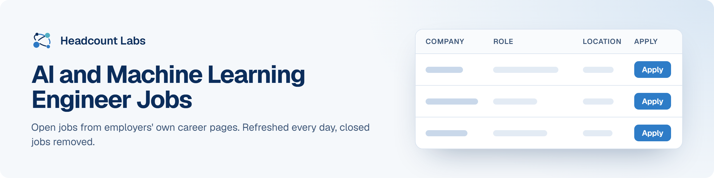

# AI and Machine Learning Engineer Jobs

AI engineer, machine learning engineer, applied scientist and LLM jobs at US employers.

**304 open jobs** · 52 new since the last update · 28 removed because they closed or left the employer's board · updated November 27, 2026 at 4:53 AM EST

This list is built and refreshed every day by [Headcount Labs](https://headcountlabs.com/?utm_source=github&utm_medium=job-list&utm_campaign=ai-ml-engineer-jobs), which reads jobs straight from employers' own career pages and job boards. Every job here was still listed on its source board when we last read that board, within the past 3 days, and was posted in the past 30 days. Copies of the same job are merged into one row, and jobs that close are removed at the next update.

Want this data in your own app or agent? Use the [Headcount Labs jobs API](https://headcountlabs.com/docs/?utm_source=github&utm_medium=job-list&utm_campaign=ai-ml-engineer-jobs) (free tier), the [MCP server](https://headcountlabs.com/mcp/?utm_source=github&utm_medium=job-list&utm_campaign=ai-ml-engineer-jobs) for Claude, ChatGPT and other AI assistants, or the [public dataset subsets](https://huggingface.co/HeadcountLabs) on Hugging Face (the full dataset is coming soon).

**Full dataset.** A bigger, one-off snapshot dated 2026-10-19 (all matching jobs, not only the open jobs below) is on Hugging Face: [Tech and software jobs](https://huggingface.co/datasets/HeadcountLabs/tech-jobs). It loads with `datasets.load_dataset` and is under the Open Database License (ODbL) 1.0.

**Jump to:** [Posted in the last 7 days (15)](#posted-in-the-last-7-days) · [Posted 8 to 30 days ago (289)](#posted-8-to-30-days-ago)

**Columns.** *Apply* opens the original posting on the employer's site. *Details* opens the job on Headcount Labs, with every posting we found for it. *Remote* shows what the employer states; a dash means the posting doesn't say. *Pay* is the range the employer published.

## Posted in the last 7 days

| Company | Role | Location | Remote | Pay | Posted | Apply | Details |
| --- | --- | --- | --- | --- | --- | :---: | :---: |
| **GXO Logistics** | Sr. AI Solutions Engineer | Greenwich, CT | — | — | Nov 27 |  | <a href="https://headcountlabs.com/catalog/jobs/154174c9-1632-40af-8c15-bd1e822ed44e?utm_source=github&utm_medium=job-list&utm_campaign=ai-ml-engineer-jobs">via Headcount Labs</a> |
| **Cyber B.A.T. Inc** | AI/ML Software Engineer, IS-02-0045 | Laurel, MD | — | — | Nov 24 |  | <a href="https://headcountlabs.com/catalog/jobs/055e001e-d0a7-4c0f-99be-3ae820bb864a?utm_source=github&utm_medium=job-list&utm_campaign=ai-ml-engineer-jobs">via Headcount Labs</a> |
| **Cisco** | Strategy &amp; Planning Manager - Enterprise AI Programs &amp; Governance , Hybrid | Research Triangle Park, NC | Hybrid | $128k–$192k/yr | Nov 24 |  | <a href="https://headcountlabs.com/catalog/jobs/6574df81-8e65-4be1-9f74-b950f92574eb?utm_source=github&utm_medium=job-list&utm_campaign=ai-ml-engineer-jobs">via Headcount Labs</a> |
| **Cisco** | AI Research Scientist II (Full Time) – United States | 

3 locations
San Francisco, CA Milpitas, CA San Jose, CA
 | Hybrid | $165k–$243k/yr | Nov 24 |  | <a href="https://headcountlabs.com/catalog/jobs/5d4fd967-ec6d-43dc-b6b3-0b7f42fc472f?utm_source=github&utm_medium=job-list&utm_campaign=ai-ml-engineer-jobs">via Headcount Labs</a> |
| **Weisiger Group** | Director, Business Intelligence &amp; AI Enablement | Charlotte, NC | — | — | Nov 23 |  | <a href="https://headcountlabs.com/catalog/jobs/5723130a-3e18-429b-8b20-b76e245338c2?utm_source=github&utm_medium=job-list&utm_campaign=ai-ml-engineer-jobs">via Headcount Labs</a> |
| **GXO Logistics** | Lead AI Application Security Engineer | North Carolina | Remote | — | Nov 21 |  | <a href="https://headcountlabs.com/catalog/jobs/2b20b558-b597-4c1e-99c0-c9d6183a7aca?utm_source=github&utm_medium=job-list&utm_campaign=ai-ml-engineer-jobs">via Headcount Labs</a> |
| **World Wide Technology** | Enterprise Transformation Program Manager - AI transformation Office | St. Louis, MO | — | $87k–$108k/yr | Nov 20 |  | <a href="https://headcountlabs.com/catalog/jobs/adbf7779-d220-48be-b5cf-8a90d21cb167?utm_source=github&utm_medium=job-list&utm_campaign=ai-ml-engineer-jobs">via Headcount Labs</a> |
| **World Wide Technology** | Analyst - AI Transformation Office | St. Louis, MO | — | $64k–$80k/yr | Nov 20 |  | <a href="https://headcountlabs.com/catalog/jobs/67fc8c98-0939-4b6c-80ed-98ceb0518435?utm_source=github&utm_medium=job-list&utm_campaign=ai-ml-engineer-jobs">via Headcount Labs</a> |
| **World Wide Technology** | Sr. Analyst - AI Transformation Office | St. Louis, MO | — | $84k–$104k/yr | Nov 20 |  | <a href="https://headcountlabs.com/catalog/jobs/c6431145-04d4-4ec4-ac3a-fd5561597a77?utm_source=github&utm_medium=job-list&utm_campaign=ai-ml-engineer-jobs">via Headcount Labs</a> |
| **World Wide Technology** | Security Solutions Principal - AI Architect (AI Factory) | Nationwide | — | $153k–$192k/yr | Nov 20 |  | <a href="https://headcountlabs.com/catalog/jobs/2d1efe2b-7def-46c2-b159-c12293a21f72?utm_source=github&utm_medium=job-list&utm_campaign=ai-ml-engineer-jobs">via Headcount Labs</a> |
| **Honeywell Aerospace** | AI Engineer II | Phoenix, AZ | — | — | Nov 20 |  | <a href="https://headcountlabs.com/catalog/jobs/934a38b4-809d-4876-b854-c3b4a1c48a3b?utm_source=github&utm_medium=job-list&utm_campaign=ai-ml-engineer-jobs">via Headcount Labs</a> |
| **Harvard University** | Postdoctoral Fellow, HBS AI Institute - Labor Economics, Organizations, and AI | Cambridge, MA | — | $75k/yr | Nov 20 |  | <a href="https://headcountlabs.com/catalog/jobs/a248e881-d9fd-484f-bdb8-10f88e0a8206?utm_source=github&utm_medium=job-list&utm_campaign=ai-ml-engineer-jobs">via Headcount Labs</a> |
| **G2** | Software Engineering Lead - Multimodal AI Products | United States | Remote | $250k–$300k/yr | Nov 20 |  | <a href="https://headcountlabs.com/catalog/jobs/c269cc3f-18a7-415b-8786-c8d3d62800e5?utm_source=github&utm_medium=job-list&utm_campaign=ai-ml-engineer-jobs">via Headcount Labs</a> |
| **Clera** | Senior Associate, Growth AI | San Francisco, CA | On-site | $150k–$175k/yr | Nov 20 |  | <a href="https://headcountlabs.com/catalog/jobs/5f62d748-0b7a-44c3-b17e-f34f063c8ae9?utm_source=github&utm_medium=job-list&utm_campaign=ai-ml-engineer-jobs">via Headcount Labs</a> |
| **Airbnb** | Product Manager, AI Trip Planning | San Francisco, CA | — | $232k–$282k/yr | Nov 20 |  | <a href="https://headcountlabs.com/catalog/jobs/11010a6e-8f63-4c85-9b4b-7a8c4b601e03?utm_source=github&utm_medium=job-list&utm_campaign=ai-ml-engineer-jobs">via Headcount Labs</a> |

## Posted 8 to 30 days ago

| Company | Role | Location | Remote | Pay | Posted | Apply | Details |
| --- | --- | --- | --- | --- | --- | :---: | :---: |
| **Veralto** | Director, Digital Program Management &amp; AI Enablement | Massachusetts | — | $210k–$240k/yr | Nov 19 |  | <a href="https://headcountlabs.com/catalog/jobs/7f0cefec-ed4c-48c4-bb44-3b30c8628269?utm_source=github&utm_medium=job-list&utm_campaign=ai-ml-engineer-jobs">via Headcount Labs</a> |
| **Oracle** | AI Data Platform Sales Representative, SLED - Houston/Dallas | United States | On-site | $77k–$123k/yr | Nov 19 |  | <a href="https://headcountlabs.com/catalog/jobs/7da01234-9f05-4695-ac6c-87079a84c374?utm_source=github&utm_medium=job-list&utm_campaign=ai-ml-engineer-jobs">via Headcount Labs</a> |
| **Netic** | Applied AI Engineer | San Francisco, CA | On-site | $145k–$330k/yr | Nov 19 |  | <a href="https://headcountlabs.com/catalog/jobs/25b25608-c53a-436b-9e67-3abd92988f7a?utm_source=github&utm_medium=job-list&utm_campaign=ai-ml-engineer-jobs">via Headcount Labs</a> |
| **Jobgether** | AI Infra System Engineering Team Lead | United States | Remote | — | Nov 19 |  | <a href="https://headcountlabs.com/catalog/jobs/ced2c22b-cbff-412a-91a6-b65019394b80?utm_source=github&utm_medium=job-list&utm_campaign=ai-ml-engineer-jobs">via Headcount Labs</a> |
| **Jobgether** | AI Enablement Manager | United States | Remote | $110k–$150k/yr | Nov 19 |  | <a href="https://headcountlabs.com/catalog/jobs/c21d34b0-69e1-4bfe-996a-2be127dcae0d?utm_source=github&utm_medium=job-list&utm_campaign=ai-ml-engineer-jobs">via Headcount Labs</a> |
| **Jobgether** | Microsoft 365 AI Security Engineer | United States | Remote | — | Nov 19 |  | <a href="https://headcountlabs.com/catalog/jobs/eaa47701-4cb2-476c-bc0b-1aa51caf0ba0?utm_source=github&utm_medium=job-list&utm_campaign=ai-ml-engineer-jobs">via Headcount Labs</a> |
| **Jobgether** | Manager, Analytics Engineering, Data &amp; AI Foundations | United States | Remote | — | Nov 19 |  | <a href="https://headcountlabs.com/catalog/jobs/92de5151-c2a1-418c-9cd7-6c1a0478b0f4?utm_source=github&utm_medium=job-list&utm_campaign=ai-ml-engineer-jobs">via Headcount Labs</a> |
| **Jobgether** | Competitive Data Scientist (Kaggle) - AI Training &amp; Evaluation | United States | Remote | $60–$120/hr | Nov 19 |  | <a href="https://headcountlabs.com/catalog/jobs/7b5ed393-c826-44c9-be89-fc36a4a3e47b?utm_source=github&utm_medium=job-list&utm_campaign=ai-ml-engineer-jobs">via Headcount Labs</a> |
| **Jobgether** | Senior Data &amp; AI Engineering Consultant | United States | Remote | — | Nov 19 |  | <a href="https://headcountlabs.com/catalog/jobs/32b04eea-d8d8-444c-9310-9aa463c9a919?utm_source=github&utm_medium=job-list&utm_campaign=ai-ml-engineer-jobs">via Headcount Labs</a> |
| **Extend** | Senior AI Software Engineer, AI Enablement | United States | Remote | $155k–$170k/yr | Nov 19 |  | <a href="https://headcountlabs.com/catalog/jobs/ebf8da42-f03a-4301-ae14-17c8e97f27c5?utm_source=github&utm_medium=job-list&utm_campaign=ai-ml-engineer-jobs">via Headcount Labs</a> |
| **Cordial Experience Inc.** | AI Go To Market Operations Manager | United States | Remote | $100k–$130k/yr | Nov 19 |  | <a href="https://headcountlabs.com/catalog/jobs/4d5ed5cc-36c5-495d-bd93-9346e9fa9001?utm_source=github&utm_medium=job-list&utm_campaign=ai-ml-engineer-jobs">via Headcount Labs</a> |
| **Clera** | Founding AI / Backend Engineer | New York, NY | Remote | $180k/yr | Nov 19 |  | <a href="https://headcountlabs.com/catalog/jobs/02649fd1-d431-43ce-826c-ab798e164153?utm_source=github&utm_medium=job-list&utm_campaign=ai-ml-engineer-jobs">via Headcount Labs</a> |
| **Ciklum** | Data &amp; AI Associate Director | United States | Remote | — | Nov 19 |  | <a href="https://headcountlabs.com/catalog/jobs/f545f58d-74e1-4667-a5b4-283d5e7c9d63?utm_source=github&utm_medium=job-list&utm_campaign=ai-ml-engineer-jobs">via Headcount Labs</a> |
| **CAIS** | Applied AI Engineer | New York, NY | Hybrid | $190k–$235k/yr | Nov 19 |  | <a href="https://headcountlabs.com/catalog/jobs/08c977f7-d0c9-478b-9b83-dcc980086af9?utm_source=github&utm_medium=job-list&utm_campaign=ai-ml-engineer-jobs">via Headcount Labs</a> |
| **Beacon Holdings** | Senior Security Engineer, AI Security | 

3 locations
New York, NY San Francisco, CA Toronto
 | On-site | — | Nov 19 |  | <a href="https://headcountlabs.com/catalog/jobs/1f22b07a-6af0-471b-9192-2cc3ae6d9d20?utm_source=github&utm_medium=job-list&utm_campaign=ai-ml-engineer-jobs">via Headcount Labs</a> |
| **Avathon** | Forward Deployed AI Scientist | Pleasanton, CA | — | $160k–$240k/yr | Nov 19 |  | <a href="https://headcountlabs.com/catalog/jobs/fabdbd20-526c-4687-810d-4441743edc3c?utm_source=github&utm_medium=job-list&utm_campaign=ai-ml-engineer-jobs">via Headcount Labs</a> |
| **Armada** | Senior Customer Engineer, AI-Factory | United States | Remote | $188k–$235k/yr | Nov 19 |  | <a href="https://headcountlabs.com/catalog/jobs/26d308ff-d46d-4133-b701-53150da8d79d?utm_source=github&utm_medium=job-list&utm_campaign=ai-ml-engineer-jobs">via Headcount Labs</a> |
| **Alaska Airlines** | Senior AI Learning Solutions Designer | WA-Renton | — | $87k/yr | Nov 19 |  | <a href="https://headcountlabs.com/catalog/jobs/be78ee7c-cf34-4fd2-80b0-6135365b71a2?utm_source=github&utm_medium=job-list&utm_campaign=ai-ml-engineer-jobs">via Headcount Labs</a> |
| **Airbnb** | Senior AI Development Lead | United States | — | $157k–$171k/yr | Nov 19 |  | <a href="https://headcountlabs.com/catalog/jobs/b47c7eb4-9117-44fa-a978-90795276f5f4?utm_source=github&utm_medium=job-list&utm_campaign=ai-ml-engineer-jobs">via Headcount Labs</a> |
| **World Wide Technology** | Security Solutions Principal - AI Security | Nationwide | Remote | $153k–$192k/yr | Nov 18 |  | <a href="https://headcountlabs.com/catalog/jobs/a15e29f0-ebf6-48ef-92c2-4f98a233db5b?utm_source=github&utm_medium=job-list&utm_campaign=ai-ml-engineer-jobs">via Headcount Labs</a> |
| **World Wide Technology** | AI Factory, Senior Technical Program Manager | San Francisco, CA | On-site | $210k–$230k/yr | Nov 18 |  | <a href="https://headcountlabs.com/catalog/jobs/91912a7e-9c89-4bf7-8807-4cde028784df?utm_source=github&utm_medium=job-list&utm_campaign=ai-ml-engineer-jobs">via Headcount Labs</a> |
| **Winfo Solutions** | Client Partner - Data &amp; AI | Dallas, TX | — | — | Nov 18 |  | <a href="https://headcountlabs.com/catalog/jobs/6017f71c-42f6-465d-8157-ac796e9f9bf5?utm_source=github&utm_medium=job-list&utm_campaign=ai-ml-engineer-jobs">via Headcount Labs</a> |
| **Winfo Solutions** | Databricks &amp; AI Consultant | Dallas, TX | — | $50–$80/hr | Nov 18 |  | <a href="https://headcountlabs.com/catalog/jobs/319a6098-9981-4ef4-8f73-f35faa55be2b?utm_source=github&utm_medium=job-list&utm_campaign=ai-ml-engineer-jobs">via Headcount Labs</a> |
| **Ventus Solutions** | AI Technology Program Analyst | Arlington, VA | On-site | $75k–$90k/yr | Nov 18 |  | <a href="https://headcountlabs.com/catalog/jobs/b94db96d-7c83-4f9f-ad2d-e426c76c2ff4?utm_source=github&utm_medium=job-list&utm_campaign=ai-ml-engineer-jobs">via Headcount Labs</a> |
| **System** | Senior Research Engineer, AI Evaluation | New York City | Remote | $180k–$240k/yr | Nov 18 |  | <a href="https://headcountlabs.com/catalog/jobs/e1493a3e-de84-4644-b9ee-45540175e183?utm_source=github&utm_medium=job-list&utm_campaign=ai-ml-engineer-jobs">via Headcount Labs</a> |
| **RWS TrainAI** | AI Data Specialist - Luxembourgish | 

4 locations
Brussels Paris Berlin United States
 | Remote | — | Nov 18 |  | <a href="https://headcountlabs.com/catalog/jobs/f2771a01-eda5-47f5-af5f-b089f03b69c3?utm_source=github&utm_medium=job-list&utm_campaign=ai-ml-engineer-jobs">via Headcount Labs</a> |
| **Nextdoor** | Senior Machine Learning Engineer - Search | 

2 locations
United States Dallas, TX
 | Remote | $195k–$276k/yr | Nov 18 |  | <a href="https://headcountlabs.com/catalog/jobs/d6d249ff-44e3-4f19-846b-45c1fb8739e3?utm_source=github&utm_medium=job-list&utm_campaign=ai-ml-engineer-jobs">via Headcount Labs</a> |
| **Navan** | AI Forward Engineer | 

2 locations
Palo Alto, CA New York, NY
 | — | $113k–$252k/yr | Nov 18 |  | <a href="https://headcountlabs.com/catalog/jobs/90440da2-1333-4ba6-9243-97c4798219c0?utm_source=github&utm_medium=job-list&utm_campaign=ai-ml-engineer-jobs">via Headcount Labs</a> |
| **Nash** | AI Brand Design Lead | United States | Remote | $140k–$175k/yr | Nov 18 |  | <a href="https://headcountlabs.com/catalog/jobs/b19d5ef3-89ee-4081-bf51-d1eb2f19850f?utm_source=github&utm_medium=job-list&utm_campaign=ai-ml-engineer-jobs">via Headcount Labs</a> |
| **Hyatt Corporation** | Senior Machine Learning Engineer (Chicago) | Chicago, IL | — | $150k–$180k/yr | Nov 18 |  | <a href="https://headcountlabs.com/catalog/jobs/5856db93-e6cb-4b5d-b9d1-b694eddae63f?utm_source=github&utm_medium=job-list&utm_campaign=ai-ml-engineer-jobs">via Headcount Labs</a> |
| **Govcio LLC** | ServiceNow Architect (AI + CSDM + Automation) | 

2 locations
Arlington, VA Fairfax, VA
 | Hybrid | $151k–$235k/yr | Nov 18 |  | <a href="https://headcountlabs.com/catalog/jobs/e3a6ba94-959c-49a6-8d37-054e9971116b?utm_source=github&utm_medium=job-list&utm_campaign=ai-ml-engineer-jobs">via Headcount Labs</a> |
| **FM** | AI Security Architect | Johnston, RI | On-site | $138k–$198k/yr | Nov 18 |  | <a href="https://headcountlabs.com/catalog/jobs/e9aafd30-7864-4045-a2b8-f10922649cd7?utm_source=github&utm_medium=job-list&utm_campaign=ai-ml-engineer-jobs">via Headcount Labs</a> |
| **FloQast** | Senior Machine Learning Engineer | San Jose, CA | Hybrid | $196k–$235k/yr | Nov 18 |  | <a href="https://headcountlabs.com/catalog/jobs/86c677ed-d7a7-4815-b1f4-4e1db37b601b?utm_source=github&utm_medium=job-list&utm_campaign=ai-ml-engineer-jobs">via Headcount Labs</a> |
| **FloQast** | Staff Applied AI Engineer | San Jose, CA | Hybrid | $230k–$270k/yr | Nov 18 |  | <a href="https://headcountlabs.com/catalog/jobs/b2be7bca-9f01-4834-9ea4-7638b73bd733?utm_source=github&utm_medium=job-list&utm_campaign=ai-ml-engineer-jobs">via Headcount Labs</a> |
| **Deepgram** | People AI Operations Specialist | 

4 locations
United States San Francisco, CA Ann Arbor, MI New York City, NY
 | Remote | $123k–$150k/yr | Nov 18 |  | <a href="https://headcountlabs.com/catalog/jobs/3066d507-8e43-4c8b-ab34-890b2d52132d?utm_source=github&utm_medium=job-list&utm_campaign=ai-ml-engineer-jobs">via Headcount Labs</a> |
| **Constellation Energy Generation, LLC.** | Drexel Co-op (Spring/Summer 2027) - AI Analyst - Baltimore, MD | Baltimore, MD | — | — | Nov 18 |  | <a href="https://headcountlabs.com/catalog/jobs/4c14e8fa-0722-40c7-95fd-c4f676dea16a?utm_source=github&utm_medium=job-list&utm_campaign=ai-ml-engineer-jobs">via Headcount Labs</a> |
| **COGNIZANT TECH SOLUTIONS A** | AI &amp; Analytics (AI&amp;A) | United States | On-site | $60k–$65k/yr | Nov 18 |  | <a href="https://headcountlabs.com/catalog/jobs/cacf2acb-1c97-4662-8fc9-abf5cbcad8ef?utm_source=github&utm_medium=job-list&utm_campaign=ai-ml-engineer-jobs">via Headcount Labs</a> |
| **COGNIZANT TECH SOLUTIONS A** | Delivery Lead - Agentic AI Platform | Juno Beach, FL | On-site | $88k–$161k/yr | Nov 18 |  | <a href="https://headcountlabs.com/catalog/jobs/38095724-5dd6-429a-97d4-20732d605b4a?utm_source=github&utm_medium=job-list&utm_campaign=ai-ml-engineer-jobs">via Headcount Labs</a> |
| **Cinter Career** | AI Scientist / Engineer (Data Science &amp; Analytics) | Plano, TX | On-site | — | Nov 18 |  | <a href="https://headcountlabs.com/catalog/jobs/f9ec03f8-1f4d-4900-a73c-6ca9bb8341b2?utm_source=github&utm_medium=job-list&utm_campaign=ai-ml-engineer-jobs">via Headcount Labs</a> |
| **Anthropic** | Applied AI Engineer, Commercial | San Francisco, CA | — | $280k–$320k/yr | Nov 18 |  | <a href="https://headcountlabs.com/catalog/jobs/b85d685e-5fd8-453f-be3c-804d6990eb43?utm_source=github&utm_medium=job-list&utm_campaign=ai-ml-engineer-jobs">via Headcount Labs</a> |
| **Abridge** | Member of Technical Staff, Machine Learning | United States | Hybrid | $205k–$300k/yr | Nov 18 |  | <a href="https://headcountlabs.com/catalog/jobs/b4ad1d65-0e9f-47a1-9f8b-8723387ddfe9?utm_source=github&utm_medium=job-list&utm_campaign=ai-ml-engineer-jobs">via Headcount Labs</a> |
| **2K** | Senior AI Tools Engineer | San Mateo, CA | Hybrid | $113k–$167k/yr | Nov 18 |  | <a href="https://headcountlabs.com/catalog/jobs/9dda2e89-ea9c-4905-bd59-166adcb12600?utm_source=github&utm_medium=job-list&utm_campaign=ai-ml-engineer-jobs">via Headcount Labs</a> |
| **vCluster Labs** | Staff Product Manager (AI Workloads) | 

2 locations
EMEA United States
 | Remote | $170k–$210k/yr | Nov 17 |  | <a href="https://headcountlabs.com/catalog/jobs/9039cccf-219a-42e2-a535-588537ec6799?utm_source=github&utm_medium=job-list&utm_campaign=ai-ml-engineer-jobs">via Headcount Labs</a> |
| **Ulta Beauty, Inc.** | Architect, AI Architecture | Bolingbrook, IL | — | $103k–$160k/yr | Nov 17 |  | <a href="https://headcountlabs.com/catalog/jobs/22bdda04-300e-466f-ad27-78ebf48f5c61?utm_source=github&utm_medium=job-list&utm_campaign=ai-ml-engineer-jobs">via Headcount Labs</a> |
| **UiPath** | Senior Applied Scientist | Bellevue, WA | On-site | $200k–$250k/yr | Nov 17 |  | <a href="https://headcountlabs.com/catalog/jobs/3024a021-2aaf-44b8-8903-083024a5beb5?utm_source=github&utm_medium=job-list&utm_campaign=ai-ml-engineer-jobs">via Headcount Labs</a> |
| **Striveworks** | Senior Machine Learning Engineer, Maritime Systems (Secret Clearance Eligible) | or Austin, TX | Remote | $160k–$200k/yr | Nov 17 |  | <a href="https://headcountlabs.com/catalog/jobs/47aa1c4e-5667-4c43-a998-abd14a33b7f0?utm_source=github&utm_medium=job-list&utm_campaign=ai-ml-engineer-jobs">via Headcount Labs</a> |
| **Samsara** | Director, AI Product Management (GTM) | United States | Remote | $157k–$280k/yr | Nov 17 |  | <a href="https://headcountlabs.com/catalog/jobs/585d1e1f-a220-471c-bf4b-d190bc64edd0?utm_source=github&utm_medium=job-list&utm_campaign=ai-ml-engineer-jobs">via Headcount Labs</a> |
| **Rockefeller Capital Management** | AI Cybersecurity Lead | New York, NY | — | $175k–$225k/yr | Nov 17 |  | <a href="https://headcountlabs.com/catalog/jobs/1a8bdd9d-83ba-4e2c-9df9-74ea9dd43f99?utm_source=github&utm_medium=job-list&utm_campaign=ai-ml-engineer-jobs">via Headcount Labs</a> |
| **Ramp** | Software Engineer, Backend, AI Ventures | New York | Hybrid | $204k–$330k/yr | Nov 17 |  | <a href="https://headcountlabs.com/catalog/jobs/61a2df57-876c-4fd4-b691-dfb12a5a6547?utm_source=github&utm_medium=job-list&utm_campaign=ai-ml-engineer-jobs">via Headcount Labs</a> |
| **Point72** | Machine Learning Infrastructure Engineer, Technology | New York, NY | — | $180k–$300k/yr | Nov 17 |  | <a href="https://headcountlabs.com/catalog/jobs/837807c8-8615-4b65-8b28-839cff9555ac?utm_source=github&utm_medium=job-list&utm_campaign=ai-ml-engineer-jobs">via Headcount Labs</a> |
| **Plaid** | Senior Machine Learning Engineer - Fraud | 

3 locations
New York City Seattle, WA San Francisco, CA
 | Hybrid | $229k–$315k/yr | Nov 17 |  | <a href="https://headcountlabs.com/catalog/jobs/ec268ba4-2383-4bbf-b61d-64bd6fc61a7e?utm_source=github&utm_medium=job-list&utm_campaign=ai-ml-engineer-jobs">via Headcount Labs</a> |
| **Plaid** | Staff Machine Learning Engineer (Research Scientist) - Fraud | 

3 locations
New York City Seattle, WA San Francisco, CA
 | Hybrid | $249k–$368k/yr | Nov 17 |  | <a href="https://headcountlabs.com/catalog/jobs/550ff786-86db-41b2-813b-26c0296c1ad7?utm_source=github&utm_medium=job-list&utm_campaign=ai-ml-engineer-jobs">via Headcount Labs</a> |
| **Plaid** | Staff Machine Learning Engineer - Fraud | 

3 locations
San Francisco, CA Seattle, WA New York City
 | Hybrid | $249k–$368k/yr | Nov 17 |  | <a href="https://headcountlabs.com/catalog/jobs/d13a2830-3c9f-4481-b847-677870330804?utm_source=github&utm_medium=job-list&utm_campaign=ai-ml-engineer-jobs">via Headcount Labs</a> |
| **Pennymac** | AI Product Owner | 

2 locations
Westlake Village, CA Cary, NC
 | — | $75k–$130k/yr | Nov 17 |  | <a href="https://headcountlabs.com/catalog/jobs/293a7812-68ed-431c-bd02-e5a30333a97f?utm_source=github&utm_medium=job-list&utm_campaign=ai-ml-engineer-jobs">via Headcount Labs</a> |
| **Mitek Systems** | Senior Product Manager – Machine Learning (Biometrics &amp; Document Intelligence) | United States | Remote | $140k–$185k/yr | Nov 17 |  | <a href="https://headcountlabs.com/catalog/jobs/be6c5fd4-a39d-40c9-a67e-a6392169765a?utm_source=github&utm_medium=job-list&utm_campaign=ai-ml-engineer-jobs">via Headcount Labs</a> |
| **Lavendo** | Senior Product Manager, Agentic Banking AI (SF, On-site) | San Francisco, CA | On-site | $180k–$210k/yr | Nov 17 |  | <a href="https://headcountlabs.com/catalog/jobs/b4410f34-78e8-489b-aac7-c03a29157943?utm_source=github&utm_medium=job-list&utm_campaign=ai-ml-engineer-jobs">via Headcount Labs</a> |
| **Internet Brands** | AI Technical Project Manager | El Segundo, CA | — | — | Nov 17 |  | <a href="https://headcountlabs.com/catalog/jobs/ca42e5e7-b8d3-48c6-b9f7-c287c32a1b36?utm_source=github&utm_medium=job-list&utm_campaign=ai-ml-engineer-jobs">via Headcount Labs</a> |
| **HSO Group B.V.** | (Senior) AI Engineer (m/w/d) – bundesweit | Böblingen, DE | — | — | Nov 17 |  | <a href="https://headcountlabs.com/catalog/jobs/9df82f3a-7e64-4c88-abdb-6fc7a7e53d08?utm_source=github&utm_medium=job-list&utm_campaign=ai-ml-engineer-jobs">via Headcount Labs</a> |
| **Fitch Group** | Enterprise AI and Productivity Engineer | New York, NY | — | $140k–$150k/yr | Nov 17 |  | <a href="https://headcountlabs.com/catalog/jobs/a6d1ea3c-c7fc-45e3-a49f-8335113b5dce?utm_source=github&utm_medium=job-list&utm_campaign=ai-ml-engineer-jobs">via Headcount Labs</a> |
| **Firecrawl** | Platform Partnerships Lead, AI Labs &amp; Agents | San Francisco, CA | Hybrid | $222k–$240k/yr | Nov 17 |  | <a href="https://headcountlabs.com/catalog/jobs/fa343d14-d2dc-4b1a-9b73-0baf0a9d90ca?utm_source=github&utm_medium=job-list&utm_campaign=ai-ml-engineer-jobs">via Headcount Labs</a> |
| **Figma** | Technical Program Manager, AI | New York, NY • United States | — | $185k–$269k/yr | Nov 17 |  | <a href="https://headcountlabs.com/catalog/jobs/5cd4a07d-9615-450d-93aa-72bea95abbd3?utm_source=github&utm_medium=job-list&utm_campaign=ai-ml-engineer-jobs">via Headcount Labs</a> |
| **Esri** | Sr. Software Engineer – Generative AI &amp; Assistants, ArcGIS Pro | Redlands, CA | On-site | $123k–$202k/yr | Nov 17 |  | <a href="https://headcountlabs.com/catalog/jobs/b536b81a-66cd-41af-9aea-bd5baef3ff87?utm_source=github&utm_medium=job-list&utm_campaign=ai-ml-engineer-jobs">via Headcount Labs</a> |
| **Ellucian** | Senior Product Counsel, AI &amp; Data &#124; Hybrid &#124; Reston, VA | 

2 locations
Reston, VA Washington, WA
 | Hybrid | — | Nov 17 |  | <a href="https://headcountlabs.com/catalog/jobs/7877c62c-18cd-4c34-be72-d5f452350171?utm_source=github&utm_medium=job-list&utm_campaign=ai-ml-engineer-jobs">via Headcount Labs</a> |
| **Edison Scientific** | Forward Deployed AI Engineer | 

3 locations
San Francisco, CA New York, NY Boston, MA
 | On-site | $200k–$300k/yr | Nov 17 |  | <a href="https://headcountlabs.com/catalog/jobs/f1b0904f-a88b-44f5-8002-df2f28f3ddcf?utm_source=github&utm_medium=job-list&utm_campaign=ai-ml-engineer-jobs">via Headcount Labs</a> |
| **COGNIZANT TECH SOLUTIONS A** | Solution Architect – Agentic AI | Louisville, KY | Remote | $116k–$180k/yr | Nov 17 |  | <a href="https://headcountlabs.com/catalog/jobs/ee256e96-967a-477b-9912-7e2355d99807?utm_source=github&utm_medium=job-list&utm_campaign=ai-ml-engineer-jobs">via Headcount Labs</a> |
| **COGNIZANT TECH SOLUTIONS A** | Consulting Principal - AI Architecture | Atlanta, GA | Hybrid | $122k–$224k/yr | Nov 17 |  | <a href="https://headcountlabs.com/catalog/jobs/cb85a6af-eae1-4c46-b1cf-8419c87e32c4?utm_source=github&utm_medium=job-list&utm_campaign=ai-ml-engineer-jobs">via Headcount Labs</a> |
| **COGNIZANT TECH SOLUTIONS A** | Partner Consulting, AI | New Jersey, NJ | Remote | $162k–$296k/yr | Nov 17 |  | <a href="https://headcountlabs.com/catalog/jobs/bfc8bb66-4686-4197-9904-37fdc8c2bf5b?utm_source=github&utm_medium=job-list&utm_campaign=ai-ml-engineer-jobs">via Headcount Labs</a> |
| **COGNIZANT TECH SOLUTIONS A** | Senior Azure AI Engineer (.NET &amp; OpenAI) | Texas City, TX | Remote | $70k–$117k/yr | Nov 17 |  | <a href="https://headcountlabs.com/catalog/jobs/a01ea445-3b5c-4239-8475-fb85e59090d4?utm_source=github&utm_medium=job-list&utm_campaign=ai-ml-engineer-jobs">via Headcount Labs</a> |
| **COGNIZANT TECH SOLUTIONS A** | Senior Consulting Manager - AI Architecture &amp; Engineering | 

2 locations
Atlanta, GA GA-Peachtree St NE, GA
 | Hybrid | $99k–$182k/yr | Nov 17 |  | <a href="https://headcountlabs.com/catalog/jobs/6aa29a0b-86f9-40e5-9f97-13499aae7167?utm_source=github&utm_medium=job-list&utm_campaign=ai-ml-engineer-jobs">via Headcount Labs</a> |
| **COGNIZANT TECH SOLUTIONS A** | Sr. AI Review Consultant /Analyst (Remote) | Des Moines, IA | Remote | $100k–$155k/yr | Nov 17 |  | <a href="https://headcountlabs.com/catalog/jobs/509e7b17-e06d-4ae6-b6ee-69c1f3e52d33?utm_source=github&utm_medium=job-list&utm_campaign=ai-ml-engineer-jobs">via Headcount Labs</a> |
| **Coalition, Inc.** | Embedded AI Builder | Any location | — | — | Nov 17 |  | <a href="https://headcountlabs.com/catalog/jobs/ce4cb87a-e50e-412a-bae7-a434ea4c5df1?utm_source=github&utm_medium=job-list&utm_campaign=ai-ml-engineer-jobs">via Headcount Labs</a> |
| **Clearview Federal Credit Union** | Principal AI Strategist | Moon Township, PA | — | — | Nov 17 |  | <a href="https://headcountlabs.com/catalog/jobs/91adb8e4-a835-42b6-a41f-1ccd9b21d2f0?utm_source=github&utm_medium=job-list&utm_campaign=ai-ml-engineer-jobs">via Headcount Labs</a> |
| **Axway Software SA** | Head of Product Marketing (AI Gateway) | United States | Remote | — | Nov 17 |  | <a href="https://headcountlabs.com/catalog/jobs/1d8ed319-9690-4f4a-b21e-66016d3451c4?utm_source=github&utm_medium=job-list&utm_campaign=ai-ml-engineer-jobs">via Headcount Labs</a> |
| **Autodesk** | Principal Perception and AI Engineer | San Francisco, CA | — | $176k–$315k/yr | Nov 17 |  | <a href="https://headcountlabs.com/catalog/jobs/d873325f-2e72-47fc-86ff-b57b2eca9ec6?utm_source=github&utm_medium=job-list&utm_campaign=ai-ml-engineer-jobs">via Headcount Labs</a> |
| **AppDirect** | Account Executive, Devs.ai | 

3 locations
Calgary Montreal United States
 | Hybrid | — | Nov 17 |  | <a href="https://headcountlabs.com/catalog/jobs/ad515e0f-c9d2-4d4c-b699-d7d4abb6f509?utm_source=github&utm_medium=job-list&utm_campaign=ai-ml-engineer-jobs">via Headcount Labs</a> |
| **Anduril Industries** | 2027 Machine Learning Engineer Intern | Santa Ana, CA | — | $42–$60/hr | Nov 17 |  | <a href="https://headcountlabs.com/catalog/jobs/9293b056-2719-4c5b-bf17-a274dda6cfa1?utm_source=github&utm_medium=job-list&utm_campaign=ai-ml-engineer-jobs">via Headcount Labs</a> |
| **Alaska Airlines** | AI Manager | WA-SeaTac | — | $150k–$224k/yr | Nov 17 |  | <a href="https://headcountlabs.com/catalog/jobs/f7290c8d-f228-43e2-86c3-1fe0f4d50ed2?utm_source=github&utm_medium=job-list&utm_campaign=ai-ml-engineer-jobs">via Headcount Labs</a> |
| **Airbnb** | Engineering Manager, External Search &amp; AI Optimization | United States | Remote | $212k–$265k/yr | Nov 17 |  | <a href="https://headcountlabs.com/catalog/jobs/5b536272-89de-4de5-9b02-8334ec76b744?utm_source=github&utm_medium=job-list&utm_campaign=ai-ml-engineer-jobs">via Headcount Labs</a> |
| **Abby Care** | Applied AI, Tech Lead Manager | San Francisco, CA | Hybrid | — | Nov 17 |  | <a href="https://headcountlabs.com/catalog/jobs/a8c24c26-10ce-46f3-bdb1-1bb8b70433d3?utm_source=github&utm_medium=job-list&utm_campaign=ai-ml-engineer-jobs">via Headcount Labs</a> |
| **2A** | Senior partner marketing manager, cloud marketplace – AI technology company | Seattle, WA | Remote | $135k–$170k/yr | Nov 17 |  | <a href="https://headcountlabs.com/catalog/jobs/fa4caef1-301d-4c5e-a12f-0d8ffbaf74b9?utm_source=github&utm_medium=job-list&utm_campaign=ai-ml-engineer-jobs">via Headcount Labs</a> |
| **UDig** | Principal Consultant, AI Engineering | Nashville, VA | Hybrid | $168k–$195k/yr | Nov 16 |  | <a href="https://headcountlabs.com/catalog/jobs/78fd1fee-76dd-4dc0-b0ae-24ab67383c3d?utm_source=github&utm_medium=job-list&utm_campaign=ai-ml-engineer-jobs">via Headcount Labs</a> |
| **THE PG&amp;E CORPORATION FOUNDATION** | Data Scientist, Senior - Substation AI &amp; Asset Intelligence | Oakland | Hybrid | — | Nov 16 |  | <a href="https://headcountlabs.com/catalog/jobs/a5591688-b906-43eb-b3cf-e0e3a5e9193a?utm_source=github&utm_medium=job-list&utm_campaign=ai-ml-engineer-jobs">via Headcount Labs</a> |
| **THE PG&amp;E CORPORATION FOUNDATION** | Data Engineer, Senior - Substation Data &amp; AI Solutions | Oakland | Hybrid | — | Nov 16 |  | <a href="https://headcountlabs.com/catalog/jobs/8204ab93-ef51-4a1d-8711-30e44f68933e?utm_source=github&utm_medium=job-list&utm_campaign=ai-ml-engineer-jobs">via Headcount Labs</a> |
| **StackAdapt** | Staff Applied Machine Learning Scientist (Identity) | United States | Remote | — | Nov 16 |  | <a href="https://headcountlabs.com/catalog/jobs/f5eccd01-13af-4d47-b24f-6a7ad0cb03bc?utm_source=github&utm_medium=job-list&utm_campaign=ai-ml-engineer-jobs">via Headcount Labs</a> |
| **Snowflake** | Staff Software Engineer, Cortex AI Functions | 

2 locations
US-WA-Bellevue US-CA-Menlo Park
 | — | $236k–$339k/yr | Nov 16 |  | <a href="https://headcountlabs.com/catalog/jobs/084debad-8f14-43d3-82d7-e044592a2b8c?utm_source=github&utm_medium=job-list&utm_campaign=ai-ml-engineer-jobs">via Headcount Labs</a> |
| **Silna Health** | AI Deployment Analyst | United States | — | $120k–$160k/yr | Nov 16 |  | <a href="https://headcountlabs.com/catalog/jobs/bfad093e-01c5-4fff-88b7-b5bf00fdaf43?utm_source=github&utm_medium=job-list&utm_campaign=ai-ml-engineer-jobs">via Headcount Labs</a> |
| **SAP IT Business Systeme** | Solution Advisor - CX - Public Services - AI Expertise | 

7 locations
Houston, TX Reston, VA Boston, MA Tempe, AZ Miami, FL Washington, DC New York, NY
 | Hybrid | $137k–$294k/yr | Nov 16 |  | <a href="https://headcountlabs.com/catalog/jobs/666960cd-e077-417c-a82e-b55d45ac8246?utm_source=github&utm_medium=job-list&utm_campaign=ai-ml-engineer-jobs">via Headcount Labs</a> |
| **SAP IT Business Systeme** | Solution Advisor - CX - AI Expertise | 

7 locations
Newtown Square, PA Atlanta, GA Chicago, IL Bellevue, WA New York, NY Houston, TX San Ramon, CA
 | Hybrid | $137k–$294k/yr | Nov 16 |  | <a href="https://headcountlabs.com/catalog/jobs/cbfe6ea6-e9de-4bea-8840-ddd18f87c903?utm_source=github&utm_medium=job-list&utm_campaign=ai-ml-engineer-jobs">via Headcount Labs</a> |
| **SAP IT Business Systeme** | Solution Advisor - BAIP Public Services - AI Expertise | 

6 locations
New York, NY Tempe, AZ Boston, MA Reston, VA Houston, TX Miami, FL
 | Hybrid | $137k–$294k/yr | Nov 16 |  | <a href="https://headcountlabs.com/catalog/jobs/bd8a11ff-d827-4e25-8533-214c5b1b99e4?utm_source=github&utm_medium=job-list&utm_campaign=ai-ml-engineer-jobs">via Headcount Labs</a> |
| **SAP IT Business Systeme** | Global Account Executive - AI Expertise | 

6 locations
Miami, FL Burlington, MA New York, NY Houston, TX Newtown Square, PA Washington, DC
 | Hybrid | $256k–$529k/yr | Nov 16 |  | <a href="https://headcountlabs.com/catalog/jobs/f78844ac-b9d1-403d-b498-937ba9888eb2?utm_source=github&utm_medium=job-list&utm_campaign=ai-ml-engineer-jobs">via Headcount Labs</a> |
| **SAP IT Business Systeme** | Solution Sales Executive - HCM - AI Expertise | 

7 locations
New York, NY Atlanta, GA Chicago, IL San Ramon, CA Houston, TX Bellevue, WA Newtown Square, PA
 | Hybrid | — | Nov 16 |  | <a href="https://headcountlabs.com/catalog/jobs/f6155f3b-78af-40ec-9161-2d111fc4ef03?utm_source=github&utm_medium=job-list&utm_campaign=ai-ml-engineer-jobs">via Headcount Labs</a> |
| **SAP IT Business Systeme** | Solution Advisor - HCM Public Services - AI Expertise | 

7 locations
Boston, MA Reston, VA Houston, TX New York, NY Tempe, AZ Washington, DC Miami, FL
 | Hybrid | $137k–$294k/yr | Nov 16 |  | <a href="https://headcountlabs.com/catalog/jobs/e56489a6-8ab0-49cb-8aab-e80475074478?utm_source=github&utm_medium=job-list&utm_campaign=ai-ml-engineer-jobs">via Headcount Labs</a> |
| **SAP IT Business Systeme** | Solution Advisor - Finance &amp; Spend - AI Expertise | 

7 locations
Houston, TX Washington, DC Reston, VA Miami, FL Boston, MA Tempe, AZ New York, NY
 | Hybrid | — | Nov 16 |  | <a href="https://headcountlabs.com/catalog/jobs/40c0d988-9208-43b1-8ca8-b231a00d036f?utm_source=github&utm_medium=job-list&utm_campaign=ai-ml-engineer-jobs">via Headcount Labs</a> |
| **SAP IT Business Systeme** | Solution Advisor Specialist - AI Expertise | 

6 locations
Tempe, AZ Alpharetta, GA Burlington, MA Newtown Square, PA New York, NY Indianapolis, IN
 | Hybrid | $92k–$206k/yr | Nov 16 |  | <a href="https://headcountlabs.com/catalog/jobs/2dee38d2-cc35-4b44-9346-8b2af6a7e639?utm_source=github&utm_medium=job-list&utm_campaign=ai-ml-engineer-jobs">via Headcount Labs</a> |
| **RWS TrainAI** | AI Voice Recording Contributor - Mandarin Chinese (Hong Kong) | 

7 locations
New York City, NY San Francisco, CA Los Angeles, CA San Jose, CA Seattle, WA Bellevue, WA Boston, MA
 | Remote | — | Nov 16 |  | <a href="https://headcountlabs.com/catalog/jobs/c4430191-7bf7-4cd5-81cc-d4f4d2fdec67?utm_source=github&utm_medium=job-list&utm_campaign=ai-ml-engineer-jobs">via Headcount Labs</a> |
| **RWS TrainAI** | AI Voice Recording Contributor - Mandarin Chinese (Singapore) | 

7 locations
San Francisco, CA San Jose, CA Mountain View, CA Palo Alto, CA Seattle, WA Bellevue, WA New York City, NY
 | Remote | — | Nov 16 |  | <a href="https://headcountlabs.com/catalog/jobs/17070f86-0960-4839-a8c6-47b7fc490085?utm_source=github&utm_medium=job-list&utm_campaign=ai-ml-engineer-jobs">via Headcount Labs</a> |
| **Perficient** | Lead AI Engineer | DALLAS, TX | Hybrid | $134k–$171k/yr | Nov 16 |  | <a href="https://headcountlabs.com/catalog/jobs/d107341b-167b-4580-975e-5d0f48003402?utm_source=github&utm_medium=job-list&utm_campaign=ai-ml-engineer-jobs">via Headcount Labs</a> |
| **Paychex** | Data Analytics &amp; AI Sales Executive | May reside in any Paychex location | — | $126k–$234k/yr | Nov 16 |  | <a href="https://headcountlabs.com/catalog/jobs/1179c52b-0867-45ff-b1ee-c2e1c670923b?utm_source=github&utm_medium=job-list&utm_campaign=ai-ml-engineer-jobs">via Headcount Labs</a> |
| **Metropolis** | Staff Machine Learning Engineer, Growth | Seattle, WA | — | $220k–$260k/yr | Nov 16 |  | <a href="https://headcountlabs.com/catalog/jobs/defbc861-bf2b-410d-b9ab-2ba7e1d759c6?utm_source=github&utm_medium=job-list&utm_campaign=ai-ml-engineer-jobs">via Headcount Labs</a> |
| **Defense Unicorns** | Agentic AI Engineer | Springfield, VA | — | $149k–$201k/yr | Nov 16 |  | <a href="https://headcountlabs.com/catalog/jobs/b596f9a1-9170-47c3-94af-12d8e299920f?utm_source=github&utm_medium=job-list&utm_campaign=ai-ml-engineer-jobs">via Headcount Labs</a> |
| **Concurrence** | Research Engineer, Voice AI [NYC or SF] | 

2 locations
New York City, NY San Francisco, CA
 | On-site | $220k–$300k/yr | Nov 16 |  | <a href="https://headcountlabs.com/catalog/jobs/649c6ead-59f2-4bea-b043-f4c423f224f3?utm_source=github&utm_medium=job-list&utm_campaign=ai-ml-engineer-jobs">via Headcount Labs</a> |
| **bioMérieux** | Machine Learning Co-Op | Durham, NC | — | — | Nov 16 |  | <a href="https://headcountlabs.com/catalog/jobs/bf213836-a863-45c5-bd0b-34ac5697311f?utm_source=github&utm_medium=job-list&utm_campaign=ai-ml-engineer-jobs">via Headcount Labs</a> |
| **AstraZeneca** | Finance AI &amp; Data Analytics Intern, Undergraduate - LIFT Program | Wilmington, DE | — | — | Nov 16 |  | <a href="https://headcountlabs.com/catalog/jobs/70824768-8fb6-4d7f-bfdb-5ee1cb004255?utm_source=github&utm_medium=job-list&utm_campaign=ai-ml-engineer-jobs">via Headcount Labs</a> |
| **Assort Health** | Senior Product Manager, AI Agents | San Francisco, CA | Hybrid | $190k–$230k/yr | Nov 16 |  | <a href="https://headcountlabs.com/catalog/jobs/95e45498-01d5-42d3-b350-3562c8249916?utm_source=github&utm_medium=job-list&utm_campaign=ai-ml-engineer-jobs">via Headcount Labs</a> |
| **Assort Health** | Product Manager, AI Agents | San Francisco, CA | Hybrid | $150k–$190k/yr | Nov 16 |  | <a href="https://headcountlabs.com/catalog/jobs/21f77ff6-f60e-46e3-be58-87ca3f8a9db7?utm_source=github&utm_medium=job-list&utm_campaign=ai-ml-engineer-jobs">via Headcount Labs</a> |
| **Anthropic** | Applied AI Architect, Beneficial Deployments (Non-Profits) | San Francisco, NY | — | $240k–$315k/yr | Nov 16 |  | <a href="https://headcountlabs.com/catalog/jobs/c674bb4e-b8e1-42b3-aa7e-948b9b276931?utm_source=github&utm_medium=job-list&utm_campaign=ai-ml-engineer-jobs">via Headcount Labs</a> |
| **Airbnb** | Engineering Manager, Machine Learning | San Francisco, CA | — | $220k–$265k/yr | Nov 16 |  | <a href="https://headcountlabs.com/catalog/jobs/0342555a-c3ae-4a8f-87fd-2fd5512e24ef?utm_source=github&utm_medium=job-list&utm_campaign=ai-ml-engineer-jobs">via Headcount Labs</a> |
| **3E** | Technical Project Manager (AI) | 

4 locations
Bethesda, MD Washington DC Metro Area Canton, OH Charlottesville, VA
 | Hybrid | $90k–$105k/yr | Nov 16 |  | <a href="https://headcountlabs.com/catalog/jobs/fa02772f-78c8-4896-a272-eb19e185c482?utm_source=github&utm_medium=job-list&utm_campaign=ai-ml-engineer-jobs">via Headcount Labs</a> |
| **Clay Labs** | Machine Learning Engineer | San Francisco, CA | Hybrid | $170k–$300k/yr | Nov 14 |  | <a href="https://headcountlabs.com/catalog/jobs/d18a04e2-7291-4c2b-9e1d-3c6b73e19618?utm_source=github&utm_medium=job-list&utm_campaign=ai-ml-engineer-jobs">via Headcount Labs</a> |
| **Trilogy Federal** | AI/ML Engineer | Arlington, VA | Remote | $100k–$115k/yr | Nov 13 |  | <a href="https://headcountlabs.com/catalog/jobs/97b74cc4-087c-40a4-9355-6fc8d7e4095e?utm_source=github&utm_medium=job-list&utm_campaign=ai-ml-engineer-jobs">via Headcount Labs</a> |
| **SimSpace Corporation** | Staff Software Engineer – AI-Native Development | United States | Remote | $185k–$260k/yr | Nov 13 |  | <a href="https://headcountlabs.com/catalog/jobs/2e975aac-2e12-4939-a5ec-c2f465d23620?utm_source=github&utm_medium=job-list&utm_campaign=ai-ml-engineer-jobs">via Headcount Labs</a> |
| **QuinStreet** | AI Product Manager | United States | Remote | — | Nov 13 |  | <a href="https://headcountlabs.com/catalog/jobs/039dbaa6-2656-4e8e-bcb0-595065fbac91?utm_source=github&utm_medium=job-list&utm_campaign=ai-ml-engineer-jobs">via Headcount Labs</a> |
| **Panasonic** | AI Automation Process Assurance Engineer I | Irvine, CA | — | $69k–$115k/yr | Nov 13 |  | <a href="https://headcountlabs.com/catalog/jobs/439def04-446e-40d5-9dd5-a02f72dabdb2?utm_source=github&utm_medium=job-list&utm_campaign=ai-ml-engineer-jobs">via Headcount Labs</a> |
| **Orbital** | AI Ops Engineer (GTM) | United States | Hybrid | — | Nov 13 |  | <a href="https://headcountlabs.com/catalog/jobs/8e583592-b38b-42a7-a349-0285bc453524?utm_source=github&utm_medium=job-list&utm_campaign=ai-ml-engineer-jobs">via Headcount Labs</a> |
| **OneStream** | AI eLearning Developer | United States | — | $65k–$84k/yr | Nov 13 |  | <a href="https://headcountlabs.com/catalog/jobs/390adef7-a24a-4656-adc6-ac420eea60b3?utm_source=github&utm_medium=job-list&utm_campaign=ai-ml-engineer-jobs">via Headcount Labs</a> |
| **Maven Robotics** | Robotics AI Research Engineer - CoRL | Santa Clara, CA | — | $175k–$350k/yr | Nov 13 |  | <a href="https://headcountlabs.com/catalog/jobs/51e9966e-9053-4013-bb02-132042dd9601?utm_source=github&utm_medium=job-list&utm_campaign=ai-ml-engineer-jobs">via Headcount Labs</a> |
| **Matrix** | AI Content and Enablement Specialist | Houston, TX | Hybrid | — | Nov 13 |  | <a href="https://headcountlabs.com/catalog/jobs/16960648-c09f-4e32-afa4-b2ea36e4dd94?utm_source=github&utm_medium=job-list&utm_campaign=ai-ml-engineer-jobs">via Headcount Labs</a> |
| **International Motors, LLC** | Digital &amp; AI Intern for Service Solutions | Lisle, IL | — | $27–$32/hr | Nov 13 |  | <a href="https://headcountlabs.com/catalog/jobs/cbd96528-8616-4c0a-8bab-b3e3ba10bbfb?utm_source=github&utm_medium=job-list&utm_campaign=ai-ml-engineer-jobs">via Headcount Labs</a> |
| **Ibotta** | Senior Content Designer, Conversational AI | Denver, CO | Hybrid | — | Nov 13 |  | <a href="https://headcountlabs.com/catalog/jobs/eb85418f-7e50-4f04-9405-29327ce2a2f7?utm_source=github&utm_medium=job-list&utm_campaign=ai-ml-engineer-jobs">via Headcount Labs</a> |
| **Harvard University** | Postdoctoral Fellow, HBS AI Institute - LISH/Data Science &amp; AI Operations Lab | Cambridge, MA | — | $75k/yr | Nov 13 |  | <a href="https://headcountlabs.com/catalog/jobs/0cff0e14-ca48-4f7e-ab60-e652d919819d?utm_source=github&utm_medium=job-list&utm_campaign=ai-ml-engineer-jobs">via Headcount Labs</a> |
| **Firestorm** | Staff AI Integration Engineer | San Diego, CA | — | $186k–$215k/yr | Nov 13 |  | <a href="https://headcountlabs.com/catalog/jobs/83404662-e1de-48bf-af4d-06e43d2ce2f3?utm_source=github&utm_medium=job-list&utm_campaign=ai-ml-engineer-jobs">via Headcount Labs</a> |
| **Cloudflare** | Director, Growth Sales (AI &amp; Digital Natives) | San Francisco, CA | Hybrid | $378k–$496k/yr | Nov 13 |  | <a href="https://headcountlabs.com/catalog/jobs/ff8de02e-5b3a-40d7-a0bf-34e8bf85dd09?utm_source=github&utm_medium=job-list&utm_campaign=ai-ml-engineer-jobs">via Headcount Labs</a> |
| **Chase-** | Chase Modeling - Applied AI ML Senior Associate | 

5 locations
New York, NY Jacksonville, FL Jersey City, NJ Plano, TX Columbus, OH
 | On-site | — | Nov 13 |  | <a href="https://headcountlabs.com/catalog/jobs/c3033a1e-ce9b-4840-81d1-bfcdd5af22cd?utm_source=github&utm_medium=job-list&utm_campaign=ai-ml-engineer-jobs">via Headcount Labs</a> |
| **Chase-** | Risk Management &amp; Compliance – AI Enablement Senior Associate | Jersey City, NJ | On-site | $109k–$165k/yr | Nov 13 |  | <a href="https://headcountlabs.com/catalog/jobs/2490f863-e37c-4c8b-94b5-b920d326a39a?utm_source=github&utm_medium=job-list&utm_campaign=ai-ml-engineer-jobs">via Headcount Labs</a> |
| **CARFAX** | Lead GEO &amp; AI Search Strategist | 

3 locations
Centreville, VA Fairfax, VA Manassas, VA
 | — | $114k–$170k/yr | Nov 13 |  | <a href="https://headcountlabs.com/catalog/jobs/f0defbe2-0c79-47b8-a3ba-2943a7dc408a?utm_source=github&utm_medium=job-list&utm_campaign=ai-ml-engineer-jobs">via Headcount Labs</a> |
| **Alumni** | AI Controls Enablement Strategy &amp; Innovation - Asset and Wealth Management Controls - Vice President | 

6 locations
United States Newark, DE Plano, TX Columbus, OH Jersey City, NJ New York, NY
 | On-site | — | Nov 13 |  | <a href="https://headcountlabs.com/catalog/jobs/7fa9d677-38f1-4803-ae2f-50c8e339bfc6?utm_source=github&utm_medium=job-list&utm_campaign=ai-ml-engineer-jobs">via Headcount Labs</a> |
| **42dot** | Machine Learning &amp; Data Engineer, Vehicle Modeling | Sunnyvale | — | — | Nov 13 |  | <a href="https://headcountlabs.com/catalog/jobs/04b05a20-6384-415c-8d9d-61d670f897c1?utm_source=github&utm_medium=job-list&utm_campaign=ai-ml-engineer-jobs">via Headcount Labs</a> |
| **UHS** | Program Manager - IT Project Management AI | KING OF PRUSSIA, PA | — | — | Nov 12 |  | <a href="https://headcountlabs.com/catalog/jobs/a07788f6-f9fe-4302-8ab0-fbbc32f6e910?utm_source=github&utm_medium=job-list&utm_campaign=ai-ml-engineer-jobs">via Headcount Labs</a> |
| **Socure** | Lead Program Manager, AI &amp; Work Transformation | United States | Remote | $150k–$185k/yr | Nov 12 |  | <a href="https://headcountlabs.com/catalog/jobs/bed2dd70-cec6-4851-a930-8f169996df22?utm_source=github&utm_medium=job-list&utm_campaign=ai-ml-engineer-jobs">via Headcount Labs</a> |
| **R/GA Careers Page** | AI Solutions Lead | 

3 locations
Los Angeles, CA New York, NY San Francisco, CA
 | Hybrid | $150k–$170k/yr | Nov 12 |  | <a href="https://headcountlabs.com/catalog/jobs/f0c36294-bffa-4cc1-94a7-07d6734a7191?utm_source=github&utm_medium=job-list&utm_campaign=ai-ml-engineer-jobs">via Headcount Labs</a> |
| **Navan** | Sr. Software Engineer, Core AI | 

2 locations
Palo Alto, CA New York, NY
 | — | $113k–$252k/yr | Nov 12 |  | <a href="https://headcountlabs.com/catalog/jobs/f95d8de0-a738-41d7-808a-93b9b26930cd?utm_source=github&utm_medium=job-list&utm_campaign=ai-ml-engineer-jobs">via Headcount Labs</a> |
| **Mimica** | Lead/Staff Product Manager (AI Automation) &#124; Remote | 

6 locations
London Edinburgh Dublin Amsterdam Barcelona New York, NY
 | Remote | — | Nov 12 |  | <a href="https://headcountlabs.com/catalog/jobs/25690f5f-119b-411d-b15d-3bdd2aa1537d?utm_source=github&utm_medium=job-list&utm_campaign=ai-ml-engineer-jobs">via Headcount Labs</a> |
| **Kaizen Labs** | AI/ML Engineer | New York, NY | Hybrid | $240k–$280k/yr | Nov 12 |  | <a href="https://headcountlabs.com/catalog/jobs/b6823a45-329b-4c90-99aa-cfa2745e5cd9?utm_source=github&utm_medium=job-list&utm_campaign=ai-ml-engineer-jobs">via Headcount Labs</a> |
| **Justworks** | Senior AI Engineer, People | New York, NY | — | $166k–$214k/yr | Nov 12 |  | <a href="https://headcountlabs.com/catalog/jobs/45b18f43-8a70-49f7-8d3f-c5f0e17a2599?utm_source=github&utm_medium=job-list&utm_campaign=ai-ml-engineer-jobs">via Headcount Labs</a> |
| **Ivo Inc.** | Senior AI Researcher | San Francisco, CA | On-site | $200k–$325k/yr | Nov 12 |  | <a href="https://headcountlabs.com/catalog/jobs/964d7dc8-c713-4f07-9520-2a82d9bad010?utm_source=github&utm_medium=job-list&utm_campaign=ai-ml-engineer-jobs">via Headcount Labs</a> |
| **International Motors, LLC** | AI/ML Product Owner | Lisle, IL | — | — | Nov 12 |  | <a href="https://headcountlabs.com/catalog/jobs/78851f11-224b-4500-b4e2-0922d4a2ddd2?utm_source=github&utm_medium=job-list&utm_campaign=ai-ml-engineer-jobs">via Headcount Labs</a> |
| **Integra LifeSciences** | Director, R&amp;D Operations, AI &amp; Digital Enablement | Princeton, NJ | — | $167k–$229k/yr | Nov 12 |  | <a href="https://headcountlabs.com/catalog/jobs/1e12233a-8e3a-4980-a65b-207fb5479728?utm_source=github&utm_medium=job-list&utm_campaign=ai-ml-engineer-jobs">via Headcount Labs</a> |
| **GAF** | Senior Sales Enablement Data &amp; AI Analyst | Parsippany, NJ | — | $92k–$126k/yr | Nov 12 |  | <a href="https://headcountlabs.com/catalog/jobs/80d80a93-9841-4bea-a7b7-1efcc00fa885?utm_source=github&utm_medium=job-list&utm_campaign=ai-ml-engineer-jobs">via Headcount Labs</a> |
| **Commure** | Software Engineer, Claims &amp; AI Billing | Mountain View, CA | Hybrid | $130k–$190k/yr | Nov 12 |  | <a href="https://headcountlabs.com/catalog/jobs/e8081b7b-5378-4c85-8c74-5e0b41e24827?utm_source=github&utm_medium=job-list&utm_campaign=ai-ml-engineer-jobs">via Headcount Labs</a> |
| **Commure** | Senior Software Engineer, Claims &amp; AI Billing | 

3 locations
Mountain View, CA Los Angeles, CA San Francisco, CA
 | Hybrid | $180k–$230k/yr | Nov 12 |  | <a href="https://headcountlabs.com/catalog/jobs/5cdf0080-8334-4020-af8d-efaf773992b4?utm_source=github&utm_medium=job-list&utm_campaign=ai-ml-engineer-jobs">via Headcount Labs</a> |
| **Commure** | Staff Software Engineer, Claims &amp; AI Billing | 

3 locations
Mountain View, CA Los Angeles, CA San Francisco, CA
 | Hybrid | $210k–$275k/yr | Nov 12 |  | <a href="https://headcountlabs.com/catalog/jobs/1fe13523-c3d6-43b4-bc2f-4ea5b7b0d670?utm_source=github&utm_medium=job-list&utm_campaign=ai-ml-engineer-jobs">via Headcount Labs</a> |
| **BGBx** | Senior Associate, AI Transformation | United States | — | $80k–$120k/yr | Nov 12 |  | <a href="https://headcountlabs.com/catalog/jobs/d8966e22-da76-465f-86d7-3d680db41e3a?utm_source=github&utm_medium=job-list&utm_campaign=ai-ml-engineer-jobs">via Headcount Labs</a> |
| **Benchling** | Product Manager, Scientific AI Models | San Francisco, CA | On-site | $194k–$265k/yr | Nov 12 |  | <a href="https://headcountlabs.com/catalog/jobs/de55b05f-843d-49f2-85d1-980776c27bea?utm_source=github&utm_medium=job-list&utm_campaign=ai-ml-engineer-jobs">via Headcount Labs</a> |
| **Asana** | Staff Product Designer, AI | San Francisco, CA | Hybrid | $223k–$253k/yr | Nov 12 |  | <a href="https://headcountlabs.com/catalog/jobs/e873817d-cb05-4039-bf0e-6a54fd9f6c3e?utm_source=github&utm_medium=job-list&utm_campaign=ai-ml-engineer-jobs">via Headcount Labs</a> |
| **Anduril Industries** | Software Engineer, AI | Costa Mesa, CA | Remote | $167k–$222k/yr | Nov 12 |  | <a href="https://headcountlabs.com/catalog/jobs/bc582948-980a-48d7-a8f7-641eeac011fe?utm_source=github&utm_medium=job-list&utm_campaign=ai-ml-engineer-jobs">via Headcount Labs</a> |
| **Alumni** | Personalization Product Manager - Machine Learning Platform - Vice President | Jersey City, NJ | On-site | $133k–$215k/yr | Nov 12 |  | <a href="https://headcountlabs.com/catalog/jobs/b5d38bb5-f89a-489a-880e-a2493536e1d2?utm_source=github&utm_medium=job-list&utm_campaign=ai-ml-engineer-jobs">via Headcount Labs</a> |
| **Upstart** | Applied Scientist | United States | Remote | $142k–$196k/yr | Nov 11 |  | <a href="https://headcountlabs.com/catalog/jobs/833b83e8-5526-4330-8cf0-bbea6133901a?utm_source=github&utm_medium=job-list&utm_campaign=ai-ml-engineer-jobs">via Headcount Labs</a> |
| **Upstart** | Staff Applied Scientist | United States | Remote | $200k–$276k/yr | Nov 11 |  | <a href="https://headcountlabs.com/catalog/jobs/3d0b535b-292b-4ea3-ace1-5abd63f52602?utm_source=github&utm_medium=job-list&utm_campaign=ai-ml-engineer-jobs">via Headcount Labs</a> |
| **Upstart** | Senior Applied Scientist | United States | Remote | $168k–$232k/yr | Nov 11 |  | <a href="https://headcountlabs.com/catalog/jobs/24f1d2a9-d6d1-4a5f-bbc2-e2e69fd502f6?utm_source=github&utm_medium=job-list&utm_campaign=ai-ml-engineer-jobs">via Headcount Labs</a> |
| **Tapestry** | Senior Research Engineer, Machine Learning | Mountain View, CA (HQ), San Francisco, CA | — | $166k–$244k/yr | Nov 11 |  | <a href="https://headcountlabs.com/catalog/jobs/a2328ff4-2032-4513-a2fe-6b9af4dc5739?utm_source=github&utm_medium=job-list&utm_campaign=ai-ml-engineer-jobs">via Headcount Labs</a> |
| **StepStone Group** | 2027 AI Quant Summer Analyst | La Jolla, CA | — | $30/hr | Nov 11 |  | <a href="https://headcountlabs.com/catalog/jobs/51627974-7aac-460e-8bd0-e6c87f1e1f35?utm_source=github&utm_medium=job-list&utm_campaign=ai-ml-engineer-jobs">via Headcount Labs</a> |
| **Schneider Geospatial** | AI Architect | United States | Remote | — | Nov 11 |  | <a href="https://headcountlabs.com/catalog/jobs/9b3e5856-f329-4a57-931b-db85b8c31b47?utm_source=github&utm_medium=job-list&utm_campaign=ai-ml-engineer-jobs">via Headcount Labs</a> |
| **Hatch IT** | Technical Program Manager - AI/ML &amp; Software Delivery | Shirlington, VA | On-site | $190k–$210k/yr | Nov 11 |  | <a href="https://headcountlabs.com/catalog/jobs/f46432a2-5139-4c64-9619-c3d9c4b2d9d9?utm_source=github&utm_medium=job-list&utm_campaign=ai-ml-engineer-jobs">via Headcount Labs</a> |
| **Georgian Partners Growth** | AI Tech Lead - Physical AI &amp; Robotics | 

2 locations
Toronto San Francisco, CA
 | Hybrid | — | Nov 11 |  | <a href="https://headcountlabs.com/catalog/jobs/052777af-7b32-4459-af57-af94094ec5d2?utm_source=github&utm_medium=job-list&utm_campaign=ai-ml-engineer-jobs">via Headcount Labs</a> |
| **Axtria, Inc.** | Associate Director – Pharma Commercial Data &amp; AI (1316) | Berkeley Heights, NJ | On-site | $131k–$175k/yr | Nov 11 |  | <a href="https://headcountlabs.com/catalog/jobs/24c4b8be-616d-41c2-8f37-9573ee8a65e2?utm_source=github&utm_medium=job-list&utm_campaign=ai-ml-engineer-jobs">via Headcount Labs</a> |
| **Alumni** | AI Domains Deployment Strategist - Vice President | New York, NY | On-site | $180k–$240k/yr | Nov 11 |  | <a href="https://headcountlabs.com/catalog/jobs/db114b7e-2301-4fd9-b788-f6765e694c79?utm_source=github&utm_medium=job-list&utm_campaign=ai-ml-engineer-jobs">via Headcount Labs</a> |
| **Western Pest Services** | Manager, AI Search &amp; Digital Authority | Parsippany, NJ | — | $100k–$115k/yr | Nov 10 |  | <a href="https://headcountlabs.com/catalog/jobs/87241a03-3cb8-4e35-82fb-06303aeafcc6?utm_source=github&utm_medium=job-list&utm_campaign=ai-ml-engineer-jobs">via Headcount Labs</a> |
| **Tapestry** | Senior Staff Machine Learning Engineer | Mountain View, CA (HQ), San Francisco, CA | — | $262k–$361k/yr | Nov 10 |  | <a href="https://headcountlabs.com/catalog/jobs/72c57a4b-3a89-48ea-b28c-bec3562b0268?utm_source=github&utm_medium=job-list&utm_campaign=ai-ml-engineer-jobs">via Headcount Labs</a> |
| **Snowflake** | AI Associate, Office of the CEO | US-CA-Menlo Park | Hybrid | $140k–$184k/yr | Nov 10 |  | <a href="https://headcountlabs.com/catalog/jobs/ae68594f-a520-4481-ac01-3309c76caaba?utm_source=github&utm_medium=job-list&utm_campaign=ai-ml-engineer-jobs">via Headcount Labs</a> |
| **Publicis Groupe Holdings B.V** | Associate Director, Applied AI Strategy | New York, NY | — | $112k–$180k/yr | Nov 10 |  | <a href="https://headcountlabs.com/catalog/jobs/e984a257-e4de-4d54-9607-82830b79aa47?utm_source=github&utm_medium=job-list&utm_campaign=ai-ml-engineer-jobs">via Headcount Labs</a> |
| **Onesignal** | Staff Product Manager, AI | United States | Remote | $200k–$220k/yr | Nov 10 |  | <a href="https://headcountlabs.com/catalog/jobs/3ac682c4-7891-4477-8b3e-23af1ca80416?utm_source=github&utm_medium=job-list&utm_campaign=ai-ml-engineer-jobs">via Headcount Labs</a> |
| **LogicMonitor** | AI Operations &amp; Workforce Transformation Director | San Francisco, CA | Hybrid | $192k–$240k/yr | Nov 10 |  | <a href="https://headcountlabs.com/catalog/jobs/a2c72bef-dec1-43b7-8807-0d8bdf721234?utm_source=github&utm_medium=job-list&utm_campaign=ai-ml-engineer-jobs">via Headcount Labs</a> |
| **Defense Unicorns** | Senior AI Engineer | Springfield, VA | — | $149k–$201k/yr | Nov 10 |  | <a href="https://headcountlabs.com/catalog/jobs/8b72b828-e8b1-41f8-a859-047eecca745d?utm_source=github&utm_medium=job-list&utm_campaign=ai-ml-engineer-jobs">via Headcount Labs</a> |
| **Chowbus** | Full Stack Engineer, GTM Systems (Built with and powered by AI) | Chicago, IL | Hybrid | $100k–$130k/yr | Nov 10 |  | <a href="https://headcountlabs.com/catalog/jobs/32e3b331-9649-4744-8f71-3b1b5a829fed?utm_source=github&utm_medium=job-list&utm_campaign=ai-ml-engineer-jobs">via Headcount Labs</a> |
| **Anduril Industries** | Senior Machine Learning Engineer (Applied Intelligence) | Santa Ana, CA | — | $220k–$292k/yr | Nov 10 |  | <a href="https://headcountlabs.com/catalog/jobs/bb162688-31c4-4302-bce5-4a40e8fa7414?utm_source=github&utm_medium=job-list&utm_campaign=ai-ml-engineer-jobs">via Headcount Labs</a> |
| **Alumni** | Lead Architect - Cloud Financial Management, Reporting and AI | Jersey City, NJ | On-site | $157k–$215k/yr | Nov 10 |  | <a href="https://headcountlabs.com/catalog/jobs/64578c86-f5b4-485e-b76f-073ff7ec500d?utm_source=github&utm_medium=job-list&utm_campaign=ai-ml-engineer-jobs">via Headcount Labs</a> |
| **Alera Group** | AI Product Lead - Property &amp; Casualty, Shared Services &amp; Sales | United States | Remote | $200k–$260k/yr | Nov 10 |  | <a href="https://headcountlabs.com/catalog/jobs/ed1efb58-3995-4de7-a824-cef3d682e4dc?utm_source=github&utm_medium=job-list&utm_campaign=ai-ml-engineer-jobs">via Headcount Labs</a> |
| **Akima, LLC** | Data AI ServiceNow Engineer | Alexandria, VA | — | $150k–$194k/yr | Nov 10 |  | <a href="https://headcountlabs.com/catalog/jobs/b4f5b78e-d31c-4a90-b141-65c17ed5bdb8?utm_source=github&utm_medium=job-list&utm_campaign=ai-ml-engineer-jobs">via Headcount Labs</a> |
| **Akima** | Data AI ServiceNow Engineer | Alexandria, VA | Remote | $150k–$194k/yr | Nov 10 |  | <a href="https://headcountlabs.com/catalog/jobs/dfa6b33e-dcc6-4c64-9af4-20ae17e28d74?utm_source=github&utm_medium=job-list&utm_campaign=ai-ml-engineer-jobs">via Headcount Labs</a> |
| **1Password** | Senior Field Performance Partner, AI | 

2 locations
Toronto Austin, TX
 | Hybrid | — | Nov 10 |  | <a href="https://headcountlabs.com/catalog/jobs/d897b3cd-ca3e-43fd-bbe6-36ee316a79f5?utm_source=github&utm_medium=job-list&utm_campaign=ai-ml-engineer-jobs">via Headcount Labs</a> |
| **Wipro Limited** | AI LEAD L1 | Chicago | — | $60k–$135k/yr | Nov 9 |  | <a href="https://headcountlabs.com/catalog/jobs/f8032256-bf58-480f-8b9c-fcad4c0d5736?utm_source=github&utm_medium=job-list&utm_campaign=ai-ml-engineer-jobs">via Headcount Labs</a> |
| **Versaterm** | AI Native Senior Software Engineer | 

3 locations
Ottawa United States Mesa, AZ
 | Remote | — | Nov 9 |  | <a href="https://headcountlabs.com/catalog/jobs/51779176-eaf6-4de9-8cc1-299e3b0090d0?utm_source=github&utm_medium=job-list&utm_campaign=ai-ml-engineer-jobs">via Headcount Labs</a> |
| **Teva Pharmaceutical Industries Limited Ordinary Shares** | AI &amp; Digital Productivity (OPEX) Intern (Summer 2027) | United States | — | — | Nov 9 |  | <a href="https://headcountlabs.com/catalog/jobs/f8bd03fa-f361-4ff5-9b30-869a60554ee4?utm_source=github&utm_medium=job-list&utm_campaign=ai-ml-engineer-jobs">via Headcount Labs</a> |
| **Sharp Electronics** | Summer IT AI Intern | Montvale, NJ | — | $20/hr | Nov 9 |  | <a href="https://headcountlabs.com/catalog/jobs/87d15ab0-616f-41b3-91db-e7d9e0ce7f43?utm_source=github&utm_medium=job-list&utm_campaign=ai-ml-engineer-jobs">via Headcount Labs</a> |
| **Odyssey** | Member of Technical Staff, Forward Deployed Machine Learning Engineer | 

2 locations
Palo Alto, CA Zurich
 | — | $164k–$508k/yr | Nov 9 |  | <a href="https://headcountlabs.com/catalog/jobs/23c878de-6679-465e-b780-6e5498e1f1b5?utm_source=github&utm_medium=job-list&utm_campaign=ai-ml-engineer-jobs">via Headcount Labs</a> |
| **JPMC** | Senior Lead Software Engineer - AWS / Java / AI | Jersey City, NJ | On-site | $176k–$260k/yr | Nov 9 |  | <a href="https://headcountlabs.com/catalog/jobs/2965f6aa-ebcd-44f2-b453-4a25f66ff46d?utm_source=github&utm_medium=job-list&utm_campaign=ai-ml-engineer-jobs">via Headcount Labs</a> |
| **JPMC** | Lead Infrastructure Engineer - GenAI/AI Automation/AWS | 

2 locations
Wilmington, DE Columbus, OH
 | On-site | — | Nov 9 |  | <a href="https://headcountlabs.com/catalog/jobs/0172f08a-ccea-4b81-9b12-0d32d3febd9f?utm_source=github&utm_medium=job-list&utm_campaign=ai-ml-engineer-jobs">via Headcount Labs</a> |
| **BlackSky** | Assembly, Integration &amp; Test (AI&amp;T) Technician | Tukwila, WA | — | $36–$40/hr | Nov 9 |  | <a href="https://headcountlabs.com/catalog/jobs/b014df94-4d39-4685-89b9-09d728f66446?utm_source=github&utm_medium=job-list&utm_campaign=ai-ml-engineer-jobs">via Headcount Labs</a> |
| **Biodesix, Inc.** | AI Research &amp; Development Internship (Undergraduate) | Louisville, CO | On-site | $19/hr | Nov 9 |  | <a href="https://headcountlabs.com/catalog/jobs/f92b0245-089b-42e0-b7cc-27d7442f7c63?utm_source=github&utm_medium=job-list&utm_campaign=ai-ml-engineer-jobs">via Headcount Labs</a> |
| **Biodesix, Inc.** | Software Development &amp; AI Internship (Undergrad/Graduate) | Louisville, CO | On-site | $19/hr | Nov 9 |  | <a href="https://headcountlabs.com/catalog/jobs/6658ce44-a7e6-46ce-9951-832271d6d80c?utm_source=github&utm_medium=job-list&utm_campaign=ai-ml-engineer-jobs">via Headcount Labs</a> |
| **Atmosera** | Principal Consultant, Data &amp; AI (Remote US) | United States | Remote | — | Nov 9 |  | <a href="https://headcountlabs.com/catalog/jobs/8554e337-1ca7-4af3-97c9-a5d4a7332311?utm_source=github&utm_medium=job-list&utm_campaign=ai-ml-engineer-jobs">via Headcount Labs</a> |
| **Arrive Logistics** | Senior Software Engineer (AI Platform) | Austin, TX | Hybrid | — | Nov 9 |  | <a href="https://headcountlabs.com/catalog/jobs/207f739b-93d5-4752-8e10-9843db02c0ad?utm_source=github&utm_medium=job-list&utm_campaign=ai-ml-engineer-jobs">via Headcount Labs</a> |
| **Alumni** | Director of Infrastructure Engineering - AI | 

3 locations
New York, NY Columbus, OH Wilmington, DE
 | On-site | — | Nov 9 |  | <a href="https://headcountlabs.com/catalog/jobs/4e597629-6775-4adf-b592-208677ed9076?utm_source=github&utm_medium=job-list&utm_campaign=ai-ml-engineer-jobs">via Headcount Labs</a> |
| **Koniag Government Services** | AI Adoption Specialist (Active Clearance Required) | Hampton, VA | — | $138k–$162k/yr | Nov 7 |  | <a href="https://headcountlabs.com/catalog/jobs/309929a5-7706-4b32-b4c8-ea36115417c4?utm_source=github&utm_medium=job-list&utm_campaign=ai-ml-engineer-jobs">via Headcount Labs</a> |
| **Wipro Limited** | Production Engineer, AI Storage for HPC Clusters L2 | Dallas | Remote | $100k–$200k/yr | Nov 6 |  | <a href="https://headcountlabs.com/catalog/jobs/9b689c08-aae3-4e7c-8dbc-0ea9730e2ef1?utm_source=github&utm_medium=job-list&utm_campaign=ai-ml-engineer-jobs">via Headcount Labs</a> |
| **Saint-Gobain** | Project Manager, Strategy; PMO, Gen AI/IT; Remote | United States | Remote | $11k–$177k/yr | Nov 6 |  | <a href="https://headcountlabs.com/catalog/jobs/1f46a3da-c9ef-4ab1-89e5-6d77504dcc4a?utm_source=github&utm_medium=job-list&utm_campaign=ai-ml-engineer-jobs">via Headcount Labs</a> |
| **QuinStreet** | Director, Communications - AI and Innovation | United States | Remote | $150k/yr | Nov 6 |  | <a href="https://headcountlabs.com/catalog/jobs/a225dd71-d2f4-4879-b6e7-5d759c6b55b0?utm_source=github&utm_medium=job-list&utm_campaign=ai-ml-engineer-jobs">via Headcount Labs</a> |
| **Orbital** | AI Ops Engineer (GTM) - Mid Level | United States | Hybrid | — | Nov 6 |  | <a href="https://headcountlabs.com/catalog/jobs/ddbbfe06-111b-453e-a096-e557c8ac1686?utm_source=github&utm_medium=job-list&utm_campaign=ai-ml-engineer-jobs">via Headcount Labs</a> |
| **Mercedes-Benz Group AG** | Applied AI/ML Solutions Engineer | Atlanta, GA | — | — | Nov 6 |  | <a href="https://headcountlabs.com/catalog/jobs/0b6e1b9b-caab-477f-9f0b-8daac9aee9ab?utm_source=github&utm_medium=job-list&utm_campaign=ai-ml-engineer-jobs">via Headcount Labs</a> |
| **Integra Beauty** | Conversational AI Specialist (On-Site) | Groveport, OH | On-site | — | Nov 6 |  | <a href="https://headcountlabs.com/catalog/jobs/614aa13d-e6e4-4c08-8c7d-f6a29cbc8414?utm_source=github&utm_medium=job-list&utm_campaign=ai-ml-engineer-jobs">via Headcount Labs</a> |
| **Hi Marley** | Sr. Product Manager, AI Products | Boston, MA | Hybrid | $130k–$205k/yr | Nov 6 |  | <a href="https://headcountlabs.com/catalog/jobs/942483d1-c534-442f-ada3-af4e83e67260?utm_source=github&utm_medium=job-list&utm_campaign=ai-ml-engineer-jobs">via Headcount Labs</a> |
| **Duolingo** | AI Research Intern (PhD) | 

2 locations
New York, NY Pittsburgh, PA
 | — | $67–$69/hr | Nov 6 |  | <a href="https://headcountlabs.com/catalog/jobs/577b219f-c14f-4087-ac5d-5d4f61f262a6?utm_source=github&utm_medium=job-list&utm_campaign=ai-ml-engineer-jobs">via Headcount Labs</a> |
| **Crux** | AI Enablement Lead | United States | Remote | — | Nov 6 |  | <a href="https://headcountlabs.com/catalog/jobs/55835376-66f6-4d6e-b864-ed83e7059aff?utm_source=github&utm_medium=job-list&utm_campaign=ai-ml-engineer-jobs">via Headcount Labs</a> |
| **Cresta** | Marketing Engineer (AI Agents) | United States | Remote | $160k–$280k/yr | Nov 6 |  | <a href="https://headcountlabs.com/catalog/jobs/4d21b490-bfd7-49c8-9069-f4197e03e4b6?utm_source=github&utm_medium=job-list&utm_campaign=ai-ml-engineer-jobs">via Headcount Labs</a> |
| **Cresta** | AI Growth Engineer | United States | Remote | $160k–$280k/yr | Nov 6 |  | <a href="https://headcountlabs.com/catalog/jobs/7f896b4e-a3ee-4b8e-ad0d-c387a90125c9?utm_source=github&utm_medium=job-list&utm_campaign=ai-ml-engineer-jobs">via Headcount Labs</a> |
| **Coupang** | Staff Machine Learning Engineer, Offsite Ads | Mountain View | — | $164k–$282k/yr | Nov 6 |  | <a href="https://headcountlabs.com/catalog/jobs/823dd30f-b40a-4747-8a7e-2579d4460299?utm_source=github&utm_medium=job-list&utm_campaign=ai-ml-engineer-jobs">via Headcount Labs</a> |
| **Cloudflare** | Customer Engineer AI/ Start Up's | San Francisco, CA | Hybrid | $150k–$220k/yr | Nov 6 |  | <a href="https://headcountlabs.com/catalog/jobs/c14d5042-bd95-4175-8916-872c8bd7fb3d?utm_source=github&utm_medium=job-list&utm_campaign=ai-ml-engineer-jobs">via Headcount Labs</a> |
| **ClickUp** | Senior AI Developer | United States | Remote | $200k–$250k/yr | Nov 6 |  | <a href="https://headcountlabs.com/catalog/jobs/226062f2-0cd6-4572-8899-058e246ba2d1?utm_source=github&utm_medium=job-list&utm_campaign=ai-ml-engineer-jobs">via Headcount Labs</a> |
| **Chase-** | Senior Lead Software Engineer- AI/ML Training Infrastructure | 

2 locations
Seattle, WA Palo Alto, CA
 | On-site | — | Nov 6 |  | <a href="https://headcountlabs.com/catalog/jobs/f076c14a-759c-414e-ad96-36fc31ee535c?utm_source=github&utm_medium=job-list&utm_campaign=ai-ml-engineer-jobs">via Headcount Labs</a> |
| **Anthropic** | Applied AI Architect, International Policy | San Francisco, NY | — | $240k–$315k/yr | Nov 6 |  | <a href="https://headcountlabs.com/catalog/jobs/59159fd0-a584-4c25-b8b8-1532650afa38?utm_source=github&utm_medium=job-list&utm_campaign=ai-ml-engineer-jobs">via Headcount Labs</a> |
| **Anthropic** | Applied AI Architect, Democratic Partnerships | San Francisco, NY | — | $240k–$315k/yr | Nov 6 |  | <a href="https://headcountlabs.com/catalog/jobs/0d5431e9-793f-4300-826c-20b8648f6ed7?utm_source=github&utm_medium=job-list&utm_campaign=ai-ml-engineer-jobs">via Headcount Labs</a> |
| **Tilt Finance** | Staff Machine Learning Engineer | United States | Remote | $220k–$265k/yr | Nov 5 |  | <a href="https://headcountlabs.com/catalog/jobs/f2b41fdc-fc18-490a-8219-39ed5087ac9a?utm_source=github&utm_medium=job-list&utm_campaign=ai-ml-engineer-jobs">via Headcount Labs</a> |
| **SingleStore** | Director, AI Infrastructure &amp; Strategic Partnerships | United States | Remote | $120k–$175k/yr | Nov 5 |  | <a href="https://headcountlabs.com/catalog/jobs/f796fc3a-7108-4cb2-9352-cf81e71793f0?utm_source=github&utm_medium=job-list&utm_campaign=ai-ml-engineer-jobs">via Headcount Labs</a> |
| **Matter Health** | AI Automation Workflow Specialist | 

2 locations
Nashville, TN Memphis, TN
 | Remote | — | Nov 5 |  | <a href="https://headcountlabs.com/catalog/jobs/412dd0e8-9e22-4230-abfd-9458f0d91399?utm_source=github&utm_medium=job-list&utm_campaign=ai-ml-engineer-jobs">via Headcount Labs</a> |
| **Gusto, Inc.** | Staff Machine Learning Engineer - Risk | San Francisco, CA | Hybrid | $227k–$284k/yr | Nov 5 |  | <a href="https://headcountlabs.com/catalog/jobs/d8e79b32-8bb7-48c4-ae15-7a37c2ac425d?utm_source=github&utm_medium=job-list&utm_campaign=ai-ml-engineer-jobs">via Headcount Labs</a> |
| **Flexential Corp.** | Security, AI &amp; Data Enablement Manager | United States | Hybrid | $140k–$150k/yr | Nov 5 |  | <a href="https://headcountlabs.com/catalog/jobs/798caf90-1d2a-483e-9133-f739f74511bc?utm_source=github&utm_medium=job-list&utm_campaign=ai-ml-engineer-jobs">via Headcount Labs</a> |
| **Everyday Health - Division** | Senior Business Intelligence Analyst – AI &amp; Automation | Eastern US | Remote | $85k–$95k/yr | Nov 5 |  | <a href="https://headcountlabs.com/catalog/jobs/6692ea46-b20a-4474-8a3d-7b9ae2f6faee?utm_source=github&utm_medium=job-list&utm_campaign=ai-ml-engineer-jobs">via Headcount Labs</a> |
| **Cloudflare** | Senior Software Engineer, AI &amp; Infrastructure Planning | 

3 locations
Austin, TX Lisboa London
 | Hybrid | — | Nov 5 |  | <a href="https://headcountlabs.com/catalog/jobs/d454ed31-7c6b-4293-a6f6-1a2f999f3369?utm_source=github&utm_medium=job-list&utm_campaign=ai-ml-engineer-jobs">via Headcount Labs</a> |
| **Cargo** | AI Process Forward Deployed Engineer | United States | Remote | — | Nov 5 |  | <a href="https://headcountlabs.com/catalog/jobs/48466db5-2a1f-460e-a63c-59df66be6afa?utm_source=github&utm_medium=job-list&utm_campaign=ai-ml-engineer-jobs">via Headcount Labs</a> |
| **BGBx** | Product Manager, AI Solutions | United States | — | $200k–$250k/yr | Nov 5 |  | <a href="https://headcountlabs.com/catalog/jobs/260659dd-b5ea-4322-8fd8-5858738fe034?utm_source=github&utm_medium=job-list&utm_campaign=ai-ml-engineer-jobs">via Headcount Labs</a> |
| **Beacon Holdings** | AI Strategist | 

2 locations
New York, NY San Francisco, CA
 | On-site | — | Nov 5 |  | <a href="https://headcountlabs.com/catalog/jobs/68c39ab0-d761-4d6b-a9df-8acf3be700f5?utm_source=github&utm_medium=job-list&utm_campaign=ai-ml-engineer-jobs">via Headcount Labs</a> |
| **Banyan Software** | Forward Deployed Engineer - Applied AI | United States | Remote | — | Nov 5 |  | <a href="https://headcountlabs.com/catalog/jobs/5eaed95b-c00b-45ef-a5d4-a0d5bd7a2f23?utm_source=github&utm_medium=job-list&utm_campaign=ai-ml-engineer-jobs">via Headcount Labs</a> |
| **Anthropic** | Applied Scientist, Engineering | San Francisco, CA | — | $320k–$405k/yr | Nov 5 |  | <a href="https://headcountlabs.com/catalog/jobs/5becb103-199a-40d1-8f95-fa874093502c?utm_source=github&utm_medium=job-list&utm_campaign=ai-ml-engineer-jobs">via Headcount Labs</a> |
| **ZipRecruiter** | Engineering Manager, Machine Learning, Ranking | Santa Monica, CA | Remote | $200k–$265k/yr | Nov 4 |  | <a href="https://headcountlabs.com/catalog/jobs/4e77bc15-4682-44d6-953e-99007223cf4c?utm_source=github&utm_medium=job-list&utm_campaign=ai-ml-engineer-jobs">via Headcount Labs</a> |
| **World Wide Technology** | Sr. Solutions Architect - ML/LLM Ops | Nationwide | Remote | $125k–$187k/yr | Nov 4 |  | <a href="https://headcountlabs.com/catalog/jobs/b702a3bc-a08e-4d1f-9610-fe7d6bad7d1a?utm_source=github&utm_medium=job-list&utm_campaign=ai-ml-engineer-jobs">via Headcount Labs</a> |
| **SAIIA** | AI Take Off Specialist | BIRMINGHAM, AL | — | — | Nov 4 |  | <a href="https://headcountlabs.com/catalog/jobs/5d13cc78-37a9-4ed0-95d2-aff9a6d9eadd?utm_source=github&utm_medium=job-list&utm_campaign=ai-ml-engineer-jobs">via Headcount Labs</a> |
| **Raspberry AI** | AI Implementation Specialist | New York, NY | Hybrid | — | Nov 4 |  | <a href="https://headcountlabs.com/catalog/jobs/52d053c6-3c07-4039-8f64-e9c1141fb1e3?utm_source=github&utm_medium=job-list&utm_campaign=ai-ml-engineer-jobs">via Headcount Labs</a> |
| **Okta** | Senior Product Manager, AI Products (Auth0) | 

5 locations
Chicago, IL New York, NY San Francisco, CA Seattle, WA Washington, DC
 | Hybrid | $189k–$260k/yr | Nov 4 |  | <a href="https://headcountlabs.com/catalog/jobs/f26f938f-a779-4219-8430-3746715a8c7b?utm_source=github&utm_medium=job-list&utm_campaign=ai-ml-engineer-jobs">via Headcount Labs</a> |
| **Navan** | AI Architect | 

2 locations
Palo Alto, CA or San Francisco, CA New York, NY
 | Remote | $130k–$288k/yr | Nov 4 |  | <a href="https://headcountlabs.com/catalog/jobs/94b16a91-575e-42eb-b693-03a0c234df87?utm_source=github&utm_medium=job-list&utm_campaign=ai-ml-engineer-jobs">via Headcount Labs</a> |
| **Megazone Cloud US** | Sr. AI FDE | Rochester, NY | On-site | $145k–$165k/yr | Nov 4 |  | <a href="https://headcountlabs.com/catalog/jobs/2eac9831-a374-4d11-8fbb-1bcc0c38b5f5?utm_source=github&utm_medium=job-list&utm_campaign=ai-ml-engineer-jobs">via Headcount Labs</a> |
| **Loadsmart** | Warehouse AI Orchestration Lead | Chicago | Hybrid | $120k–$155k/yr | Nov 4 |  | <a href="https://headcountlabs.com/catalog/jobs/8e558958-c4cb-4509-a516-9bf1d44b16d3?utm_source=github&utm_medium=job-list&utm_campaign=ai-ml-engineer-jobs">via Headcount Labs</a> |
| **Legora** | People Integrations and AI Architect | New York City, NY | On-site | $235k–$276k/yr | Nov 4 |  | <a href="https://headcountlabs.com/catalog/jobs/df5d55f2-6bfe-4e6a-ae16-8de195696605?utm_source=github&utm_medium=job-list&utm_campaign=ai-ml-engineer-jobs">via Headcount Labs</a> |
| **ION Group** | Freelance Reporter/Analyst – Cybersecurity and AI Law Report and Anti-Corruption Report | United States | Remote | $750–$1k/yr | Nov 4 |  | <a href="https://headcountlabs.com/catalog/jobs/c0d7c46f-65af-4efb-a540-0bdb4c12d4af?utm_source=github&utm_medium=job-list&utm_campaign=ai-ml-engineer-jobs">via Headcount Labs</a> |
| **Edison Scientific** | Member of Technical Staff, Machine Learning Engineer | San Francisco, CA | On-site | $240k–$350k/yr | Nov 4 |  | <a href="https://headcountlabs.com/catalog/jobs/a83ccc43-f4df-4a96-95a1-da06358a8116?utm_source=github&utm_medium=job-list&utm_campaign=ai-ml-engineer-jobs">via Headcount Labs</a> |
| **Deepgram** | Software Engineer - Applied AI | San Francisco, CA | On-site | $174k–$212k/yr | Nov 4 |  | <a href="https://headcountlabs.com/catalog/jobs/31908799-0ded-40c7-9df4-4286e7dc41ea?utm_source=github&utm_medium=job-list&utm_campaign=ai-ml-engineer-jobs">via Headcount Labs</a> |
| **CloudZero** | Senior AI Enablement Engineer | Boston, MA | Hybrid | $150k–$205k/yr | Nov 4 |  | <a href="https://headcountlabs.com/catalog/jobs/308d9ef8-8bbe-4592-823e-04ae0a0ba7ad?utm_source=github&utm_medium=job-list&utm_campaign=ai-ml-engineer-jobs">via Headcount Labs</a> |
| **Cloudflare** | Hardware Systems Engineer, AI Hardware | 

2 locations
Austin, TX Lisboa
 | Hybrid | — | Nov 4 |  | <a href="https://headcountlabs.com/catalog/jobs/18ec6157-8b9a-445f-a1d6-b549453111ed?utm_source=github&utm_medium=job-list&utm_campaign=ai-ml-engineer-jobs">via Headcount Labs</a> |
| **Chase-** | Senior Product Manager – Controls &amp; AI Transformation, Trusts &amp; Estates, VP | 

2 locations
New York, NY Newark, DE
 | On-site | — | Nov 4 |  | <a href="https://headcountlabs.com/catalog/jobs/c7d52692-f3a3-410f-93b2-4c8d1db223d6?utm_source=github&utm_medium=job-list&utm_campaign=ai-ml-engineer-jobs">via Headcount Labs</a> |
| **Cambridge Mobile Telematics** | Senior Software Engineer, AI Native | Cambridge, MA | — | $139k–$174k/yr | Nov 4 |  | <a href="https://headcountlabs.com/catalog/jobs/d3ee896c-ca9e-4811-bfca-6a93907565e0?utm_source=github&utm_medium=job-list&utm_campaign=ai-ml-engineer-jobs">via Headcount Labs</a> |
| **Anduril Industries** | Compute Systems Architect - Expeditionary AI/HPC Data Centers | 

2 locations
Mountain View, CA Costa Mesa, CA
 | — | $146k–$222k/yr | Nov 4 |  | <a href="https://headcountlabs.com/catalog/jobs/cffd2c14-f789-489d-ab3c-96ec0bc3745e?utm_source=github&utm_medium=job-list&utm_campaign=ai-ml-engineer-jobs">via Headcount Labs</a> |
| **Airbnb** | Senior Machine Learning Engineer, Relevance | United States | — | $200k–$235k/yr | Nov 4 |  | <a href="https://headcountlabs.com/catalog/jobs/08c2a0fc-cfa1-40aa-b907-bb4625b63fca?utm_source=github&utm_medium=job-list&utm_campaign=ai-ml-engineer-jobs">via Headcount Labs</a> |
| **Tulip Interfaces** | Software Engineering Manager, Agentic AI | Somerville, MA | — | $160k–$220k/yr | Nov 3 |  | <a href="https://headcountlabs.com/catalog/jobs/fcd4aba7-7e17-41cb-9da5-639d6eae696a?utm_source=github&utm_medium=job-list&utm_campaign=ai-ml-engineer-jobs">via Headcount Labs</a> |
| **Suno** | Senior / Staff Full-Stack Engineer, AI Visuals | United States | On-site | $228k–$363k/yr | Nov 3 |  | <a href="https://headcountlabs.com/catalog/jobs/19dc95c4-8fa3-4506-a43e-0eb50219c5d3?utm_source=github&utm_medium=job-list&utm_campaign=ai-ml-engineer-jobs">via Headcount Labs</a> |
| **Stuut** | Member of the Technical Staff — Applied AI, Fullstack | 

2 locations
San Francisco, CA New York City, NY
 | Hybrid | $185k–$250k/yr | Nov 3 |  | <a href="https://headcountlabs.com/catalog/jobs/804a202b-5e49-4a4e-9ec2-a1fe2819d1cc?utm_source=github&utm_medium=job-list&utm_campaign=ai-ml-engineer-jobs">via Headcount Labs</a> |
| **OpenLoop Health** | Senior Engineering Manager, AI Platform | United States | Remote | — | Nov 3 |  | <a href="https://headcountlabs.com/catalog/jobs/27e83c6c-d63e-4f5c-893a-0c1bec4cdd79?utm_source=github&utm_medium=job-list&utm_campaign=ai-ml-engineer-jobs">via Headcount Labs</a> |
| **OneStream** | AI Product Specialist | United States | Hybrid | $65k–$84k/yr | Nov 3 |  | <a href="https://headcountlabs.com/catalog/jobs/0293c2d6-ddd6-402d-bec9-fa370c3554d1?utm_source=github&utm_medium=job-list&utm_campaign=ai-ml-engineer-jobs">via Headcount Labs</a> |
| **Massachusetts Institute of Technology** | Executive Director, MIT AI Exchange | Cambridge, MA | Hybrid | $177k–$241k/yr | Nov 3 |  | <a href="https://headcountlabs.com/catalog/jobs/65e4ca1c-d8d3-4803-a4f7-f43f38a45230?utm_source=github&utm_medium=job-list&utm_campaign=ai-ml-engineer-jobs">via Headcount Labs</a> |
| **LCS** | Director, Business Intelligence &amp; AI | Des Moines, IA | On-site | $133k–$166k/yr | Nov 3 |  | <a href="https://headcountlabs.com/catalog/jobs/1a837975-9dc1-4596-a2d1-d4787e2da15e?utm_source=github&utm_medium=job-list&utm_campaign=ai-ml-engineer-jobs">via Headcount Labs</a> |
| **ExxonMobil** | AI Engineer | Spring, TX | On-site | $143k–$165k/yr | Nov 3 |  | <a href="https://headcountlabs.com/catalog/jobs/8fd0a664-c9fe-4bb7-b30a-46c06be1e8de?utm_source=github&utm_medium=job-list&utm_campaign=ai-ml-engineer-jobs">via Headcount Labs</a> |
| **Engineers and Constructors International Inc.** | Sr Tech Lead – Software Engineering &amp; AI | Houston, TX | On-site | — | Nov 3 |  | <a href="https://headcountlabs.com/catalog/jobs/7cb06d76-bafb-41f9-9fb9-187364e0b082?utm_source=github&utm_medium=job-list&utm_campaign=ai-ml-engineer-jobs">via Headcount Labs</a> |
| **Credo.AI** | Technical Product Manager, Governance of AI Agents | USA (Pacific Time Zone Preferred) | Remote | — | Nov 3 |  | <a href="https://headcountlabs.com/catalog/jobs/451bbea6-179f-4bb8-a824-621d9a8ce894?utm_source=github&utm_medium=job-list&utm_campaign=ai-ml-engineer-jobs">via Headcount Labs</a> |
| **Concurrence** | Staff Applied AI Engineer (Forward Deployed) [NYC or SF] | 

2 locations
New York City, NY San Francisco, CA
 | On-site | $240k–$300k/yr | Nov 3 |  | <a href="https://headcountlabs.com/catalog/jobs/c60dc176-ecc5-446c-ae89-490033565215?utm_source=github&utm_medium=job-list&utm_campaign=ai-ml-engineer-jobs">via Headcount Labs</a> |
| **Anthropic** | Applied AI Architect, Beneficial Deployments (Global &amp; Public Health) | San Francisco, CA &#124; New York City, NY | — | $240k–$315k/yr | Nov 3 |  | <a href="https://headcountlabs.com/catalog/jobs/ab8cac08-5a90-49f7-a474-0d40706a61ba?utm_source=github&utm_medium=job-list&utm_campaign=ai-ml-engineer-jobs">via Headcount Labs</a> |
| **Anduril Industries** | Senior Software Engineer, AI | Costa Mesa, CA | Remote | $191k–$254k/yr | Nov 3 |  | <a href="https://headcountlabs.com/catalog/jobs/a49c3bad-448b-4362-838d-501008ef8338?utm_source=github&utm_medium=job-list&utm_campaign=ai-ml-engineer-jobs">via Headcount Labs</a> |
| **Anduril Industries** | Staff Software Engineer, AI | Costa Mesa, CA | Remote | $220k–$292k/yr | Nov 3 |  | <a href="https://headcountlabs.com/catalog/jobs/262b094e-b910-449b-a11f-b6d9319fb2f6?utm_source=github&utm_medium=job-list&utm_campaign=ai-ml-engineer-jobs">via Headcount Labs</a> |
| **SupplyHouse.com** | Technical Product Manager - AI | United States | Remote | $122k–$152k/yr | Nov 2 |  | <a href="https://headcountlabs.com/catalog/jobs/dd7daf68-8e57-49e3-ae7a-1799c48fd78b?utm_source=github&utm_medium=job-list&utm_campaign=ai-ml-engineer-jobs">via Headcount Labs</a> |
| **Spring Health** | Staff Software Engineer I, AI Transformation | New York, NY | Hybrid | $208k–$280k/yr | Nov 2 |  | <a href="https://headcountlabs.com/catalog/jobs/39501670-1af1-460d-bc14-47a16d1519d8?utm_source=github&utm_medium=job-list&utm_campaign=ai-ml-engineer-jobs">via Headcount Labs</a> |
| **Prodapt** | AI Full Stack Engineer | Irving | On-site | — | Nov 2 |  | <a href="https://headcountlabs.com/catalog/jobs/0068a4a2-bf8f-43d5-b0b6-07416df4faad?utm_source=github&utm_medium=job-list&utm_campaign=ai-ml-engineer-jobs">via Headcount Labs</a> |
| **LogicMonitor** | Sr. AI Engineer - IT | Austin, TX | Hybrid | $136k–$189k/yr | Nov 2 |  | <a href="https://headcountlabs.com/catalog/jobs/c5715ced-ba5d-483c-b205-78c035206695?utm_source=github&utm_medium=job-list&utm_campaign=ai-ml-engineer-jobs">via Headcount Labs</a> |
| **LG Electronics** | Senior AI &amp; Business Transformation Manager | Englewood Cliffs, NJ | — | $145k–$185k/yr | Nov 2 |  | <a href="https://headcountlabs.com/catalog/jobs/d25ed295-ee51-42af-bb36-c65e1be85bca?utm_source=github&utm_medium=job-list&utm_campaign=ai-ml-engineer-jobs">via Headcount Labs</a> |
| **Internet Brands** | AI Engineer (Application Design &amp; Rapid Deployment) | 

2 locations
El Segundo, CA Newark, NJ
 | — | — | Nov 2 |  | <a href="https://headcountlabs.com/catalog/jobs/21ac7c43-e765-40be-a04d-34cf07623bab?utm_source=github&utm_medium=job-list&utm_campaign=ai-ml-engineer-jobs">via Headcount Labs</a> |
| **insitro** | Lead/ Senior Machine Learning Scientist, Integrative Phenotyping | South San Francisco, CA | Hybrid | — | Nov 2 |  | <a href="https://headcountlabs.com/catalog/jobs/413c009c-3d36-45a8-afa8-13c16be27750?utm_source=github&utm_medium=job-list&utm_campaign=ai-ml-engineer-jobs">via Headcount Labs</a> |
| **Gyde** | Head of AI Deployment | Austin, NY | — | $215k–$245k/yr | Nov 2 |  | <a href="https://headcountlabs.com/catalog/jobs/fb6da6cc-ed6d-48cb-9639-cc4a67a60f36?utm_source=github&utm_medium=job-list&utm_campaign=ai-ml-engineer-jobs">via Headcount Labs</a> |
| **Ellucian** | Director, Professional Services (Data Migration &amp; Conversion and AI &amp; Automation) | United States | Remote | — | Nov 2 |  | <a href="https://headcountlabs.com/catalog/jobs/260d42c3-fc4b-4f3d-a836-651b9072f187?utm_source=github&utm_medium=job-list&utm_campaign=ai-ml-engineer-jobs">via Headcount Labs</a> |
| **Concurrence** | Senior Applied AI Engineer (Forward Deployed) [NYC or SF] | 

2 locations
New York City, NY San Francisco, CA
 | On-site | $200k–$260k/yr | Nov 2 |  | <a href="https://headcountlabs.com/catalog/jobs/e986d107-ba9c-4917-a188-240267df840c?utm_source=github&utm_medium=job-list&utm_campaign=ai-ml-engineer-jobs">via Headcount Labs</a> |
| **Anthropic** | AI Outcomes Manager, Strategic Tech (Spanish-speaking) | San Francisco, CA &#124; Seattle, WA &#124; New York City, NY &#124; Washington, DC | — | $200k–$265k/yr | Nov 2 |  | <a href="https://headcountlabs.com/catalog/jobs/c2ddb2ce-aff6-44b0-90ab-a9591dfd1f5e?utm_source=github&utm_medium=job-list&utm_campaign=ai-ml-engineer-jobs">via Headcount Labs</a> |
| **Anduril Industries** | Senior Machine Learning Tracking Engineer | 

2 locations
Waltham, MA Broomfield, CO
 | — | $220k–$292k/yr | Nov 2 |  | <a href="https://headcountlabs.com/catalog/jobs/80166785-72f3-4dc8-a6fa-6465d36c74c5?utm_source=github&utm_medium=job-list&utm_campaign=ai-ml-engineer-jobs">via Headcount Labs</a> |
| **Dexmate** | Robotics Field Engineer, Physical AI | Fremont, CA | On-site | $70k–$110k/yr | Oct 31 |  | <a href="https://headcountlabs.com/catalog/jobs/4601518b-7b20-43b2-a0fa-970f730257e5?utm_source=github&utm_medium=job-list&utm_campaign=ai-ml-engineer-jobs">via Headcount Labs</a> |
| **Sanity** | AI &amp; Innovation Lead, G&amp;A | in the United States | Remote | — | Oct 30 |  | <a href="https://headcountlabs.com/catalog/jobs/a76ff9eb-efbf-4e21-abc8-7b3d8063feea?utm_source=github&utm_medium=job-list&utm_campaign=ai-ml-engineer-jobs">via Headcount Labs</a> |
| **Radix Trading Experienced Job Board** | AI Engineer | 

2 locations
Chicago, IL New York, NY
 | — | — | Oct 30 |  | <a href="https://headcountlabs.com/catalog/jobs/a3a0564b-1160-42e0-9abe-808064a400ef?utm_source=github&utm_medium=job-list&utm_campaign=ai-ml-engineer-jobs">via Headcount Labs</a> |
| **Pinterest** | Business Development, AI Product Partnerships | San Francisco, CA | Remote | $132k–$272k/yr | Oct 30 |  | <a href="https://headcountlabs.com/catalog/jobs/60153665-9292-43be-bfb3-ebe50eef2949?utm_source=github&utm_medium=job-list&utm_campaign=ai-ml-engineer-jobs">via Headcount Labs</a> |
| **NetDocuments** | Content Strategist - AI Training | Lehi, UT | Remote | $70k–$80k/yr | Oct 30 |  | <a href="https://headcountlabs.com/catalog/jobs/5887817e-ce14-438a-9a42-f02cbd607b41?utm_source=github&utm_medium=job-list&utm_campaign=ai-ml-engineer-jobs">via Headcount Labs</a> |
| **MINT dentistry** | AI Software Engineer | Dallas, TX | — | — | Oct 30 |  | <a href="https://headcountlabs.com/catalog/jobs/b0878106-0dc4-47d8-8e18-db8c339037f3?utm_source=github&utm_medium=job-list&utm_campaign=ai-ml-engineer-jobs">via Headcount Labs</a> |
| **Legora** | AI Enablement Lead | New York City, NY | On-site | $134k–$203k/yr | Oct 30 |  | <a href="https://headcountlabs.com/catalog/jobs/e086cc12-1e1e-4147-b3b3-57da6b2029ad?utm_source=github&utm_medium=job-list&utm_campaign=ai-ml-engineer-jobs">via Headcount Labs</a> |
| **Justworks** | Senior Manager, AI Enablement | New York, NY | Hybrid | $188k–$269k/yr | Oct 30 |  | <a href="https://headcountlabs.com/catalog/jobs/451d7480-39e5-4615-8cc3-0dff11661f6e?utm_source=github&utm_medium=job-list&utm_campaign=ai-ml-engineer-jobs">via Headcount Labs</a> |
| **AstraZeneca** | Associate Director, Clinical AI Translation &amp; Solutions | Cambridge, MA | — | $145k–$217k/yr | Oct 30 |  | <a href="https://headcountlabs.com/catalog/jobs/b7509f33-1ed7-4052-8a7f-c0b227e50035?utm_source=github&utm_medium=job-list&utm_campaign=ai-ml-engineer-jobs">via Headcount Labs</a> |
| **Zuora** | AI Product Manager, Enterprise AI | Foster City, CA | — | $116k–$174k/yr | Oct 29 |  | <a href="https://headcountlabs.com/catalog/jobs/36289fc4-5ec3-4f7b-8b36-a595bc2eb9ba?utm_source=github&utm_medium=job-list&utm_campaign=ai-ml-engineer-jobs">via Headcount Labs</a> |
| **World Wide Technology** | Program Manager, Data Center and AI | Nationwide | Remote | $118k–$147k/yr | Oct 29 |  | <a href="https://headcountlabs.com/catalog/jobs/63920401-5a1c-4e15-815c-352277845658?utm_source=github&utm_medium=job-list&utm_campaign=ai-ml-engineer-jobs">via Headcount Labs</a> |
| **reliance** | Software Engineer- NET and AI Solutions (Hybrid) | Forth Worth, TX | Hybrid | — | Oct 29 |  | <a href="https://headcountlabs.com/catalog/jobs/6c56c295-8df2-4b90-8b5d-9a9c76c7df83?utm_source=github&utm_medium=job-list&utm_campaign=ai-ml-engineer-jobs">via Headcount Labs</a> |
| **Mapbox** | Product Manager II, Maps AI | Mapbox US | Remote | — | Oct 29 |  | <a href="https://headcountlabs.com/catalog/jobs/03097740-1ff8-4e8e-9baa-03e2d0eda1ed?utm_source=github&utm_medium=job-list&utm_campaign=ai-ml-engineer-jobs">via Headcount Labs</a> |
| **Koniag Government Services** | AI/ML Integration Specialist | Washington, DC | — | $160k–$187k/yr | Oct 29 |  | <a href="https://headcountlabs.com/catalog/jobs/c208ed7b-2b2f-4e33-944e-e9b4cf70c04d?utm_source=github&utm_medium=job-list&utm_campaign=ai-ml-engineer-jobs">via Headcount Labs</a> |
| **Koniag Government Services** | Generative AI Software Engineer | Washington, DC | — | $149k–$175k/yr | Oct 29 |  | <a href="https://headcountlabs.com/catalog/jobs/0ef8f6e1-5d08-4e2a-87d1-8864ca77eda7?utm_source=github&utm_medium=job-list&utm_campaign=ai-ml-engineer-jobs">via Headcount Labs</a> |
| **Jasper** | Strategic AI Outcomes Manager | United States | Remote | — | Oct 29 |  | <a href="https://headcountlabs.com/catalog/jobs/3e5b674f-58ef-424c-88f8-956709e884ee?utm_source=github&utm_medium=job-list&utm_campaign=ai-ml-engineer-jobs">via Headcount Labs</a> |
| **Everpure** | AI Enablement Engineer | Santa Clara, CA | On-site | $158k–$192k/yr | Oct 29 |  | <a href="https://headcountlabs.com/catalog/jobs/ccfce401-3789-4124-bba7-67f5287d547a?utm_source=github&utm_medium=job-list&utm_campaign=ai-ml-engineer-jobs">via Headcount Labs</a> |
| **Edra** | AI Research Engineer (New York) | United States | On-site | $250k–$350k/yr | Oct 29 |  | <a href="https://headcountlabs.com/catalog/jobs/393c6ba2-d03f-4b1b-a202-4ef9e63248ac?utm_source=github&utm_medium=job-list&utm_campaign=ai-ml-engineer-jobs">via Headcount Labs</a> |
| **Distyl AI** | AI Engineer (French Speaking) | New York, NY | — | — | Oct 29 |  | <a href="https://headcountlabs.com/catalog/jobs/fbf01fb8-2825-46fa-8bd9-d581e726b6fc?utm_source=github&utm_medium=job-list&utm_campaign=ai-ml-engineer-jobs">via Headcount Labs</a> |
| **Cresta** | Senior Partner AI Enablement Manager | United States | Remote | — | Oct 29 |  | <a href="https://headcountlabs.com/catalog/jobs/7ffdfe4f-1e08-48f9-8dbc-ab6c23ae35f0?utm_source=github&utm_medium=job-list&utm_campaign=ai-ml-engineer-jobs">via Headcount Labs</a> |
| **Citizen** | Mission Control Specialist, AI Operator | New York City | On-site | — | Oct 29 |  | <a href="https://headcountlabs.com/catalog/jobs/ccec7c1b-1eb2-4e7e-9a83-8c1d59b5f7a8?utm_source=github&utm_medium=job-list&utm_campaign=ai-ml-engineer-jobs">via Headcount Labs</a> |
| **Capco** | Sr. AI Engineer | United States | Hybrid | — | Oct 29 |  | <a href="https://headcountlabs.com/catalog/jobs/a9e5e9e1-09fe-4d33-8cb4-9f2491c4cd9d?utm_source=github&utm_medium=job-list&utm_campaign=ai-ml-engineer-jobs">via Headcount Labs</a> |
| **Capco** | AI Technical Architect | United States | — | — | Oct 29 |  | <a href="https://headcountlabs.com/catalog/jobs/f63314fb-640f-48a7-8535-b22ded199be4?utm_source=github&utm_medium=job-list&utm_campaign=ai-ml-engineer-jobs">via Headcount Labs</a> |
| **Aperio Global** | AI Engineer (TS/SCI with Polygraph is REQUIRED) | Fort Meade, MD | — | $127k–$200k/yr | Oct 29 |  | <a href="https://headcountlabs.com/catalog/jobs/c8334975-3f3c-4f3e-8ccd-c44b915dd98c?utm_source=github&utm_medium=job-list&utm_campaign=ai-ml-engineer-jobs">via Headcount Labs</a> |
| **AFC Companies** | Product Development Lead, AI &amp; Enterprise Platforms | Chicago, IL | — | $160k–$200k/yr | Oct 29 |  | <a href="https://headcountlabs.com/catalog/jobs/42e085da-a493-4df0-983c-109ad590a8c5?utm_source=github&utm_medium=job-list&utm_campaign=ai-ml-engineer-jobs">via Headcount Labs</a> |
| **Verisign** | Principal AI Enablement Engineer | Reston, VA | — | $181k–$244k/yr | Oct 28 |  | <a href="https://headcountlabs.com/catalog/jobs/9ca50610-f580-4346-b4b2-5ac6c95874ed?utm_source=github&utm_medium=job-list&utm_campaign=ai-ml-engineer-jobs">via Headcount Labs</a> |
| **Lovable** | AI-Led Scaled Customer Success Manager | 

3 locations
Boston San Francisco, CA New York City
 | On-site | $118k–$160k/yr | Oct 28 |  | <a href="https://headcountlabs.com/catalog/jobs/8cd7d2c8-b41e-4faf-a700-ccd555f11dbf?utm_source=github&utm_medium=job-list&utm_campaign=ai-ml-engineer-jobs">via Headcount Labs</a> |
| **Commure** | Ambulatory AI Specialist, East Coast | United States | Remote | $150k/yr | Oct 28 |  | <a href="https://headcountlabs.com/catalog/jobs/79d1625d-dd1b-417e-9472-bcdae2bf909c?utm_source=github&utm_medium=job-list&utm_campaign=ai-ml-engineer-jobs">via Headcount Labs</a> |
| **Commure** | Senior Fullstack Engineer, Air AI | 

4 locations
Mountain View, CA Los Angeles, CA New York City, NY San Francisco, CA
 | — | $170k–$230k/yr | Oct 28 |  | <a href="https://headcountlabs.com/catalog/jobs/37ca1771-dd22-470a-90f9-5ff7a7db6043?utm_source=github&utm_medium=job-list&utm_campaign=ai-ml-engineer-jobs">via Headcount Labs</a> |
| **BGBx** | SVP, AI Transformation | United States | — | $210k–$250k/yr | Oct 28 |  | <a href="https://headcountlabs.com/catalog/jobs/e4337f69-e5f7-4fbe-ae2e-44e637bf041d?utm_source=github&utm_medium=job-list&utm_campaign=ai-ml-engineer-jobs">via Headcount Labs</a> |
| **Astrion** | OUSW Senior AI Technology Analyst | Washington | — | $162k–$179k/yr | Oct 28 |  | <a href="https://headcountlabs.com/catalog/jobs/3d071007-dbbe-40e0-b450-01c5c06d7ea6?utm_source=github&utm_medium=job-list&utm_campaign=ai-ml-engineer-jobs">via Headcount Labs</a> |
| **Alumni** | Applied Machine Learning Scientist - Vice President | Palo Alto, CA | On-site | $171k–$260k/yr | Oct 28 |  | <a href="https://headcountlabs.com/catalog/jobs/552dd1f3-19f6-4b28-9ceb-63803ea0eae1?utm_source=github&utm_medium=job-list&utm_campaign=ai-ml-engineer-jobs">via Headcount Labs</a> |

## Related data on Headcount Labs

- [Machine learning engineer salary data from posted pay](https://headcountlabs.com/salary-data/machine-learning-engineer/)
- [Machine learning engineer job postings dataset](https://headcountlabs.com/data/machine-learning-engineer-job-postings/)
- [US job market report: open jobs by state, top employers, pay and remote share](https://headcountlabs.com/reports/us-job-market/)

## More lists from Headcount Labs

[Software Engineering Internships](https://github.com/HeadcountLabs/software-engineering-internships) · [Data Science, AI and Machine Learning Internships](https://github.com/HeadcountLabs/data-science-ai-internships) · [Engineering Internships](https://github.com/HeadcountLabs/engineering-internships) · [Business, Finance and Marketing Internships](https://github.com/HeadcountLabs/business-finance-internships) · [Internships in the US](https://github.com/HeadcountLabs/internships) · [New Grad Software Engineer Jobs](https://github.com/HeadcountLabs/new-grad-software-engineer-jobs) · [Entry-Level and New Grad Jobs](https://github.com/HeadcountLabs/entry-level-jobs) · [Entry-Level Data Analyst Jobs](https://github.com/HeadcountLabs/entry-level-data-analyst-jobs) · [Remote Software Engineer Jobs](https://github.com/HeadcountLabs/remote-software-engineer-jobs) · [Remote Data, AI and Machine Learning Jobs](https://github.com/HeadcountLabs/remote-data-jobs) · [Remote Product Manager Jobs](https://github.com/HeadcountLabs/remote-product-manager-jobs) · [Remote Marketing Jobs](https://github.com/HeadcountLabs/remote-marketing-jobs) · [Remote Sales Jobs](https://github.com/HeadcountLabs/remote-sales-jobs) · [Remote Customer Support and Success Jobs](https://github.com/HeadcountLabs/remote-customer-support-jobs) · [Remote Healthcare Jobs](https://github.com/HeadcountLabs/remote-healthcare-jobs) · [Remote Finance and Accounting Jobs](https://github.com/HeadcountLabs/remote-finance-accounting-jobs) · [Remote Jobs in the US](https://github.com/HeadcountLabs/remote-jobs) · [Data Engineer Jobs](https://github.com/HeadcountLabs/data-engineer-jobs) · [Cybersecurity Jobs](https://github.com/HeadcountLabs/cybersecurity-jobs) · [Product Manager Jobs](https://github.com/HeadcountLabs/product-manager-jobs) · [Registered Nurse Jobs](https://github.com/HeadcountLabs/registered-nurse-jobs) · [Software Jobs Paying $200k+](https://github.com/HeadcountLabs/high-paying-software-jobs) · [Tech and Software Jobs in the US](https://github.com/HeadcountLabs/tech-jobs) · [Jobs with Salary Listed in the US](https://github.com/HeadcountLabs/pay-transparency-jobs) · [San Francisco Bay Area Tech Jobs](https://github.com/HeadcountLabs/bay-area-tech-jobs) · [New York City Tech Jobs](https://github.com/HeadcountLabs/new-york-tech-jobs) · [Seattle Tech Jobs](https://github.com/HeadcountLabs/seattle-tech-jobs) · [Austin Tech Jobs](https://github.com/HeadcountLabs/austin-tech-jobs) · [Boston Tech Jobs](https://github.com/HeadcountLabs/boston-tech-jobs) · [Los Angeles Tech Jobs](https://github.com/HeadcountLabs/los-angeles-tech-jobs) · [Washington, DC Tech Jobs](https://github.com/HeadcountLabs/washington-dc-tech-jobs)

## Contributing

This README is generated, so edits to it are overwritten at the next update. If a job is closed, a link is broken or a detail is wrong, [open an issue](../../issues/new) with the link and we'll fix it in the data, which fixes it everywhere. Requests for new lists are welcome too.

## License

The list data is under the [Open Database License (ODbL) 1.0](LICENSE). Our own values in it are under the [Database Contents License (DbCL) 1.0](https://opendatacommons.org/licenses/dbcl/1-0/). Credit "Headcount Labs (https://headcountlabs.com)" when you reuse it. Job description text is the employer's own text and is not licensed by us. Takedown requests: [https://headcountlabs.com/remove/](https://headcountlabs.com/remove/). Location data includes data from OpenStreetMap contributors (ODbL) and Overture Maps. The same rows are in [`data/jobs.csv`](data/jobs.csv).

Generated by Headcount Labs from the jobs API on November 27, 2026 at 4:53 AM EST. At most 8 jobs per employer are shown in each list.
